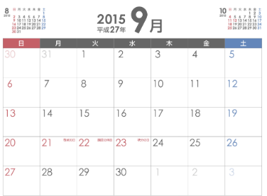
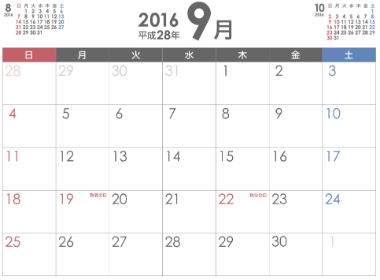
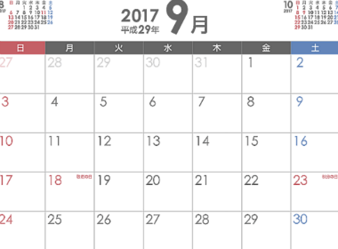

もうすぐ８月も終わりますね！

９月に入ると待望のシルバーウィークがやってくる！！

皆さんわくわくしてらっしゃる方も多いのではないでしょうか！

しかしちょっと待って下さい…！

今年のシルバーウィークは……

## 今年２０１６年のシルバーウィークはない？！

さて問題のシルバーウィークについてなのですが

昨年の２０１５年のシルバーウィークは最高でしたね！

５連休でゴールデンウィーク並み☆

- ２１日(月)：敬老の日

- ２２日(火)：国民の休日

- ２３日(水)：秋分の日

旅行に行かれた方もおおかったのではないでしょうか！

今年も９月にはあんな大型連休が…と思っていたのですが、

それでは２０１６年を御覧ください…

２０１６年のシルバーウィークはなんと飛び飛びなのです…。

- １９日(月)：敬老の日

- ２２日(木)：秋分の日

５連休など夢の夢な感じですね…。

ちなみに２０１７年の場合はもっと悲惨で…

- １８日(月)：敬老の日

- ２３日(土)：秋分の日

２３日の秋分の日が土曜日な為、振替休日が日曜日と重なってしまうので、本当に３連休しかないという状況になります。

oh…

２０１７年の方がショックが大きそうですね…

ここで気になった方もいると思うのですが、

２０１５年にあった『国民の休日』って何？！

なんで今年にも来年にもないの？！

そもそもシルバーウィークとは何なのかも気になりますよね！

詳しく紹介していきましょう。

## そもそもシルバーウィークってなに？国民の休日とは？

５月の春のゴールデンウィークに対抗して名付けられた秋のシルバーウィーク。

ゴールデンウィークの対のような名前まで付いているんだから毎年あるんでしょ？

と思われがちですが、これは日付の並びの運でしか発生しないんですね。

シルバーウィークが初めて発生したのは２００９年。

ハッピーマンデー制度という、国民の祝日の一部を従来の固定された日から週の月曜日に移動させた制度によって、月曜日に動くようになった敬老の日のおかげで生まれたものですね。

２００９年は、

- ２１日(月)：敬老の日

- ２２日(火)：国民の休日

- ２３日(水)：秋分の日

となりました。

ここで気になる点が２点。

-  秋分の日が２２日だったり２３日だったりするのはなぜ？

- 『国民の休日』とはなんだ？！

それぞれ見ていきましょう。

#### 秋分の日が２２日だったり２３日だったりするのはなぜ？

秋分の日は”毎年9月23日ごろ”とされており、地球が秋分点を通過する日とされているそうです。

天文計算によって求められた秋分日の日付以外の日が秋分の日とされたことはない。

引用：wikipedia：https://ja.wikipedia.org/wiki/%E7%A7%8B%E5%88%86%E3%81%AE%E6%97%A5

ということなので、その年によって２２日だったり２３日だったりするわけです。

#### 『国民の休日』とはなんだ？！

シルバーウィークの時に突然現れてくる『国民の休日』。

何なのか気になりますよね！

これは1985年12月27日に行われた法改正によって生まれた制度で、

平日の祝日と祝日の間に挟まれた平日は『国民の休日』として休みになるというものです！

例えば、

- １日(月)：祝日

- ２日(火)：平日

- ３日(水)：祝日

ならば、

- １日(月)：祝日

- ２日(火)：国民の休日

- ３日(水)：祝日

となるということですね！

なんと！オセロのような仕組み！！！

祝日が土日の場合やもっと間が開いていたら適用されない制度ということです！

##

## 次回のシルバーウィークは？

ここまでくると、次回のシルバーウィークは一体いつなのか気になりますよね！

次回のシルバーウィークは…

11年後の2026年

…oh…

気が遠くなる話ですね…

2009年から2015年の間が６年ぐらいだったのでそんなもんかなと思っていたらこんなにも…

2020年のオリンピックイヤーはかろうじて４連休あるということなので少し期待ですね…

それにしてもシルバーウィークという名前があるんだったらもっとその名前活かして休日になってくれよ…と切に思ってしまいました…
