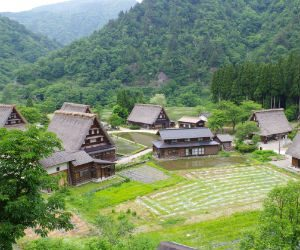

9月7日放送のバラエティ番組『世界の何だコレ!?ミステリー』にて、

中国に『住むだけでお金持ちになれる村がある』という話題が放送されるということで大変話題になっています。

まるで夢の様な村ですよね。

一体どのような村なのでしょうか。

早速見ていきましょう。

## 中国の住むだけでお金持ちになれる村はどこ？

住んでいるだけでお金持ちになれるなんて本当に夢のようですね！

一体どこにあるのでしょうか？

場所は中国の『華西村』という村です。

かつては貧しい村で村人も2000人と少ない村だったということですが、

初代村長の呉仁宝さんが村の工業化・株式化を進め、どんどん村が発達していったそうです。

村自体が会社を経営していて、村人の働く所が出来、さらに利益が１年で470億円というのですから凄いですね！

現在は観光業にも取り組んでいるそうです。

呉仁宝さんは「人民の幸せこそ社会主義」という志で、その言葉の通り村人に富を分け与えているといいます。

それでは驚きの村人の年収について迫っていきましょう。

## 住むだけでお金持ちになれる村人の年収は？

住んでいる村がこんなに潤っているなんて羨ましいですね〜！

中国の平均年収は約26万円ということなのですが、

華西村の村人の年収はなんと、1600万円ということで

かなりびっくりですよね！！！

この金額を日本に置き換えると1億6500万円ということでもう驚きしかありません…！！

しかもそれだけではなく、村人はほぼお金を使わなくても生活出来るということです。

どういうことなのかといいますと、

- この村の住民になると全員に家が与えられる。しかも３階建の１５LDK！

- この村の住民になると高級外車が配られる。

- 学費・医療費・薬代・ガス代全て無料。

- 米や調味料は支給される。

- レストランで食べる食費も無料。

- 泊まるホテルも無料。

- ヘリコプターの空中遊泳が無料。

- 年に1度、無料で旅行も行かせてもらえる。

もうすごすぎます…！！！

年収があんなにあるのにここまで至れり尽くせりだとは…！！

羨ましいを通り越してもうわけがわからない状態です(笑

## 村内で格差社会？

そんな裕福な村で、今問題になっていることがあります。

昔から住んでいる株主村民と後から流入してきた村民の間で格差があるということです。

上記の暮らしは昔から住んでいる株式村民の暮らしで、後から流入してきた村民は中国の一般的な収入ということです。

お金持ちになれるからと村に来た人全てにお金をあげていたら大変なことになりますもんね。

昔から住んでいる人への恩恵なのかもしれません。

本当に思った以上にセレブな村でした。
