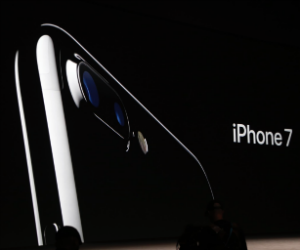
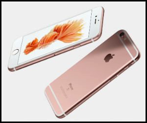

ついにiPhone7に関しての情報が解禁されましたね！

日本時間にして９月８日午前２時からAppleの会見が行われていました。

気になって眠い中起きて起きていた方も多いのではないでしょうか。

それでは見ていきましょう！

▼iPhone７の関連記事

[iPhone7でICOCA使える？PASMOやTOICAは？](../../../../2016/09/10/51/)

## iPhone7発表！スペックと日本円での価格は？

とうとうiPhone７の発売日が決定しました！

発売日は9月16日ということでいまから待ち遠しいですね！

ちなみに予約は9月9日からなのでお忘れのないように…！！

肝心のスペックなのですが、

今回のiPhone7で外せない機能といえば、

防水機能です！！！

やっときたかーー！！という感じです！

これから水に濡らす恐怖から逃れられそうですね！

残念ながらその弊害でイヤホンジャックは除去されました。

その代わりに充電の部分からイヤホンを繋ぐということです。

旧イヤホン向けに変換アダプタも添付しているということでひとまず安心ですね。

充電しながらイヤホンできなくなるのは難点ですが…。

もちろんワイヤレスイヤホンでも可能です！

これを期にこれからはワイヤレスイヤホンが主流にになっていくのかもしれません。

カラーは、

- ジェットブラック

- ブラック

- シルバー

- ゴールド

- ローズゴールド

の５色です。

ジェットブラックがかっこよすぎです〜！！

ホームボタンは感圧式になるようでこれから出来ることの幅が広がりそうですね！

そしてスピーカーがステレオになるということです。

カメラの機能もかなりアップしており、インカメラが700万画像になったり、ズームが10倍になったり、デュアルカメラ搭載ととにかく凄いです！！

またFeliCaがつくということでSUICAなどが使えるようになります！

これはかなり便利ですね！！！

⇒[iPhone7でICOCA使える？PASMOやTOICAは？](../../../../2016/09/10/51/)

バッテリーについてなのですが、iPhone7はiPhone6sシリーズから2時間多くバッテリーがもつとのことです。

気になるiPhone7の価格(税込み価格)とストレージなのですが、

[iPhone7]

32GB[7万2800円(税込7万8624円)]

128GB[8万3800円(税込9万0504円)]

256GB[9万4800円(税込10万2384円)]

[iPhone7Plus]

32GB[8万5800円(税込9万2664円)]

128GB[9万6800円(税込10万4544円)]

256GB[10万7800円(税込11万6424円)]

ということです！！

これだけ機能が目白押しだったので一番最低でも１０万近くするかなと覚悟していたのですが意外に安いですね…！

というか昨日までiPhone6sの128GBが10万以上していて買うのためらってたんですよ！！

それがiPhone７の256GBの方が安いなんて拍子抜けしました…かなりいい意味で…！！(笑

 これは人気でそうですね〜！！予約してから届くまで半端なくかかりそうですw

## iPhone6s／SEはかなり値下げ！！！値段は？

iPhone7が発売されたということで気になるのは旧機種であるiPhone6sやiPhoneSEが値下げされるかですよね。

格安スマホでSIMフリーiPhoneを探してらっしゃる方には気になる情報なのではないでしょうか。

iPhone6s、iPhoneSE共にかなり値下がりしています！！！

気になる値段(税込み価格)なのですが、

[iPhone6s]

32GB[6万1800円(税込6万6744円)]

128GB[7万2800円(税込7万8624円)]

[iPhone6sPlus]

32GB[7万2800円(税込7万8624円)]

128GB[8万3800円(税込9万504円)]

[iPhoneSE]

16GB[4万4800円(税込4万8384円)]

64GB[4万9800円(税込5万3784円)]

ちょっ！！！！

全体的に１〜２万値下がりしました！

今出てる中古品並の安さになりましたね！！！

SEなんてどっちも５万きっています！！！

またauショップなどでiPhone６sの緊急値下げをしている店舗もあるみたいなので要チェックです！

【速報】iPhone6s緊急値下げ！ケース、フィルムも値下がりしてます！ぜひ一度ご来店ください☆ [pic.twitter.com/Rr2PzlqNuB](https://t.co/Rr2PzlqNuB)

— auショップ太田中央 (@au_otachuo) [September 6, 2016](https://twitter.com/au_otachuo/status/773087141546958848)

★ [#iPhone](https://twitter.com/hashtag/iPhone?src=hash) 6S 緊急値下げ!! ★機種変更おトク割★
9月9日～◎iPhone6S 16GB 10,000割引
◎iPhone6S 64-128GB・iPhone6S Plus 全容量 15,000割引
※変更前機種がiPhone/誰割/ﾃﾞｰﾀ定額5GB以上

— 札幌au 菊水元町 旭ヶ丘 真駒内五輪 (@Sapporo_au) [September 7, 2016](https://twitter.com/Sapporo_au/status/773433883056599040)

全容量１５０００円割引はかなりお得ですね！！！

##

## iOSにマリオがやってきた！

今回の発表会では、まず最初の目玉として、

『iOSにスーパーマリオがやってきた』というお話から始まりました。

頑なにスマホ進出しないと公言していたマリオがついにiPhoneでも遊べるようになるということで非常に会場の空気も熱気に溢れました。

iPhoneアプリゲームで『スーパーマリオラン』という名前で配信されます！

ゲーム内容は、自動で走るマリオを操ってきのこやコインなどを獲得していくゲームだということで、つり革持ちながらでもハンバーガーを食べながらでも遊ぶことが出来ます。

対戦や競争の要素もあるということでマリオカートのように対戦しながら楽しめたら最高ですよね！

今回はiPhone７について紹介しました。

正直そんなに変わらないかな〜と思っていたのですが防水機能がつくということで俄然購入に前のめりになってきました(笑

今回のiPhone7は革命的です！

これからの情報も見逃せません！！
