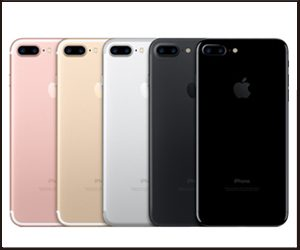
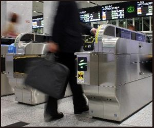

９月１６日に発売されるiPhone７。

昨日の９月９日はiPhone７の予約が始まったということでTwitterで「予約したー」というツイートであふれていました(笑

そんな大注目なiPhone７。

今回はiPhone７の目玉機能である『Felica』について紹介していきます。

▼iPhone７の関連記事

[iPhone7発売！税込価格は？iPhone6s／SE値下げ？](../../../../2016/09/08/49/)

##

## iPhone7はFelica対応

今回発売されるiPhone７はおサイフケータイなどでも有名な『Felica』がついています！

今までAppleでは海外向きにApplePayを2014年10月から搭載していたのですが、日本では規格外ということで対応出来ていなかったんです。

今回ソニーが開発した非接触ICカード技術方式『FeliCa』を搭載したことにより日本でもApplePayが使えるようになったんですね。

これは日本限定に対応したiPhoneということで、『日本専用機』と呼ばれ、海外の人からは「いらね」「iPhone８まで待つか」「iPhone日本に媚びすぎw」など言われているようです。

日本人にとっては嬉しいこと限りないのですが色んな事情がありますね。

『FeliCa』の機能なのですが、

iPhoneにSuicaやクレジットカードなどを登録することで、駅の改札やコンビニ、その他ショッピングモールなどでiPhoneをかざすだけで会計が出来てしまうという優れものなのです。

登録方法もカードにiPhone７をかざすだけで読み取るということでとても簡単です！

さらに指紋認証でチャージもその場で出来るということでかなり便利になりますね！

しかし…

地方民には辛い事実もあるのです…

さて見ていきましょう…！

##

## iPhone7はICOCA使える？PASMOやTOICA他カードは？

iPhone７がSuica対応ということで、首都圏以外の人が気になるのは

「うちの使ってるICカードは使えるのか……？」

ということですよね！

ICOCA、PASMO、TOIKA、Kitaca、nimoca、SUGOCA、はやかけん、manaca…

それぞれの地方のICカードがありますが…

残念ながら現在はSuica以外対応していません。。。

oh…

これはAppleさんに素早い対応を願います…！！

ちなみにSuicaは地方でも乗車可能な所があるということなのですが、エリアを跨っての利用は出来ないということでかなりめんどく…

いやいやなんでもありません！！

とにかくAppleに気持ちが届くことを祈りながら待ちます…！

## iPhone7で使えるクレジットカードは？

iPhoneではSuicaだけでなく、クレジットカードも登録することが出来ます！

これによってコンビニやショッピングモールでの買い物が格段に楽になりますね☆

対応しているクレジットカードは、

アメリカン・エキスプレス／JCB／MasterCard／イオンカード／au／オリコカード／クレディセゾン／ソフトバンク／オリコカード／セゾンカード／TS／dカード／ビューカード／三井住友カード／MUFGカード

に対応しています！

ん？

お気づきでしょうか…？？

そうです…

現時点ではVISAは対応していないのです……！！

oh…

しかし上記のカードでVISAカードの場合は使用できるようです。

し

か

し

上記のカード以外のVISAは今のところ全滅です…

oh…

iPhone７を張り切って予約しルンルン気分だったのに

地方ICカードな上にVISAしか持っていない私…なんでやねーーーん！！！！！

かなり残念なパターンに当てはまってしまいました｜｜｜｜｜

これはもう待つしかないです。

AppleさんもVISA対応したいと言っているようなので

地方カードも含めて対応してくれることを願ってます…

願ってますよ！！！！Appleさん！！！！！
