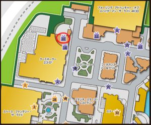
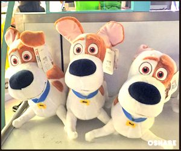
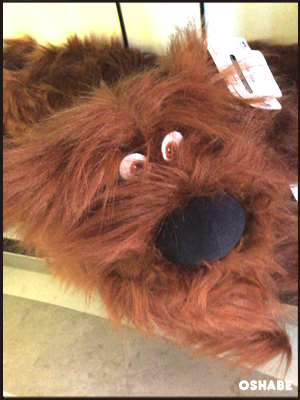
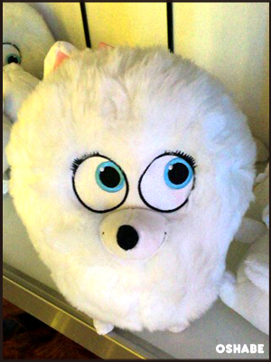
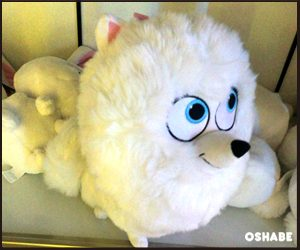
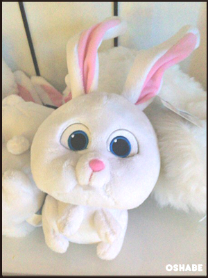
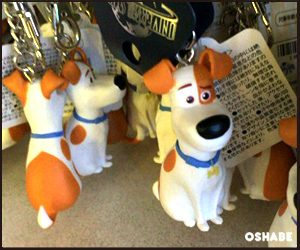
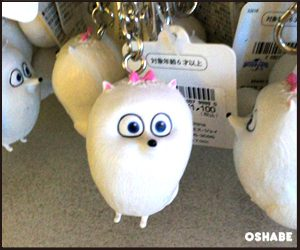
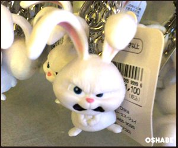
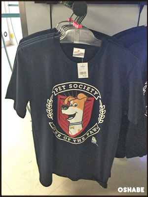

ユニバーサルスタジオジャパンでは、現在ハロウィンで大盛況していますが、

皆さんにあまり知られていないグッズが発売しているのをご存知でしょうか？

実は、大ヒットアニメ映画『ペット』のグッズがUSJ内で売られているのです！

それでは見ていきましょう。

##

## USJで映画『ペット』のグッズが売られている？

映画『ペット』は今USJ内でも大人気のミニオンズと同じ映画制作会社「ユニバーサル・スタジオ」が監修している映画です。

映画は大ヒットしましたし、登場する犬やウサギといったキャラクターも大変可愛いということで、必然的にUSJでも大々的にグッズが並ぶだろうと思っていました。。。。

が、

なぜかあまりグッズを見かけない…

え…もしかして売られてないの？？

と思っていた矢先、

なんとペットのマックス(犬)のぬいぐるみを抱いている少年に出会ったのです。

その後も少数ですがちらほら…。

一体どこで手に入れているのか…！

聞いてみた所、ペットのグッズが売られている店舗はわずか１店舗のみだったのです！！

まじか…！？！

さっそく見ていきましょう！

## 映画『ペット』のグッズの場所は？

ペットのグッズが売られている店舗が１店舗なんて驚きですよね…

ペットのグッズは、

ターミネーターとスパイダーマンの間にある地図ナンバー１０番のショップ、

『ユニバーサル・スタジオ・スーベニア』

にのみ展開されています！（※赤丸している部分）

かなり品薄状態だったので、気になる方は早めに訪れてみて下さい！

##

## USJ映画『ペット』グッズお土産【画像】

マックスぬいぐるみ

デュークぬいぐるみ

ギジェットぬいぐるみ

ギジェットぬいぐるみ※横から見た図

スノーボールぬいぐるみ

マックスキーホルダーマスコット

ギジェットキーホルダーマスコット

スノーボールキーホルダーマスコット

マックスTシャツ

いかがでしたか。

ぬいぐるみのサイズが意外にも大きくて本物の小型犬ぐらいのサイズがあり、ちょっとリアルにペットのキャラクターに会えたような気持ちになれます(笑

私が行った際(2016年9月11日時点)はかなり品薄になっていたので、

欲しい方はなるべく早く見に行かれた方が懸命だと思います！

こんなにもかわいい映画『ペット』のグッズ。

なぜこんな少ないグッズ展開なのかは分からないですが、今後ミニオンズのようにUSJのメインキャラの仲間入りをするのか！？

今後のUSJでの映画『ペット』についても要チェックですね☆
