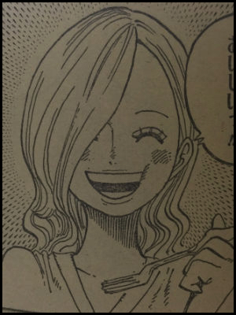
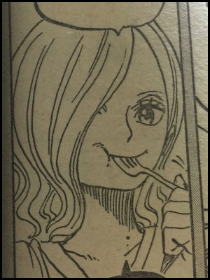
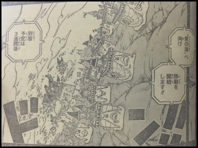
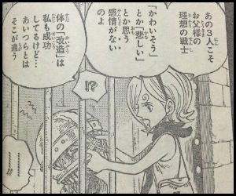

２０１６年１０月３日月曜日発売の少年ジャンプ44号に掲載のONE PIECE(ワンピース)841話が凄いことになっていると話題になっています！

一体どういうことなのでしょうか。

詳しく見ていきましょう！

## サンジの母親が可愛い！【画像】

今回の話でずっと存在が不明となっていた『サンジのお母さん』が登場します！

最近の話ではサンジの過去編に入り、

サンジの兄弟であるイチジ、ニジ、ヨンジ、レイジュ、そして父親であるヴィンスモーク・ ジャッジから悲痛な扱いを受けている場面が多く、サンジファンのみならずともとても心苦しい場面が多数あったのですが、

今回現れたサンジの母親が天使すぎて凄く癒やされました…！

王族である幼いサンジが家来を誰も引き連れず、コケながらも遠い道程を歩き、たどり着いたのは母が入院している病院。

サンジは自分で作ったお弁当を母親に食べさせたい一心で遠いところから歩いてきました。

そして無事にたどり着いたのですが、道中で狂犬に襲われ料理をひっくり返してしまったのでお弁当はぐちゃぐちゃ。

それ以前にサンジはまだ料理の能力がなかったので味付けはめちゃくちゃでした。

そんなぐちゃぐちゃで不味そうなお弁当を見たお手伝いさんはこっそりそのお弁当をゴミ箱に捨て、別人が作ったきれいなお弁当をサンジの母親に差し出します。

しかしサンジの母親はゴミ箱に捨ててしまったその料理を「持ってきて！」と言い、

どうみてもまずそうなその料理を

「ん〜〜〜♡おいしいっ！！」

と平らげてしまうのでした。

ほんとに地獄の中にオアシスのような優しいお母さんでした。

サンジの心優しさはこのお母さんから来ているのかもしれません。

そして肝心のお顔なのですが見ていきましょう！！

かわいい〜♡

お母さんも片目隠れてるんですね！

レイジュにも似ています。

しかしお母さんはグル眉じゃない…！

父・ヴィンスモーク・ ジャッジは目から上を仮面？マスク？で隠れていますがあれはグル眉を隠したいがための仮面なのか…

そう考えるとちょっとかわいく感じますね…

いやとんでもない胸糞悪い毒親なのですがww

しかし非常に残念ながらそんな心優しきサンジのお母さんは病気で死んでしまいます。

本当にサンジはどんだけ幼少期に試練乗り越えてるんだ？！という気持ちになりました。

## サンジがノースブルーからイーストブルーに渡れた理由

今回のワンピースの内容は盛りだくさんで、サンジの母親が現れただけではありません。

ずっと謎だった

”ノースブルー(北の海)にいたサンジがなぜイーストブルー(東の海)にいたのか”

”レッドラインはどうやって超えたのか”

という長年の謎が解明されています。

ノースブルーからイーストブルーに行くにはレッドラインという高い壁を超えなくてはいけないので行き来できないと考えられていました。

しかしジェルマ６６は…

この電々虫のような謎のかたつむりによってレッドラインを乗り越えていたのです！！

ジェルマは人間だけでなく電々虫さえも「改造」していたのでしょうか。

『科学戦闘部隊』であるジェルマ66だから出来たことなのかもしれません。

## サンジ以外の兄弟はクローン？

前回の８４０話ではジェルマ６６の戦士たちがクローンだということが明かされました。

その中で、サンジ達兄弟も「人間を超える超人的存在」として改造されていたことが発覚しました。

サンジは父親であるヴィンスモーク・ ジャッジから「出来損ない」「失敗作」と罵られてきましが、

他の４人の兄弟は運動神経も戦闘能力も超人並みでした。

医者が言うには「サンジ様は……ただの人間です」

では他の４人は一体…？

極悪非道な兄弟たち…

そんな兄弟の中で一人だけサンジの力になってくれる存在がいました。

レイジュです。

レイジュも他の兄弟と同じく超人なのですが、感情の部分は人間の部分が残っていたのでした。

レイジュのこの言葉にもあるように

サンジ、レイジュ以外のイチジ、ニジ、ヨンジには『かわいそう』という感情が一切排除されています。

だからどんな極悪非道なことをしても心が痛まないのです…。

人の心が分からない…感情がない…

もうこうなったらクローンと呼ばざる負えないのではないでしょうか？

今回の話で他の兄弟と同じく極悪なのかと思っていたレイジュがいい子で…感動してしまいました…。

レイジュお姉さん…！誤解しててごめん…！！！

しかし今回、

ひとつだけ…本当にひとつだけ父親のヴィンスモーク・ ジャッジが救えるなと思ったのが、

サンジを生きさせたこと。

極悪非道の人間ではありますが、そこにまだ人間としての心が残っていたようですね。

ただ追い出すときの言葉が毒親そのものですがｗｗｗｗ

今回のワンピースは本当に読み応えがありました！

というか号泣です！！！

泣かずには見れませんでした！

この後のサンジに一体何が待ち受けているのか…

ますます今後の展開に目が離せません！！！！！
