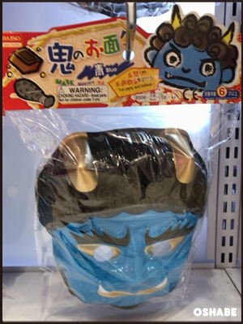
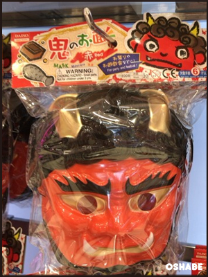
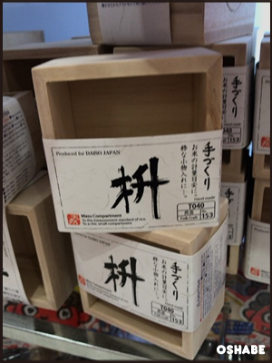
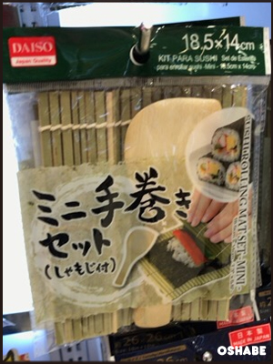
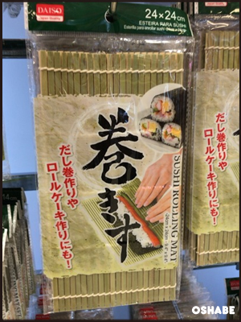
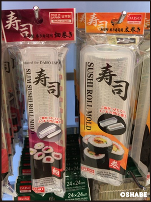

来月の２月３日は節分ですね！

毎度おなじみ１００円均一ショップのダイソーでは節分グッズも早々に発売されています！

今回は『ダイソー』の節分グッズについて紹介していきたいと思います。

## ダイソー節分グッズ

ソフト煎り大豆(鬼のお面付き)

ソフト煎り大豆(おかめのお面付き)

鬼のお面（青）

鬼のお面（赤）

枡

ミニ手巻きセット（しゃもじ付き）

恵方巻きにも！巻きす

簡単寿司作り（細巻き／太巻き）

## まとめ

いかがでしたか？

親子で一緒に…子供会や幼稚園、友達や恋人と一緒にダイソーの節分グッズで節分を楽しみましょう！
