ひなまつりに子どもたちと一緒にひな祭りパーティーをする家庭も多いのではないでしょうか。

そんな時に可愛いひなまつりのお菓子があったら盛り上がりますよね！！

今回は『ダイソーのセントパトリックデーグッズ』を紹介していきたいと思います！

## セントパトリックデーとは何の日？なぜ緑？

聖パトリックの祝日（せいパトリックのしゅくじつ)通称セントパトリックデーはアイルランドにキリスト教を広めた聖人聖パトリックの命日です。

アイルランドでは祝祭日になっており、セントパトリックデーが近づくと政府が主体となり5日間の盛大なフェスティバルやパレードなどを行うそうです。

アメリカでは緑の物を身につけて祝う日とされ、「緑の日」とも呼ばれています。

シカゴではシカゴ川を緑色に染め上げるなど大きなイベントも行っているようです！！すごいですね！

“緑の三つ葉”が特別なモチーフとなっています。

なぜ緑なのかというと、

聖人聖パトリックのシンボルがシャムロック(クローバー、シロツメクサなどの葉が3枚に分かれている草の総称)だからです！

なのでセントパトリックデーは緑と三つ葉のイメージなのですね☆

そんなセントパトリックデーは3月17日。

現在日本では知らない人も多いセントパトリックデーですがこれから根付いて行くのでしょうか！

## ダイソーセントパトリックデー商品画像一覧

#### DAISO St Patrick’s Day goods

セントパトリックデー ファーカチューシャ クローバー三つ葉 緑

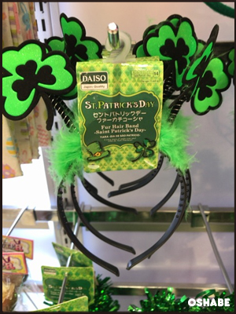

セントパトリックデー カチューシャ ハット 緑

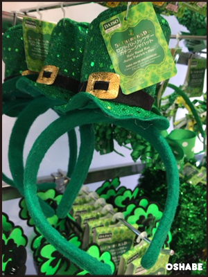

セントパトリックデー カチューシャ リボン 緑

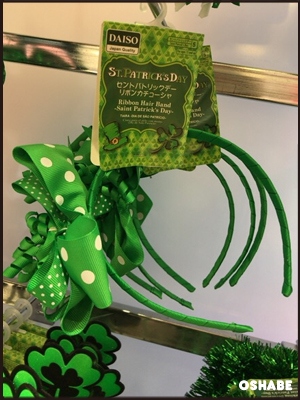

セントパトリックデー カチューシャ リボン 緑

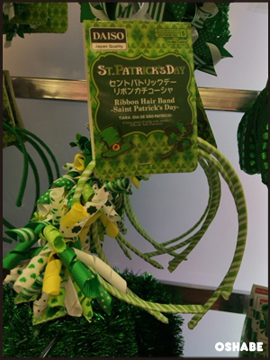

セントパトリックデー ヘアバンド 緑

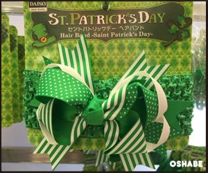

 セントパトリックデー カチューシャ ピン 緑

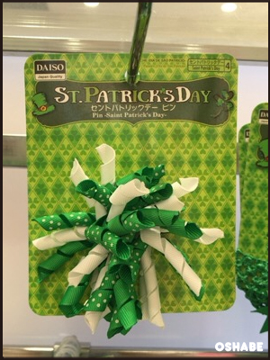

 セントパトリックデー クローバーメガネ 緑

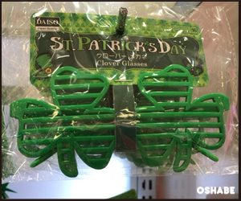

 セントパトリックデー 蝶ネクタイ リボン 緑

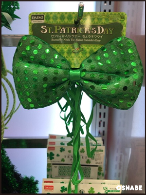

セントパトリックデー クローバー三つ葉靴下 黒／緑

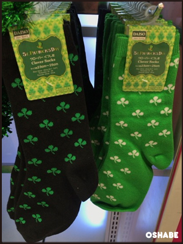

セントパトリックデー キラキラ飾りクローバー三つ葉 緑

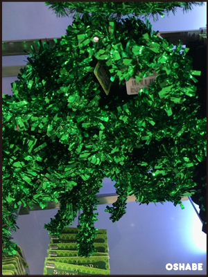

セントパトリックデー キラキラ飾り ハット 緑

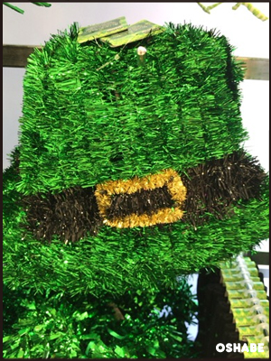

セントパトリックデー クローバー 手ぬぐい 緑

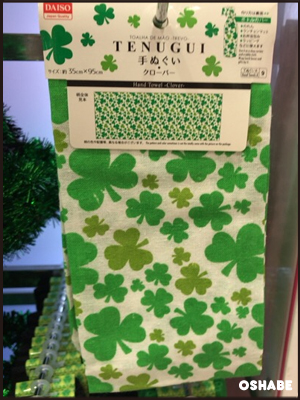

 セントパトリックデー 風船アイリッシュカラー 20P 9インチ （緑／オレンジ）

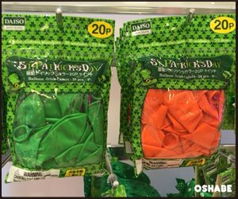

セントパトリックデー グリーンエクステピン／クローバーネックレス／ビッグネクタイ

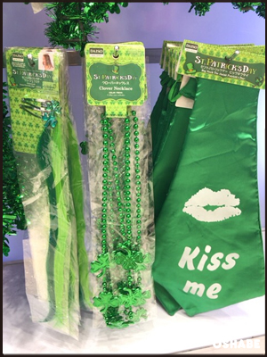

セントパトリックデー モール 2.5m 緑

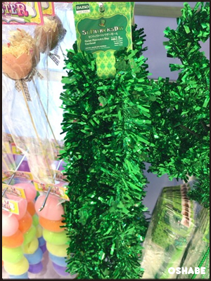

## まとめ

いかがでしたか。

日本ではまだ珍しいセントパトリックデー。

東京都知事の小池百合子さんが百合子グリーンを推していたのが記憶に新しいですが、新しいグリーンの日が日本にも浸透するのでしょうか！

わくわくしてしまいますね☆
