最近台風などが多いですが、雨の日はジトジト…憂鬱な気持ちになっちゃいますよね…！

１００円ショップセリアではレインコートが豊富に発売されていますよ。

普段だけでなくUSJやディズニーランドなどのテーマパークやレジャーでも活躍すること間違い無しですね。

それでは今回は「セリア カッパ(レインコート)」について紹介していきます。

## Seriaカッパ(レインコート)画像一覧 子供用／大人用／ポンチョ／ズボンなど【サイズ】

キッズ用 レインコート ピンク サイズ：着丈約85cm×胸囲120cm
 【使用身長の目安】約125〜145cm

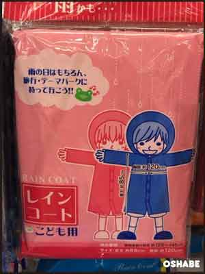

キッズ用 レインコート 赤ドット柄 女児用 サイズ：着丈約85cm×胸囲120cm
 【使用身長の目安】約125〜145cm

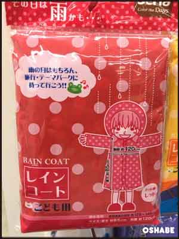

キッズ用 レインコート 青ドット 男児用 サイズ：着丈約85cm×胸囲120cm
 【使用身長の目安】約125〜145cm

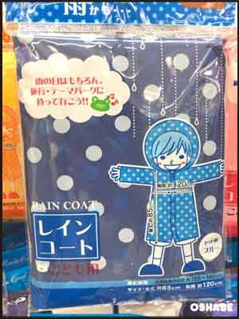

キッズ用 レインコート イエロードット柄 男女兼用 サイズ：着丈約85cm×胸囲120cm
 【使用身長の目安】約125〜145cm

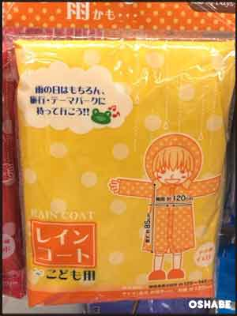

大人用 レインコート ネイビー メンズ・ユニセックス サイズ：着丈約100cm×胸囲116cm
 【使用身長の目安】約150〜170cm

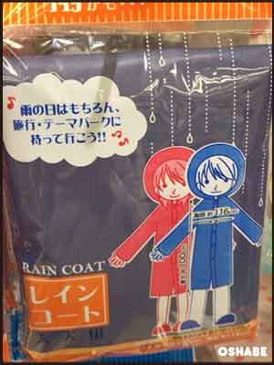

大人用 レインコート 赤 レディース・ユニセックス サイズ：着丈約100cm×胸囲116cm
 【使用身長の目安】約150〜170cm

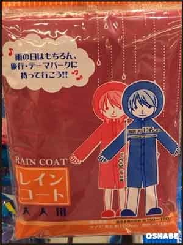

大人用 レインコート 白 ユニセックス サイズ：着丈約100cm×胸囲116cm
 【使用身長の目安】約150〜170cm

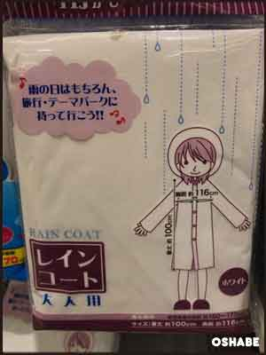

大人用 レインパーカー 白 ユニセックス サイズ：着丈約80cm×胸囲120cm
 【使用身長の目安】約150〜170cm

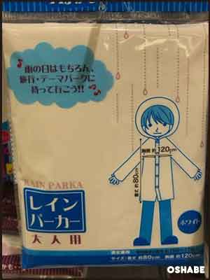

大人用 レインパンツ 白 ユニセックス サイズ：ウエスト約62〜110cm×股下70cm
 【使用身長の目安】約150〜170cm

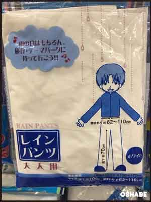

大人用 レインコートS 男女兼用 サイズ：着丈約100cm×胸囲120cm
 【使用身長の目安】約150〜160cm

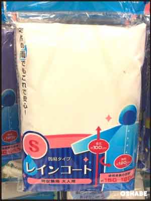

大人用 レインコートS 紺 男女兼用 サイズ：着丈約100cm×胸囲120cm
 【使用身長の目安】約150〜160cm

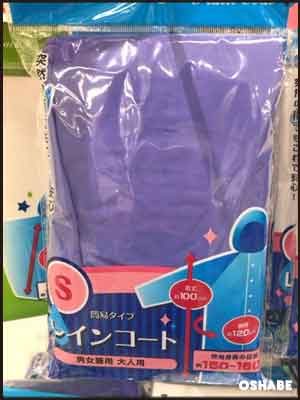

大人用 レインコートM 男女兼用 サイズ：着丈約110cm×胸囲120cm
 【使用身長の目安】約160〜170cm

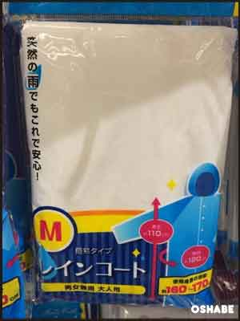

大人用 レインコートM 紺 男女兼用 サイズ：着丈約110cm×胸囲120cm
 【使用身長の目安】約160〜170cm

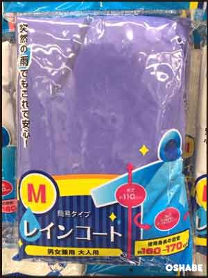

こども用 レインポンチョ 男女兼用 サイズ：着丈約80cm
 【使用身長の目安】約140〜150cm

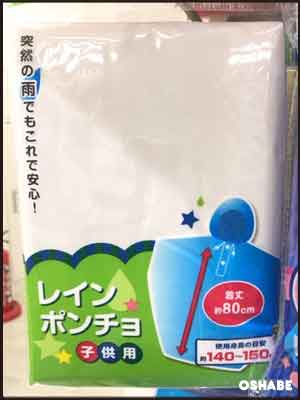

こども用 レインパンツ 男女兼用 サイズ：ウエスト約44〜55cm×股下58cm 総丈約85cm

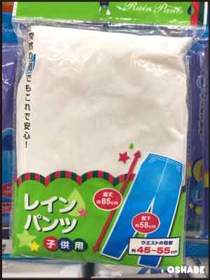

▼他店のレインコートはコチラ

- [キャンドゥ100均カッパ レインコート画像！子供用 大人用 ポンチョ等](../../../../2017/06/21/294/)

## まとめ

いかがでしたか。

セリアのカッパは子供が着たらとっても可愛いカラフルなデザインのものが多いですね！

前回はダイソーのカッパを紹介しましたが、ダイソーのカッパはどちらかというと大人向けのお洒落女子に向けたデザインのものが多い印象です。

可愛いカッパを着て梅雨を乗り切りましょう！

ぜひ参考にしてください。
