5月は男の子のお祭り、端午の節句ですよー！

前回は[ダイソーのこいのぼりグッズ](../../../../2018/03/13/432/)を紹介しましたが、

今回は『セリア』の端午の節句(こどもの日)グッズを紹介していきたいと思います。

## Seria鯉のぼり・こどもの日グッズ2018商品一覧【画像】

端午の節句 鯉のぼりスタンド 置物

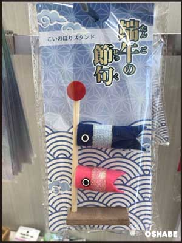

端午の節句 こいのぼりぬいぐるみ 黄色／赤

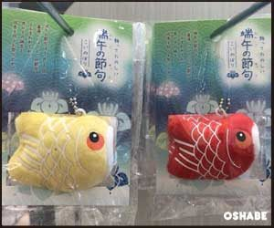

端午の節句 こいのぼり置物 青／赤／オレンジ

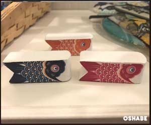

端午の節句 置物飾り 兜／こいのぼり

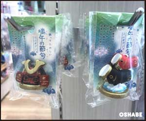

端午の節句 兜フィギュア 青／黒・赤

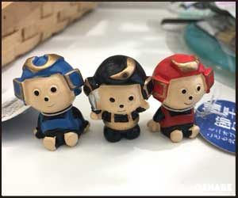

端午の節句 こいのぼりPVCパネル

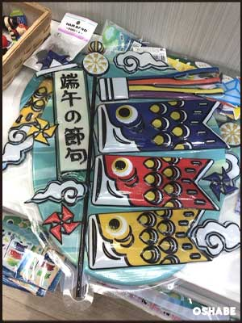

端午の節句 こいのぼりダイカットオーナメント 赤

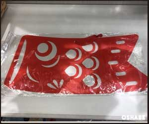

端午の節句 こいのぼりダイカットオーナメント 青

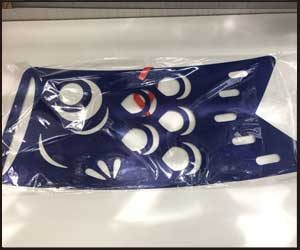

端午の節句 こいのぼりペーパーバナー

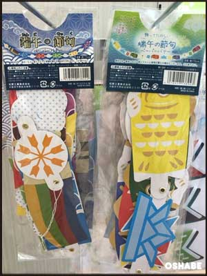

端午の節句 こいのぼりフェルトオーナメント

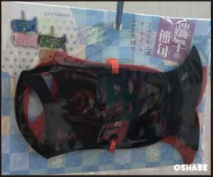

端午の節句 こいのぼりPVCガーランド

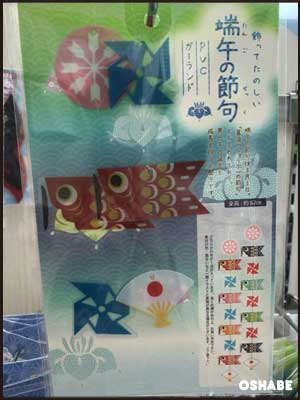

端午の節句 こいのぼりウォールステッカーシール

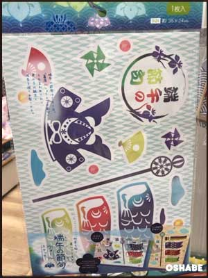

端午の節句 こいのぼりウォールステッカーシール

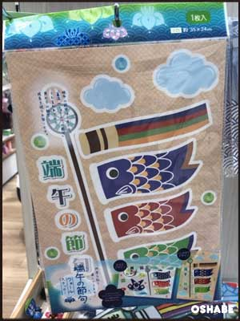

端午の節句 こいのぼり３Dウォールステッカーシール

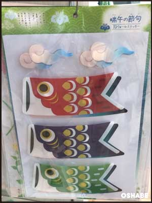

端午の節句 こいのぼりウィンドウジェルシール

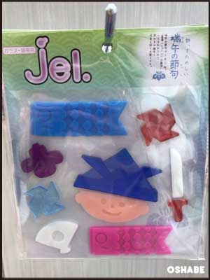

▼他店のこどもの日グッズ・こいのぼりはこちら

【ダイソーこどもの日グッズ2018】

[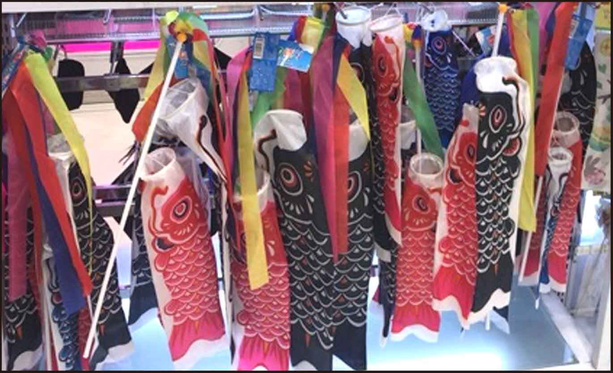 ダイソー100均こいのぼり こどもの日グッズ飾り2018商品画像](../../../../2018/03/13/432/)

[https://oshabe.com/2018/03/13/432/](../../../../2018/03/13/432/)

5月5日は男の子のお祭り、端午の節句です☆ ダイソーでは１００均とは思えないクオリティのこいのぼりが一足お先に発売されていますよ。...

[ oshabe.com（このサイト内）](../../../../2018/03/13/432/)

## まとめ

いかがでしたか。

かわいいこどもの日グッズが盛りだくさんですね！

たくさん飾ってみんなでこどもの日パーティーをしてみてはいかがでしょうか☆

是非参考にしてください。
