2020年の１００円ショップの卓上カレンダーもう発売されていますー☆

ヲタ活カレンダーやディズニーサンリオなど種類が豊富ですよ！

今回はセリア・卓上カレンダー2020を紹介して行きます！

## セリア 卓上カレンダー2020オタ活・ディズニー・サンリオ・シンプル他【画像一覧】

セリア卓上カレンダー2020リトルツインスターズキキララサンリオ

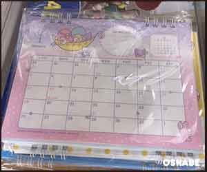

セリア卓上カレンダー2020ディズニープリンセス

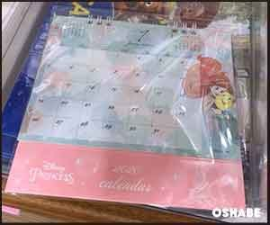

セリア卓上カレンダー2020トイストーリー

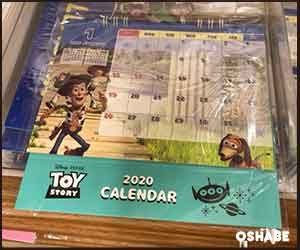

セリア卓上カレンダー2020ぐでたま サンリオ

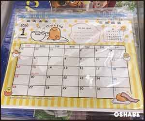

セリア卓上カレンダー2020 マイメロ

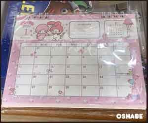

セリア卓上カレンダー2020 ツムツム

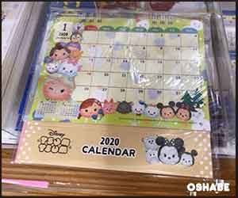

セリア卓上カレンダー2020 ドラえもん

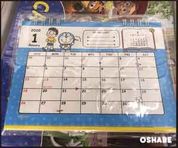

セリア卓上カレンダー2020 ハローキティ

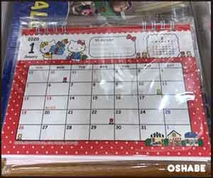

セリア卓上カレンダー2020 パンダ 動物 おしり

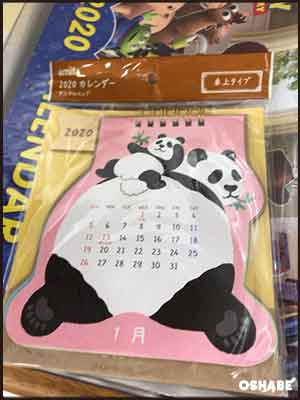

↓いろんな動物

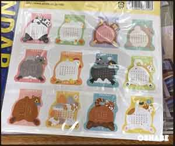

セリア卓上カレンダー2020 イラスト

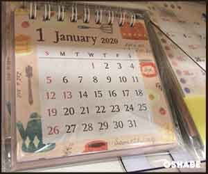

セリア卓上カレンダー2020 芝犬

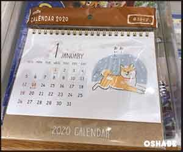

セリア卓上カレンダー2020 花柄

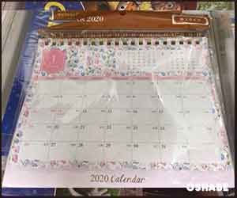

セリア卓上カレンダー2020 ヲタ活カレンダー ヲタあにまる

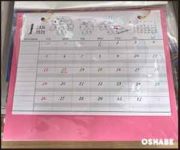

セリア卓上カレンダー2020 スタンダードシンプル

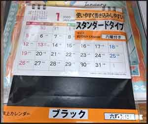

セリア卓上カレンダー2020 １２アイドルカレンダー

参照：セリアHP https://www.seria-group.com/recommendation/pickup/2019/08/post-70.html

[セリア100均壁掛けカレンダー2020ヲタ活カレンダー 鳥かご ディズニー等](../../../../2019/09/06/506/)

[セリア100均手帳2020【画像】ダイアリー 少女漫画風 ディズニープリンセス等](../../../../2019/09/06/507/)

## まとめ

セリアはほんとに100円とは思えないようなカレンダーを出してくれてとてもたすかっています☆

アイドルのカレンダーなどあって最近のセリアは攻めてますね・・！すばらしい！

参考にしてみてください。
