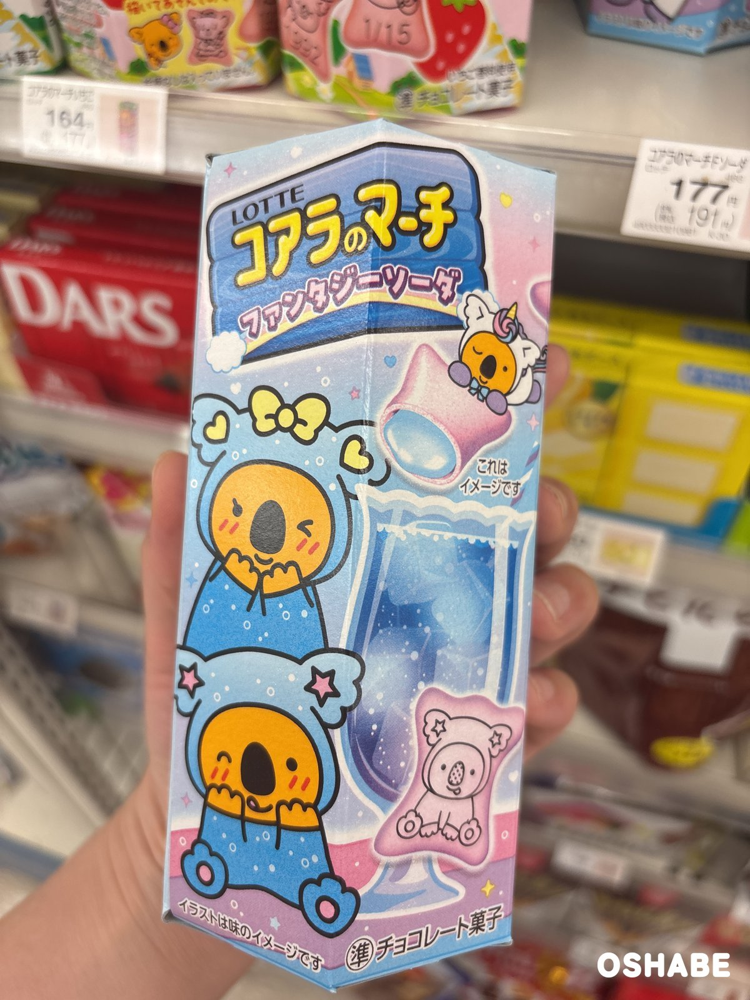
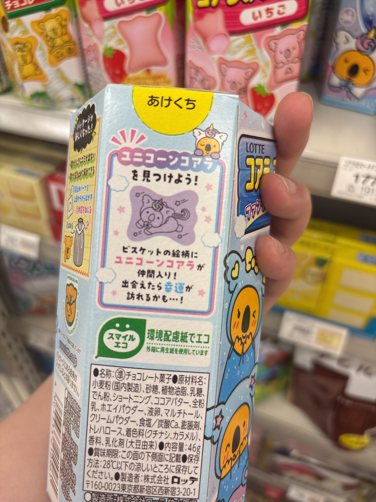
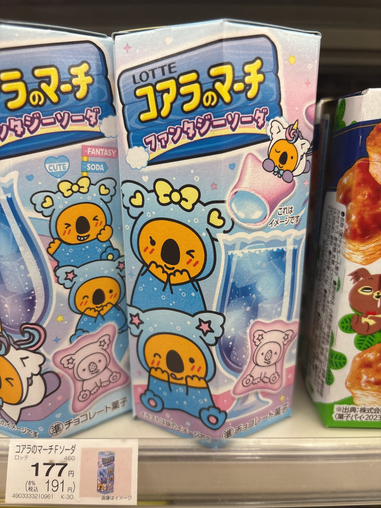

コアラのマーチから、不思議な見た目の新作が発売されていますよ☆

ロッテの「コアラのマーチ（Koala's March）」は、子供のころから食べている方も多いですよね！

2026年7月7日の七夕に、新作の「コアラのマーチ＜ファンタジーソーダ＞」が全国で発売されました。

お店で見つけたので、思わず手に取ってみました♪

今回は『コアラのマーチ＜ファンタジーソーダ＞』について紹介していきたいと思います。

 ▼その他スーパー・コンビニで買える市販のお菓子はコチラ

- [ハロウィン市販のお菓子2018スーパーコンビニ【画像】個包装](../../../../2018/09/12/476/)

- [イースター市販お菓子2017スーパーコンビニ画像まとめ](../../../../2017/03/21/189/)

- [受験合格願掛けお菓子市販スーパーコンビニ画像キャラメルコーン等](../../../../2017/02/23/165/)

## コアラのマーチ＜ファンタジーソーダ＞2026【画像・値段】

### パッケージ

コアラのマーチ＜ファンタジーソーダ＞ 46g

パッケージは、水色とピンクのパステルカラーです。

コアラたちは、リボンや星の付いた水色のフードをかぶっています。

右上には、ユニコーンの姿をしたコアラもいますよ☆

### ビスケットとチョコレート

箱の上の面には「ソーダ味なのに紫色!?」と書いてあります。

ビスケットの生地は、なんと紫色！

中のチョコレートは水色で、ソーダ味なんです。

ロッテの紹介では、サクサクの紫色のビスケットと、甘酸っぱいソーダ味のチョコレートが楽しめるそうです。

ビスケットとチョコレートの色が違うので、割って中を見てみたくなりますよね！

### ユニコーンコアラ

箱の裏には「ユニコーンコアラを見つけよう！」と書いてあります。

ビスケットの絵柄に、新しく「ユニコーンコアラ」が仲間入りしました。

ユニコーンは、幸運のモチーフなんだとか。

ユニコーンコアラに出会えたら、いいことがあるかもしれませんね♪

### 値段

お店では税込191円でした（2026年7月15日時点）。

ロッテが発表した想定小売価格は、税込194円前後です。

内容量は46gです。

## まとめ

いかがでしたか。

コアラのマーチ＜ファンタジーソーダ＞は、ソーダ味なのに紫色という不思議なお菓子です。

パッケージもパステルカラーで、とっても可愛いですよね！

お子さんと一緒に、ユニコーンコアラを探してみるのも楽しそうです♪

ぜひ参考にしてみてくださいね。
