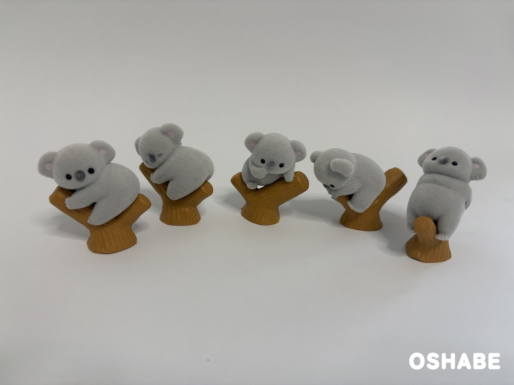

今回は、とっても可愛いコアラのガチャガチャを紹介します☆

コアラのゆったりした姿に、癒やされる方も多いですよね！

エール（YELL）のカプセルトイ「べびこあら（BABY KOALA）」は、小さな赤ちゃんコアラのフィギュアです。

コアラたちは、みんな木の枝につかまっています。

全5種が揃ったので、1匹ずつ見ていきますね♪

今回は『べびこあら』について紹介していきたいと思います。

## べびこあら（BABY KOALA）【画像・値段】

### 値段と種類

べびこあらは、1回税込300円のガチャガチャです。

種類は全部で5種類あります。

名前は「にっく」「ぱん」「ぽす」「おもち」「おはぎ」です。

1匹ずつ名前が付いているので、どの子が出るか楽しみになりますよね！

発売は2025年5月で、ガチャガチャのお店で順次並びました。

### ふわふわのフロッキー

並んでいるコアラは、全部で5匹！

体は灰色で、耳の内側は薄いピンク色になっています。

表面はフロッキー加工で、ふわふわの手ざわりです♪

本物のコアラの毛のようで、ついなでたくなります。

大きさは、高さ4cmくらいです。

手のひらにのるくらいの、小さなサイズですよ☆

### 木の枝の台座

コアラたちは、茶色の木の枝の台座につかまっています。

台座は二股に分かれた枝の形です。

1匹ずつ立てて飾れるので、並べ方を変えても楽しいです♪

### 5匹のポーズ

ポーズは、1匹ずつ違います。

写真の左のコアラは、枝をぎゅっと抱えて、こちらを見ています。

左から2番目のコアラは、枝に顔をのせて、目を閉じてぐっすり眠っています。

真ん中のコアラは小さめで、枝の上から顔をのぞかせています。

右から2番目のコアラは、下を向いて枝にしがみついています。

右のコアラは、枝の先に足をかけて、こちらを向いていますよ♪

寝ている子も起きている子もいて、並べると本当の木の上みたいですよね！

## まとめ

いかがでしたか。

エールのガチャガチャ「べびこあら」は、ふわふわの赤ちゃんコアラが全5種並ぶ可愛いフィギュアです。

1回税込300円で、木の枝の台座つきです。

ポーズが1匹ずつ違うので、全部揃えて並べたくなります♪

棚や机に飾ると、お部屋がぐっと楽しくなりそうです。

ガチャガチャを見かけたら、ぜひ回してみてくださいね。

お子さんと一緒に、お気に入りの1匹を探すのも楽しいですよ☆

ぜひ参考にしてみてくださいね。
