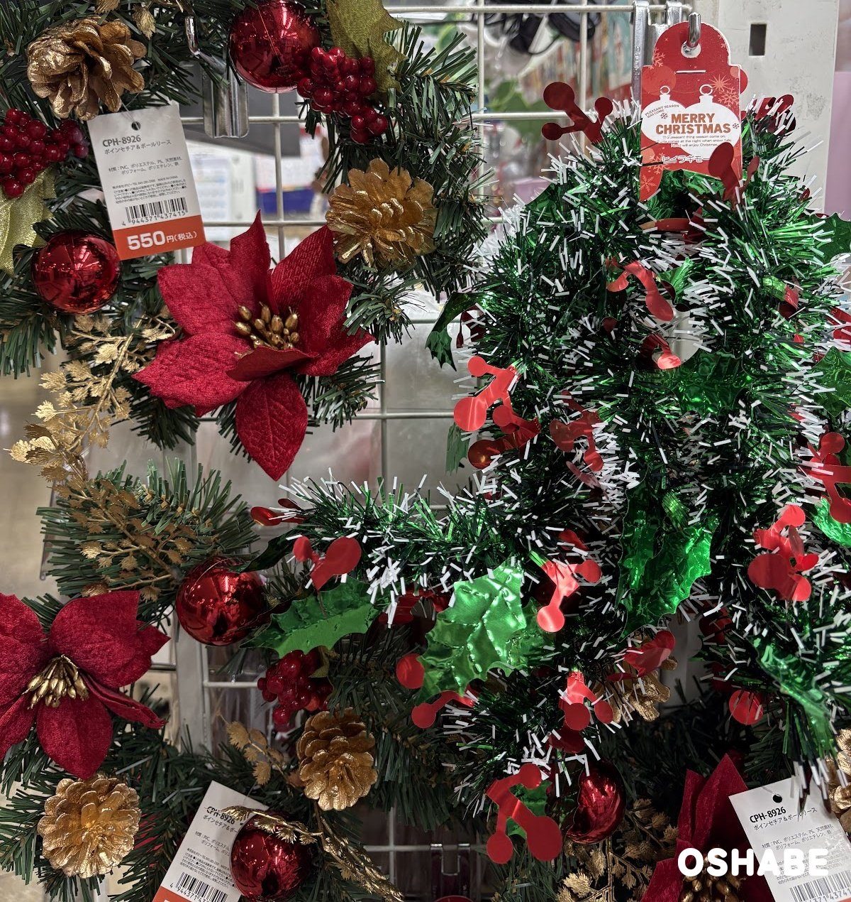
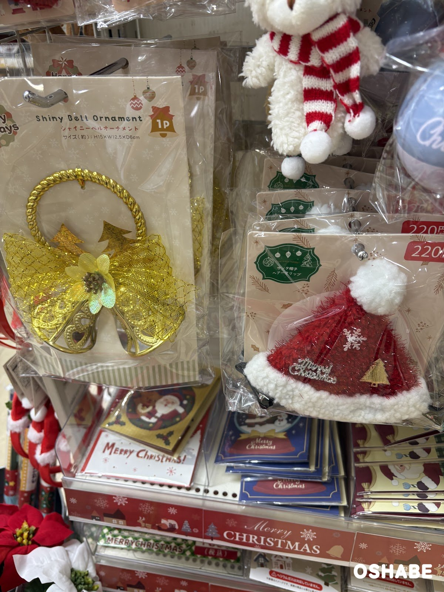
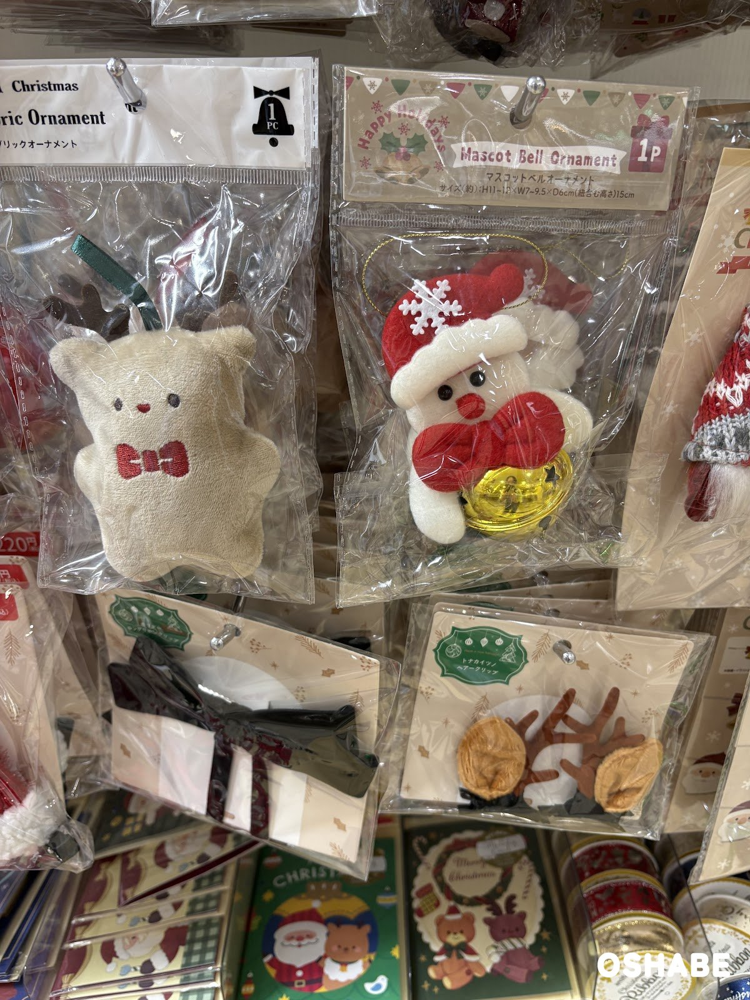
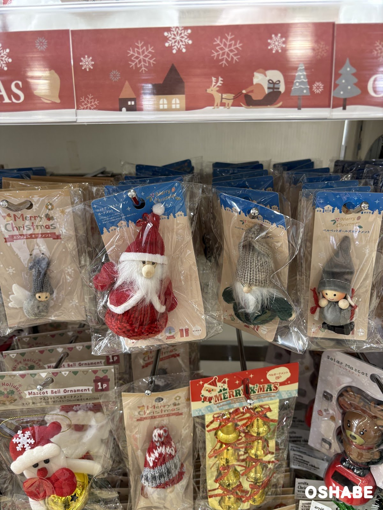
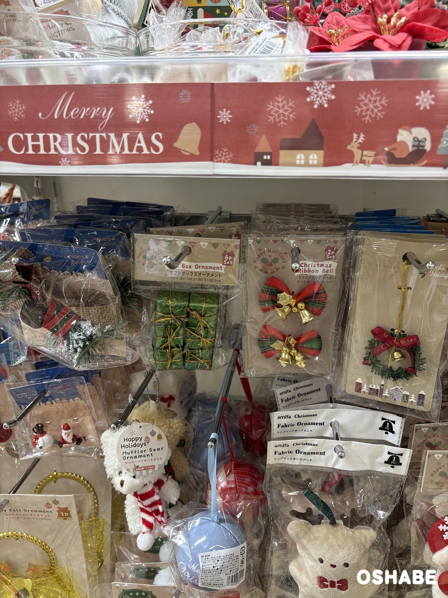
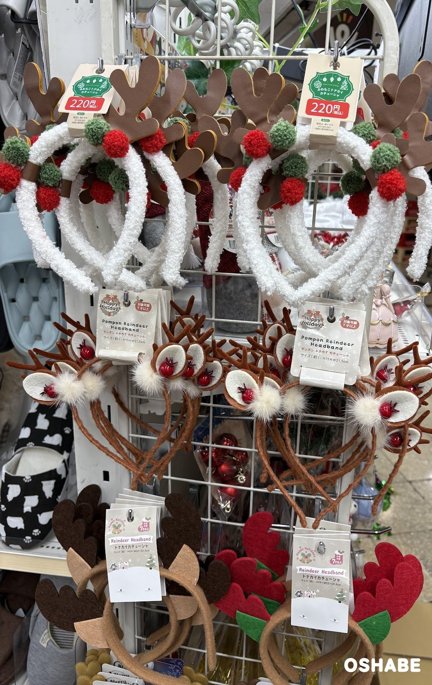
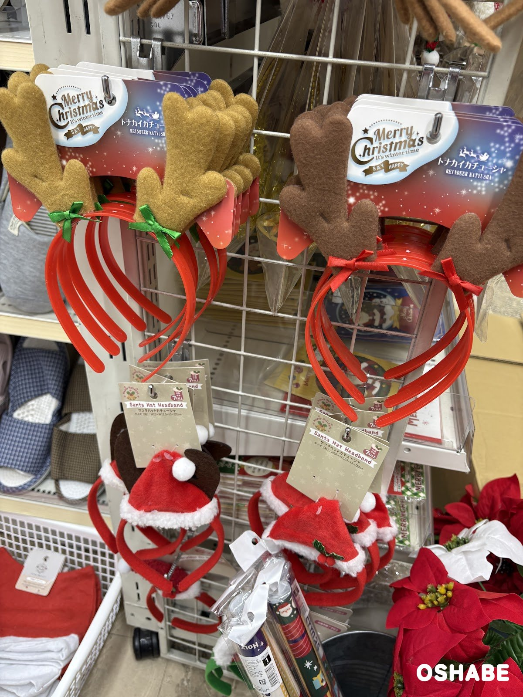

11月に入って、売り場がすっかりクリスマスの色になってきました☆

ツリーに飾るオーナメントや、パーティーで着けるカチューシャを探している方も多いですよね！

ワッツ（Watts）の売り場に、リースやオーナメント、トナカイのカチューシャがずらりと並んでいました。

今回は『ワッツのクリスマス2026』について紹介していきたいと思います。

 ▼その他クリスマスグッズ2026はコチラ

- [ダイソーのクリスマスカチューシャ2026【画像・値段】サンタ、トナカイ](../../../../2026/11/03/daiso-christmas-headband/)
- [ダイソーのクリスマス雑貨2026【画像・値段】ウッドオブジェ、スノードーム](../../../../2026/11/04/daiso-christmas-2026/)
- [LAKOLE（ラコレ）のクリスマス2026【画像・値段】リース、ツリー](../../../../2026/11/11/lakole-christmas-2026/)

## ワッツのクリスマス2026【画像一覧】

値段は、店頭の値札に書かれていた税込の値段です（2026年11月10日時点）。

### リース

ポインセチア＆ボールリース

税込550円です。

緑の葉に、赤いポインセチアの花と赤いボール、金色の松ぼっくりが付いています。
赤い実や金色の葉の飾りもあって、華やかなリースです。

玄関のドアや壁に掛けると、お部屋の入口が一気にクリスマスらしくなります。

赤と金の組み合わせで、ちょっと豪華に見えるのが嬉しいです。

### ベルとマスコットのオーナメント

シャイニーベルオーナメント、サンタ帽子ヘアークリップ

シャイニーベルオーナメント（Shiny Bell Ornament）は、1個入りです。
金色のベルに、金色のネットのリボンと小さな花が付いています。
上には、ねじった金色の輪とツリーの飾りもあります。
大きさは約 高さ15×幅12.5×奥行き6cm です。

ツリーのてっぺん近くや、ドアノブに掛けて飾れます。

右に並んでいたサンタ帽子ヘアークリップは、税込220円です。
赤いもこもこの帽子に、白いボアのふちとポンポンが付いています。
帽子には、雪の結晶と金色のツリー、「Merry Christmas」の文字の飾りがあります。

髪に留めるだけで、クリスマス会らしい雰囲気になります♪

マスコットベルオーナメント、ファブリックオーナメント、トナカイツノヘアークリップ

マスコットベルオーナメント（Mascot Bell Ornament）は、1個入りです。
赤い帽子と赤い蝶ネクタイのスノーマンが、金色の鈴を抱えています。
大きさは約 高さ11〜12×幅7〜9.5×奥行き6cm で、ひもを含めた高さは約15cm です。

左は、アミファ（amifa）のファブリックオーナメントです。
角のあるくまの形で、赤い蝶ネクタイが刺しゅうされています。

どちらも、ツリーに吊るしても、かばんに付けても楽しめそうです。

下の段のトナカイツノヘアークリップは、茶色の角とベージュの耳が付いています。
髪に留めるだけなので、カチューシャが苦手な子供にも使いやすそうです。

### ニットとベルベットのオーナメント

ニットサンタ＆スノーマンオーナメント、ベルベットガールズオーナメント、エンジェルオーナメント

ニットサンタ＆スノーマンオーナメントは、赤いニットの体に白いおひげのサンタです。
ベルベットガールズオーナメントは、グレーのとんがり帽子をかぶり、赤と白の三つ編みをした女の子です。
左のエンジェルオーナメントには、白い羽が付いています。

木の顔に、ニットやベルベットの服を合わせた、北欧のような雰囲気のオーナメントです。

下の段には、金色の鈴が8個入ったベルオーナメントも掛かっていました。

ツリーの枝に並べて吊るすと、小人たちが集まったように見えそうです。

### 小さなオーナメントとマフラーベア

ギフトボックスオーナメント、クリスマスリボンベル、マフラーベアオーナメント

ギフトボックスオーナメントは、金色のひもを掛けた緑のプレゼントの箱の6個セットです。
1個の大きさは約 高さ2.5×幅2.5×奥行き2.5cm です。

クリスマスリボンベルは、赤と緑のチェックのリボンに金色のベルが付いた2個セットです。

マフラーベアオーナメント（Muffler Bear Ornament）は、白いくまのオーナメントです。
赤と白のしま模様のマフラーを巻いています。
こちらは対象年齢7才以上です。

小さな箱やリボンベルは、ミニツリーやラッピングの飾りにも使えます。

### トナカイとサンタのカチューシャ

ふわもこトナカイカチューシャ、ポンポントナカイカチューシャ、トナカイカチューシャ

上の段のふわもこトナカイカチューシャは、税込220円です。
白いもこもこのカチューシャに、茶色の角と、赤と緑のポンポンが付いています。

真ん中の段は、ポンポントナカイカチューシャ（Pompon Reindeer Headband）です。
トナカイの耳と角に、赤い鼻と白いファーのポンポンが付いています。
大きさは約 高さ15×幅21.5cm で、対象年齢7才以上です。

下の段のトナカイカチューシャ（Reindeer Headband）は、フェルトの角のカチューシャです。
角の色は、茶色とベージュの組み合わせと、赤と緑の組み合わせがありました。
大きさは約 高さ19×幅22×奥行き1.5cm です。

トナカイカチューシャ、サンタハットカチューシャ

こちらのトナカイカチューシャは、赤いカチューシャにフェルトの角が付いています。
角は明るい茶色と濃い茶色の2色で、根元にリボンが結んであります。

下のサンタハットカチューシャ（Santa Hat Headband）は、赤いサンタの帽子が付いたカチューシャです。
大きさは約 高さ20×幅12.5〜15×奥行き2cm で、対象年齢7才以上です。

家族や友達と色違いで着けると、クリスマス会の写真が楽しくなりそうです。

## まとめ

いかがでしたか。

ワッツでは、リース、ベルやニットのオーナメント、ヘアクリップ2種類、トナカイやサンタのカチューシャが並んでいました。

値札で見た値段は、税込220円から550円までです。

12月のクリスマス会の前に、飾りと仮装のグッズをまとめて揃えてみてはいかがでしょうか。

ぜひ参考にしてみてくださいね。
