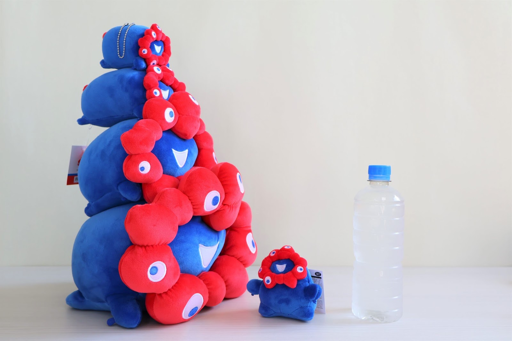

大阪・関西万博の公式キャラクター、ミャクミャク。独特の見た目が、じわじわ可愛いと人気ですよね！
今回は『ミャクミャクのぬいぐるみ』を並べて、大きさを比べてみたいと思います。

## ミャクミャクのぬいぐるみ【画像一覧】

#### 大きさ比べ

大きいぬいぐるみを積み重ねて、手前に小さいぬいぐるみを置きました。
右側のペットボトルと並べると、大きさがよく分かります。

赤い部分はふわふわで、目がたくさん付いています。
青い体には、白い口の刺繍が入っています。
小さいぬいぐるみにはボールチェーンが付いていて、バッグなどに付けられそうです。

## まとめ

いかがでしたか。
ミャクミャクのぬいぐるみは、大きさがいろいろあって迷っちゃいそうです☆
お家に飾っても、持ち歩いても可愛いですよね！
ぜひ参考にしてみてくださいね。
