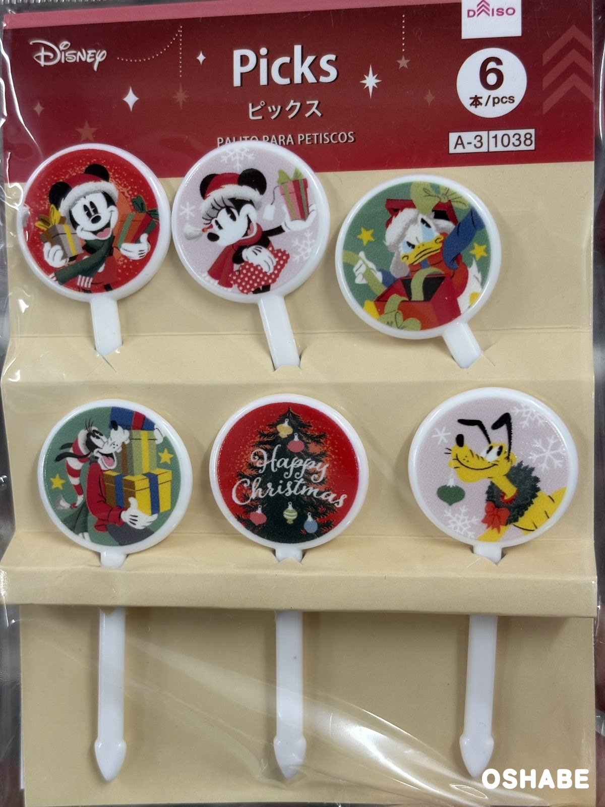
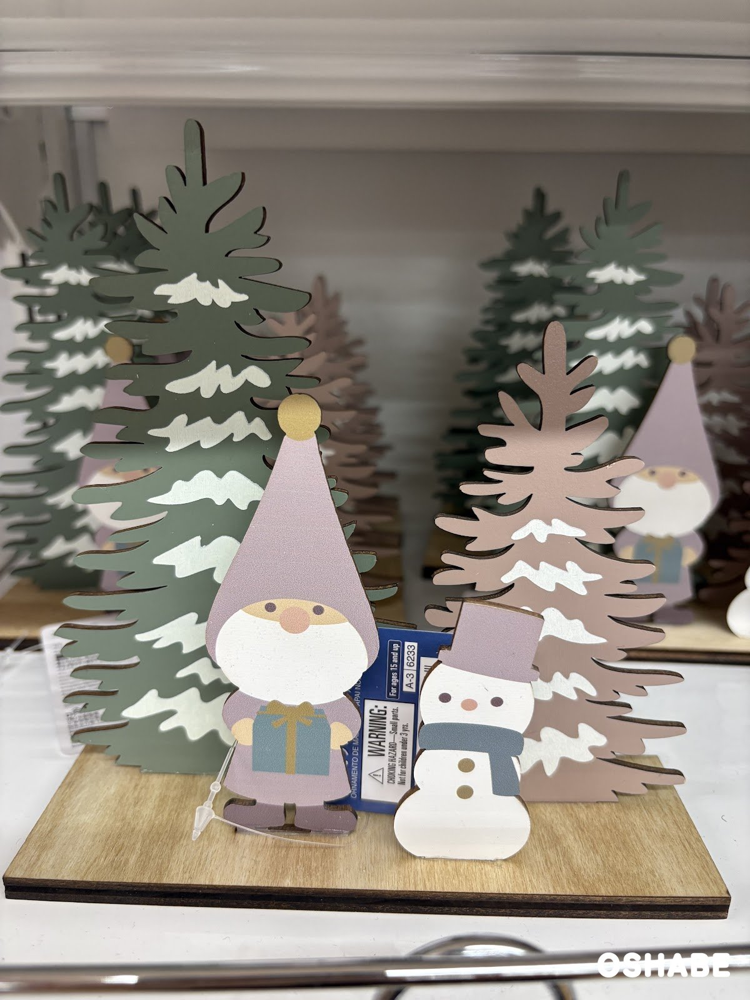
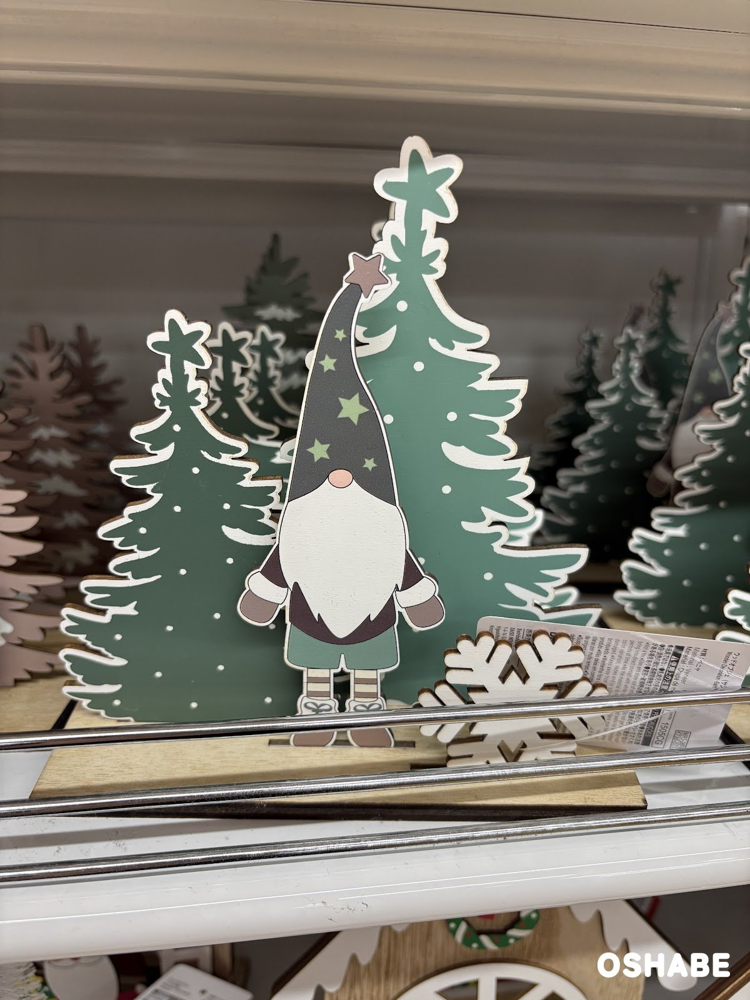
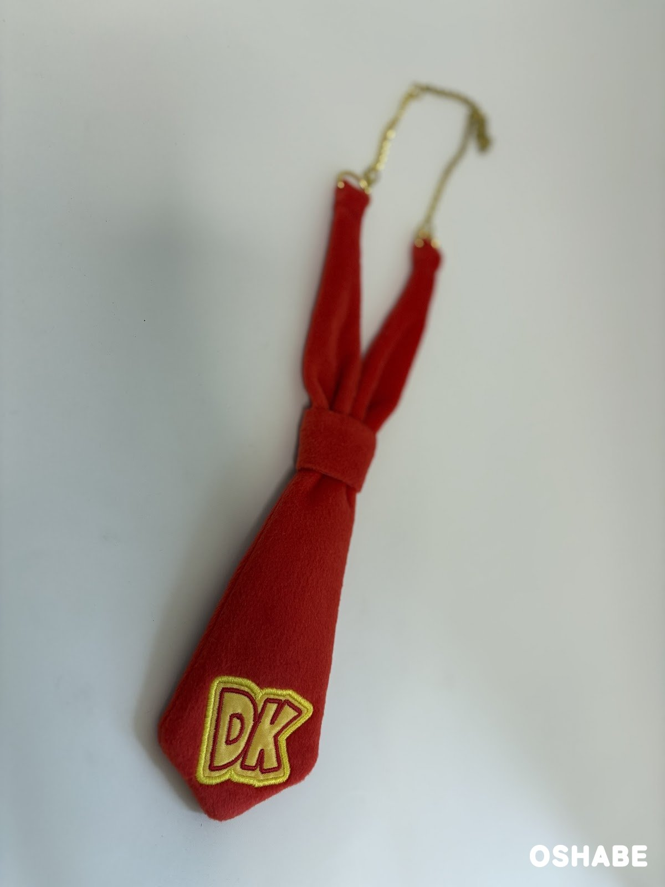
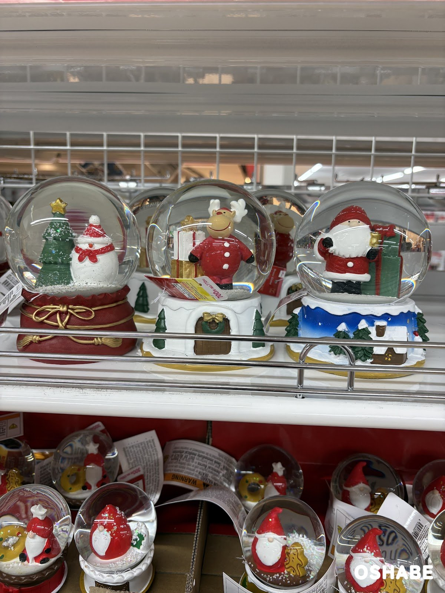
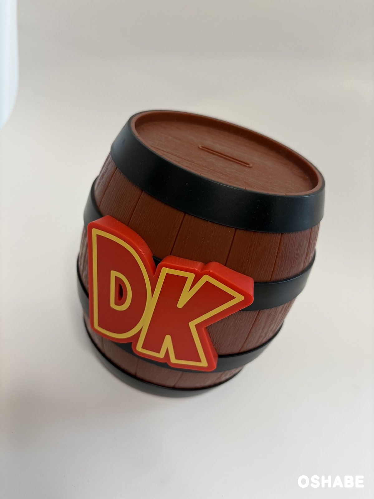
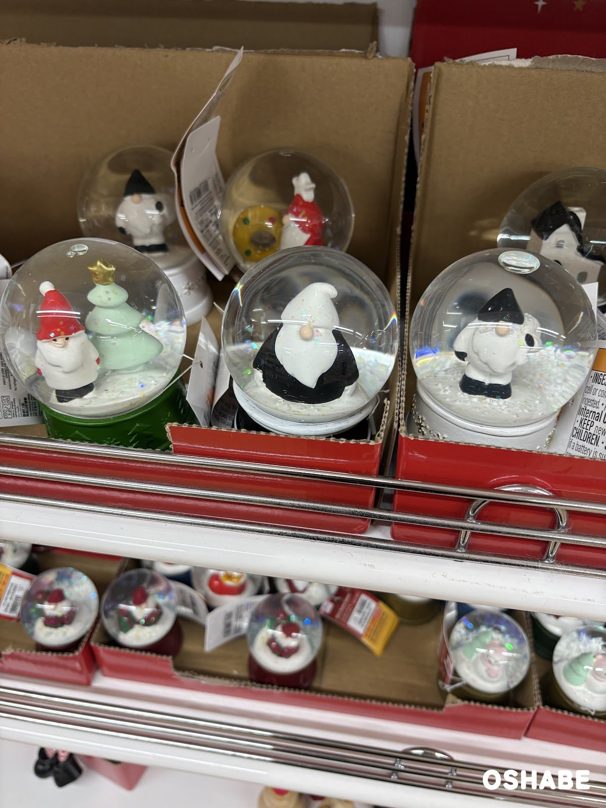
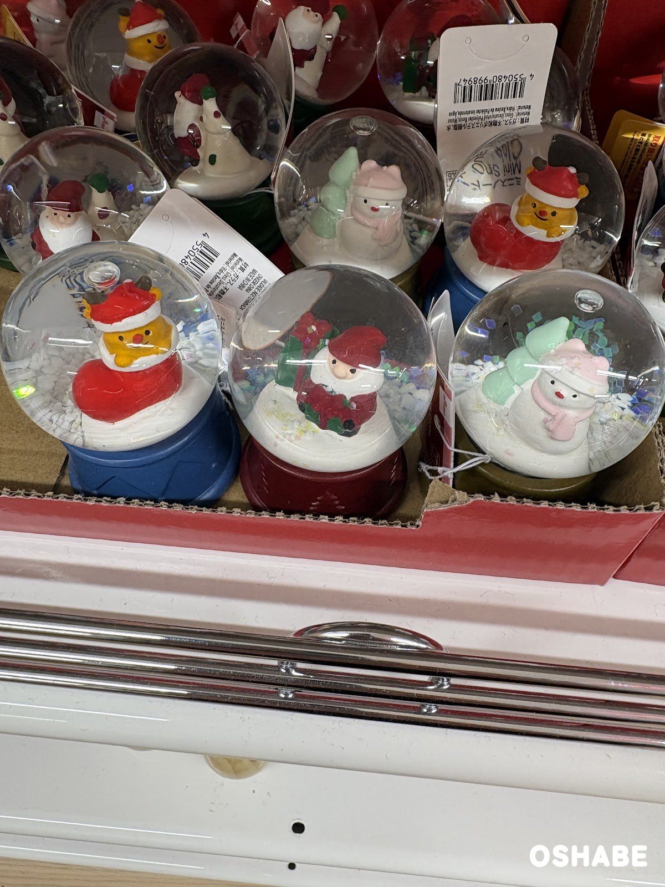

今年もやって来ました！クリスマスの季節です！！

11月に入ると、お部屋をクリスマスらしく飾りたくなる方も多いですよね！

ダイソー（DAISO）では、もうクリスマスの雑貨がたくさん並んでいました☆

木のウッドオブジェや、キラキラのスノードームもありますよ♪

今回は『ダイソーのクリスマス雑貨2026』について紹介していきたいと思います。

 ▼その他ダイソーのクリスマスグッズはコチラ

- [ダイソー100均クリスマス2017飾り付けグッズ ツリー【画像】](../../../../2017/11/06/357/)
- [ダイソークリスマス2016ツリー飾りリースオーナメントLED画像](../../../../2016/11/15/115/)

## ダイソーのクリスマス雑貨2026【画像一覧】

### ディズニーのピックス

ディズニー（Disney）のクリスマスのピックス 6本入り

ピックスには、ミッキーとミニーが描かれています。

ドナルド、グーフィー、プルートもいますよ☆

6本のうち1本は、「Happy Christmas」の文字とツリーの絵柄です。

ミッキーたちはサンタの帽子やマフラーを着けていて、プルートは首にリースを掛けています。

とっても可愛いですよね！

お弁当やケーキに刺すと、一気にクリスマスらしくなりそうです♪

### ウッドオブジェ

ウッドオブジェ（トナカイ、スノーマン）

税込220円でした（2026年11月4日時点）。

グレーのお家の形をした、木のオブジェです。

前には、麻のリボンを巻いたスノーマンが立っています。

スノーマンの首には、金色の鈴も付いていますよ☆

シンプルな色なので、どんなお部屋にも合わせやすいですよね！

森の小人とスノーマンのウッドオブジェ

モミの木の前に、小人とスノーマンが並んでいます。

木は緑とピンクの2色で、雪の模様が描かれています。

小人はプレゼントの箱を持っています。

くすんだ色合いが、とってもお洒落です♪

星の帽子の小人のウッドオブジェ

小人は、星柄のとんがり帽子をかぶっています。

帽子の先には、小さな星が付いていますよ☆

後ろには、白いふちのモミの木が2本並んでいます。

前には、雪の結晶の飾りもあります。

ウッドオブジェ（ハウス）

値札は本体200円（税込220円）でした（2026年11月4日時点）。

雪が積もった屋根の、木のお家のオブジェです。

窓からは、スノーマンが手を振っています。

スノーマンはプレゼントの箱を持っています。

屋根の下には、赤いリボンのリースも付いています。

お家の窓の扉が開いているデザインが可愛いですよね！

### スノードーム

大きめのスノードーム

真ん中のトナカイのスノードームは、税込770円でした（2026年11月4日時点）。

左はツリーとスノーマン、右はサンタさんのスノードームです。

台座も、サンタさんの袋や雪のお家の形になっています。

ガラスの中に雪が舞うと、とても素敵です♪

小さなスノードーム

小さなスノードームは、売り場の下の段に並んでいました。

中には、赤い帽子の小人が入っています。

小人の横には、ドーナツのような黄色のリースもあります。

右の台座には、「Merry Christmas」の文字があります。

白と黒の小人のミニスノードーム

こちらは、白や黒の帽子をかぶった小人のミニスノードームです。

赤と白のクリスマスカラーとは違って、モノトーンでお洒落ですよね！

左には、サンタさんとミントグリーンのツリーのスノードームもあります。

ミニスノードーム

ミニスノードーム（Mini Snow Globe）です。

トナカイの角が付いた帽子のキャラクターや、サンタさんが入っています。

ピンクの帽子のスノーマンも、とっても可愛いです♪

台座の色は、青・赤・金色などがあります。

いくつか並べて飾っても楽しいですよね！

## まとめ

いかがでしたか。

ダイソーでは、2026年もクリスマスの雑貨がたくさん並んでいました。

ウッドオブジェは税込220円、大きめのスノードームは税込770円でした。

木のオブジェはナチュラルで、北欧風のお部屋にも合いそうです。

スノードームは種類が多くて、どれにしようか迷っちゃいそうです☆

家族や子供と一緒に、お気に入りを探してみてはいかがでしょうか。

ぜひ参考にしてみてくださいね。
