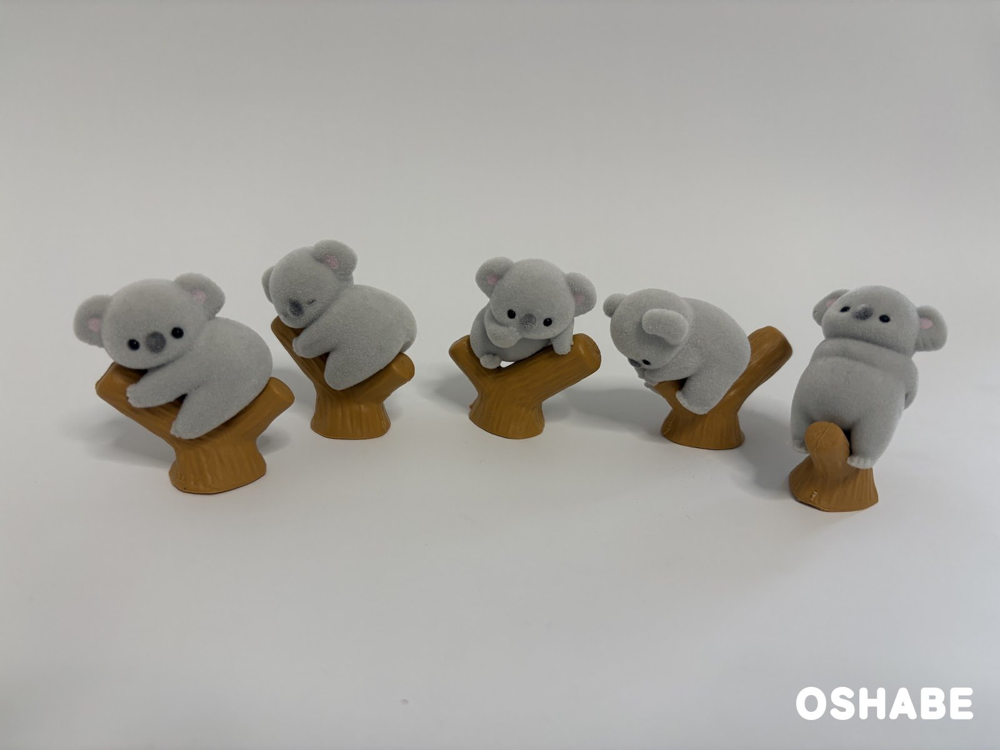

今回は、とっても可愛いコアラのミニフィギュアを見つけました☆

コアラのゆったりした姿に、癒やされる方も多いですよね！

このフィギュアのコアラたちは、みんな木の枝につかまっています。

今回は『木の枝にしがみつくコアラのミニフィギュア』について紹介していきたいと思います。

## コアラのミニフィギュア2026【画像】

### 5匹のコアラ

並んでいるコアラは、全部で5匹！

体は灰色で、耳の内側は薄いピンク色になっています。

表面はふわふわの起毛で、本物のコアラの毛のようです♪

台は茶色の木の枝の形なので、1匹ずつ立てて飾れますよ☆

### それぞれのポーズ

左のコアラは、枝をぎゅっと抱えて、こちらを見ています。

左から2番目のコアラは、枝に顔をのせて、目を閉じたままぐっすり。

真ん中のコアラは小さめで、枝の上から顔をのぞかせているんです。

右から2番目のコアラは、下を向いて枝にしがみついています。

右のコアラは、枝の先に足をかけて、こちらを向いていますよ♪

ポーズが1匹ずつ違うので、並べて見比べるのも楽しいですよね！

## まとめ

いかがでしたか。

木の枝にしがみつくコアラのミニフィギュアは、ポーズの違う5匹が並ぶ可愛いグッズです。

ふわふわの手ざわりで、見ているだけで癒やされます♪

棚や机に並べて飾ると、お部屋がぐっと楽しくなりそうです。

お子さんと一緒に、お気に入りの1匹を選んでみてはいかがでしょうか。

ぜひ参考にしてみてくださいね。
