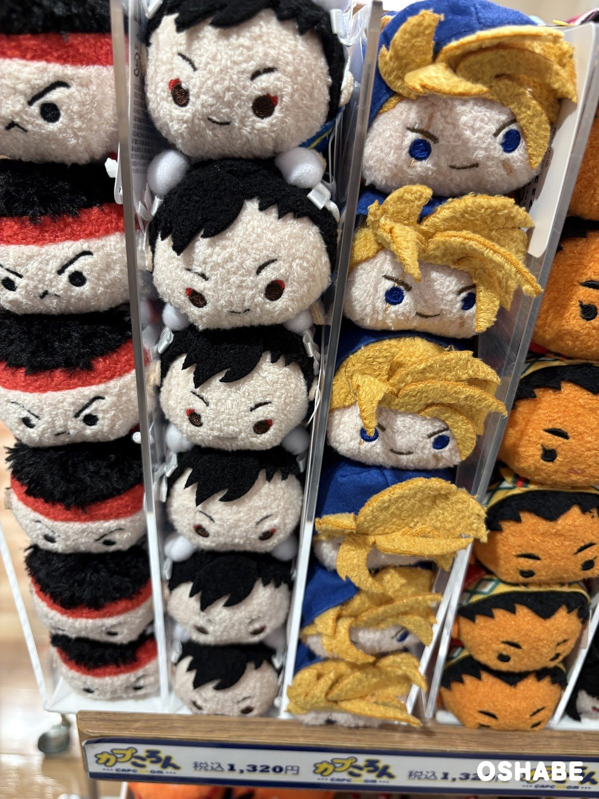
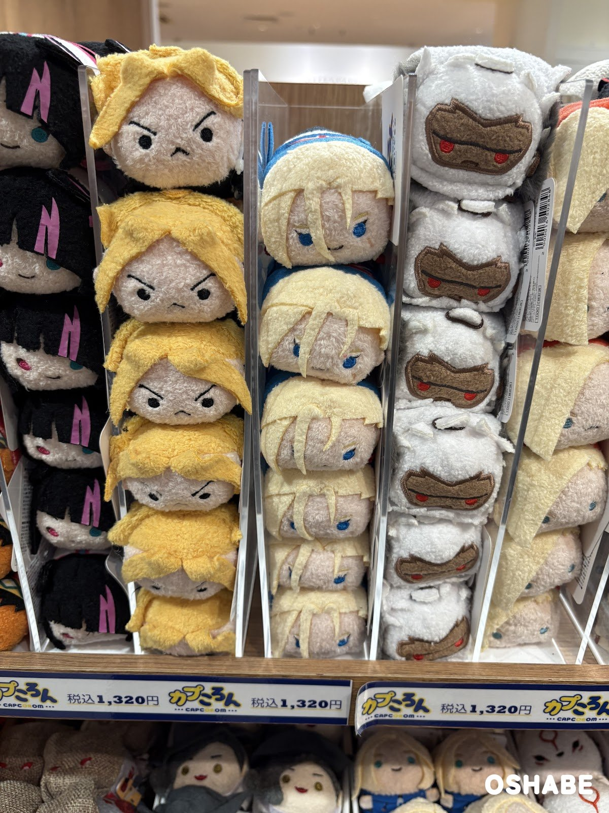
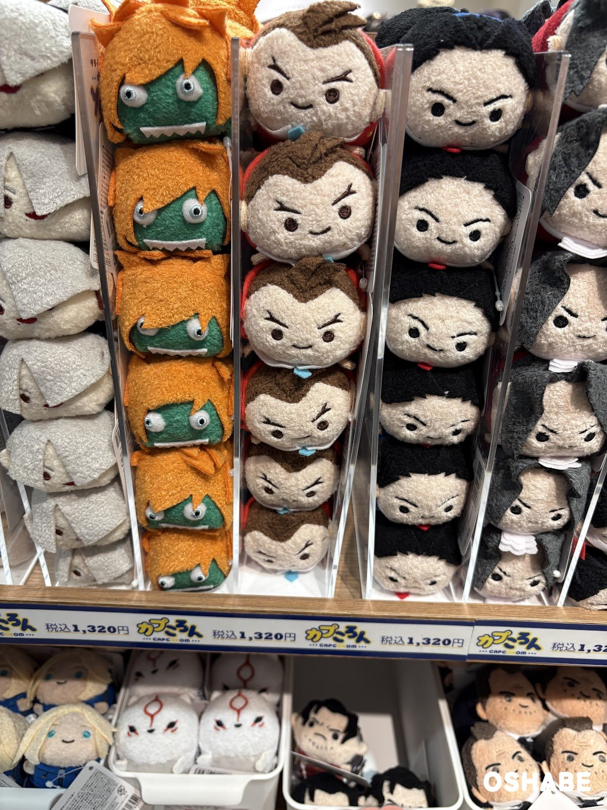
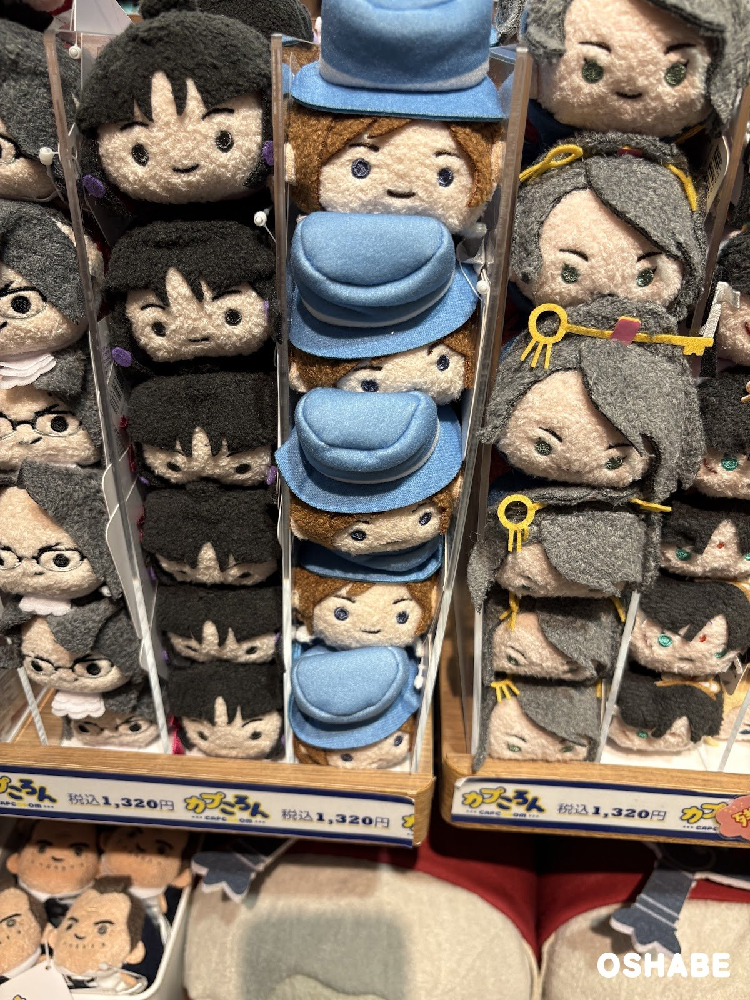
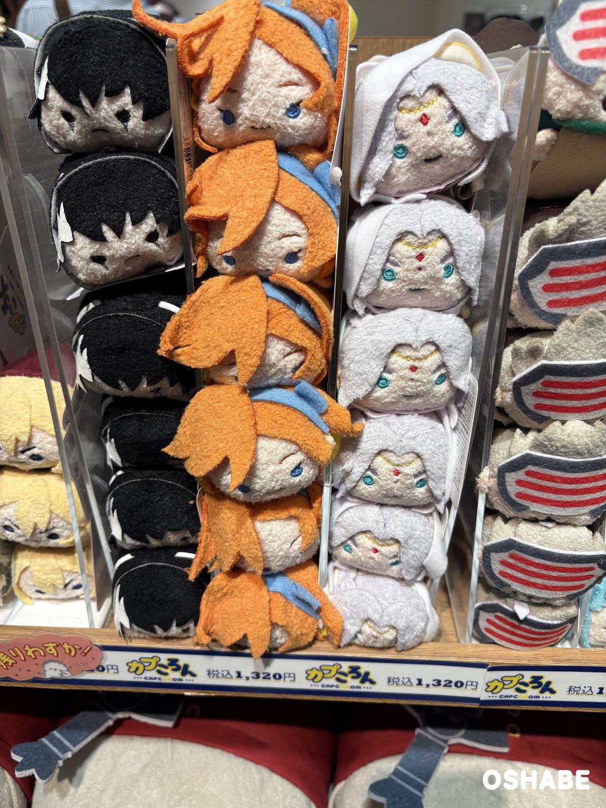
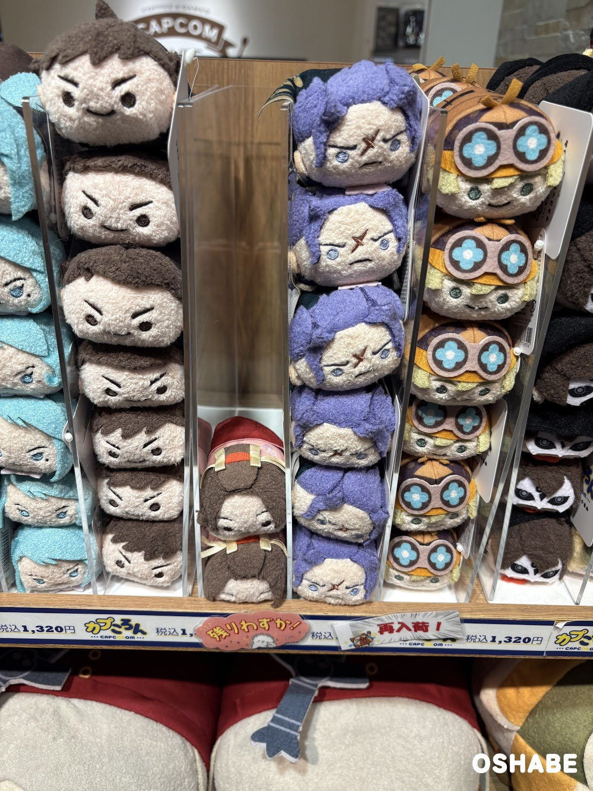
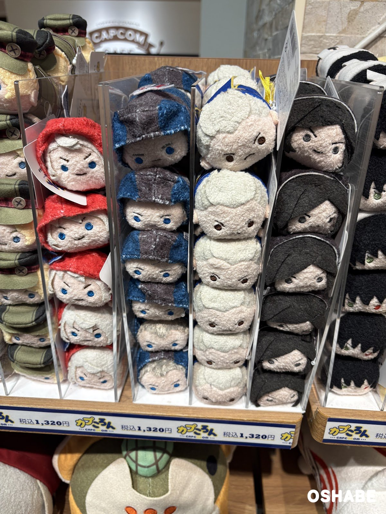
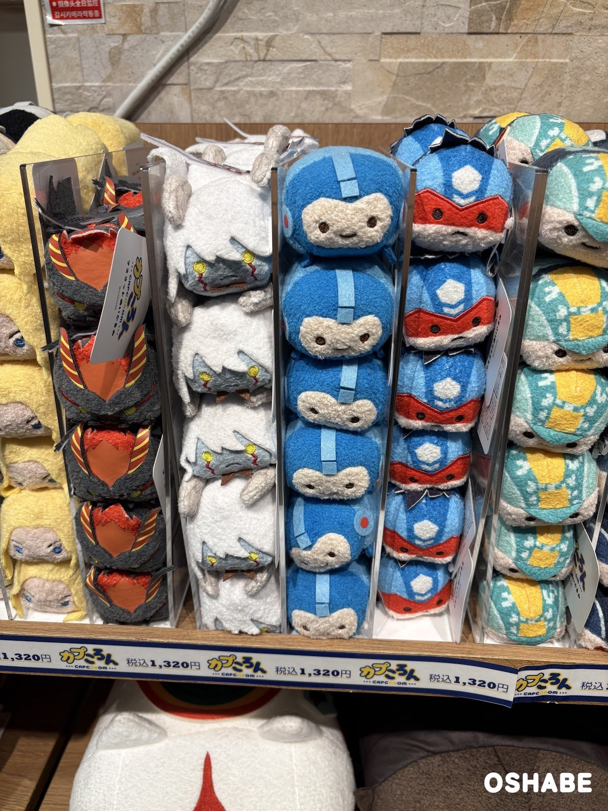
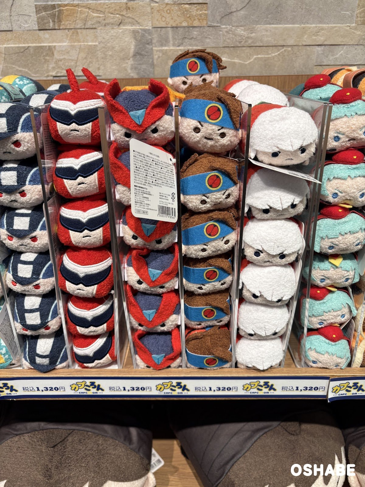
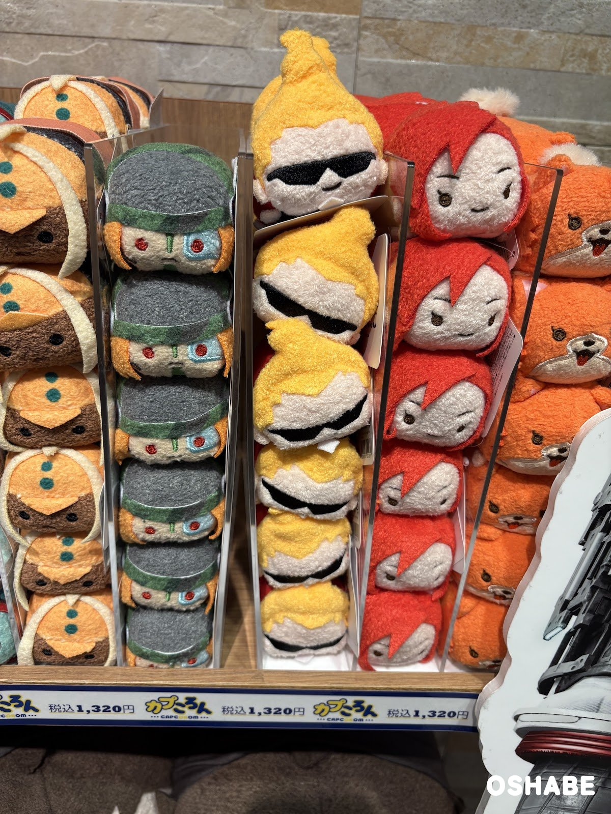

カプコンストア（CAPCOM STORE）に行ってきました！

カプコンストアは、カプコンのゲームの公式グッズのお店です。

ゲームのキャラクターのぬいぐるみは、子供にも大人にも人気ですよね！

お店には、「カプころん」のぬいぐるみがずらりと並んでいました☆

カプころんは、カプコンのゲームのキャラクターを、手のひらサイズの丸い形にしたぬいぐるみのシリーズです。

今回は『カプコンストアのカプころん2026』について紹介していきたいと思います。

## カプコンストアのカプころん2026【画像一覧】

### カプころんの値段

棚の値札は、どれも「カプころん 税込1,320円」でした（2026年11月5日時点）。

キャラクターごとに透明なケースに分かれていて、同じキャラクターが縦に積み重なっています。

ころんとした形のぬいぐるみが並ぶ様子は、とても可愛いですよね！

### ストリートファイターのぬいぐるみ

カプころん マスコットぬいぐるみ

税込1,320円でした（2026年11月5日時点）。

左の2列は、『ストリートファイター』シリーズのリュウと春麗（チュンリー）です。

赤いハチマキや、白いシニヨンキャップもしっかり作られていますよ♪

### いろいろなキャラクターのぬいぐるみ

カプころん マスコットぬいぐるみ

税込1,320円でした（2026年11月5日時点）。

金色の髪のキャラクターや、白いマスクのキャラクターが並んでいました。

カプころん マスコットぬいぐるみ

税込1,320円でした（2026年11月5日時点）。

緑の顔にオレンジの髪のぬいぐるみは、『ストリートファイター6』の「ブランカちゃん」です。

並んだ中でも、とても目立っていました。

眉毛の形がキャラクターごとに違っていて、表情豊かです♪

カプころん マスコットぬいぐるみ

税込1,320円でした（2026年11月5日時点）。

真ん中の列のキャラクターは、水色の帽子をかぶっています。

右の列のキャラクターには、金色の鍵の飾りが付いていますよ☆

カプころん マスコットぬいぐるみ

税込1,320円でした（2026年11月5日時点）。

オレンジの髪のキャラクターと、白い髪のキャラクターが並んでいました。

左下には「残りわずか！」の札も付いていました。

カプころん マスコットぬいぐるみ

税込1,320円でした（2026年11月5日時点）。

棚には、「残りわずか！」や「再入荷！」の札も付いていました。

紫の髪のキャラクターや、ゴーグルを着けたキャラクターも可愛いですよね！

カプころん マスコットぬいぐるみ

税込1,320円でした（2026年11月5日時点）。

赤いフードのキャラクターや、白い髪のキャラクターがいました。

チェック柄のフードも、布で細かく作られています。

### ロックマンシリーズのぬいぐるみ

カプころん マスコットぬいぐるみ

税込1,320円でした（2026年11月5日時点）。

真ん中の青いぬいぐるみは、ロックマンです。

にっこりした顔がとても可愛いです♪

カプころん マスコットぬいぐるみ

税込1,320円でした（2026年11月5日時点）。

真ん中の2列は、『ロックマンゼロ』のゼロと、『ロックマンエグゼ』の光熱斗です。

この2つが2024年3月に発売されたときは税込1,100円だったので、少し値上がりしていますね。

ロックマンシリーズが好きな方は、迷っちゃいそうです☆

### カラフルなぬいぐるみ

カプころん マスコットぬいぐるみ

税込1,320円でした（2026年11月5日時点）。

サングラスのキャラクターや、赤い髪のキャラクターが並んでいました。

右の列には、オレンジ色の動物のぬいぐるみもありましたよ♪

## まとめ

いかがでしたか。

カプコンストアには、カプころんのぬいぐるみがたくさん並んでいました。

値札はどれも税込1,320円でした（2026年11月5日時点）。

好きなゲームのキャラクターを探すのも楽しいですよね！

家族へのお土産や、ゲームが好きな友達へのプレゼントにもぴったりではないでしょうか。

ぜひ参考にしてみてくださいね。
