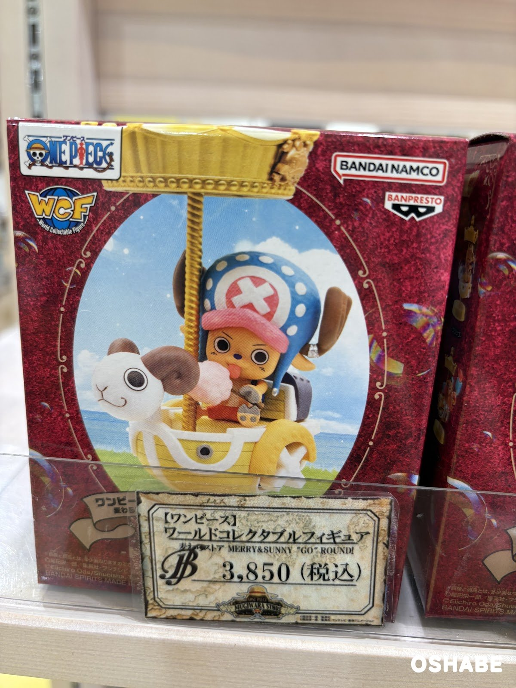
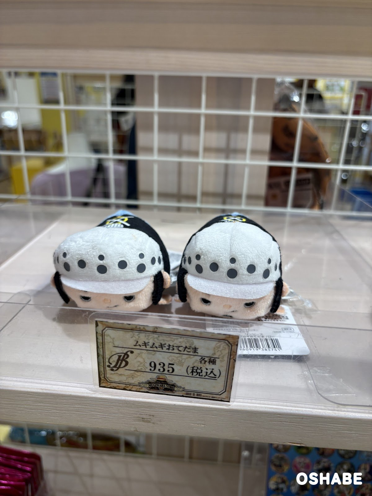
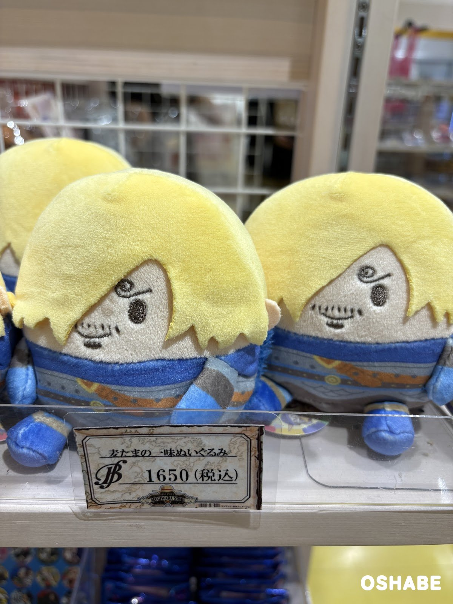
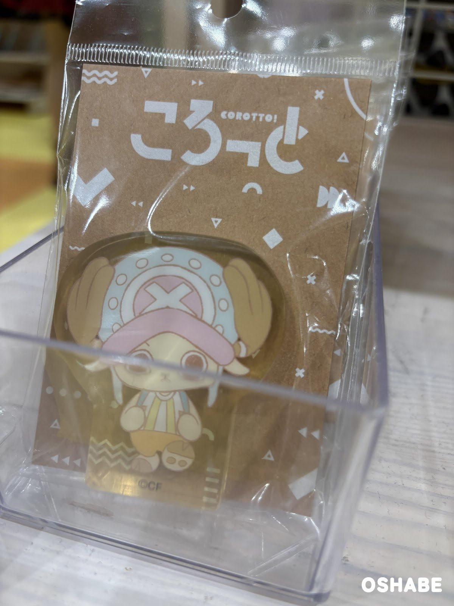
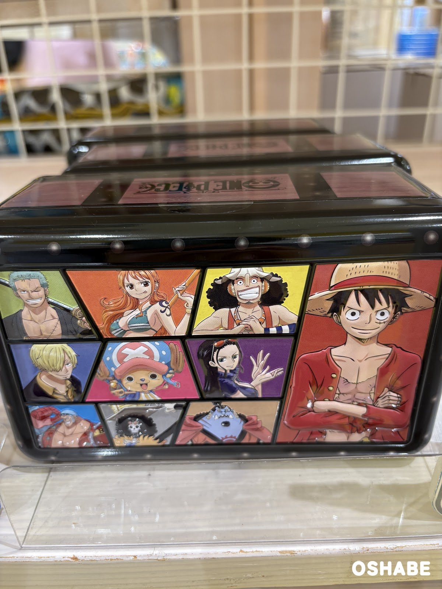

ONE PIECE 麦わらストア（ONE PIECE MUGIWARA STORE）に行ってきました！

麦わらストアは、ワンピースの公式グッズのお店です。

ワンピースが好きな方は、子供にも大人にもたくさんいますよね！

お店には、フィギュアやぬいぐるみがずらりと並んでいました☆

今回は『麦わらストアのワンピースグッズ2026』について紹介していきたいと思います。

 ▼その他ワンピースのグッズはコチラ

- [USJワンピースグッズ2018【画像一覧・値段】ルフィゾロサンジ等](../../../../2018/06/30/454/)
- [USJワンピースグッズお土産2017全種類【画像一覧・値段】](../../../../2017/07/01/303/)

## 麦わらストアのワンピースグッズ2026【画像一覧】

### フィギュア

【ワンピース】ワールドコレクタブルフィギュア 麦わらストア MERRY&SUNNY "GO" ROUND!

税込3,850円でした（2026年11月5日時点）。

箱の写真は、メリーゴーランドに乗ったチョッパーのフィギュアです。

チョッパーが乗っている乗り物は、ゴーイング・メリー号の形をしています。

チョッパーは、わたあめを持っていますよ♪

金色の柱がキラキラしていて、とても豪華ですよね！

### ぬいぐるみ

ムギムギおてだま

値札は「各種 税込935円」でした（2026年11月5日時点）。

写真は、ローのおてだまです。

白い帽子に黒い水玉の模様があります。

寝そべったような形が可愛いです♪

麦たまの一味ぬいぐるみ

税込1,650円でした（2026年11月5日時点）。

写真は、サンジのぬいぐるみです。

丸い卵のような形で、ころんとしたシルエットがたまらないですよね！

ぐるぐるの眉毛も、しっかり刺しゅうされています。

### 小物

ころっと（COROTTO!）

店頭で見つけた、チョッパーの「ころっと」です。

パステルカラーのチョッパーが描かれた、透明なグッズです。

淡い色合いがお洒落ですよね！

### ボックス

麦わらの一味のボックス

店頭で見つけた、黒いボックスです。

ふたには ONE PIECE のロゴが入っています。

横の面には、ルフィ・ゾロ・ナミ・ウソップ・サンジ・チョッパーが描かれています。

ロビン・フランキー・ブルック・ジンベエも並んでいますよ☆

小物入れにしても、飾っておいてもインスタ映えしそうですね！

## まとめ

いかがでしたか。

麦わらストアには、ワンピースのグッズがたくさん並んでいました。

ムギムギおてだまは税込935円、麦たまの一味ぬいぐるみは税込1,650円です。

ワールドコレクタブルフィギュアは税込3,850円でした。

好きなキャラクターを探すのも楽しいですよね！

家族へのお土産や、ワンピースが好きな友達へのプレゼントにもぴったりではないでしょうか。

ぜひ参考にしてみてくださいね。
