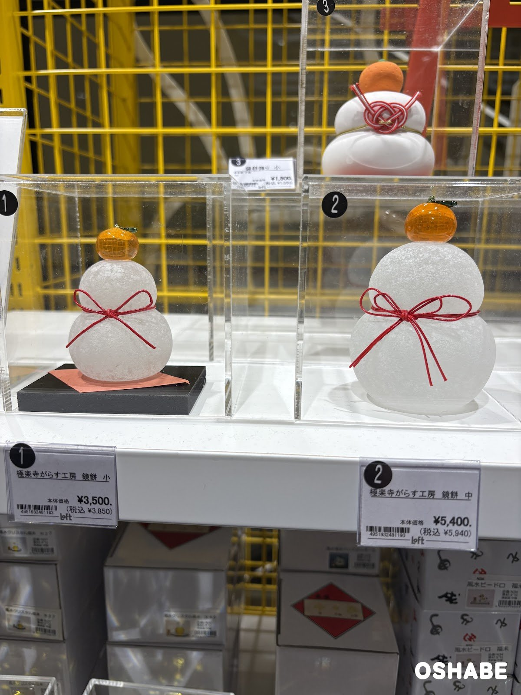
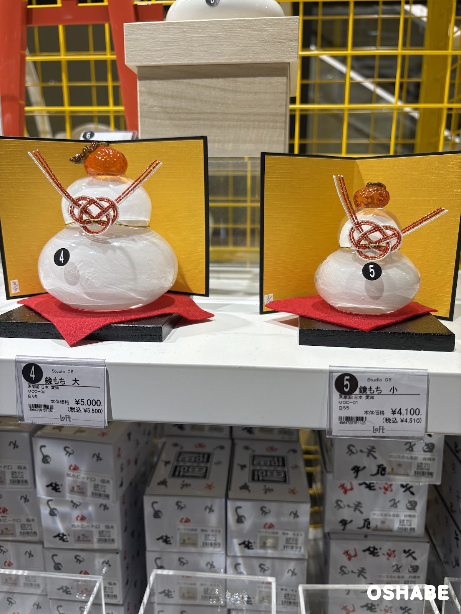
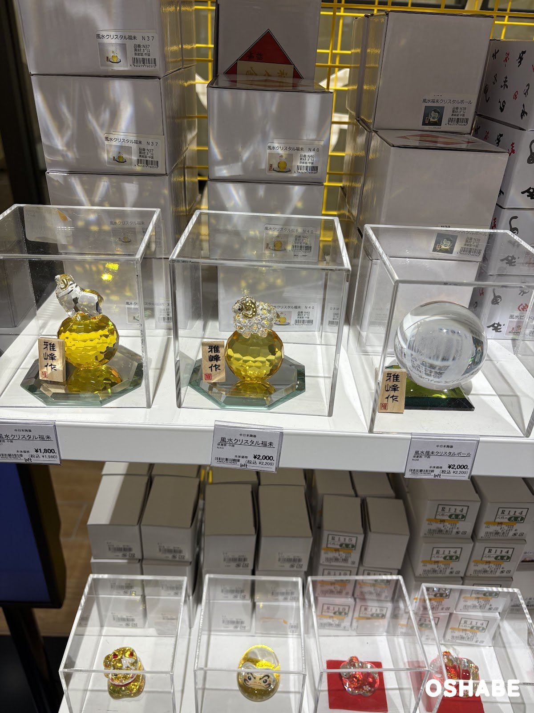
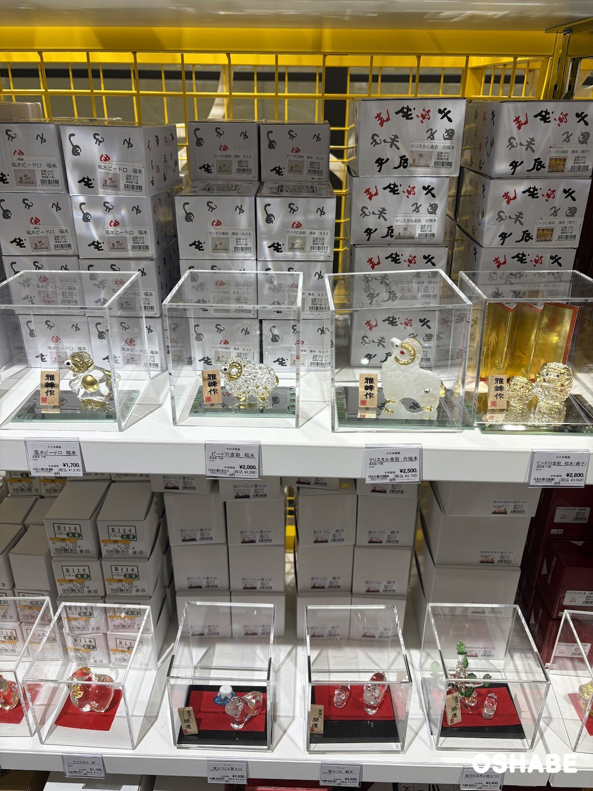
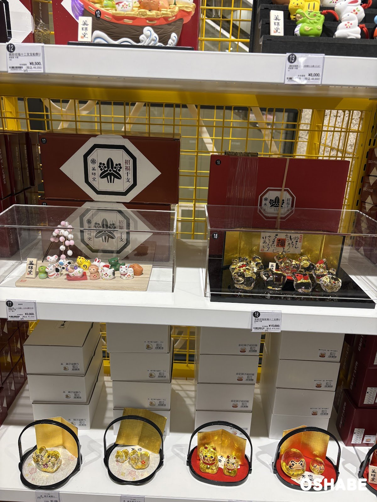
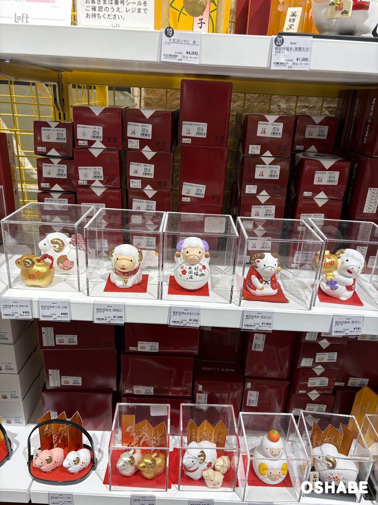
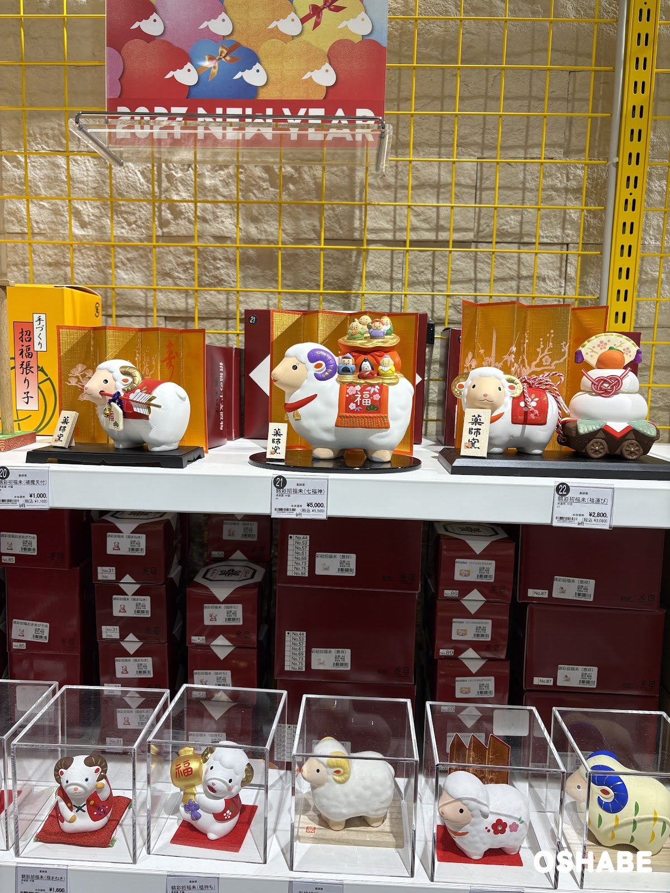
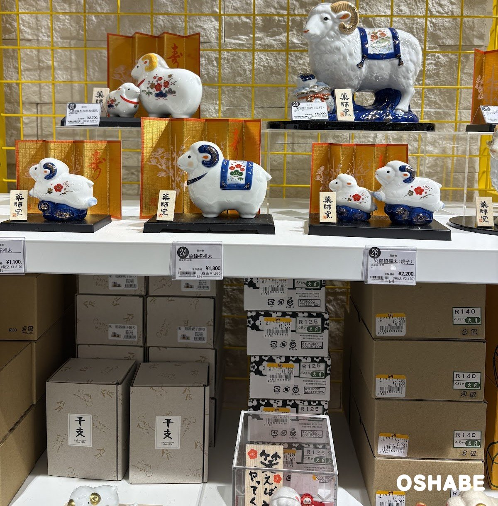
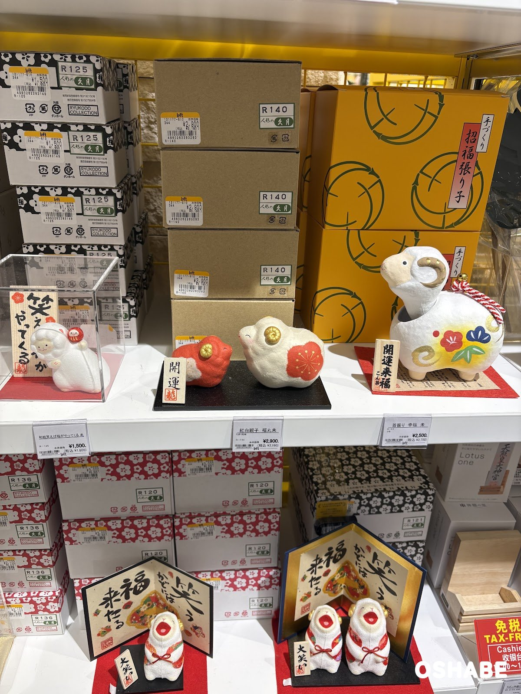
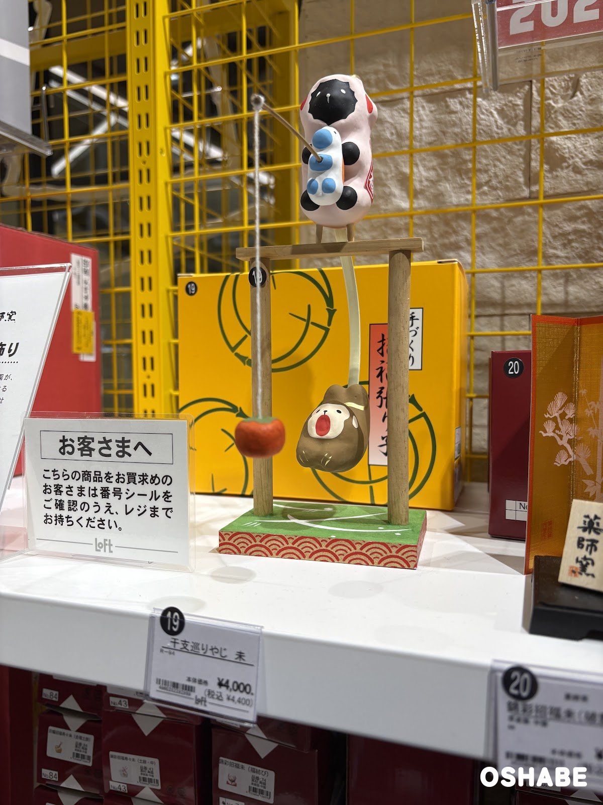

今年もやって来ました！お正月の飾りの季節です！

2027年の干支は「未（ひつじ）」ですよね！

ロフト（LOFT）に行ったら、お正月の飾りの売り場ができていました☆

売り場には「2027 NEW YEAR」の看板があり、未の置物や鏡餅がずらりと並んでいました。

干支の置物を毎年買い替えて、玄関やリビングに飾る方も多いですよね！

今回は『ロフトの迎春アイテム2027』について紹介していきたいと思います。

## ロフトの迎春アイテム2027【画像一覧】

値段は、店頭の値札に書かれていた税込の値段です（2026年11月6日時点）。

### ガラスの鏡餅

極楽寺がらす工房 鏡餅

小は税込3,850円、中は税込5,940円でした。

すりガラスのお餅に、オレンジ色のガラスのみかんが乗っています。

赤い紐のリボンが可愛いですよね♪

後ろには「鏡餅飾り 小」もあり、税込1,650円でした。

### 屏風付きの鏡もち

Studio 08 鏡もち

大は税込5,500円、小は税込4,510円でした。

値札には、原産国は日本（愛知）と書かれていました。

金色の屏風と赤い敷物が付いています。

水引の飾りが華やかで、お正月らしい置物です☆

### 未のクリスタルの置物

風水クリスタル福未

左の風水クリスタル福未（N37）は税込1,980円でした。

真ん中の風水クリスタル福未（N40）は税込2,200円でした。

右の風水福未クリスタルボールも税込2,200円でした。

黄色いクリスタルの玉の上に、透明な未が乗っています。

光が当たるとキラキラしてとってもキレイです♪

### 未のビードロの置物

ビードロ金彩 福未

風水ビードロ 福未は税込1,870円でした。

ビードロ金彩 福未は税込2,200円でした。

クリスタル金彩 白福未は税込2,750円でした。

ビードロ金彩 福未（親子）は税込3,080円でした。

ガラスの未に、金色の角が付いています。

白いすりガラスの未は、ふわふわの毛のように見えて可愛いですね！

### 十二支の飾り

錦彩招福 十二支飾り

左の錦彩招福 十二支飾りは税込3,300円でした。

小さな十二支が、木の台の上に並んでいます。

右の彩絵招福玻璃十二支飾りは税込16,500円でした。

こちらは金色の十二支のガラスの置物です。

上の段の錦彩招福十二支宝船飾りは税込9,350円でした。

十二支がそろっているので、毎年飾れるのがうれしいポイントです♪

### 未の陶器の置物

錦彩招福未

彩鞠招福寿々未（金福土鈴）は税込440円でした。

錦彩招福寿々未（土鈴）は税込506円でした。

錦彩招福未（福結び）は税込1,320円でした。

錦彩招福おきあがり未は税込1,100円でした。

錦彩招福未（福まねき）は税込1,760円でした。

錦彩招福未（福持ち）は税込825円でした。

まんまるのお顔の未がたくさん並んでいて、迷っちゃいそうです☆

### 屏風付きの未の置物

錦彩招福未（七福神）

左の錦彩招福未（破魔矢付）は税込1,100円でした。

真ん中の錦彩招福未（七福神）は税込5,500円でした。

背中に七福神が乗っていて、とっても縁起が良さそうですよね！

右の錦彩招福未（福運び）は税込3,080円でした。

未が鏡餅の車を引いている置物です。

### 染付の未の置物

染錦招福未

真ん中の染錦招福未は税込1,980円でした。

右の染錦招福未（親子）は税込2,420円でした。

白い磁器に青い模様が入っていて、上品な雰囲気です。

上の段の大きな未は税込6,600円でした。

存在感があるので、玄関に飾ったら素敵ではないでしょうか。

### 張り子の未

首振り 幸福 未

右の首振り 幸福 未は税込2,750円でした。

真ん中の紅白親子 福丸未は税込3,190円でした。

左の和紙 笑えば福がやってくる 未は税込1,650円でした。

張り子の未は、ころんとした形がとっても可愛いです♡

### 干支巡りやじ

干支巡りやじ 未

干支巡りやじ 未は税込4,400円でした。

やじろべえのように、ゆらゆら揺れる飾りです。

上には未が乗っていて、糸の先には赤い実が下がっています。

子供と一緒に揺らして楽しめそうですね♪

## まとめ

いかがでしたか。

ロフトには、2027年の干支の未の置物がたくさん並んでいました。

値段は税込440円から税込16,500円まででした（2026年11月6日時点）。

小さな土鈴なら、プチプラで気軽に飾れますよね！

ガラスや陶器、張り子など、素材ごとに雰囲気が違うのも楽しいです。

家族で選んで、お正月に飾ってみてはいかがでしょうか。

ぜひ参考にしてみてくださいね。
