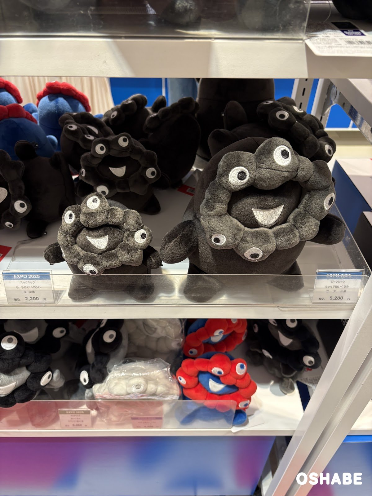
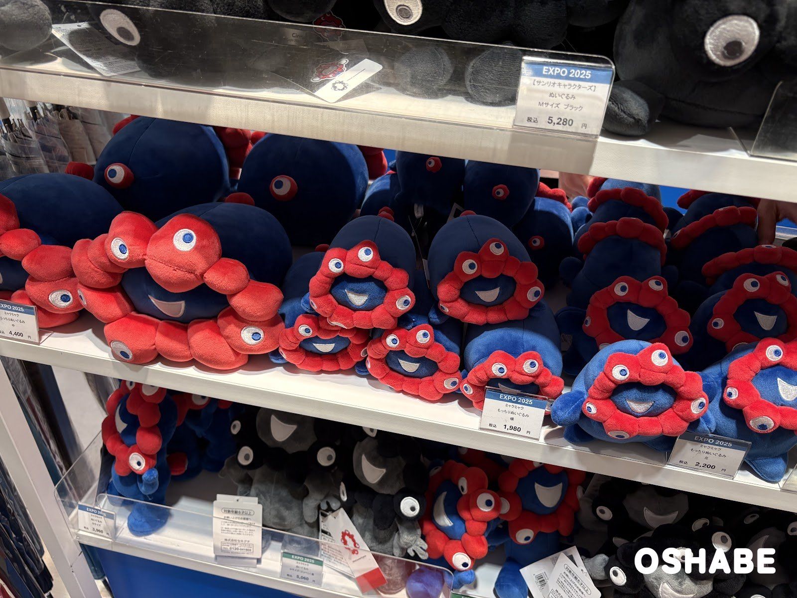
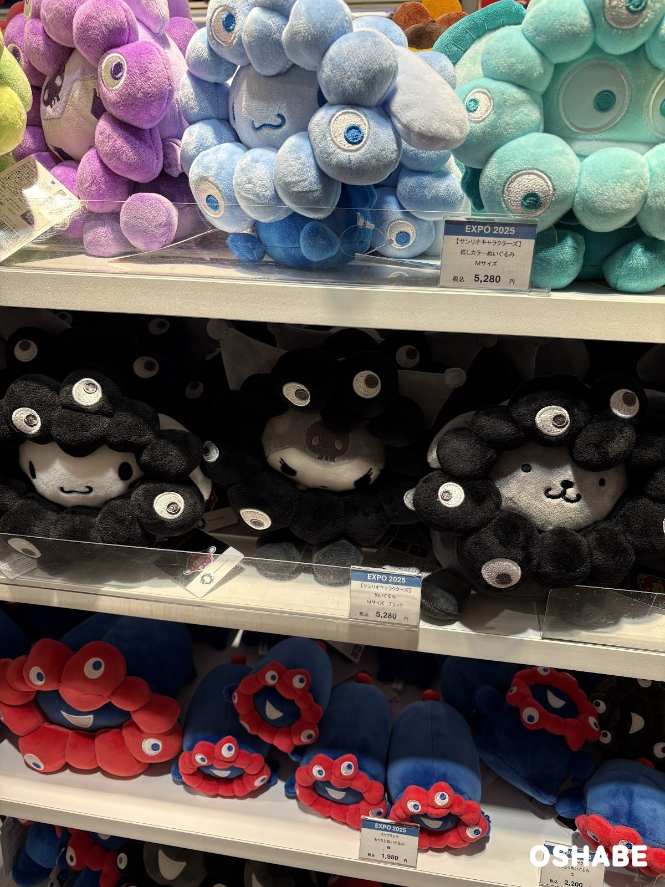
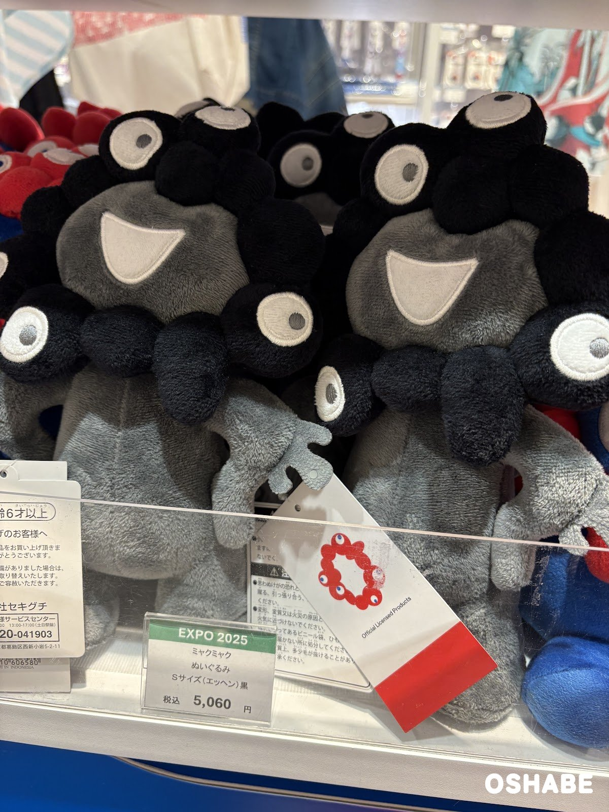
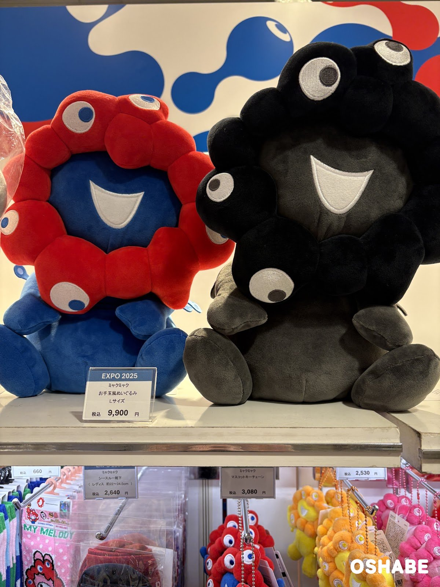
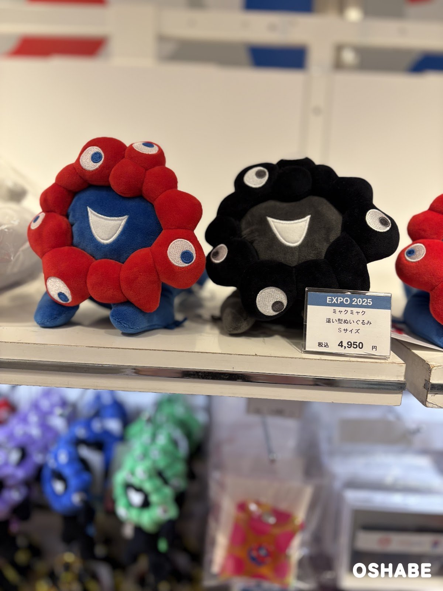
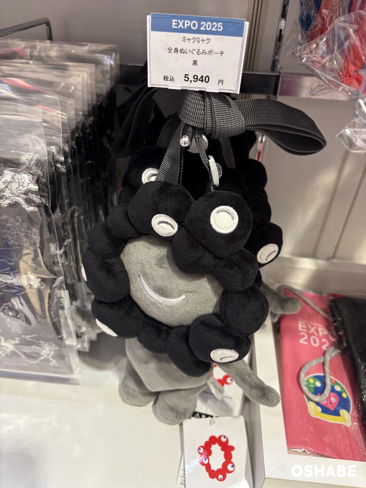
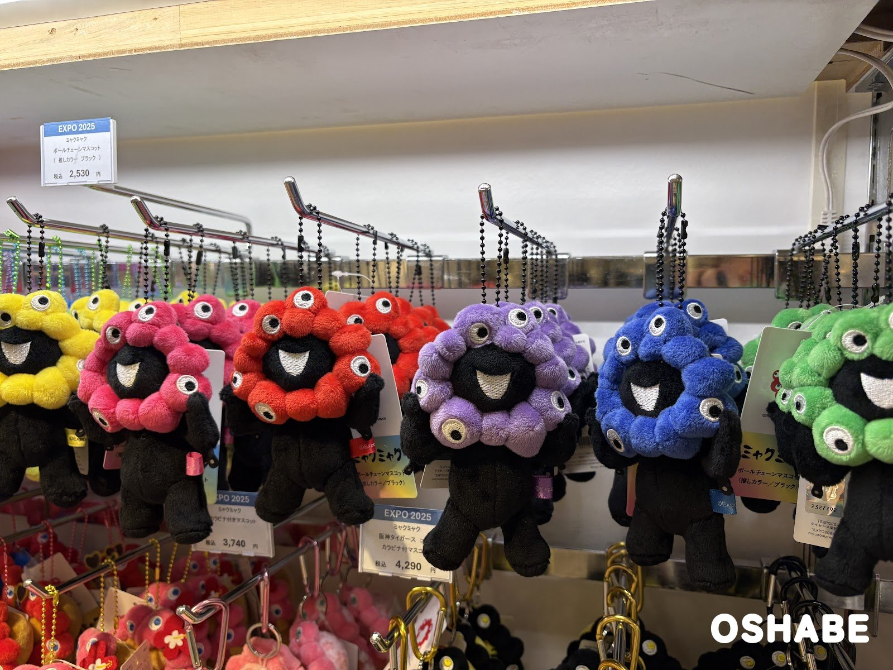
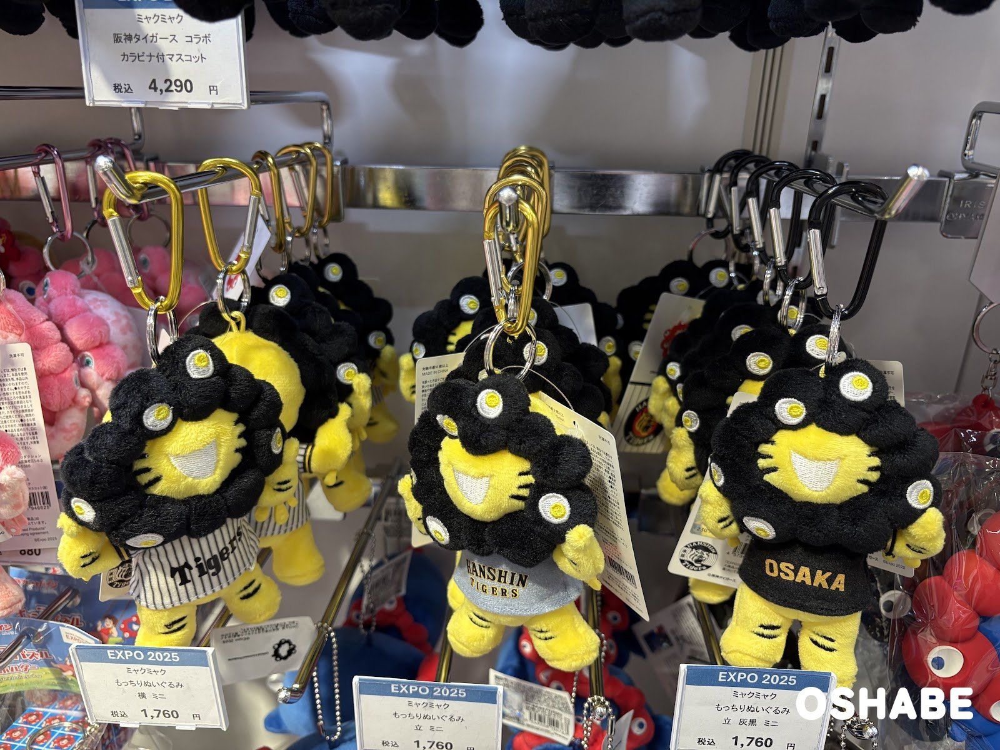
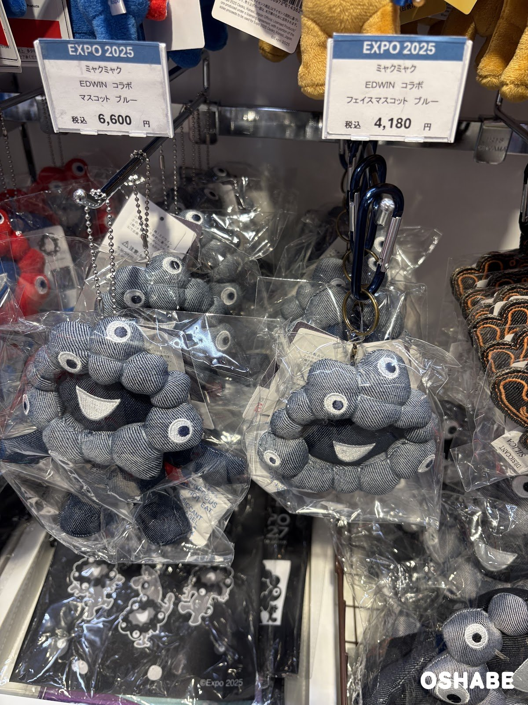

ミャクミャクのグッズの売り場に行ってきました！

ミャクミャクは、大阪・関西万博（EXPO 2025）の公式キャラクターです。

万博は2025年10月13日に閉幕しました。

それでも、ミャクミャクのグッズは今も売られていますよ☆

ミャクミャクが大好きな方は、子供にも大人にもたくさんいますよね！

売り場には、赤と青のミャクミャクだけでなく、黒いミャクミャクのぬいぐるみもずらりと並んでいました。

今回は『ミャクミャクのグッズ2026』について紹介していきたいと思います。

## ミャクミャクのグッズ2026【画像一覧】

値段は、店頭の値札に書かれていた税込の値段です（2026年11月6日時点）。

### もっちりぬいぐるみ

もっちりぬいぐるみ 灰黒

左の「もっちりぬいぐるみ 立 灰黒」は税込2,200円でした。

右の「もっちりぬいぐるみ 立 大 灰黒」は税込5,280円でした。

灰色と黒のミャクミャクで、落ち着いた色合いがお洒落ですよね！

大きいほうは、手を広げたポーズが可愛いです♪

もっちりぬいぐるみ 赤と青

赤と青のミャクミャクのもっちりぬいぐるみも並んでいました。

寝そべった形の「もっちりぬいぐるみ 横」は税込1,980円でした。

立った形の「もっちりぬいぐるみ 立」は税込2,200円でした。

左の大きな「もっちりぬいぐるみ 中」は税込4,400円でした。

ころんとした形で、抱っこしたくなりますね！

### サンリオキャラクターズとのコラボ

【サンリオキャラクターズ】ぬいぐるみ Mサイズ

上の段は「【サンリオキャラクターズ】推しカラーぬいぐるみ Mサイズ」で、税込5,280円でした。

紫・水色・緑など、ミャクミャクのような色の帽子をかぶっています。

真ん中の段は「【サンリオキャラクターズ】ぬいぐるみ Mサイズ ブラック」で、こちらも税込5,280円でした。

黒い帽子のサンリオのキャラクターも可愛いですよね！

### 大きめのぬいぐるみ

ぬいぐるみ Sサイズ（エッヘン）黒

「ミャクミャク ぬいぐるみ Sサイズ（エッヘン）黒」は税込5,060円でした。

腰に手を当てた、得意げなポーズのミャクミャクです。

大きく開いた口が楽しそうですね♪

お手玉風ぬいぐるみ Lサイズ

「ミャクミャク お手玉風ぬいぐるみ Lサイズ」は税込9,900円でした。

赤と青のミャクミャクと、黒いミャクミャクが並んでいました。

値札は、赤と青のミャクミャクの前にありました。

座った形の大きなぬいぐるみで、存在感があります☆

下の段には「ミャクミャク シースルー靴下」（レディス 約22〜24.5cm）もあり、税込2,640円でした。

「ミャクミャク マスコットキーチェーン」は税込3,080円でした。

這い型ぬいぐるみ Sサイズ

「ミャクミャク 這い型ぬいぐるみ Sサイズ」は税込4,950円でした。

はいはいをしているような形のぬいぐるみです。

赤と青のミャクミャクと、黒いミャクミャクが並んでいました。

値札は、黒いミャクミャクの前にありました。

### ポーチ

全身ぬいぐるみポーチ 黒

「ミャクミャク 全身ぬいぐるみポーチ 黒」は税込5,940円でした。

肩にかけられるベルトが付いたポーチです。

目を閉じたにっこり顔が可愛いですよね！

おでかけのときに持って行きたくなります♪

### マスコット

ボールチェーンマスコット（推しカラー ブラック）

「ミャクミャク ボールチェーンマスコット（推しカラー ブラック）」は税込2,530円でした。

黒い体に、黄色・ピンク・赤・紫・青・緑の頭が付いています。

推しの色を選べるのがうれしいですね！

色がたくさんあって迷っちゃいそうです☆

阪神タイガース コラボ カラビナ付マスコット

「ミャクミャク 阪神タイガース コラボ カラビナ付マスコット」は税込4,290円でした。

黄色いトラの体に、黒いミャクミャクの頭が付いています。

縦じまのユニフォームや「OSAKA」のTシャツを着ていますよ♪

近くには「もっちりぬいぐるみ ミニ」の値札もあり、税込1,760円でした。

EDWIN コラボ マスコット ブルー

左の「ミャクミャク EDWIN コラボ マスコット ブルー」は税込6,600円でした。

右の「ミャクミャク EDWIN コラボ フェイスマスコット ブルー」は税込4,180円でした。

デニムの生地で作られたミャクミャクです。

大人っぽい雰囲気で、カバンに付けてもお洒落ではないでしょうか。

## まとめ

いかがでしたか。

ミャクミャクのグッズの売り場には、ぬいぐるみやマスコットがたくさん並んでいました。

値段は税込1,760円から税込9,900円まででした（2026年11月6日時点）。

黒いミャクミャクや推しカラーのグッズは、色違いで集めたくなりますよね！

家族へのお土産や、ミャクミャクが好きな友達へのプレゼントにもぴったりです。

ぜひ参考にしてみてくださいね。
