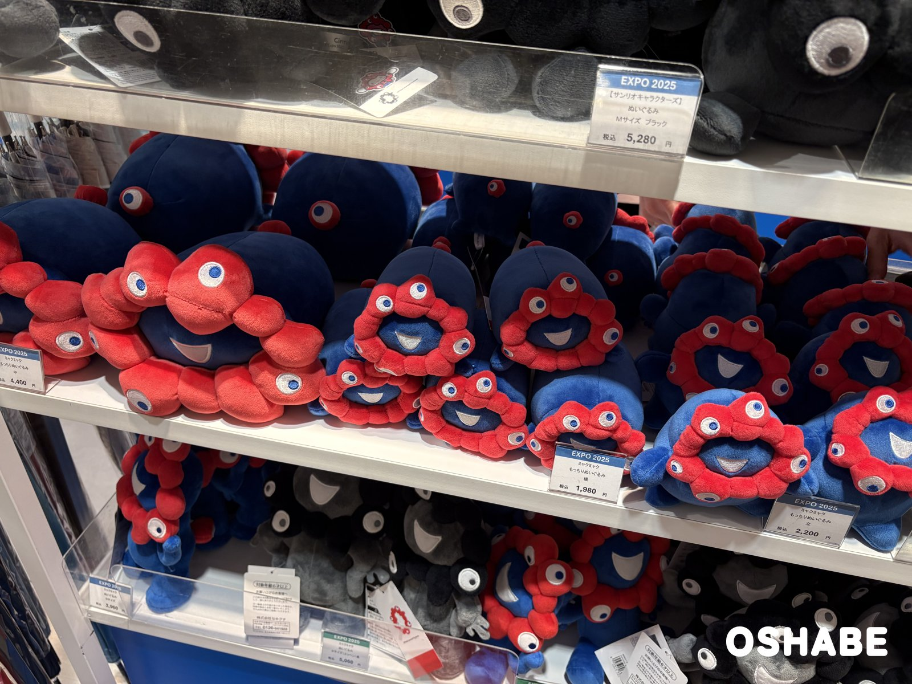
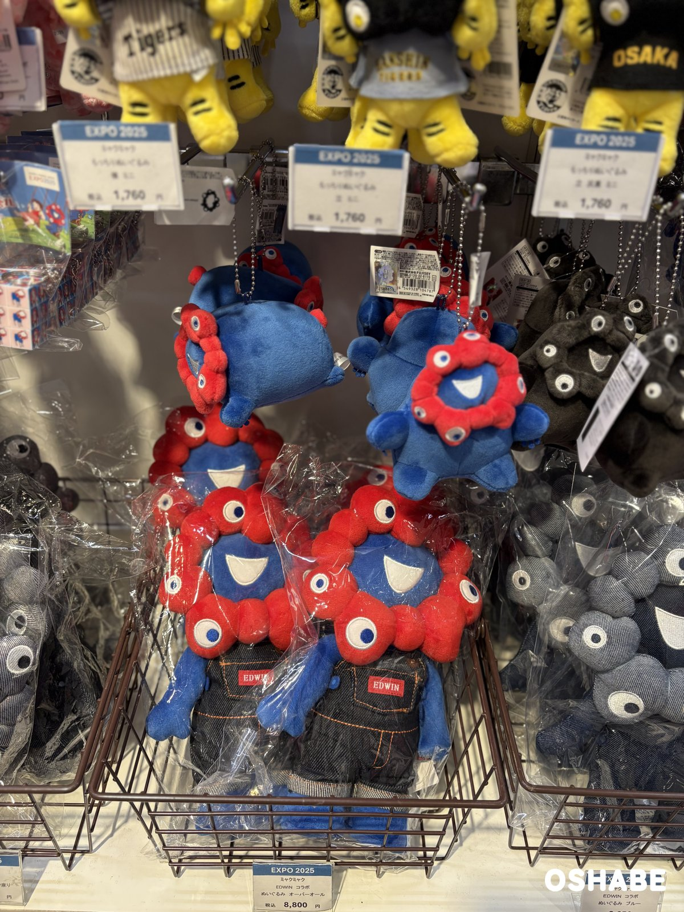
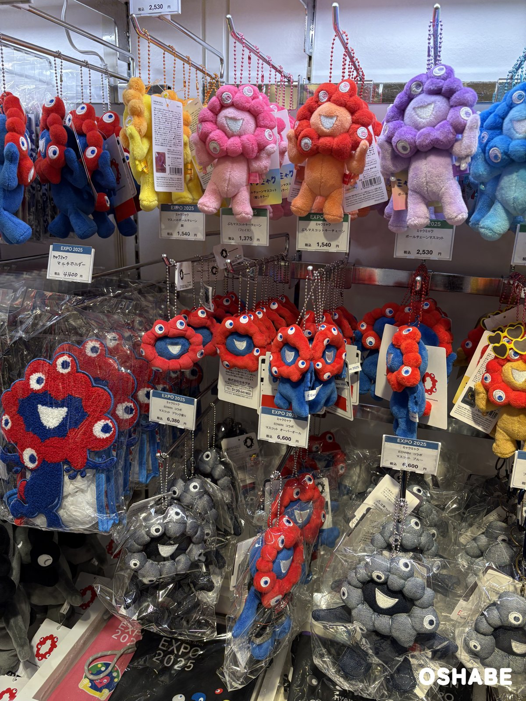

前回は、ミャクミャクのぬいぐるみやポーチを紹介しました☆

今回は、カバンに付けられる小さなマスコットを中心に紹介します。

ミャクミャクは、大阪・関西万博（EXPO 2025）の公式キャラクターです。

万博が終わった今も、ミャクミャクのグッズは売り場にたくさん並んでいます。

小さなマスコットなら、毎日持ち歩けるのがうれしいですよね！

今回は『ミャクミャクのマスコット2026』について紹介していきたいと思います。

 ▼その他ミャクミャクのグッズはコチラ

- [ミャクミャクのグッズ2026【画像・値段】ぬいぐるみ、マスコット、ポーチ](../../../../2026/11/07/myakumyaku-goods/)

## ミャクミャクのマスコット2026【画像一覧】

値段は、店頭の値札に書かれていた税込の値段です（2026年11月6日時点）。

### もっちりぬいぐるみの大きさ

もっちりぬいぐるみ 中・立・横

| 形 | 商品名 | 値段 |
| :--- | :--- | :--- |
| 左の大きなもの | もっちりぬいぐるみ 中 | 税込4,400円 |
| 立った形 | もっちりぬいぐるみ 立 | 税込2,200円 |
| 寝そべった形 | もっちりぬいぐるみ 横 | 税込1,980円 |

赤と青のミャクミャクの「もっちりぬいぐるみ」は、大きさと形がいろいろあります。

ころんと丸い形が、とっても可愛いですよね！

### もっちりぬいぐるみ ミニ

もっちりぬいぐるみ ミニとEDWIN コラボ ぬいぐるみ

「もっちりぬいぐるみ ミニ」は、どれも税込1,760円です。

「横 ミニ」「立 ミニ」と、灰色と黒の「立 灰黒 ミニ」があります。

いちばん小さいサイズで、ボールチェーンが付いています。

カバンに付けると、ミャクミャクがぶら下がって見えます♪

下のかごの「EDWIN コラボ ぬいぐるみ オーバーオール」は、税込8,800円です。

デニムのオーバーオールを着たミャクミャクです。

### マスコットとキーチェーン

ぷちマスコットキーチェーンとボールチェーンマスコット

| 商品名 | 値段 |
| :--- | :--- |
| ぷちマスコットキーチェーン（フェイス） | 税込1,375円 |
| ぷちマスコットキーチェーン | 税込1,540円 |
| マスコットボールチェーン 顔 | 税込1,540円 |
| ボールチェーンマスコット（推しカラー） | 税込2,530円 |
| EDWIN コラボ マスコット オーバーオール | 税込6,600円 |
| EDWIN コラボ マスコット ブルー | 税込6,600円 |

上の段には、カラフルなミャクミャクのマスコットが並んでいました。

「ボールチェーンマスコット（推しカラー）」は、ピンク・オレンジ・紫・水色がありました。

推しの色で選ぶのも楽しいです☆

真ん中の段は、デニムのブランドEDWINとのコラボのマスコットです。

## まとめ

いかがでしたか。

ミャクミャクの小さなマスコットは、もっちりぬいぐるみのミニ、キーチェーン、EDWIN コラボが並んでいました。

値段は、税込1,375円から8,800円までです。

家族や友達とお揃いで付けてみてはいかがでしょうか。

ぜひ参考にしてみてくださいね。
