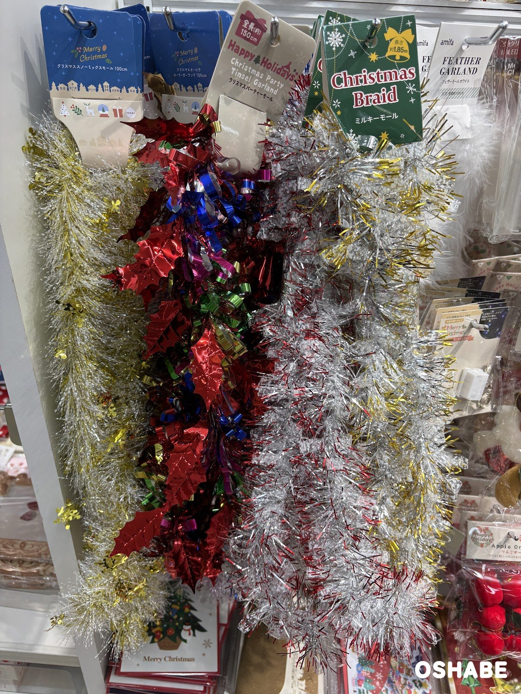
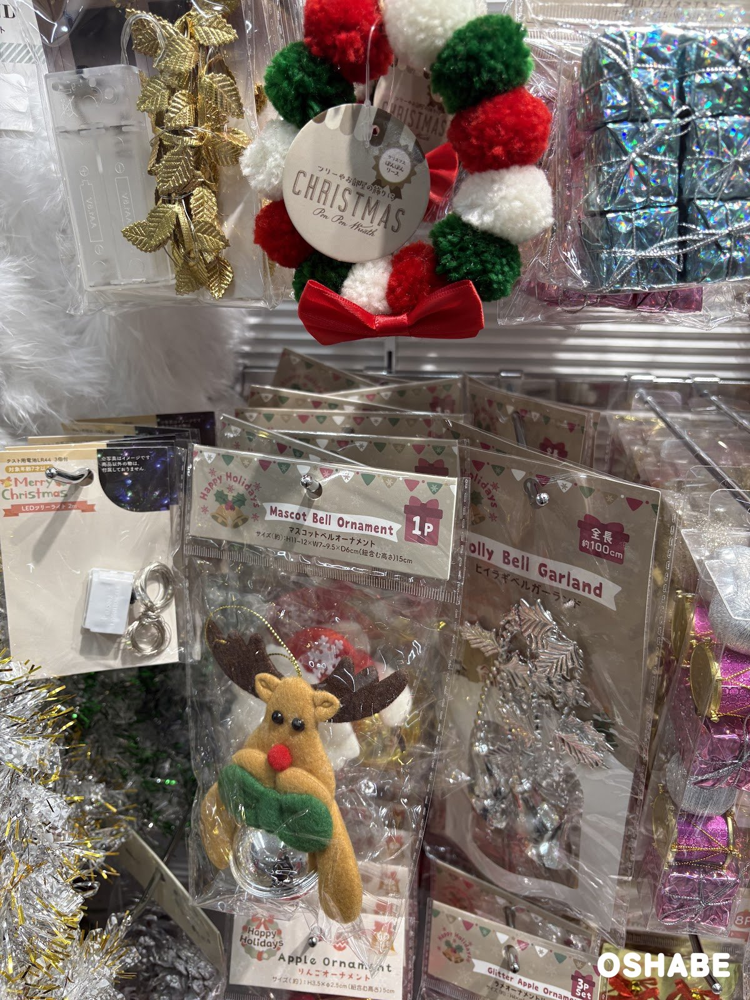
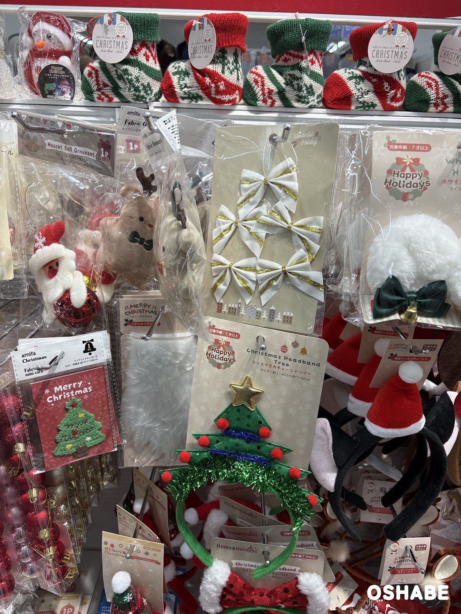
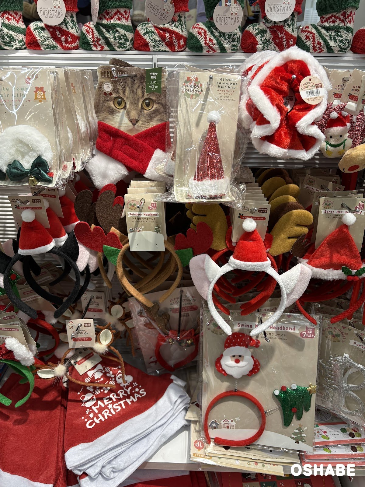
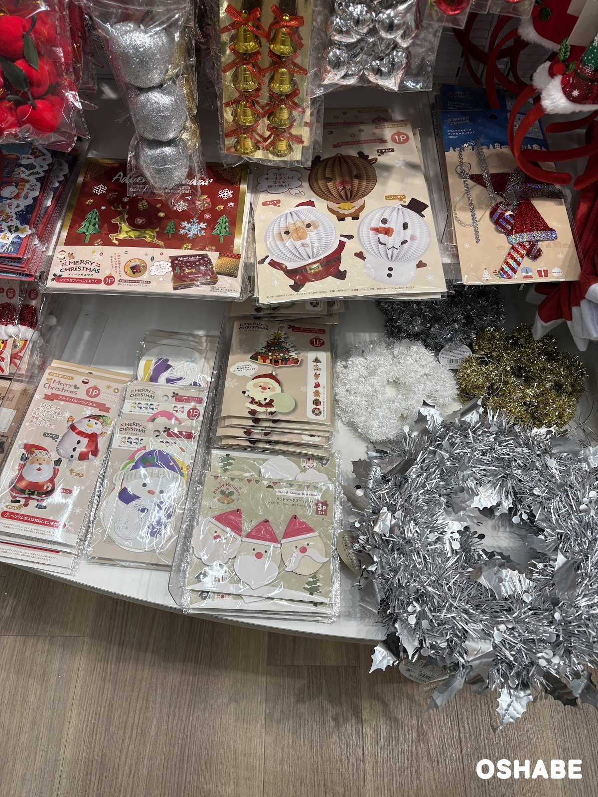
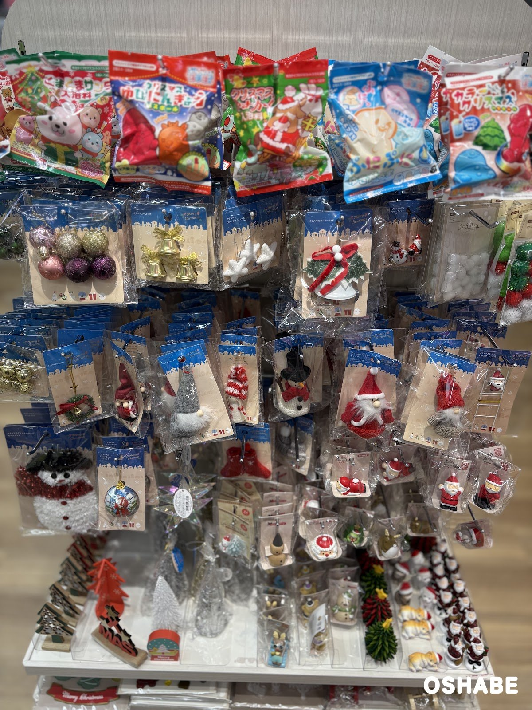
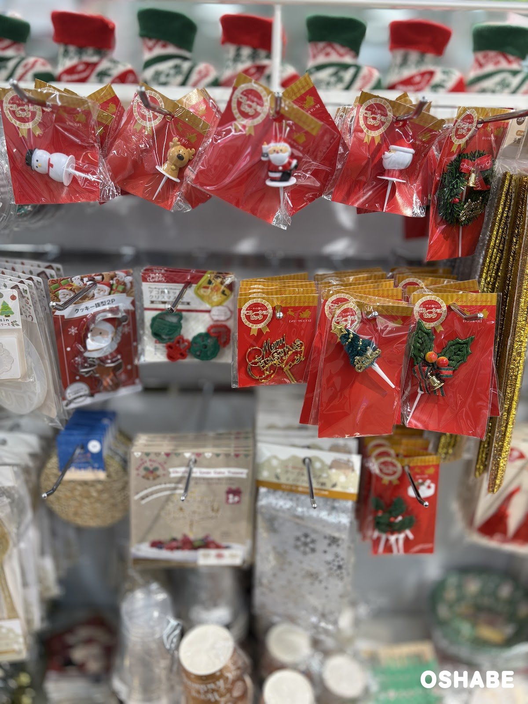
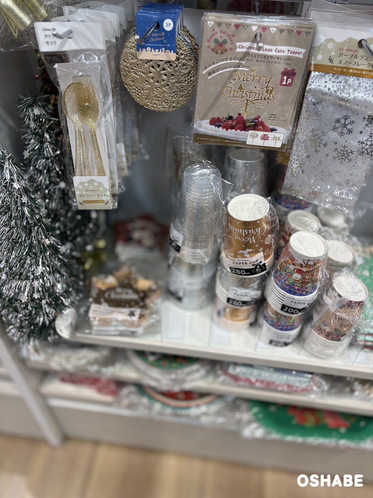

今年もクリスマスの飾り付けの季節がやって来ました☆

ツリーだけでなく、お部屋の壁やテーブルもクリスマスらしく飾りたい方も多いですよね！

100均のセリア（Seria）の売り場には、キラキラのモールやガーランド、ケーキに刺すピックも並んでいました。

今回は『セリアのクリスマス飾り2026』について紹介していきたいと思います。

 ▼セリアのお正月グッズはコチラ

- [セリア100均のポチ袋とお正月飾り2027【画像・値段】だるま、招き猫、獅子舞](../../../../2026/11/14/new-year-pochibukuro-2027/)

## セリアのクリスマス飾り2026【画像一覧】

セリアの商品は、どれも税込110円です。商品名と大きさは、パッケージに書かれていたものです。

### モールとガーランド

クリスマススノーミックスモール、クリスマスオーロラホーリーガーランド、クリスマスパーティーモール、ミルキーモール

左のクリスマススノーミックスモールは、長さ100cmです。白っぽいモールに、金色の雪の結晶の飾りが混ざっています。

隣のクリスマスオーロラホーリーガーランドも、長さ100cmです。赤いヒイラギの葉の形の飾りが連なっています。

真ん中のクリスマスパーティーモールは、全長約150cmです。青や緑、ピンク、赤のくるくるしたテープのモールです。

右のミルキーモール（Christmas Braid）は、長さ約1.85mです。銀色のモールに、赤や金色の細いテープが混ざっています。

右端には、アミファ（amifa）のフェザーモール ホワイトも掛かっていました。ふわふわの白い羽のモールで、全長は約100cmです。

モールは、ツリーに巻いたり、壁や棚のふちに沿わせたりして飾れます。

長さがいろいろあるので、飾る場所に合わせて選べるのが嬉しいです♪

### リースとベルのガーランド

クリスマスぽんぽんリース、マスコットベルオーナメント、ヒイラギベルガーランド

上のクリスマスぽんぽんリースは、赤、白、緑の毛糸のポンポンを輪にしたリースです。下には赤いリボンが付いています。

マスコットベルオーナメント（Mascot Bell Ornament）は、1個入りです。茶色の角のトナカイが、緑のマフラーを巻いて、銀色の鈴を抱えています。大きさは約 高さ11〜12×幅7〜9.5×奥行き6cm で、ひもを含めた高さは約15cmです。

右のヒイラギベルガーランド（Holly Bell Garland）は、全長約100cmです。銀色のヒイラギの葉とベルがつながっています。

左のLEDツリーライトは、長さ2mです。テスト用の電池（LR44）が3個付いています。

ぽんぽんリースは、ツリーに掛けても、お部屋のドアノブに掛けても楽しめそうです。

### ヘアクリップとカチューシャ

ベルベットリボン、クリスマスカチューシャツリー、ファブリックミニカード

ベルベットリボンは、白いリボンに金色のラインが入った5個セットです。ツリーの枝やラッピングの飾りに使えます。

クリスマスカチューシャツリー（Christmas Headband Tree）は、緑のカチューシャです。金色の星をのせたツリーに、赤いポンポンと青いモールが付いています。大きさは約 高さ23×幅17×奥行き2cm で、対象年齢7才以上です。

左のアミファ（amifa）のファブリックミニカードは、赤いカードです。緑のツリーの刺しゅうのワッペンが付いていて、見開きの大きさは約 97×138mmです。

ツリーのカチューシャは、着けるだけで頭の上がクリスマスツリーになります。

ラメサンタハットヘアクリップ、トナカイカチューシャ、猫耳サンタカチューシャ

ラメサンタハットヘアクリップは、赤いラメのサンタ帽子のクリップです。帽子のふちとてっぺんに、白いボアが付いています。

猫耳サンタカチューシャは、白い猫耳の間に小さなサンタ帽子がのっています。黒い猫耳のものもありました。

トナカイカチューシャ（Reindeer Headband）は、フェルトの角のカチューシャです。大きさは約 高さ19×幅22×奥行き1.5cm で、対象年齢7才以上です。

上の段には、小型犬と猫用の赤いマフラーも掛かっていました。首回り約28cm まで着けられます。

家族や友達と、ペットも一緒にお揃いで写真を撮ると楽しそうです☆

### パーティーの飾り

ブック型アドベントBOX、アコーディオンオーナメント、アルミバルーンノエル、ウッドサンタオーナメント

ブック型アドベントBOXは、赤い本の形の箱です。表紙には、金色のトナカイとツリー、雪の結晶が描かれています。中の仕切りに小さなお菓子などを入れて、クリスマスまでの日を数えて楽しめます。

アコーディオンオーナメントは、紙を広げて丸くする飾りです。サンタ、トナカイ、スノーマンの3種類があり、1個入りです。

アルミバルーンノエルは、サンタとスノーマンの形の風船です。膨らませた大きさは約 高さ53〜54.5×横幅36cm で、ヘリウムガスには対応していません。

ペーパーガーランドキットは、紙のパーツとひもを組み合わせて作るガーランドです。スノーマンの絵柄と、サンタやツリーの絵柄がありました。

ウッドサンタオーナメント（Wood Santa Ornament）は、木のサンタの顔の3個セットです。おひげの形が1つずつ違います。

どれも壁に貼ったり吊るしたりするだけなので、子供と一緒に飾り付けができます。

### ツリーのオーナメント

クリスマスベル、クリスマススターオーナメント、クリスマスホーリーベル

クリスマスベルは、金色のリボンが付いた金色のベルの3個セットです。

クリスマススターオーナメントは、白い星の3個セットです。

クリスマスホーリーベルは、白いベルにヒイラギの葉と赤いリボンが付いています。

下の段には、ニットの帽子をかぶったサンタやスノーマンのオーナメントも並んでいました。棚には、小さなツリーやサンタの置物もあります。

小さなオーナメントは、ミニツリーに飾るのにちょうどよい大きさです。

### ケーキのデコレーションピック

デコレーションピック、クッキー抜型

デコレーションピックは、ケーキに刺して飾るピックです。上の段には、スノーマン、トナカイ、サンタ、リースのピックが並んでいました。下の段には、金色の「Merry Christmas」の文字、ツリー、ヒイラギとベルのピックがあります。

左のクッキー抜型は、2個入りです。サンタの形の抜型が見えていました。

いつものケーキも、ピックを刺すだけでクリスマスケーキらしくなります♪

### テーブルの飾り

クリスマスロゴケーキトッパー、カトラリーセット、ペーパーカップ

クリスマスロゴケーキトッパーは、金色の「Merry Christmas」の文字の飾りです。1個入りで、大きさは約 高さ13〜14.5×幅10〜11.5cmです。

左のカトラリーセットは、金色のラメが入ったスプーンとフォークのセットです。

クリスマスミニマットスノーは、金色の雪の結晶の形のマットで、3枚入りです。

右のテーブルランナー スノーフレークは、銀色の雪の結晶の柄で、幅は約20cmです。

アミファ（amifa）のペーパーカップは、280ml と 200ml がありました。金色に白い文字の柄や、サンタの絵の柄があります。

テーブルランナーを敷いて紙コップを並べると、片付けも簡単なパーティーのテーブルになります。

## まとめ

いかがでしたか。

セリアでは、モールとガーランド5種類、リース、カチューシャ、パーティーやテーブルの飾りが並んでいました。

値段は、どれも税込110円です。

12月のクリスマス会の前に、お部屋とテーブルの飾りをまとめて揃えてみてはいかがでしょうか。

ぜひ参考にしてみてくださいね。

## 他のクリスマス関連はこちら

▼2026年のクリスマスグッズ

- [ダイソー100均のクリスマスカチューシャ2026【画像・値段】サンタ、トナカイ](../../../../2026/11/03/daiso-christmas-headband/)
- [ダイソー100均のサンタコスプレ2026【画像・値段】子供のサンタ服、ワンピース](../../../../2026/11/09/daiso-santa-costume-2026/)
- [ダイソー100均のクリスマス雑貨2026【画像・値段】スノードーム、オブジェ](../../../../2026/11/04/daiso-christmas-2026/)
- [セリア100均のクリスマスシール2026【画像・値段】フレーク、マスキングテープ](../../../../2026/11/19/seria-christmas-stickers-2026/)
- [セリア100均のクリスマスカード2026【画像・値段】メロディカード、ポチ袋](../../../../2026/11/21/seria-christmas-cards-2026/)
- [セリア100均のクリスマス仮装2026【画像・値段】カチューシャ、ぬい服、ペット](../../../../2026/11/22/seria-christmas-headband-2026/)
- [ワッツ100均のクリスマス2026【画像・値段】オーナメント、カチューシャ](../../../../2026/11/02/xmas-ornament-headband/)
- [ニトリ デコホームのクリスマス飾り2026【画像・値段】ツリー、オーナメント](../../../../2026/11/16/nitori-christmas-2026/)
- [無印良品のクリスマスお菓子2026【画像・値段】バウムリース、ヘクセンハウス](../../../../2026/11/12/muji-christmas-sweets/)
- [フランフランのクリスマスツリー2026【画像・値段】スターターセット](../../../../2026/11/15/francfranc-christmas-tree-2026/)
- [フランフランのクリスマス2026【画像・値段】リース、ノルディックサンタ](../../../../2026/11/18/francfranc-christmas-2026/)
- [ナチュラルキッチンのクリスマス食器2026【画像・値段】サンタの皿、箸置き、紙皿](../../../../2026/11/17/christmas-tableware-2026/)
- [アフタヌーンティーのクリスマス2026【画像・値段】紅茶、LEDライト](../../../../2026/11/06/afternoon-tea-christmas-2026/)
- [LAKOLE（ラコレ）のクリスマス2026【画像・値段】リース、ツリー](../../../../2026/11/11/lakole-christmas-2026/)
- [TOP TOYのMayMei2026【画像・値段】冬のぬいぐるみ、がま口](../../../../2026/11/10/toptoy-maymei-winter/)

▼クリスマスの記事をまとめて見る

- [クリスマスの記事の一覧](../../../../category/xmas/)
