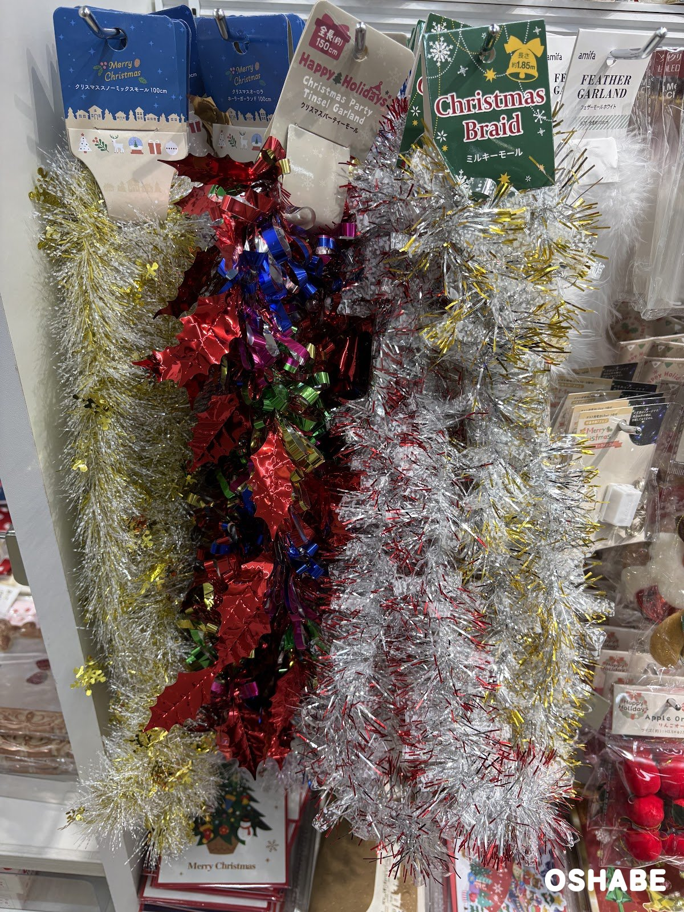
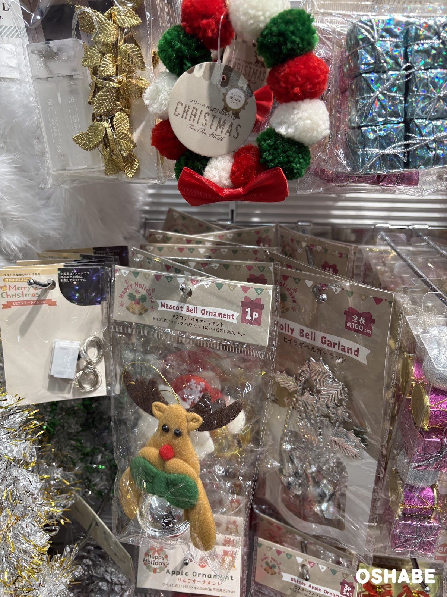
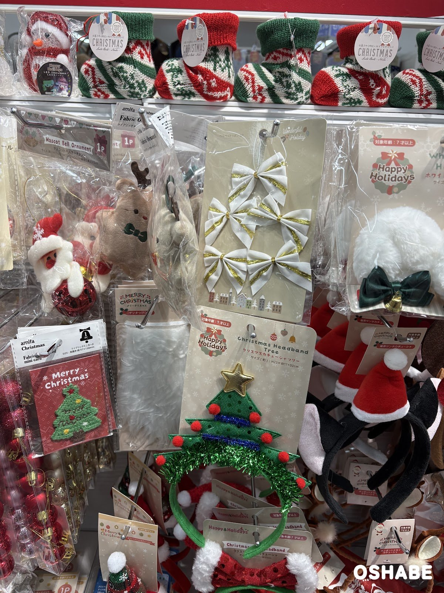
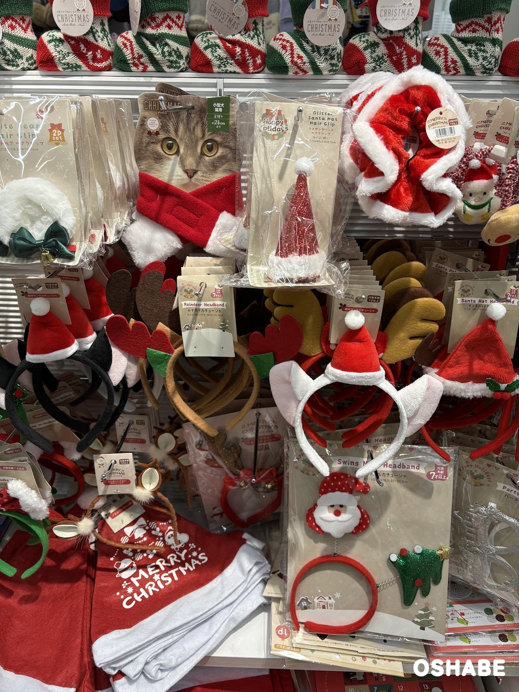
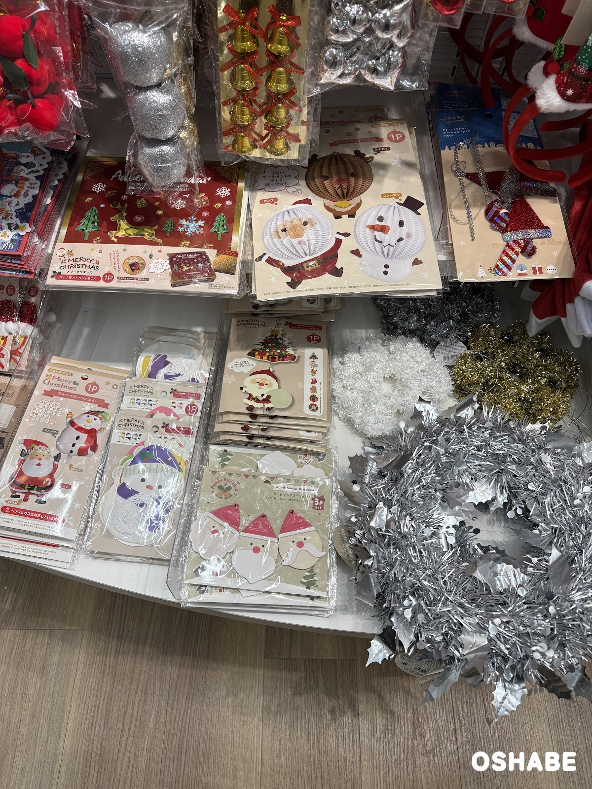
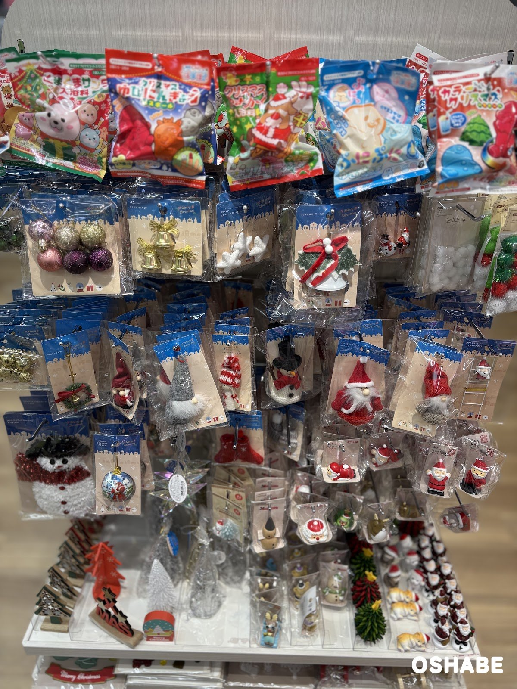
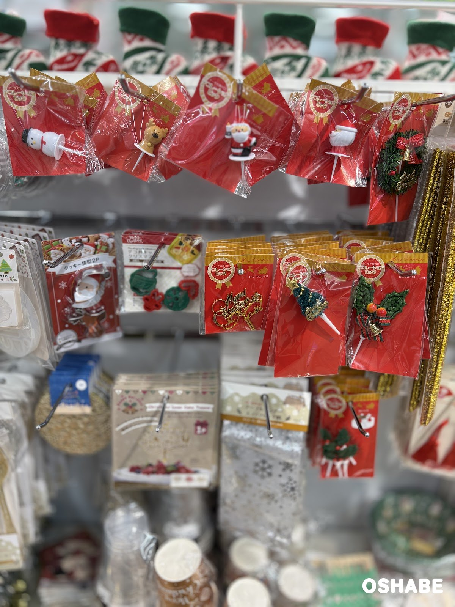
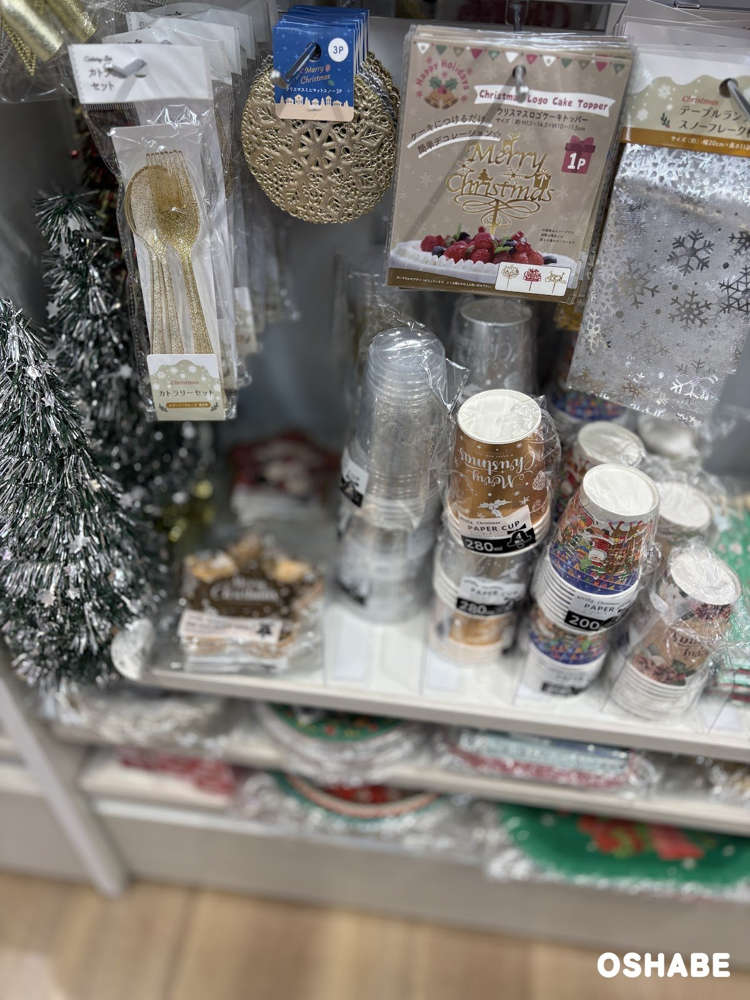

今年もクリスマスの飾り付けの季節がやって来ました☆

ツリーだけでなく、お部屋の壁やテーブルもクリスマスらしく飾りたい方も多いですよね！

セリア（Seria）の売り場には、キラキラのモールやガーランド、ケーキに刺すピックも並んでいました。

今回は『セリアのクリスマス飾り2026』について紹介していきたいと思います。

 ▼その他クリスマスグッズ2026はコチラ

- [ワッツのクリスマス2026【画像・値段】オーナメント、カチューシャ、リース](../../../../2026/11/02/xmas-ornament-headband/)
- [ダイソーのクリスマス雑貨2026【画像・値段】ウッドオブジェ、スノードーム](../../../../2026/11/04/daiso-christmas-2026/)
- [LAKOLE（ラコレ）のクリスマス2026【画像・値段】リース、ツリー](../../../../2026/11/11/lakole-christmas-2026/)

## セリアのクリスマス飾り2026【画像一覧】

セリアの商品は、どれも税込110円です（2026年11月13日時点）。商品名と大きさは、パッケージに書かれていたものです。

### モールとガーランド

クリスマススノーミックスモール、クリスマスパーティーモール、ミルキーモール

左のクリスマススノーミックスモールは、長さ100cm です。
白っぽいモールに、金色の雪の結晶の飾りが混ざっています。

隣のクリスマスオーロラホーリーガーランドも、長さ100cm です。

真ん中のクリスマスパーティーモールは、全長約150cm です。
赤いヒイラギの葉に、青や緑、ピンクのくるくるしたテープが付いています。

右のミルキーモール（Christmas Braid）は、長さ約1.85m です。
銀色のモールに、赤や金色の細いテープが混ざっています。

右端には、アミファ（amifa）のフェザーモール ホワイトも掛かっていました。
ふわふわの白い羽のモールで、全長は約100cm です。

モールは、ツリーに巻いたり、壁や棚のふちに沿わせたりして飾れます。

長さがいろいろあるので、飾る場所に合わせて選べるのが嬉しいです♪

### リースとベルのガーランド

クリスマスぽんぽんリース、マスコットベルオーナメント、ヒイラギベルガーランド

上のクリスマスぽんぽんリースは、赤、白、緑の毛糸のポンポンを輪にしたリースです。
下には赤いリボンが付いています。

マスコットベルオーナメント（Mascot Bell Ornament）は、1個入りです。
茶色の角のトナカイが、緑のマフラーを巻いて、銀色の鈴を抱えています。
大きさは約 高さ11〜12×幅7〜9.5×奥行き6cm で、ひもを含めた高さは約15cm です。

右のヒイラギベルガーランド（Holly Bell Garland）は、全長約100cm です。
銀色のヒイラギの葉とベルがつながっています。

左のLEDツリーライトは、長さ2m です。
テスト用の電池（LR44）が3個付いています。

ぽんぽんリースは、ツリーに掛けても、お部屋のドアノブに掛けても楽しめそうです。

### ヘアクリップとカチューシャ

ベルベットリボン、クリスマスカチューシャツリー、ファブリックミニカード

ベルベットリボンは、白いリボンに金色のラインが入った5個セットです。
ツリーの枝やラッピングの飾りに使えます。

クリスマスカチューシャツリー（Christmas Headband Tree）は、緑のカチューシャです。
金色の星をのせたツリーに、赤いポンポンと青いモールが付いています。
大きさは約 高さ23×幅17×奥行き2cm で、対象年齢7才以上です。

左のアミファ（amifa）のファブリックミニカードは、赤いカードです。
緑のツリーの刺しゅうのワッペンが付いていて、見開きの大きさは約 97×138mm です。

ツリーのカチューシャは、着けるだけで頭の上がクリスマスツリーになります。

ラメサンタハットヘアクリップ、トナカイカチューシャ、猫耳サンタカチューシャ

ラメサンタハットヘアクリップは、赤いラメのサンタ帽子のクリップです。
帽子のふちとてっぺんに、白いボアが付いています。

猫耳サンタカチューシャは、白い猫耳の間に小さなサンタ帽子がのっています。
黒い猫耳のものもありました。

トナカイカチューシャ（Reindeer Headband）は、フェルトの角のカチューシャです。
大きさは約 高さ19×幅22×奥行き1.5cm で、対象年齢7才以上です。

上の段には、小型犬と猫用の赤いマフラーも掛かっていました。
首回り約28cm まで着けられます。

家族や友達と、ペットも一緒にお揃いで写真を撮ると楽しそうです☆

### パーティーの飾り

ブック型アドベントBOX、アコーディオンオーナメント、アルミバルーンノエル、ウッドサンタオーナメント

ブック型アドベントBOXは、赤い本の形の箱です。
表紙には、金色のトナカイとツリー、雪の結晶が描かれています。
中の仕切りに小さなお菓子などを入れて、クリスマスまでの日を数えて楽しめます。

アコーディオンオーナメントは、紙を広げて丸くする飾りです。
サンタ、トナカイ、スノーマンの3種類があり、1個入りです。

アルミバルーンノエルは、サンタとスノーマンの形の風船です。
膨らませた大きさは約 高さ53〜54.5×横幅36cm で、ヘリウムガスには対応していません。

ペーパーガーランドキットは、紙のパーツとひもを組み合わせて作るガーランドです。
スノーマンの絵柄と、サンタやツリーの絵柄がありました。

ウッドサンタオーナメント（Wood Santa Ornament）は、木のサンタの顔の3個セットです。
おひげの形が1つずつ違います。

どれも壁に貼ったり吊るしたりするだけなので、子供と一緒に飾り付けができます。

### ツリーのオーナメント

クリスマスベル、クリスマススターオーナメント、クリスマスホーリーベル

クリスマスベルは、金色のリボンが付いた金色のベルの3個セットです。

クリスマススターオーナメントは、白い星の3個セットです。

クリスマスホーリーベルは、白いベルにヒイラギの葉と赤いリボンが付いています。

下の段には、ニットの帽子をかぶったサンタやスノーマンのオーナメントも並んでいました。
棚には、小さなツリーやサンタの置物もあります。

小さなオーナメントは、ミニツリーに飾るのにちょうどよい大きさです。

### ケーキのデコレーションピック

デコレーションピック、クッキー抜型

デコレーションピックは、ケーキに刺して飾るピックです。
上の段には、スノーマン、トナカイ、サンタ、リースのピックが並んでいました。
下の段には、金色の「Merry Christmas」の文字、ツリー、ヒイラギとベルのピックがあります。

左のクッキー抜型は、2個入りです。
サンタの形の抜型が見えていました。

いつものケーキも、ピックを刺すだけでクリスマスケーキらしくなります♪

### テーブルの飾り

クリスマスロゴケーキトッパー、カトラリーセット、ペーパーカップ

クリスマスロゴケーキトッパーは、金色の「Merry Christmas」の文字の飾りです。
1個入りで、大きさは約 高さ13〜14.5×幅10〜11.5cm です。

左のカトラリーセットは、金色のラメが入ったスプーンとフォークのセットです。

クリスマスミニマットスノーは、金色の雪の結晶の形のマットで、3枚入りです。

右のテーブルランナー スノーフレークは、銀色の雪の結晶の柄で、幅は約20cm です。

アミファ（amifa）のペーパーカップは、280ml と 200ml がありました。
金色に白い文字の柄や、サンタの絵の柄があります。

テーブルランナーを敷いて紙コップを並べると、片付けも簡単なパーティーのテーブルになります。

## まとめ

いかがでしたか。

セリアでは、モールとガーランド5種類、リース、カチューシャ、パーティーやテーブルの飾りが並んでいました。

値段は、どれも税込110円です。

12月のクリスマス会の前に、お部屋とテーブルの飾りをまとめて揃えてみてはいかがでしょうか。

ぜひ参考にしてみてくださいね。
