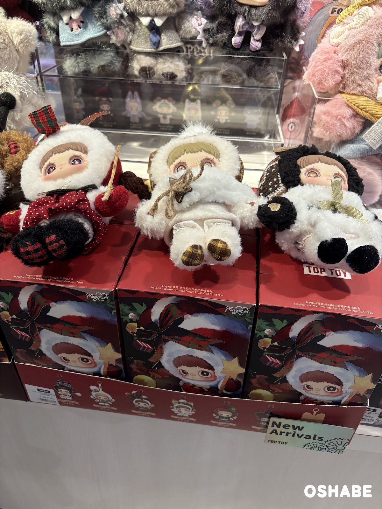
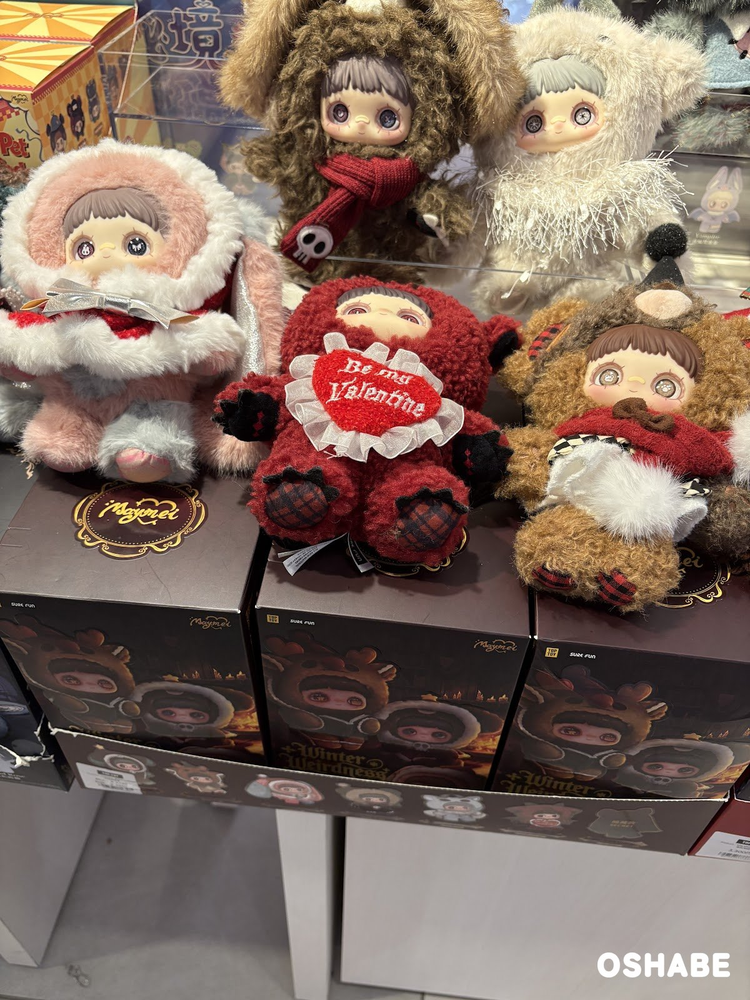
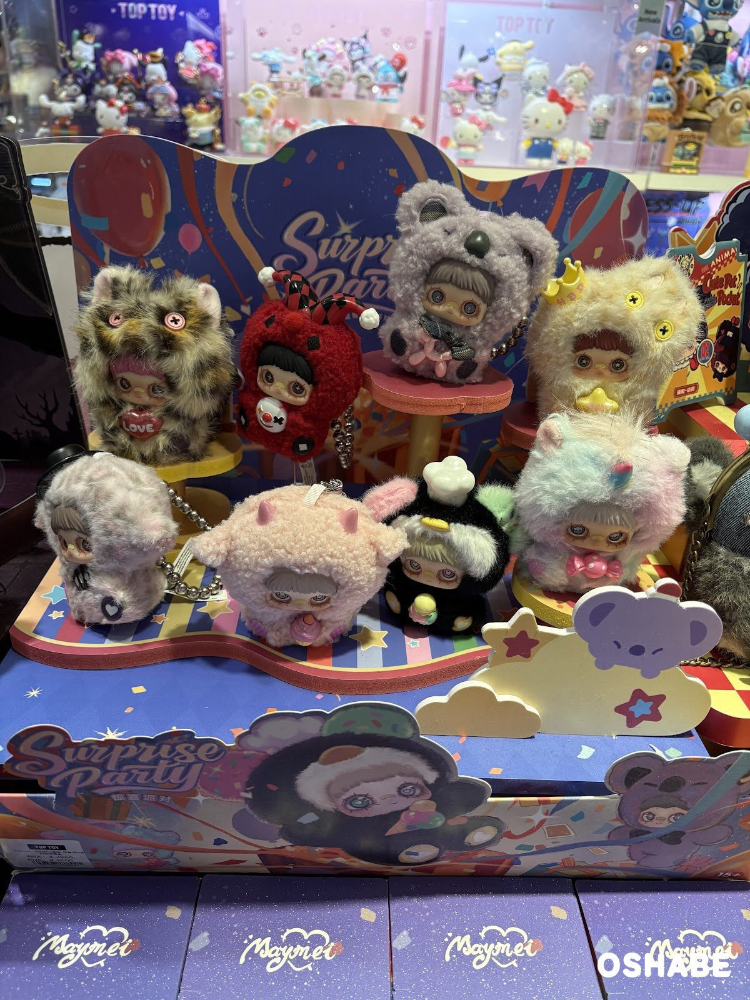
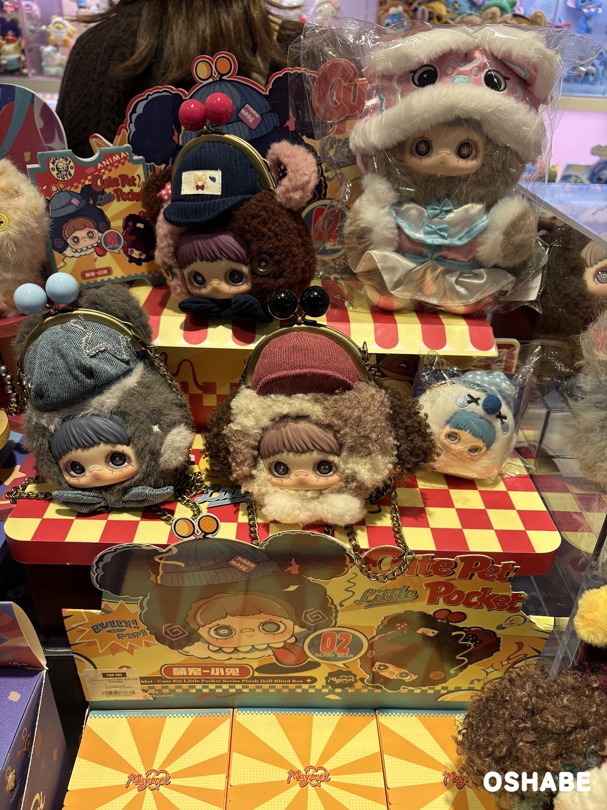

寒くなってきて、ふわふわのぬいぐるみが恋しい季節になりましたね☆

TOP TOYで、MayMeiのぬいぐるみがずらりと並んでいました。

MayMeiは、大きな目の子が動物の着ぐるみのようなフードをかぶったキャラクターです。

どれもブラインドボックスで、箱を開けるまでどのデザインが入っているか分かりません。

1つのシリーズに6〜7種類のデザインがあり、その中からランダムで1つが入っています。

何が出るかドキドキするのも楽しいですよね！

今回は『TOP TOYのMayMei2026』について紹介していきたいと思います。

## TOP TOYのMayMei2026【画像一覧】

値段は、店頭の値札に書かれていた税込の値段です（2026年11月9日時点）。

### Winter Promise

MayMei Winter Promise Series Plush Doll Blind Box

税込3,300円です。

今年（2026年）のクリスマスのシリーズです。

白いふわふわのフードに、赤や茶色のチェックのリボンを合わせた3体が、箱の上に並んでいました。
箱の絵の子は、金色の星のステッキを持っています。
売り場には「New Arrivals」の札も立っていました。

クリスマスの時期に、棚に並べて飾るのにも合いそうです。

白と赤の組み合わせが、冬らしくて素敵です♪

### Winter Weirdness

MayMei Winter Weirdness

去年（2025年）のハロウィンのシリーズです。

値札の文字は写真では読み取れず、公式の値段も見つかりませんでした。

箱には、ハートの形の角が付いたトナカイのようなフードの子が描かれています。
見本には、「Be my Valentine」のハートを抱えた赤いもこもこの子がいました。
ドクロの付いた赤いマフラーを巻いた、茶色の子もいます。

少し変わったデザインを集めている方のコレクションにも良さそうです。

甘さと不思議さが混ざった、くすんだ色合いが魅力です。

### Surprise Party

MayMei Surprise Party

値札は「税込 2,860円」「税抜 2,600円」です。

見本の8体は、パステルカラーや豹柄のふわふわの着ぐるみ姿です。
「LOVE」のハートを持つ子や、王冠を付けた子、ピエロのような帽子の子がいました。
上にボールチェーンが付いていて、ぶら下げられる作りです。
箱には「15+」と書かれていて、15歳以上向けの商品です。

かばんに付けて持ち歩くのにも良さそうです。

パーティーのような明るい色で、見ているだけで楽しくなります♪

### Cute Pet Little Pocket

MayMei Cute Pet Little Pocket Series Plush Doll Blind Box

税込3,080円です。

頭の上にがま口の口金が付いた、ポーチの形のぬいぐるみです。
ニット帽やデニムの帽子をかぶった子がいて、細いチェーンも付いています。

チェーンで提げて、小さなポシェットのように使えそうです。

ころんとした形で、小銭やリップを入れて出かけたくなります。

## まとめ

いかがでしたか。

TOP TOYでは、MayMeiのぬいぐるみのブラインドボックスが4種類並んでいました。

値札で値段が分かった3種類は、税込2,860円から3,300円までです。

クリスマスのプレゼントや、自分へのご褒美にもぴったりです。

ぜひ参考にしてみてくださいね。
