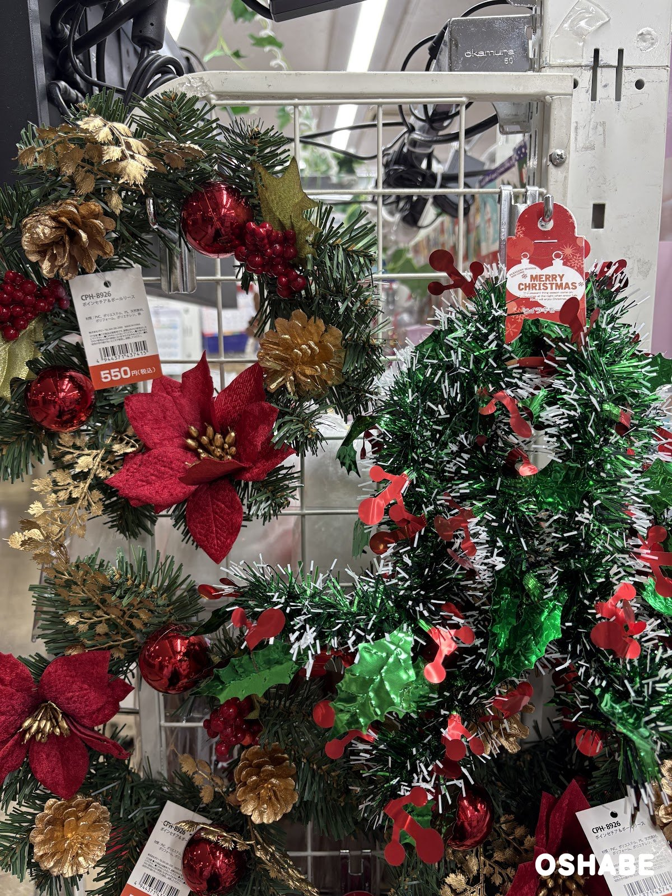
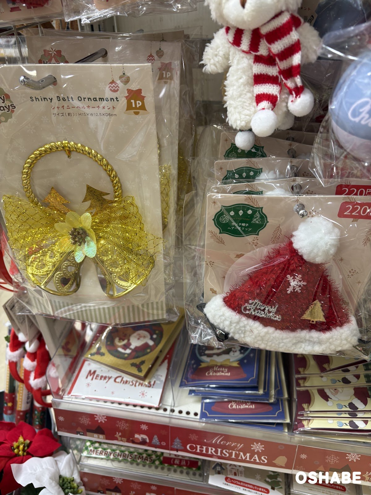
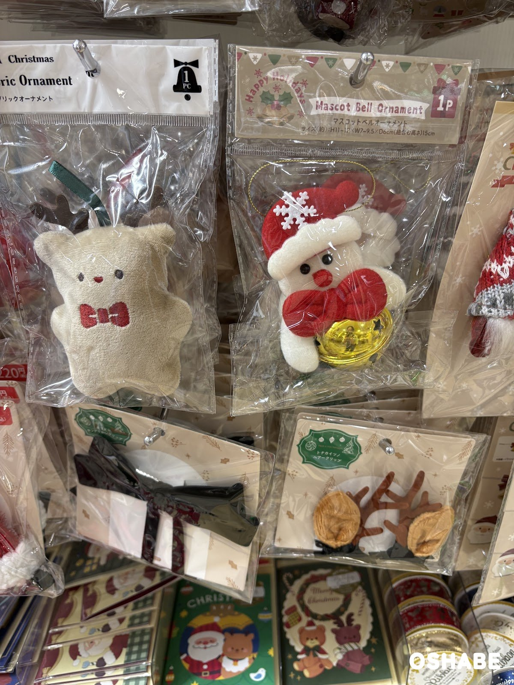
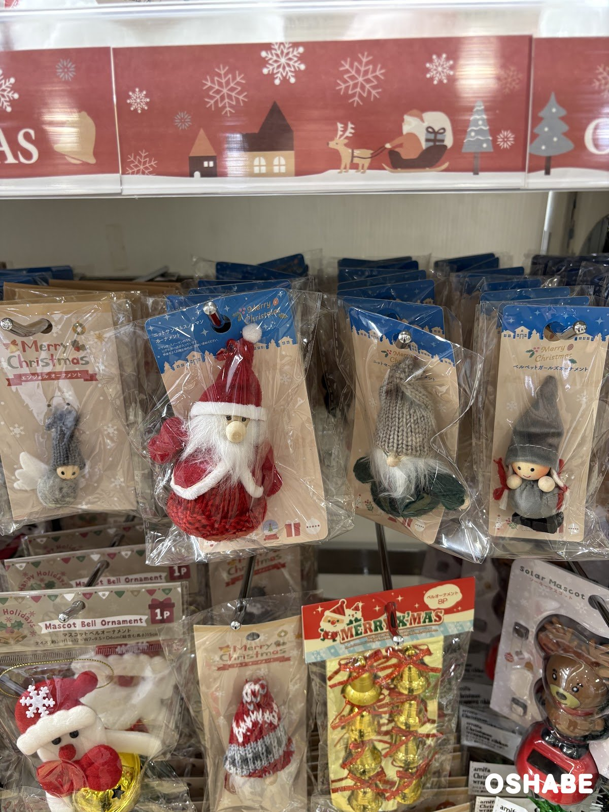
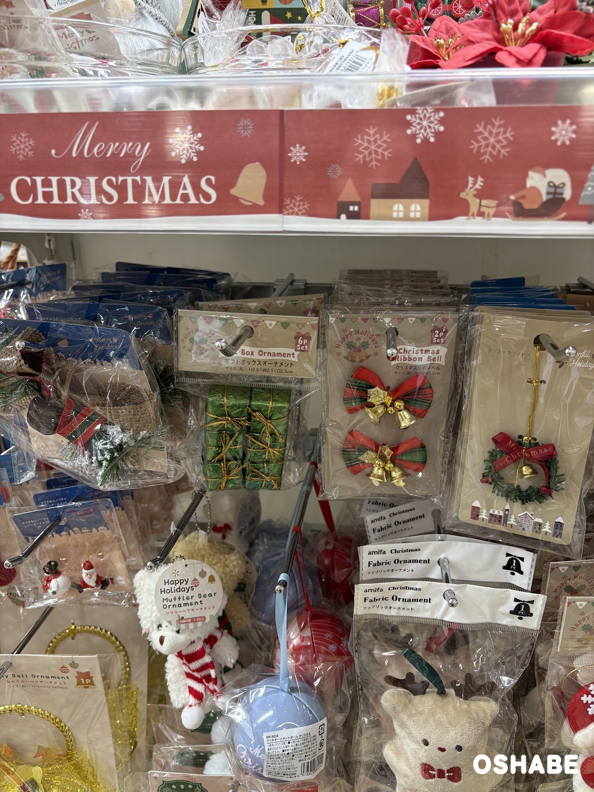
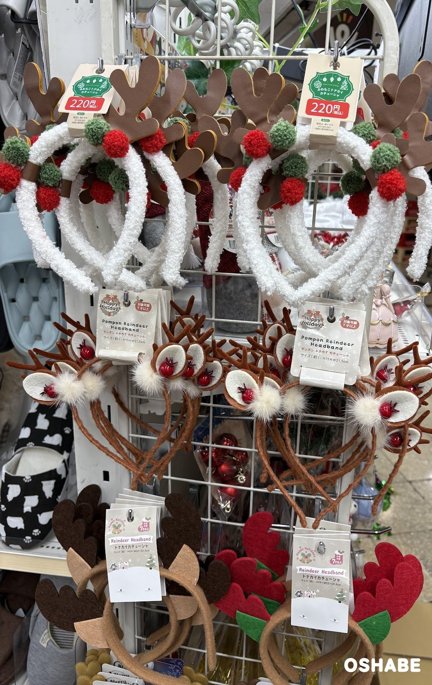
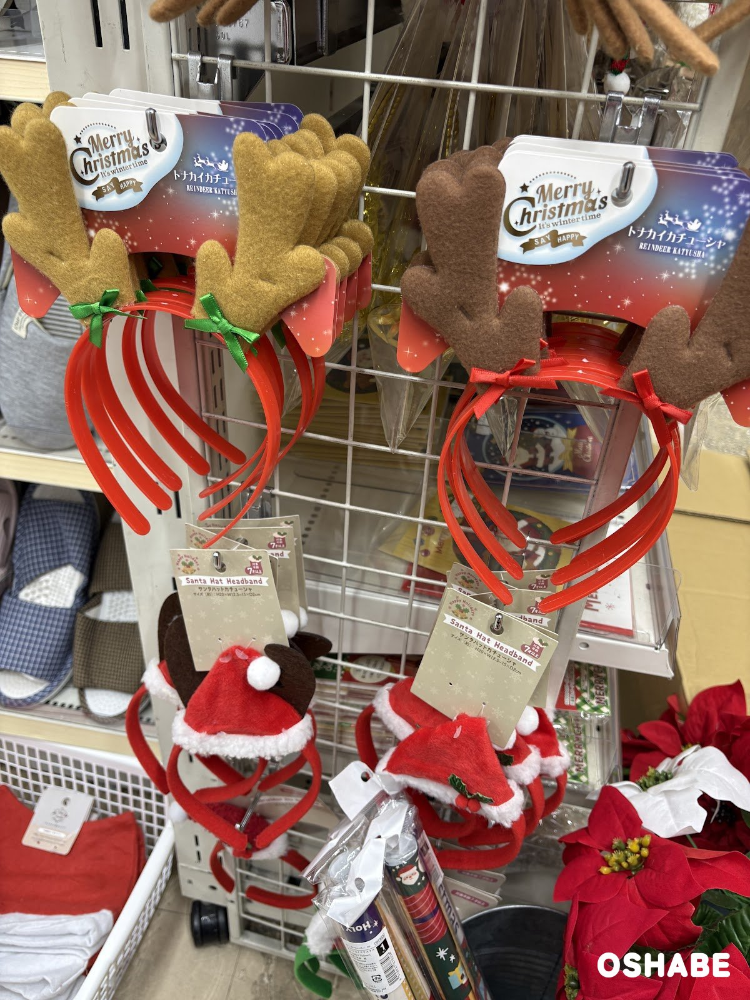

11月に入って、売り場がすっかりクリスマスの色になってきました☆

ツリーに飾るオーナメントや、パーティーで着けるカチューシャを探している方も多いですよね！

雑貨の売り場に、リースやオーナメント、トナカイのカチューシャがずらりと並んでいました。

今回は『クリスマスのオーナメントとカチューシャ2026』について紹介していきたいと思います。

## クリスマスのオーナメントとカチューシャ2026【画像一覧】

値段は、店頭の値札に書かれていた税込の値段です（2026年11月10日時点）。

### リース

ポインセチア＆ボールリース

税込550円です。

緑の葉に、赤いポインセチアの花と赤いボール、金色の松ぼっくりが付いています。
赤い実や金色の葉の飾りもあって、華やかなリースです。

玄関のドアや壁に掛けると、お部屋の入口が一気にクリスマスらしくなります。

赤と金の組み合わせで、ちょっと豪華に見えるのが嬉しいです。

### ベルのオーナメント

シャイニーベルオーナメント（Shiny Bell Ornament）

金色のベルに、金色のネットのリボンと小さな花が付いた1個入りのオーナメントです。
上には、ねじった金色の輪とツリーの飾りもあります。
大きさは約 縦15×横12.5×奥行き6cm です。

ツリーのてっぺん近くや、ドアノブに掛けて飾れます。

キラキラした金色で、飾るだけでパッと明るくなりますよ。

右に並んでいたのは「サンタ帽子ヘアークリップ」で、値札は税込220円です。
赤いもこもこの帽子に、白いボアのふちとポンポンが付いたヘアクリップです。
帽子には、雪の結晶と金色のツリー、「Merry Christmas」の文字の飾りがあります。

マスコットベルオーナメント（Mascot Bell Ornament）

赤い帽子と赤い蝶ネクタイのスノーマンが、金色の鈴を抱えたオーナメントです。
大きさは約 縦11〜12×横7〜9.5×奥行き6cm で、ひもを含めた高さは約15cm です。

左には、アミファ（amifa）の「ファブリックオーナメント」も並んでいました。
こちらは赤い蝶ネクタイを刺しゅうした、角のあるくまの形のふわふわしたオーナメントです。

ツリーに吊るしても、かばんに付けても楽しめそうです。

ころんとした形で、思わず手に取りたくなります♪

下の段には、茶色の角とベージュの耳が付いた「トナカイツノヘアークリップ」もありました。
髪に留めるだけなので、カチューシャが苦手な子供にも使いやすそうです。

### ニットとベルベットのオーナメント

ニットサンタ＆スノーマンオーナメント、ベルベットガールズオーナメント

ニットサンタ＆スノーマンオーナメントは、赤いニットの体に白いおひげのサンタさんです。
ベルベットガールズオーナメントは、グレーのとんがり帽子をかぶり、赤と白の三つ編みをした女の子です。
左には、白い羽の付いた「エンジェルオーナメント」もあります。

下の段には、金色の鈴が8個入った「ベルオーナメント」も掛かっていました。

木の顔に、ニットやベルベットの服を合わせた、北欧のような雰囲気のオーナメントです。

ツリーの枝に並べて吊るすと、小人たちが集まったように見えそうです。

### 小さなオーナメントとマフラーベア

ギフトボックスオーナメント、クリスマスリボンベル、マフラーベアオーナメント

ギフトボックスオーナメントは、金色のひもを掛けた緑のプレゼントの箱の6個セットです。
1個の大きさは約 縦2.5×横2.5×奥行き2.5cm です。
クリスマスリボンベルは、赤と緑のチェックのリボンに金色のベルが付いた2個セットです。

マフラーベアオーナメント（Muffler Bear Ornament）は、赤と白のしま模様のマフラーを巻いた白いくまです。
こちらは対象年齢7才以上です。

小さな箱やリボンベルは、ミニツリーやラッピングの飾りにも使えます。

### トナカイのカチューシャ

ふわもこトナカイカチューシャ

税込220円です。

白いもこもこのカチューシャに、茶色の角と、赤と緑のポンポンが付いています。

ポンポントナカイカチューシャ（Pompon Reindeer Headband）は、真ん中の段に並んでいたカチューシャです。
トナカイの顔に、赤い鼻と白いファーのポンポンが付いています。
大きさは約 縦15×横21.5cm で、対象年齢7才以上です。

下の段の「トナカイカチューシャ（Reindeer Headband）」は、フェルトの角のカチューシャです。
角の色は、茶色とベージュの組み合わせと、赤と緑の組み合わせがありました。

トナカイカチューシャ

こちらは、赤いカチューシャにフェルトの角が付いたトナカイカチューシャです。
角は明るい茶色と濃い茶色の2色で、根元にリボンが結んであります。

下には、赤い帽子の「サンタハットカチューシャ（Santa Hat Headband）」もありました。
大きさは約 縦20×横12.5〜15×奥行き2cm で、こちらも対象年齢7才以上です。

家族や友達と色違いで着けると、クリスマス会の写真が楽しくなりそうです♪

## まとめ

いかがでしたか。

リース、ベルやニットのオーナメント、ヘアクリップ2種、トナカイやサンタのカチューシャが並んでいました。

値札で見た値段は、税込220円から550円までです。

12月のクリスマス会の前に、飾りと仮装のグッズをまとめて揃えてみてはいかがでしょうか。

ぜひ参考にしてみてくださいね。
