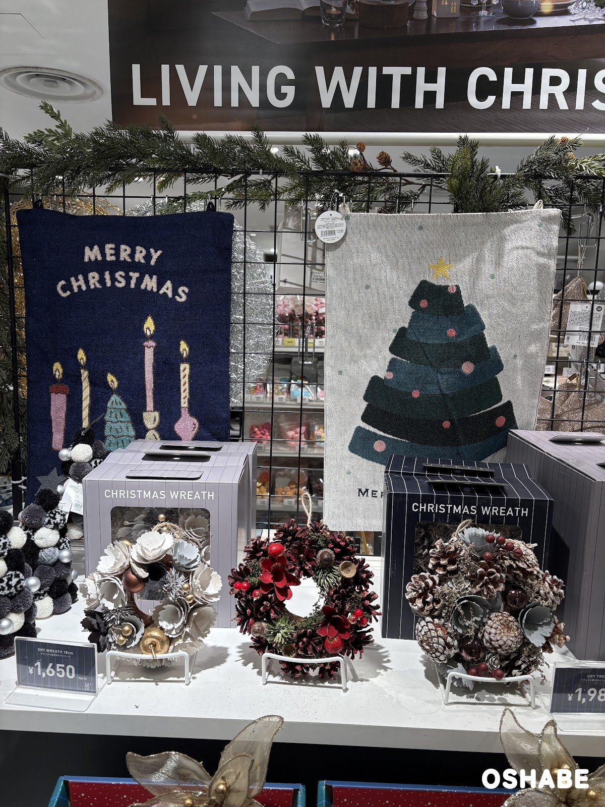
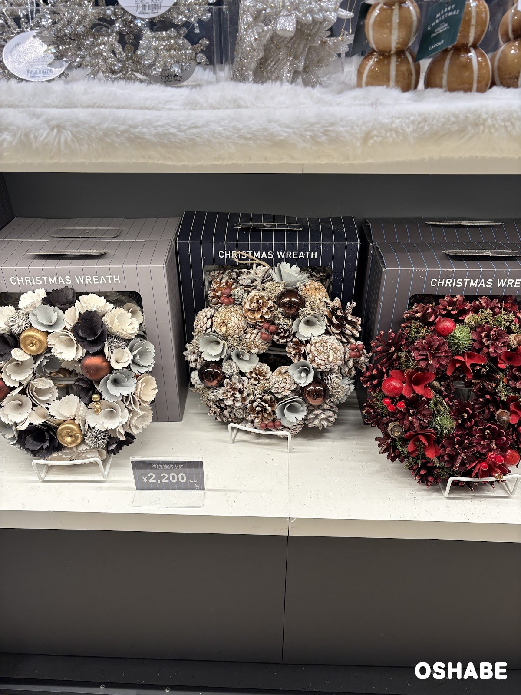
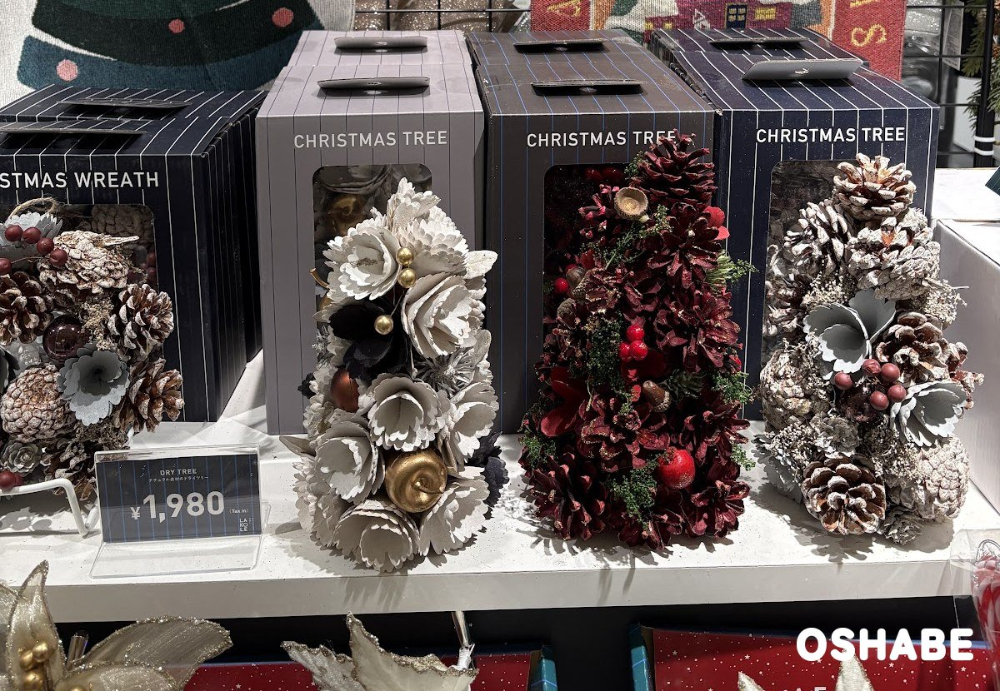
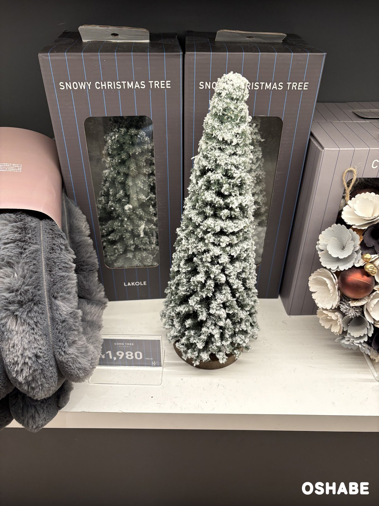
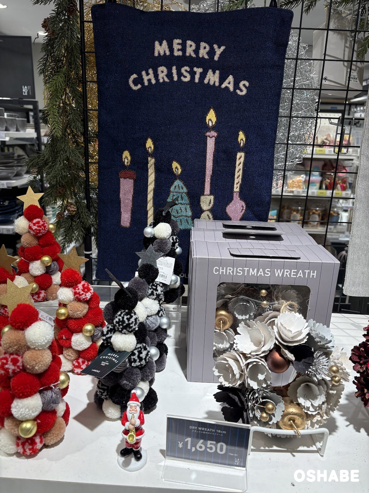
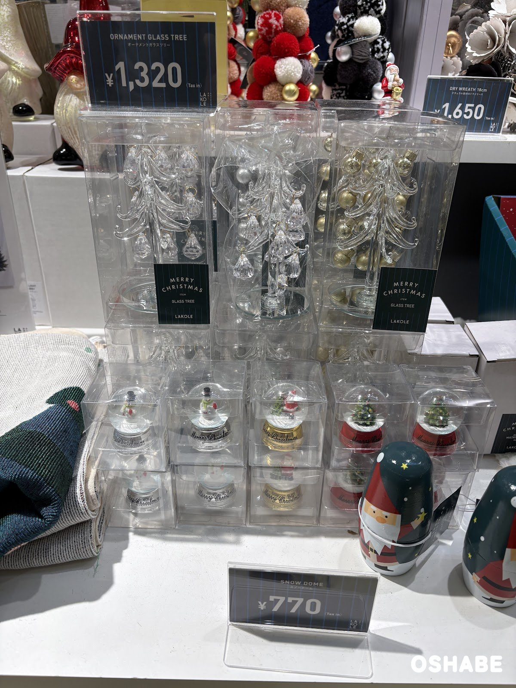
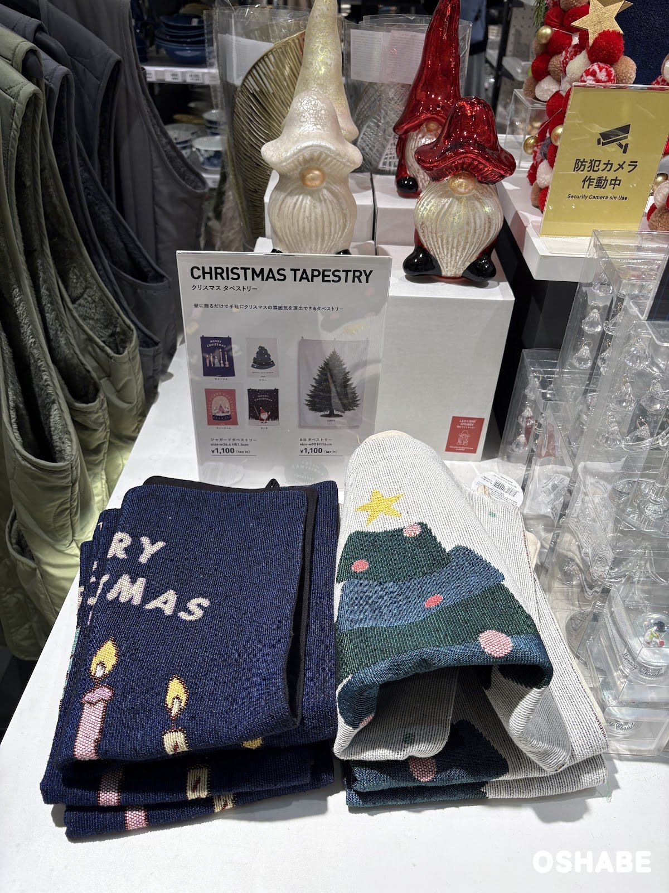

今年もクリスマスの飾りの季節がやって来ました☆

LAKOLE（ラコレ）に行ったら、クリスマスの売り場ができていました。

売り場には「LIVING WITH CHRISTMAS」の看板があり、リースやツリーがずらりと並んでいました。

お部屋を少しだけクリスマスらしくしたい方も多いですよね！

今回は『LAKOLEのクリスマス2026』について紹介していきたいと思います。

 ▼その他クリスマスグッズ2026はコチラ

- [ダイソーのクリスマス雑貨2026【画像・値段】ウッドオブジェ、スノードーム](../../../../2026/11/04/daiso-christmas-2026/)
- [ダイソーのクリスマスカチューシャ2026【画像・値段】サンタ、トナカイ](../../../../2026/11/03/daiso-christmas-headband/)
- [ダイソーのサンタコスプレ2026【画像・値段】サンタ服、ワンピース、キッズ](../../../../2026/11/09/daiso-santa-costume-2026/)

## LAKOLEのクリスマス2026【画像一覧】

値段は、店頭の値札に書かれていた税込の値段です（2026年11月10日時点）。ポンポンツリーだけは、公式オンラインストアの値段です（2026年11月11日時点）。

### ドライリース

ドライリース 18cm

税込1,650円です。

値札には「ナチュラル素材のドライリース」と書かれています。
左のリースは、白とグレーの木の花に、金色の実の飾りが付いています。
真ん中は、赤く色を付けた松ぼっくりに、赤い実を合わせたリースです。
右のリースには、先を白くした松ぼっくりと茶色の玉が使われています。

上に麻のひもが付いているので、玄関のドアや壁に掛けて飾れます。

どのリースも「CHRISTMAS WREATH」と書かれた箱入りなので、プレゼントにも選びやすいです。

ドライリース 23cm

税込2,200円です。

18cmと同じ3つのデザインが、ひと回り大きなサイズで並んでいました。
白い木の花、先を白くした松ぼっくり、赤い松ぼっくりの3種類です。

大きい方は、リビングの壁の主役になりそうです。

木の花と松ぼっくりの、ナチュラルな色合いが素敵です。

### ツリー

ドライツリー

税込1,980円です。

値札には「ナチュラル素材のドライツリー」と書かれています。
ドライリースと同じ木の花や松ぼっくりを、ツリーの形にまとめた置物です。
白い木の花、赤い松ぼっくり、先を白くした松ぼっくりの3種類が並んでいました。

棚やテーブルに、そのまま置いて飾れます。

同じデザインのリースとおそろいで飾るのも良さそうです。

コーンツリー（SNOWY CHRISTMAS TREE）

税込1,980円です。

雪が積もったような白い粉が付いた、細長い円すい形のツリーです。
下は茶色の丸い台になっていて、そのまま置けます。

棚の上や玄関に置くだけで、冬らしい雰囲気になります。

すっとした形で、狭い場所にも飾りやすいのがうれしいポイントです。

ポンポンツリー（POMPON TREE）

公式オンラインストアでは、ポンポンツリー（L）が税込880円です。

毛糸のポンポンを重ねて、ツリーの形にした置物です。
赤・白・ベージュのツリーには、金色の星と金色の玉が付いています。
黒・白・グレーのツリーには、黒い星と銀色の玉が付いています。

子供部屋の棚に並べても楽しそうです。

もこもこした手ざわりで、ころんとした姿が可愛いです♪

### ガラスツリーとスノードーム

オーナメントガラスツリー、スノードーム

オーナメントガラスツリーは税込1,320円、スノードームは税込770円です。

オーナメントガラスツリーは、透明なガラスのツリーに、しずくの形の飾りが下がっています。
丸いガラスの台に立っていて、銀色の玉や金色の玉が入ったものもあります。

スノードームは、台に「Merry Christmas」の文字が入っています。
台の色は銀・金・赤で、中には雪だるま、サンタクロース、ツリーがいました。

ガラスツリーは窓辺に置くと、光が通ってキラキラしそうです。

小さなスノードームは、机の上にも飾りやすいです。

### クリスマスタペストリー

ジャガードタペストリー、BIGタペストリー

どちらも税込1,100円です。

ジャガードタペストリーは、幅36.4cm×高さ51.5cmです。
柄は、キャンドル・ツリー・スノードーム・サンタの4種類があります。

BIGタペストリーは、幅80cm×高さ116cmです。
本物のようなもみの木が、大きく描かれています。

壁に掛けるだけなので、ツリーを置く場所が無いお部屋にも向いています。

ネイビーのキャンドルの柄は、落ち着いた大人っぽい雰囲気が素敵です。

## まとめ

いかがでしたか。

LAKOLEでは、2つのサイズのドライリース、4種類のツリー、スノードーム、2種類のタペストリーが並んでいました。

値段は、税込770円から2,200円までです。

12月に入る前に、玄関やリビングの飾りを選んでみてはいかがでしょうか。

ぜひ参考にしてみてくださいね。
