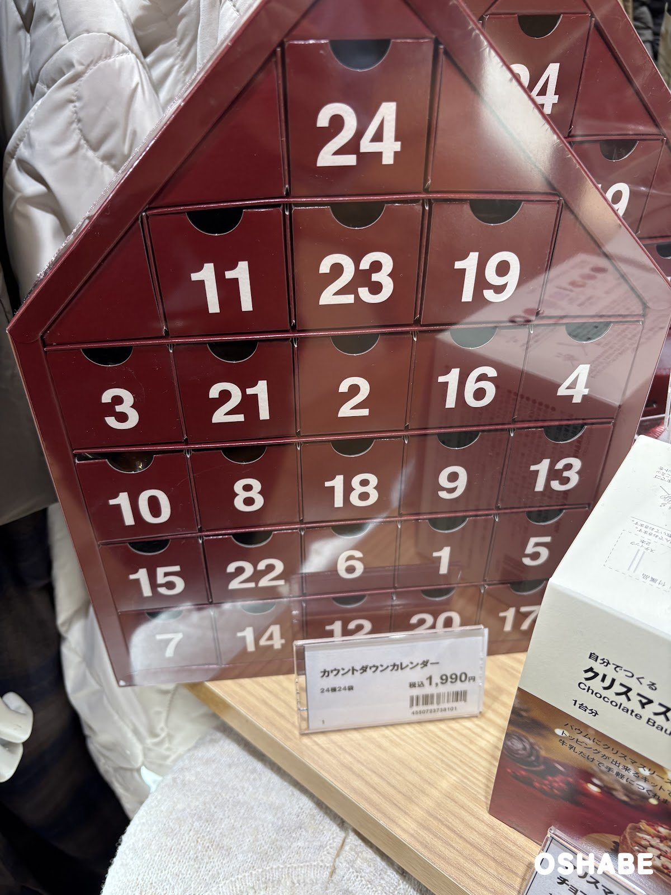
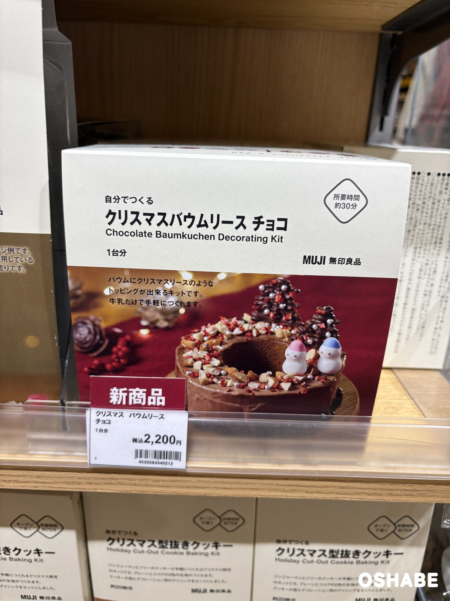
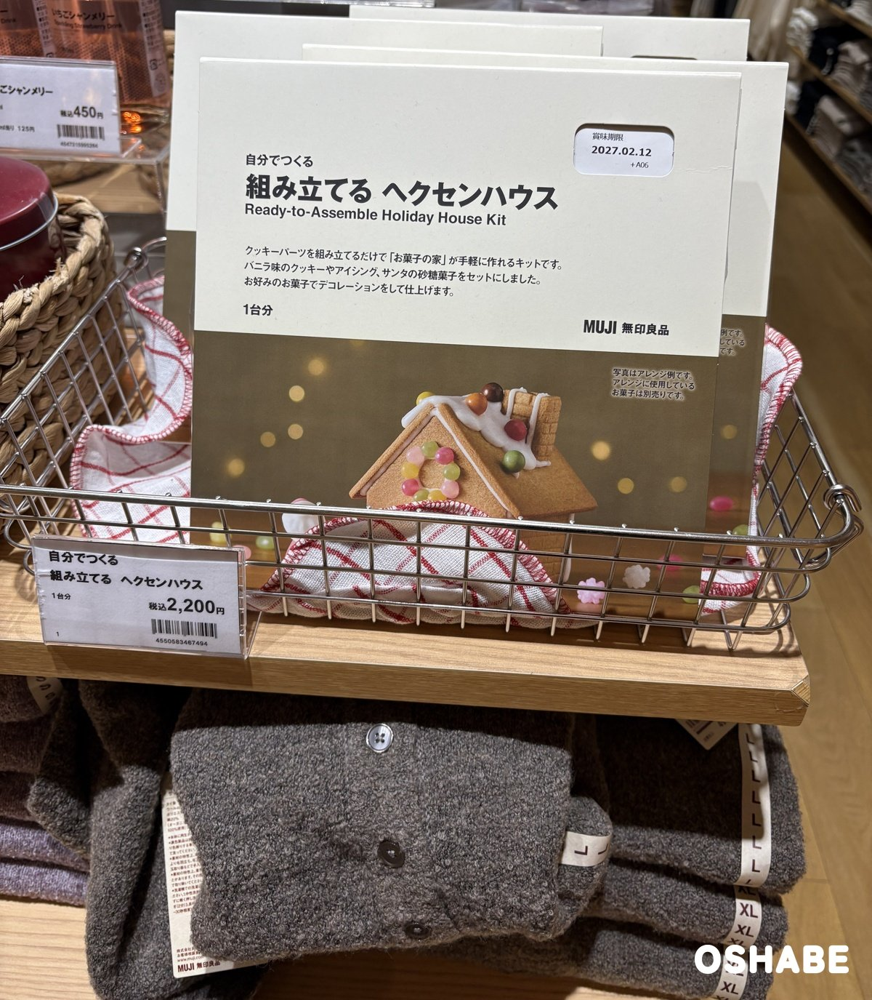
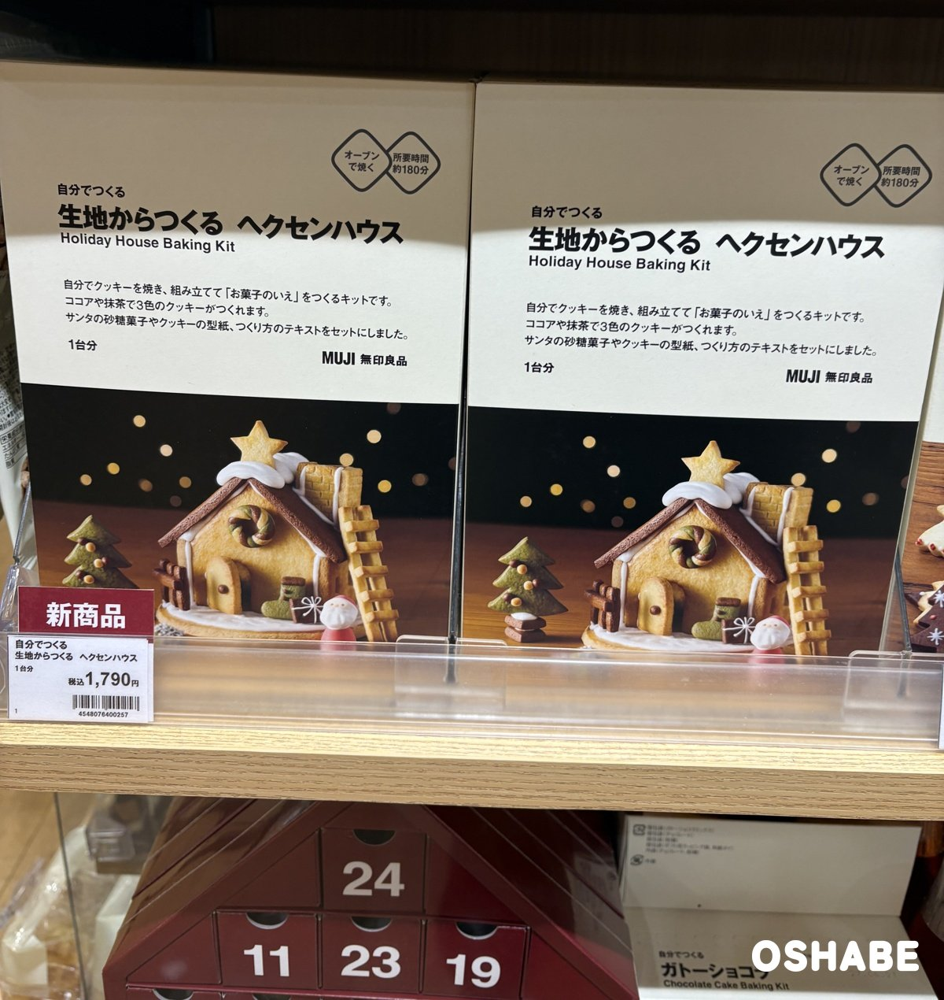
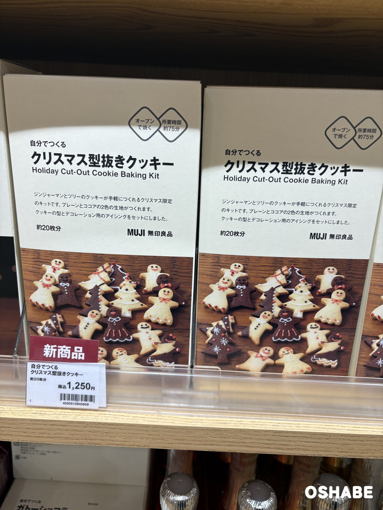
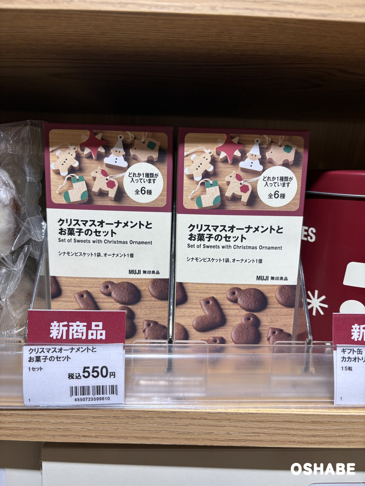
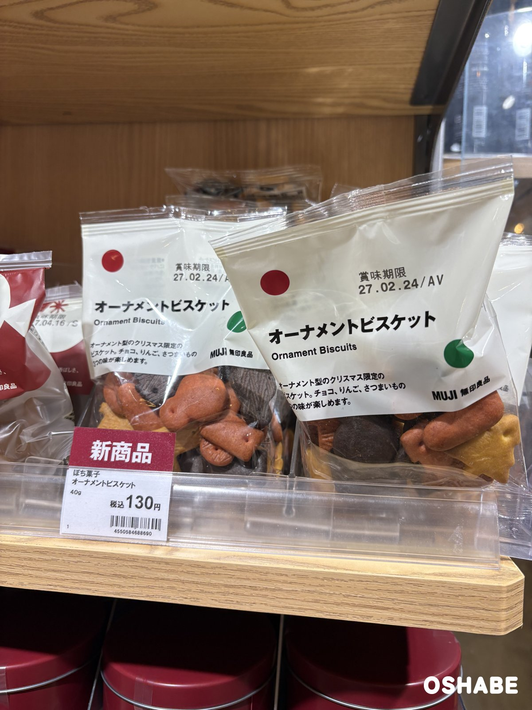
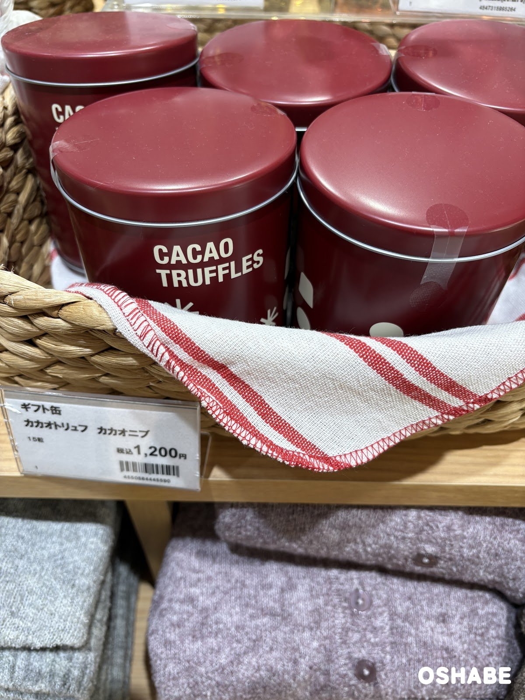
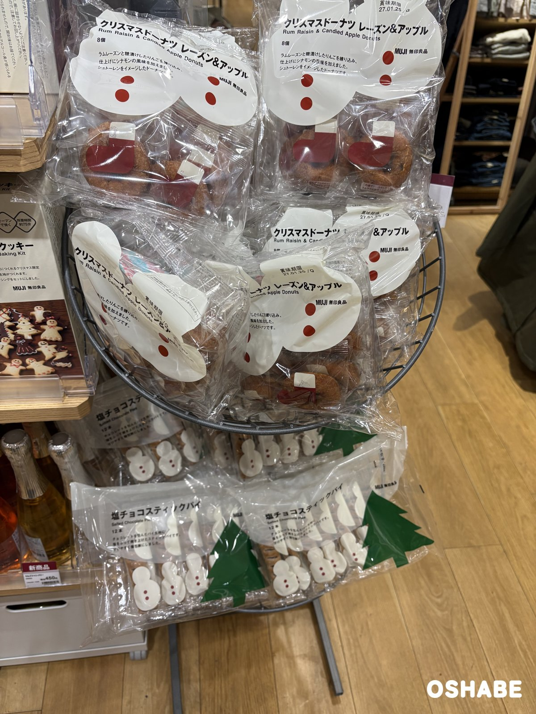
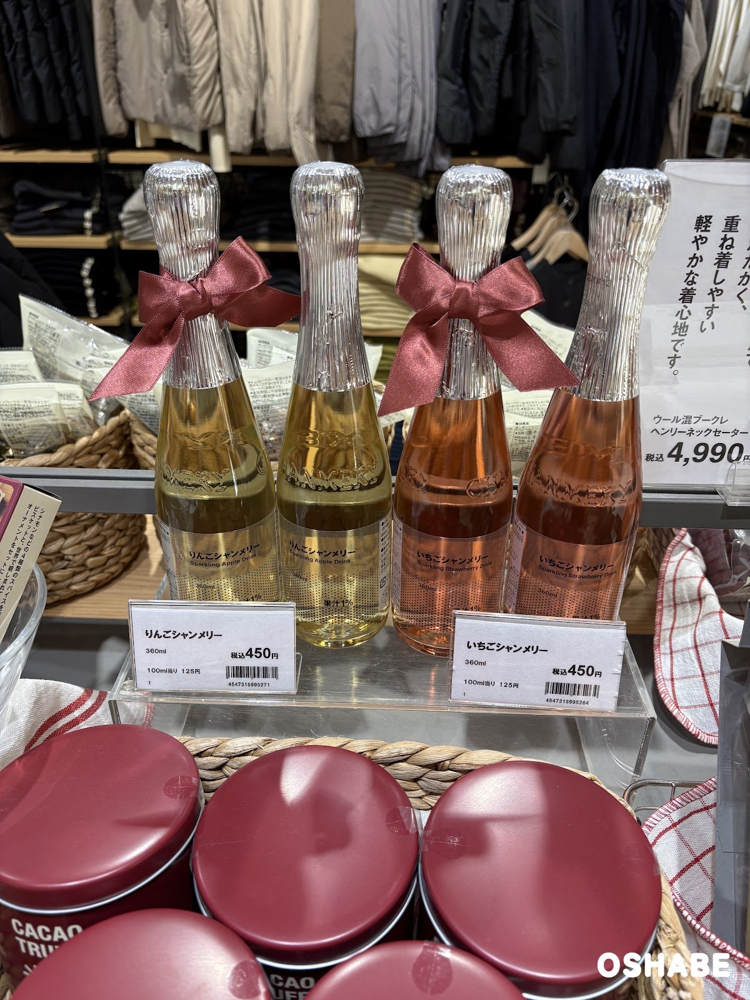

今年もクリスマスの季節がやって来ました☆

無印良品（MUJI）の売り場に、クリスマスのお菓子がずらりと並んでいました。

家族で作れるキットや、ちょっとした贈り物を探している方も多いですよね！

今回は『無印良品のクリスマスお菓子2026』について紹介していきたいと思います。

 ▼その他クリスマスグッズ2026はコチラ

- [LAKOLE（ラコレ）のクリスマス2026【画像・値段】リース、ツリー](../../../../2026/11/11/lakole-christmas-2026/)
- [ダイソーのクリスマス雑貨2026【画像・値段】ウッドオブジェ、スノードーム](../../../../2026/11/04/daiso-christmas-2026/)
- [ダイソーのサンタコスプレ2026【画像・値段】サンタ服、ワンピース、キッズ](../../../../2026/11/09/daiso-santa-costume-2026/)

## 無印良品のクリスマスお菓子2026【画像一覧】

値段は、店頭の値札に書かれていた税込の値段です（2026年11月10日時点）。

### カウントダウンカレンダー

カウントダウンカレンダー 24種24袋

税込1,990円です。

えんじ色の家の形をした箱に、1から24までの数字の引き出しが並んでいます。
数字はばらばらに並んでいて、どこに次の数字があるか探すのも楽しめます。
値札には「24種24袋」と書かれています。

1日に1つずつ引き出しを開けて、クリスマスまでの日を数えるのに使えそうです。

家の形なので、そのまま棚に置いても飾りになります。

### 自分でつくるお菓子のキット

「自分でつくる」シリーズのクリスマスのキットから、4種類を紹介します。

| 商品名 | 分量 | 値段 |
| :--- | :--- | :--- |
| 自分でつくる クリスマスバウムリース チョコ | 1台分 | 税込2,200円 |
| 自分でつくる 組み立てる ヘクセンハウス | 1台分 | 税込2,200円 |
| 自分でつくる 生地からつくる ヘクセンハウス | 1台分 | 税込1,790円 |
| 自分でつくる クリスマス型抜きクッキー | 約20枚分 | 税込1,250円 |

自分でつくる クリスマスバウムリース チョコ

バウムクーヘンに、クリスマスリースのようなトッピングができるキットです。
箱には「牛乳だけで手軽につくれます」とあり、所要時間は約30分と書かれています。
見本の写真では、チョコのバウムにナッツや赤いトッピング、チョコのツリーと雪だるまが乗っています。

クリスマス当日に、子供と一緒にデコレーションするのにも良さそうです。

できあがりの写真を見るだけで、わくわくしてきます♪

自分でつくる 組み立てる ヘクセンハウス

クッキーのパーツを組み立てるだけで「お菓子の家」が作れるキットです。
バニラ味のクッキーやアイシング、サンタの砂糖菓子がセットになっています。
箱の写真はアレンジ例で、屋根や壁に飾っているお菓子は別売りです。

好きなお菓子を用意して、家族で飾り付けを楽しめます。

ころんとした小さなお家が、テーブルを明るくしてくれそうです。

自分でつくる 生地からつくる ヘクセンハウス

こちらは、自分でクッキーを焼いてから組み立てる「お菓子のいえ」のキットです。
ココアや抹茶を使って、3色のクッキーが作れます。
サンタの砂糖菓子やクッキーの型紙、作り方のテキストがセットになっています。

箱には「オーブンで焼く」「所要時間 約180分」と書かれています。
時間のある休みの日に、じっくり作るのに向いています。

見本の写真では、屋根に星が乗り、家の横に抹茶色のツリーが立っています。

自分でつくる クリスマス型抜きクッキー

ジンジャーマンとツリーの形のクッキーが作れるキットです。
プレーンとココアの2色の生地が作れます。
クッキーの型と、デコレーション用のアイシングがセットになっています。

オーブンで焼くキットで、所要時間は約75分と書かれています。

アイシングで顔や服を描けるので、子供と一緒に作ると盛り上がりそうです。

### ちょっとした贈り物

クリスマスオーナメントとお菓子のセット

税込550円です。

シナモンビスケット1袋と、オーナメント1個のセットです。
オーナメントは全6種で、どれか1種類が入っています。
箱には、ジンジャーマンや星、サンタ、くつしたの形の木のオーナメントが描かれています。

食べたあとも、オーナメントをツリーに飾って楽しめます。

何が入っているか、開けるまで分からないのも楽しいところです。

オーナメントビスケット 40g

税込130円です。

オーナメントの形をした、クリスマス限定のビスケットです。
袋には、チョコ、りんご、さつまいもの3つの味が楽しめると書かれています。
白い袋に、赤と緑の丸が付いたパッケージです。

小さな袋なので、クリスマス会で配るお菓子にも使えます。

ツリーの形のビスケットが、袋から透けて見えるのが可愛いです。

ギフト缶 カカオトリュフ カカオニブ

税込1,200円です。

えんじ色の丸い缶に、白い文字で「CACAO TRUFFLES」と書かれています。
値札によると、中身は15粒です。

缶のまま渡せるので、友達へのちょっとしたお返しにも使えます。

食べ終わったあとの缶は、小物入れにもなりそうです。

### ドーナツとスティックパイ

クリスマスドーナツ レーズン&アップル、塩チョコスティックパイ

クリスマスドーナツ レーズン&アップルは、8個入りです。
ラムレーズンと糖漬けのりんごを練り込み、シナモンの風味を加えたドーナツです。
袋には「シュトーレンをイメージしたドーナツです」と書かれています。

塩チョコスティックパイは、12本入りです。
1本ずつの包みに雪だるまの絵柄、袋に緑のツリーの絵柄が付いています。

どちらも個包装なので、クリスマス会で分けやすいです。

### シャンメリー

りんごシャンメリー、いちごシャンメリー 360ml

どちらも税込450円です。

りんごは淡い金色、いちごはピンク色の飲み物です。
銀色の包みの瓶で、首にはくすんだ赤のリボンが結ばれています。
容量はどちらも360mlで、ラベルには「果汁1%」と書かれています。

クリスマスの食卓で、子供と一緒に乾杯するのにも良さそうです。

リボン付きの瓶なので、テーブルに置くだけでパーティーらしくなります。

## まとめ

いかがでしたか。

無印良品では、カレンダー、4種類の手作りキット、贈り物向きのお菓子、シャンメリーなど12点が並んでいました。

値札で見た値段は、税込130円から2,200円までです。

クリスマス会の準備や、家族へのちょっとした贈り物を探すときに合いそうです。

ぜひ参考にしてみてくださいね。
