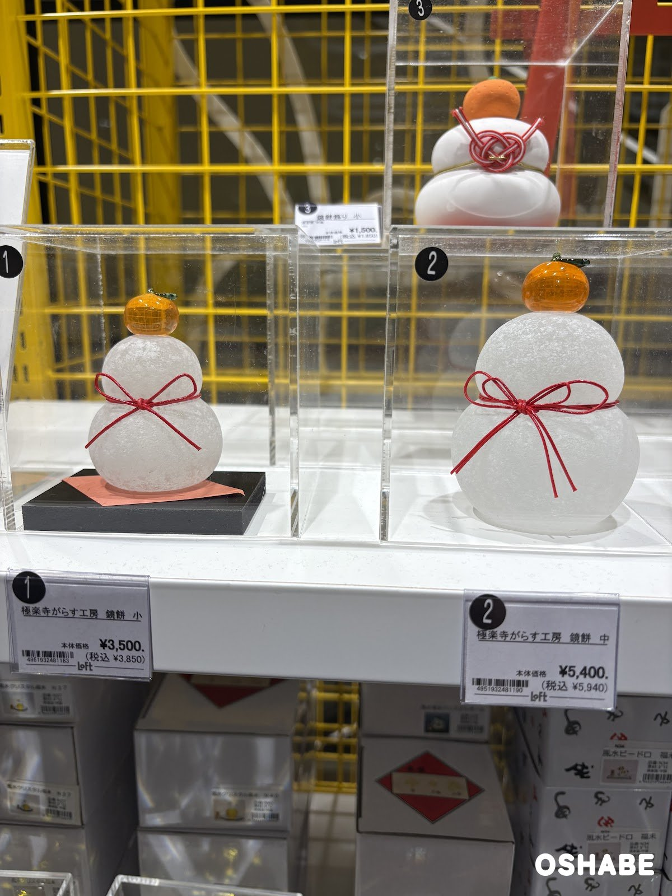
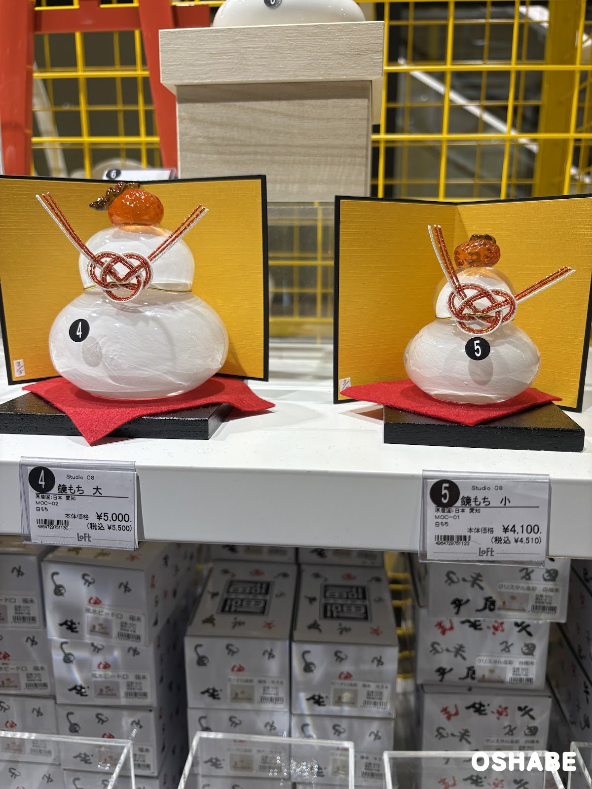
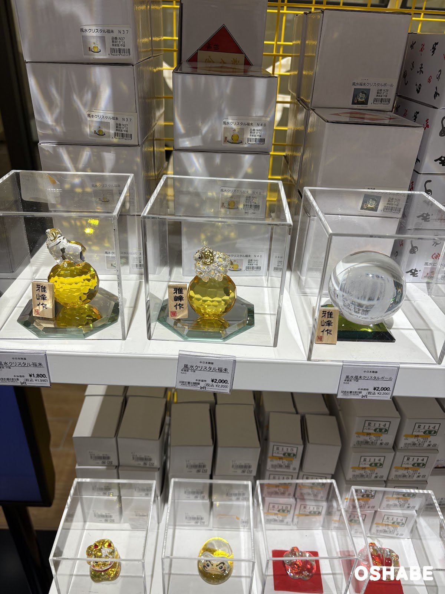
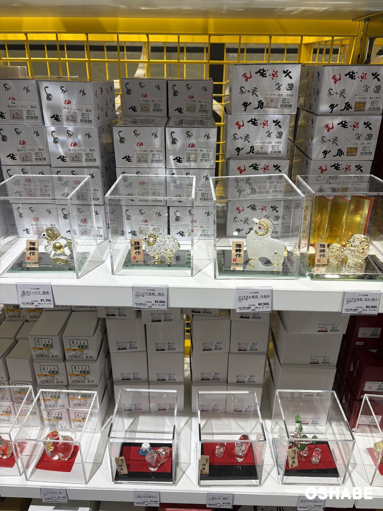
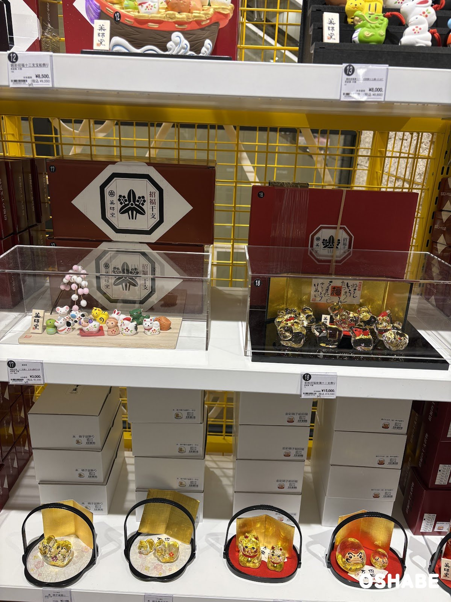
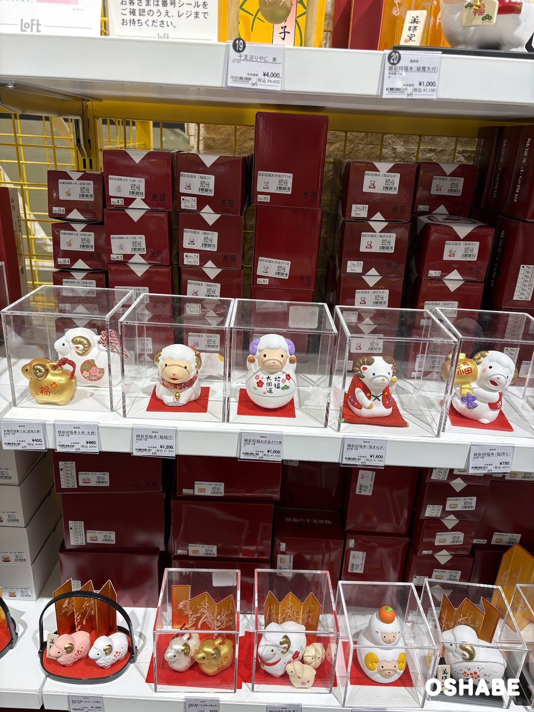
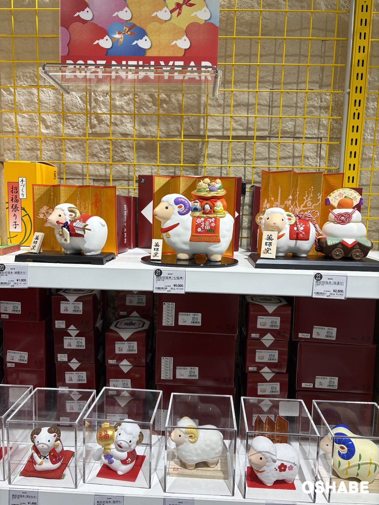
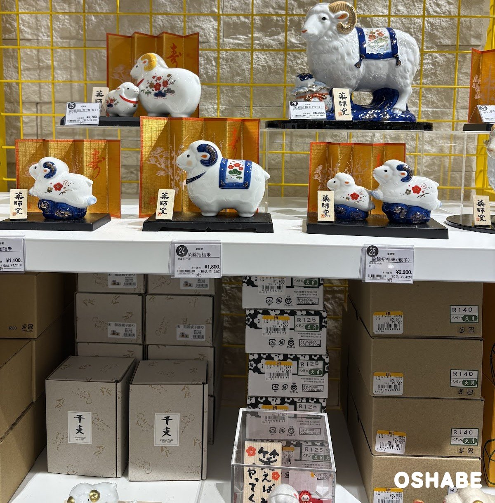
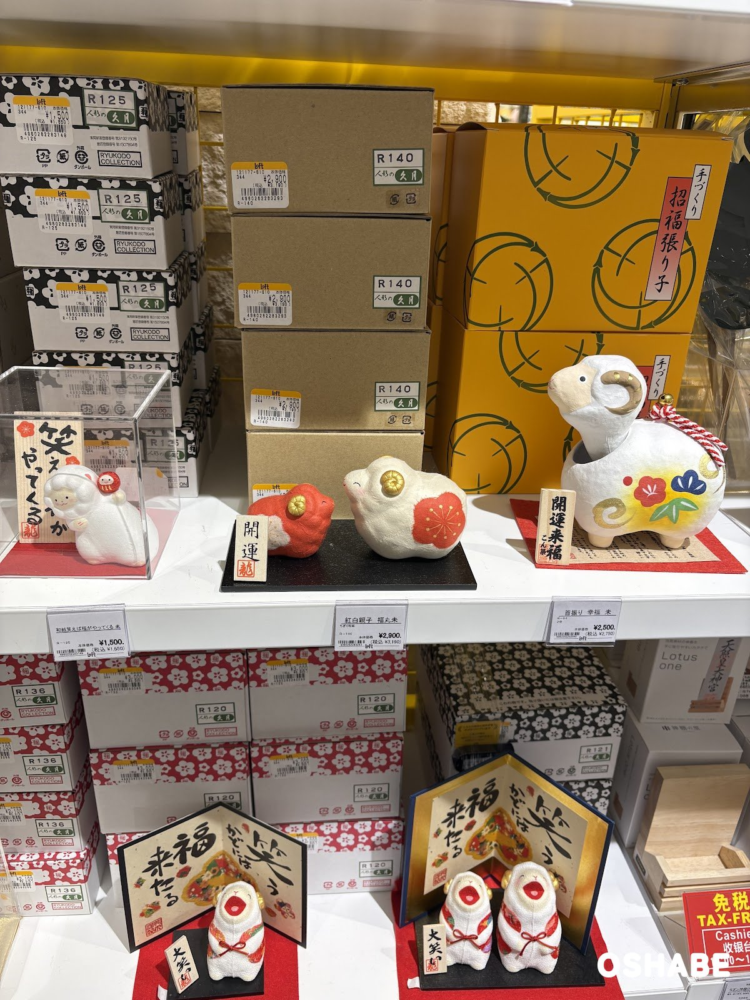
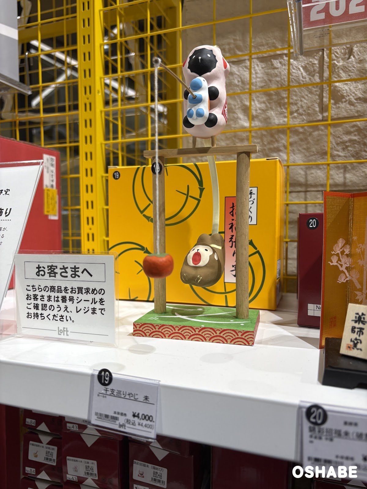

今年もやって来ました！お正月の飾りの季節です。

2027年の干支は「未（ひつじ）」です。

ロフト（LOFT）に行ったら、お正月の飾りの売り場ができていました☆

売り場には「2027 NEW YEAR」の看板があり、未の置物や鏡餅がずらりと並んでいました。

干支の置物を毎年買い替えて、玄関やリビングに飾る方も多いですよね！

今回は『ロフトの迎春アイテム2027』について紹介していきたいと思います。

## ロフトの迎春アイテム2027【画像一覧】

値段は、店頭の値札に書かれていた税込の値段です（2026年11月6日時点）。

### ガラスの鏡餅

極楽寺がらす工房 鏡餅

| 商品名 | 値段 |
| :--- | :--- |
| 極楽寺がらす工房 鏡餅 小 | 税込3,850円 |
| 極楽寺がらす工房 鏡餅 中 | 税込5,940円 |
| 鏡餅飾り 小 | 税込1,650円 |

すりガラスのお餅に、オレンジ色のガラスのみかんが乗っています。

赤い紐のリボンが可愛いです♪

「鏡餅飾り 小」は、後ろの段に並んでいました。

### 屏風付きの鏡もち

Studio 08 鏡もち

大は税込5,500円、小は税込4,510円です。

値札には、原産国は日本（愛知）と書かれていました。

金色の屏風と赤い敷物が付いています。

水引の飾りが華やかで、お正月らしい置物です。

### 未のクリスタルの置物

風水クリスタル福未

| 写真の位置 | 商品名 | 値段 |
| :--- | :--- | :--- |
| 左 | 風水クリスタル福未（N37） | 税込1,980円 |
| 真ん中 | 風水クリスタル福未（N40） | 税込2,200円 |
| 右 | 風水福未クリスタルボール | 税込2,200円 |

黄色いクリスタルの玉の上に、透明な未が乗っています。

光が当たるとキラキラして、とってもキレイです。

### 未のビードロの置物

ビードロ金彩 福未

| 商品名 | 値段 |
| :--- | :--- |
| 風水ビードロ 福未 | 税込1,870円 |
| ビードロ金彩 福未 | 税込2,200円 |
| クリスタル金彩 白福未 | 税込2,750円 |
| ビードロ金彩 福未（親子） | 税込3,080円 |

ガラスの未に、金色の角が付いています。

白いすりガラスの未は、ふわふわの毛のように見えます。

### 十二支の飾り

錦彩招福 十二支飾り

| 写真の位置 | 商品名 | 値段 |
| :--- | :--- | :--- |
| 左 | 錦彩招福 十二支飾り | 税込3,300円 |
| 右 | 彩絵招福玻璃十二支飾り | 税込16,500円 |
| 上の段 | 錦彩招福十二支宝船飾り | 税込9,350円 |

錦彩招福 十二支飾りは、小さな十二支が木の台の上に並んでいます。

彩絵招福玻璃十二支飾りは、金色の十二支のガラスの置物です。

十二支がそろっているので、毎年飾れるのがうれしいポイントです♪

### 未の陶器の置物

錦彩招福未

| 商品名 | 値段 |
| :--- | :--- |
| 彩鞠招福寿々未（金福土鈴） | 税込440円 |
| 錦彩招福寿々未（土鈴） | 税込506円 |
| 錦彩招福未（福持ち） | 税込825円 |
| 錦彩招福おきあがり未 | 税込1,100円 |
| 錦彩招福未（福結び） | 税込1,320円 |
| 錦彩招福未（福まねき） | 税込1,760円 |

まんまるのお顔の未がたくさん並んでいて、迷っちゃいそうです。

### 屏風付きの未の置物

錦彩招福未（七福神）

| 写真の位置 | 商品名 | 値段 |
| :--- | :--- | :--- |
| 左 | 錦彩招福未（破魔矢付） | 税込1,100円 |
| 真ん中 | 錦彩招福未（七福神） | 税込5,500円 |
| 右 | 錦彩招福未（福運び） | 税込3,080円 |

七福神の置物は、未の背中に七福神が乗っていて、縁起が良さそうです。

福運びの置物は、未が鏡餅の車を引いています。

### 染付の未の置物

染錦招福未

| 写真の位置 | 商品名 | 値段 |
| :--- | :--- | :--- |
| 真ん中 | 染錦招福未 | 税込1,980円 |
| 右 | 染錦招福未（親子） | 税込2,420円 |
| 上の段の右 | 染錦招福未（宝祥） | 税込6,600円 |

白い磁器に青い模様が入っていて、上品な雰囲気です。

上の段の大きな未は存在感があるので、玄関に飾ったら素敵ではないでしょうか。

### 張り子の未

首振り 幸福 未

| 写真の位置 | 商品名 | 値段 |
| :--- | :--- | :--- |
| 左 | 和紙 笑えば福がやってくる 未 | 税込1,650円 |
| 真ん中 | 紅白親子 福丸未 | 税込3,190円 |
| 右 | 首振り 幸福 未 | 税込2,750円 |

張り子の未は、ころんとした形が可愛いです♡

### 干支巡りやじ

干支巡りやじ 未

税込4,400円です。

やじろべえのように、ゆらゆら揺れる飾りです。

上には未が乗っていて、糸の先には赤い実が下がっています。

子供と一緒に揺らして楽しめそうです。

## まとめ

いかがでしたか。

ロフトでは、未の置物、鏡餅、十二支の飾りが、ガラス・陶器・張り子などの素材で並んでいました。

値段は、税込440円から16,500円までです。

小さな土鈴ならプチプラなので、家族で選んで、お正月に飾ってみてはいかがでしょうか。

ぜひ参考にしてみてくださいね。
