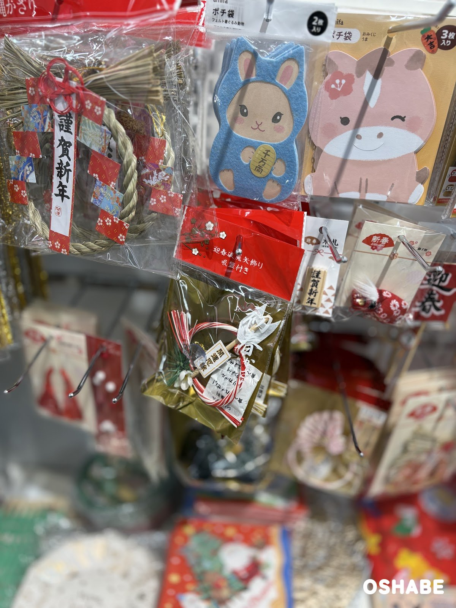
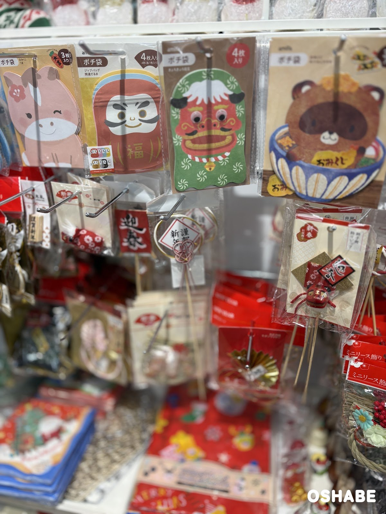
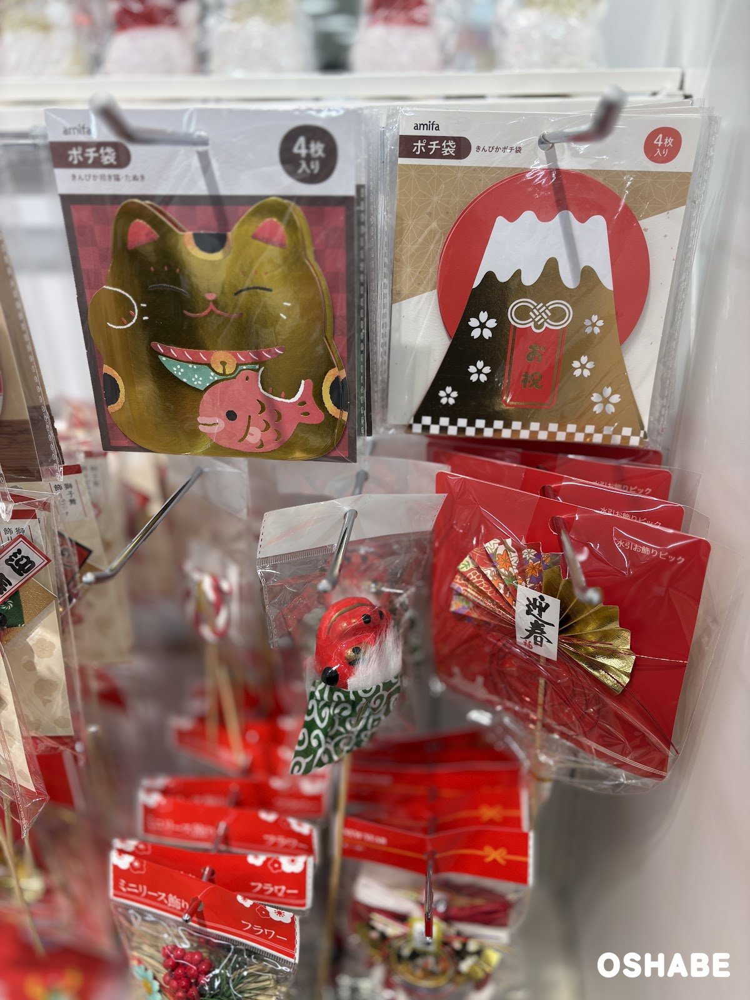
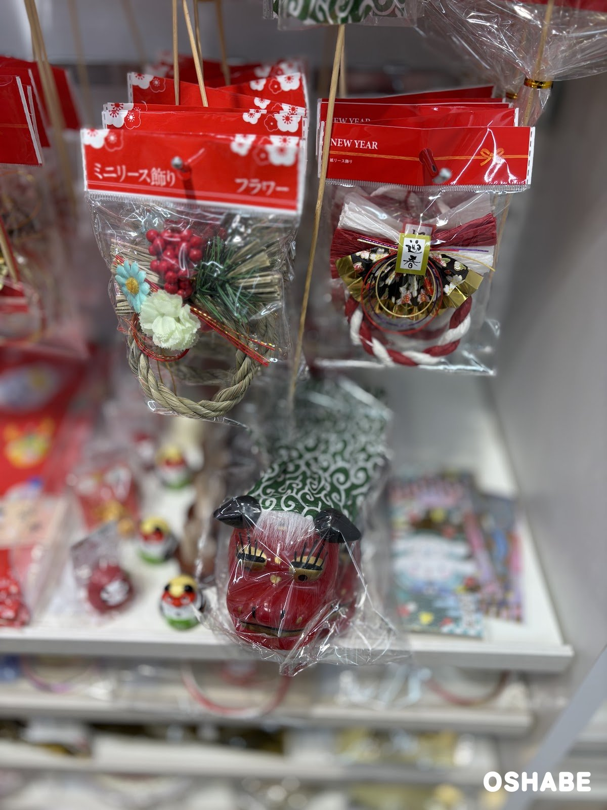

今年もやって来ました！お正月の準備の季節です。

セリア（Seria）では、クリスマスの売り場のすぐ隣に、もうお正月のコーナーができていました☆

お年玉を入れるポチ袋を、毎年どれにしようか選ぶ方も多いですよね！

今回は『セリアのポチ袋とお正月飾り2027』について紹介していきたいと思います。

 ▼その他お正月グッズ2027はコチラ

- [ロフトの迎春アイテム2027【画像・値段】未の置物、鏡餅、十二支飾り](../../../../2026/11/13/loft-new-year-2027/)

## セリアのポチ袋とお正月飾り2027【画像一覧】

セリアの商品は、どれも税込110円です（2026年11月13日時点）。商品名は、パッケージに書かれていた名前です。

### 動物のポチ袋と破魔矢飾り

ポチ袋 フェルト着ぐるみ動物、ポチ袋 おみくじ うま、迎春破魔矢飾り 吸盤付き

ポチ袋は、どちらもアミファ（amifa）の商品です。

「フェルト着ぐるみ動物」は2枚入りです。
水色のフェルトの着ぐるみを着たうさぎが、「千万両」の小判を抱えています。

「おみくじ うま」は3枚入りです。
ピンク色のうまの形で、頭に赤い梅の花が付いています。
パッケージには「大吉」と書かれたにんじんの絵があります。

下の「迎春破魔矢飾り 吸盤付き」は、紅白のひもの輪に、破魔矢と「開運厄除」の札が付いています。
吸盤付きなので、窓ガラスやタイルの壁にも飾れます。

右の木札には、「謹賀新年」の文字が入っています。
左上のしめ縄の飾りにも、「謹賀新年」の札と和柄の紙の飾りが付いていました。

フェルトのポチ袋は、ふわっとした手ざわりが楽しめそうです。

### だるまのポチ袋と獅子舞のピック

ポチ袋 ジップバッグ 開運だるま、獅子舞飾りピック

「ジップバッグ 開運だるま」は、4色が各1枚ずつの4枚入りです。
赤いだるまのお腹に、金色で「福」の文字が入っています。

右には、緑の獅子舞の柄のポチ袋（4枚入り）も掛かっていました。

写真の右下は、新春お祝飾りの「獅子舞飾りピック」です。
赤い獅子舞の顔に、金色の紙と「迎春」の札が付いています。
ピックなので、鉢植えやお正月のアレンジメントに挿して使えます。

真ん中には、金色の輪に「謹賀新年」の札と水引が付いたピックも並んでいました。

だるまのポチ袋は、子供が何人か集まるお正月に、色違いで渡せるのが嬉しいです♪

### きんぴかのポチ袋と水引のピック

ポチ袋 きんぴか招き猫・たぬき、きんぴかポチ袋、水引お飾りピック

ポチ袋はこちらもアミファの商品で、どちらも4枚入りです。

「きんぴか招き猫・たぬき」は、金色の招き猫の形をしています。
招き猫は、赤い鯛を抱えて、にっこり笑っています。

「きんぴかポチ袋」は、赤い丸の中に金色の富士山が描かれています。
富士山の真ん中には、水引の絵と「お祝」の文字があります。

写真の右下が「水引お飾りピック」です。
金色の扇に和柄の折り紙が重なり、「迎春」の札と赤い水引が付いています。
お花と一緒に花びんに挿すと、いつものお花がお正月らしくなります。

金色がキラキラしていて、親戚の集まりで渡すお年玉にぴったりではないでしょうか。

### リースのお飾り

ミニリース飾り フラワー、紙リース飾り

「ミニリース飾り フラワー」は、わらの輪に、松と赤い実、水色と白の花が付いています。

「紙リース飾り」は、紅白の紙のひもの輪です。
金色の扇と和柄の飾り、「迎春」の札が付いています。

下に掛かっていたのは、緑の唐草模様の布をかぶった赤い獅子舞の飾りです。

小さなリースは、玄関のドアやお部屋の壁に掛けるのにちょうど良さそうです。

小さな獅子舞と一緒に飾っても可愛いです♡

## まとめ

いかがでしたか。

セリアには、アミファのポチ袋5種類と、破魔矢、リース、獅子舞、水引のお飾りが並んでいました。

値段は、どれも税込110円です。

年末の大掃除のあとに、家族でお飾りを選んで、新しい年を迎えてみてはいかがでしょうか。

ぜひ参考にしてみてくださいね。
