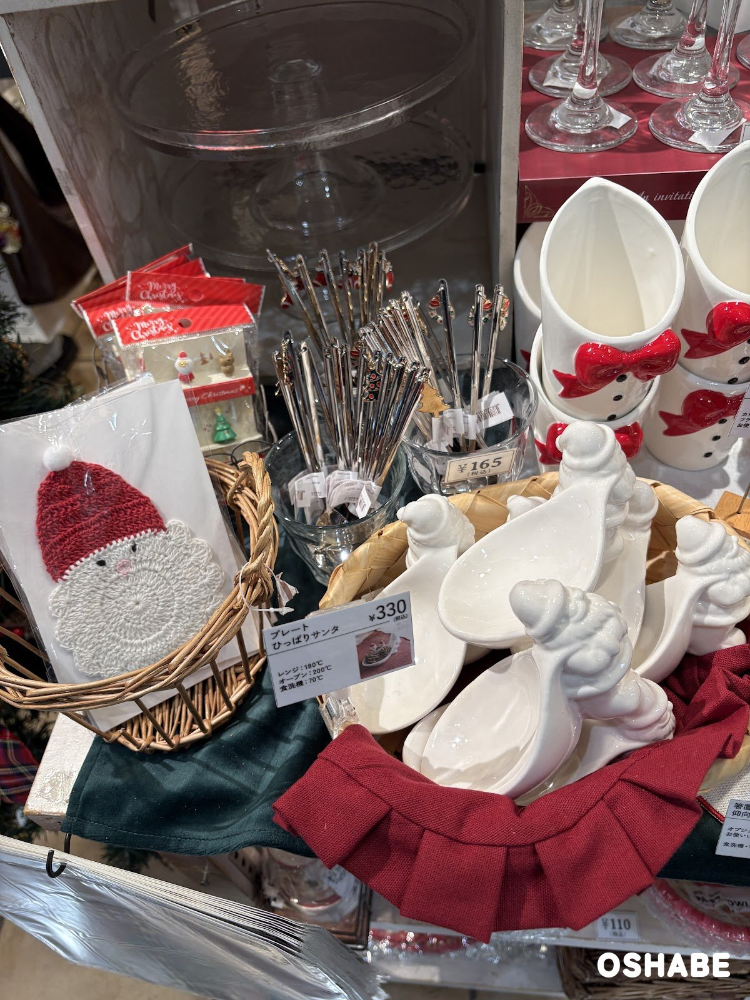
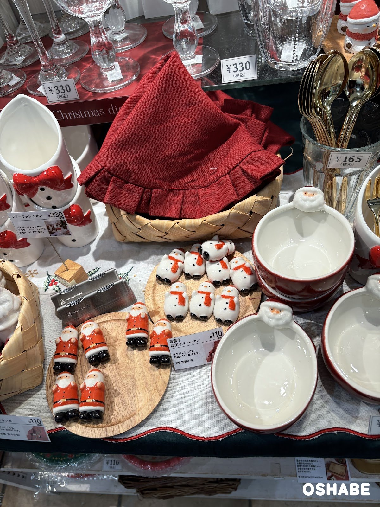
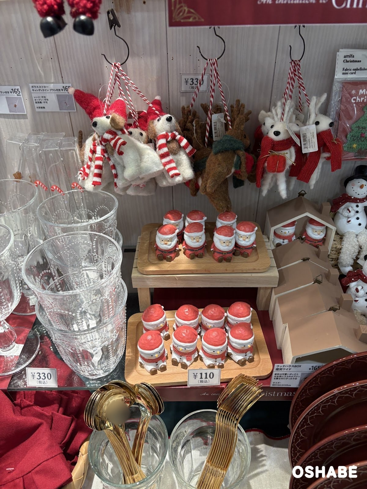
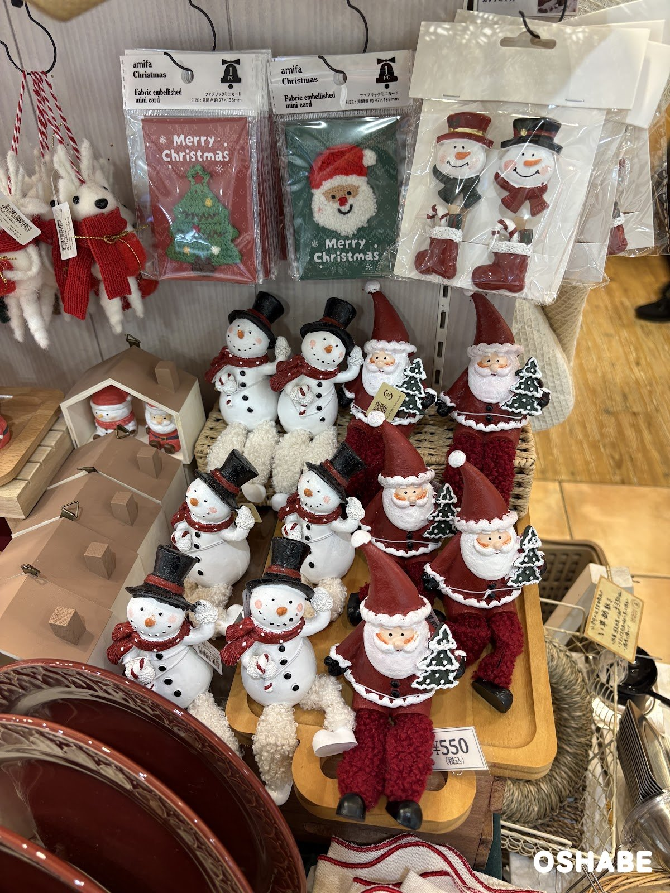
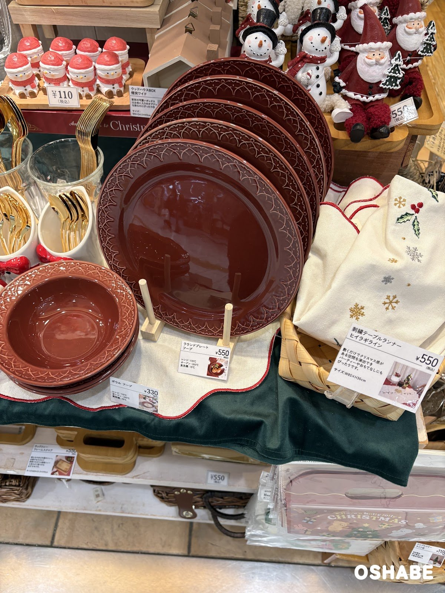
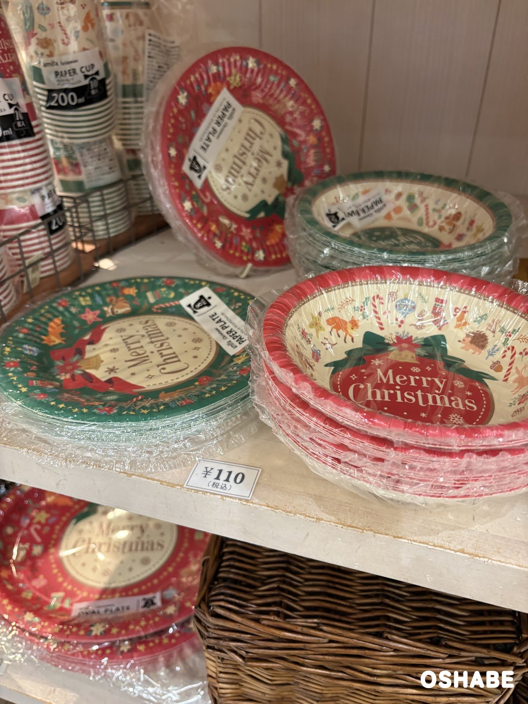

クリスマスのテーブルの準備を始める季節がやって来ました☆

ナチュラルキッチン（Natural Kitchen &）に行ったら、クリスマスの食器と雑貨の売り場ができていました。

売り場には、サンタやスノーマンの食器、赤いお皿、紙皿がずらりと並んでいました。

おうちのクリスマスパーティーを、食器から楽しみたい方も多いですよね！

今回は『ナチュラルキッチンのクリスマス食器2026』について紹介していきたいと思います。

## ナチュラルキッチンのクリスマス食器2026【画像一覧】

値段は、店頭の値札に書かれていた税込の値段です。

| 商品名 | 値段 |
| :--- | :--- |
| プレート ひっぱりサンタ | 税込330円 |
| フリーポット リボン | 税込330円 |
| 箸置き 仰向けスノーマン | 税込110円 |
| ガラスストロー キャンディケイン ブラシ付き | 税込165円 |
| ウッドハウスBOX 煙突ワイド | 税込165円 |
| ラウンドプレート フープ | 税込550円 |
| ボウル フープ | 税込330円 |
| 刺繍テーブルランナー ヒイラギライン | 税込550円 |
| 紙皿・紙ボウル（amifa） | 税込110円 |

### サンタとスノーマンの食器

プレート ひっぱりサンタ

税込330円です。

白い陶器の細長いお皿で、持ち手の先に白いサンタが付いています。値札には、電子レンジは180℃、オーブンは200℃、食器洗い機は70℃まで使えると書かれています。

クッキーやチョコを少しだけのせて出すのに良さそうです。

真っ白なサンタが、お皿のふちからのぞいているような形です。

フリーポット リボン、箸置き 仰向けスノーマン

フリーポット リボンは税込330円、箸置き 仰向けスノーマンは税込110円です。

フリーポット リボンは、白い陶器のポットです。前に赤いリボンと黒いボタンが付いていて、スノーマンのように見えます。値札には、カトラリースタンドやフラワーベースとしても使えると書かれています。

箸置き 仰向けスノーマンは、赤いマフラーを巻いたスノーマンがあお向けに寝ている形です。値札には、オブジェとしても使えること、食器洗い機は使えないことが書かれています。

フォークやスプーンを立てておけば、パーティーのテーブルがすっきりします。

ころんと寝ころんだスノーマンの箸置きは、並べるだけで可愛いです♪

### ガラスストローとウッドハウスBOX

ガラスストロー キャンディケイン ブラシ付き、ウッドハウスBOX 煙突ワイド

どちらも税込165円です。

ガラスストロー キャンディケイン ブラシ付きは、透明なガラスのストローです。上に、赤と白のしまのキャンディケインの飾りが付いています。値札には、電子レンジ・オーブン・食器洗い機は使えず、耐熱ではないと書かれています。

ウッドハウスBOX 煙突ワイドは、煙突の付いたおうちの形の木の箱です。サイズは、幅9cm×奥行4.5cm×高さ7cmです。売り場では、箱の中に小さなサンタの置物が飾られていました。

ストローはジュースのグラスに添えると、クリスマスらしくなります。

木の箱は、お気に入りの小さなオブジェを飾る場所にぴったりです。

### クリスマスのミニカード

amifa（アミファ）のファブリックミニカード

見開きで約97mm×138mmの、小さなクリスマスカードです。赤いカードには、緑の毛糸のようなツリーと「Merry Christmas」の文字があります。緑のカードには、もこもこした生地のサンタの顔が付いています。

プレゼントに添えるメッセージカードにちょうどいい大きさです。

さわると立体的な、布の飾りがうれしいカードです。

### フープのお皿とテーブルランナー

ラウンドプレート フープ、ボウル フープ、刺繍テーブルランナー ヒイラギライン

ラウンドプレート フープは税込550円、ボウル フープは税込330円です。刺繍テーブルランナー ヒイラギラインは税込550円です。

ラウンドプレート フープとボウル フープは、深い赤茶色のお皿です。ふちには、レースのような模様が浮き出ています。値札には、電子レンジは170℃、オーブンは260℃、食器洗い機は70℃まで使えると書かれています。

刺繍テーブルランナー ヒイラギラインは、生成り色の布に、ヒイラギと金や銀の雪の結晶の刺繍が入っています。ふちは、赤い波のような線で縁どられています。サイズは、幅85cm×高さ36cmです。

テーブルの真ん中にランナーを敷いて、赤茶色のお皿を並べると、クリスマスのテーブルになります。

落ち着いた赤茶色なので、クリスマスの後も使いやすそうです。

### クリスマスの紙皿と紙ボウル

amifaの紙皿（PAPER PLATE）と紙ボウル（PAPER BOWL）

棚の値札は「税込110円」です。

赤と緑の「Merry Christmas」のデザインで、ふちにはキツネやリス、キャンディケインが描かれています。紙皿と、深さのある紙ボウルが並んでいました。上の段には、同じシリーズの紙コップ（200ml）もありました。

人が集まるパーティーでは、洗い物が少なくて済むので助かります。

動物たちが描かれた絵柄は、子供も喜びそうです。

## まとめ

いかがでしたか。

ナチュラルキッチンでは、サンタやスノーマンの食器、フープのお皿、テーブルランナー、紙皿など10点が並んでいました。

値段は、税込110円から550円までです。

12月のクリスマスパーティーの前に、家族や友達と囲むテーブルの準備をしてみてはいかがでしょうか。

ぜひ参考にしてみてくださいね。

## 他のクリスマス関連はこちら

▼2026年のクリスマスグッズ

- [ダイソー100均のクリスマスカチューシャ2026【画像・値段】サンタ、トナカイ](../../../../2026/11/03/daiso-christmas-headband/)
- [ダイソー100均のサンタコスプレ2026【画像・値段】子供のサンタ服、ワンピース](../../../../2026/11/09/daiso-santa-costume-2026/)
- [ダイソー100均のクリスマス雑貨2026【画像・値段】スノードーム、オブジェ](../../../../2026/11/04/daiso-christmas-2026/)
- [セリア100均のクリスマス飾り2026【画像・値段】ガーランド、ケーキピック](../../../../2026/11/08/seria-christmas-decoration/)
- [セリア100均のクリスマスシール2026【画像・値段】フレーク、マスキングテープ](../../../../2026/11/19/seria-christmas-stickers-2026/)
- [セリア100均のクリスマスカード2026【画像・値段】メロディカード、ポチ袋](../../../../2026/11/21/seria-christmas-cards-2026/)
- [セリア100均のクリスマス仮装2026【画像・値段】カチューシャ、ぬい服、ペット](../../../../2026/11/22/seria-christmas-headband-2026/)
- [セリア100均のクリスマスオーナメント2026【画像・値段】ツリー、りんご](../../../../2026/11/21/seria-christmas-ornaments-2026/)
- [ワッツ100均のクリスマス2026【画像・値段】オーナメント、カチューシャ](../../../../2026/11/02/xmas-ornament-headband/)
- [ニトリ デコホームのクリスマス飾り2026【画像・値段】ツリー、オーナメント](../../../../2026/11/16/nitori-christmas-2026/)
- [無印良品のクリスマスお菓子2026【画像・値段】バウムリース、ヘクセンハウス](../../../../2026/11/12/muji-christmas-sweets/)
- [フランフランのクリスマスツリー2026【画像・値段】スターターセット](../../../../2026/11/15/francfranc-christmas-tree-2026/)
- [フランフランのクリスマス2026【画像・値段】リース、ノルディックサンタ](../../../../2026/11/18/francfranc-christmas-2026/)
- [アフタヌーンティーのクリスマス2026【画像・値段】紅茶、LEDライト](../../../../2026/11/06/afternoon-tea-christmas-2026/)
- [LAKOLE（ラコレ）のクリスマス2026【画像・値段】リース、ツリー](../../../../2026/11/11/lakole-christmas-2026/)
- [TOP TOYのMayMei2026【画像・値段】冬のぬいぐるみ、がま口](../../../../2026/11/10/toptoy-maymei-winter/)

▼クリスマスの記事をまとめて見る

- [クリスマスの記事の一覧](../../../../category/xmas/)
