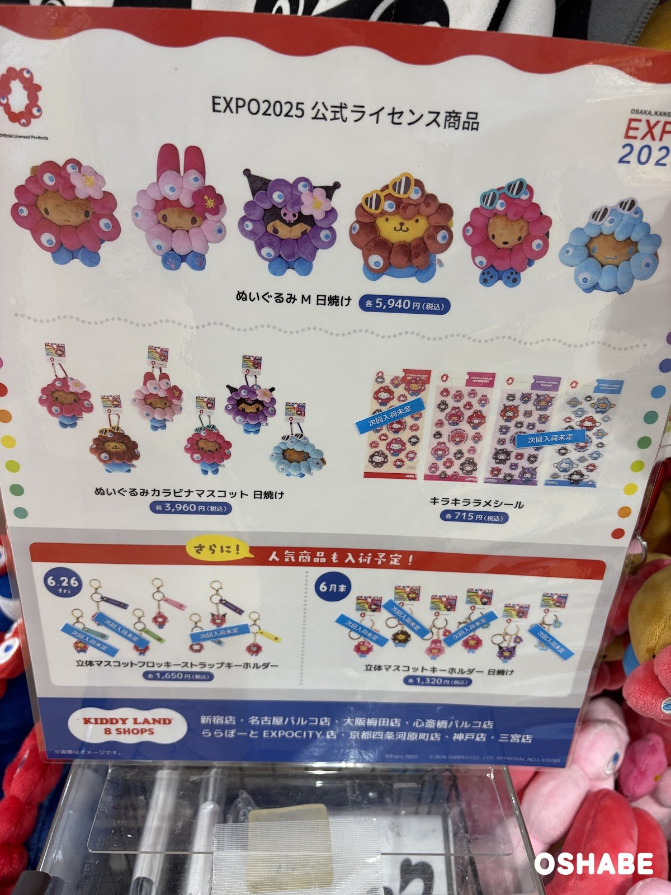
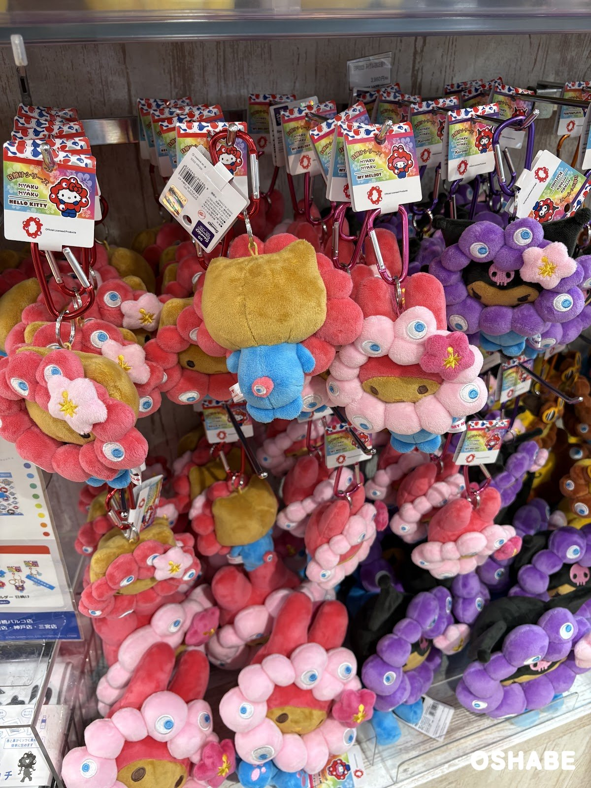
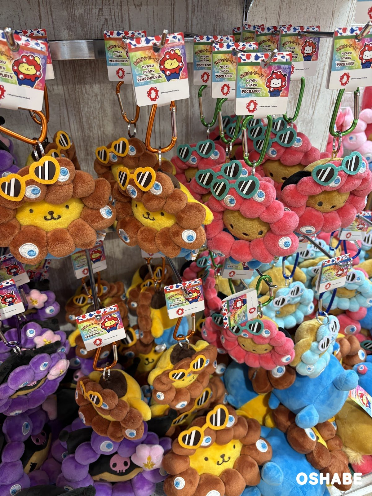
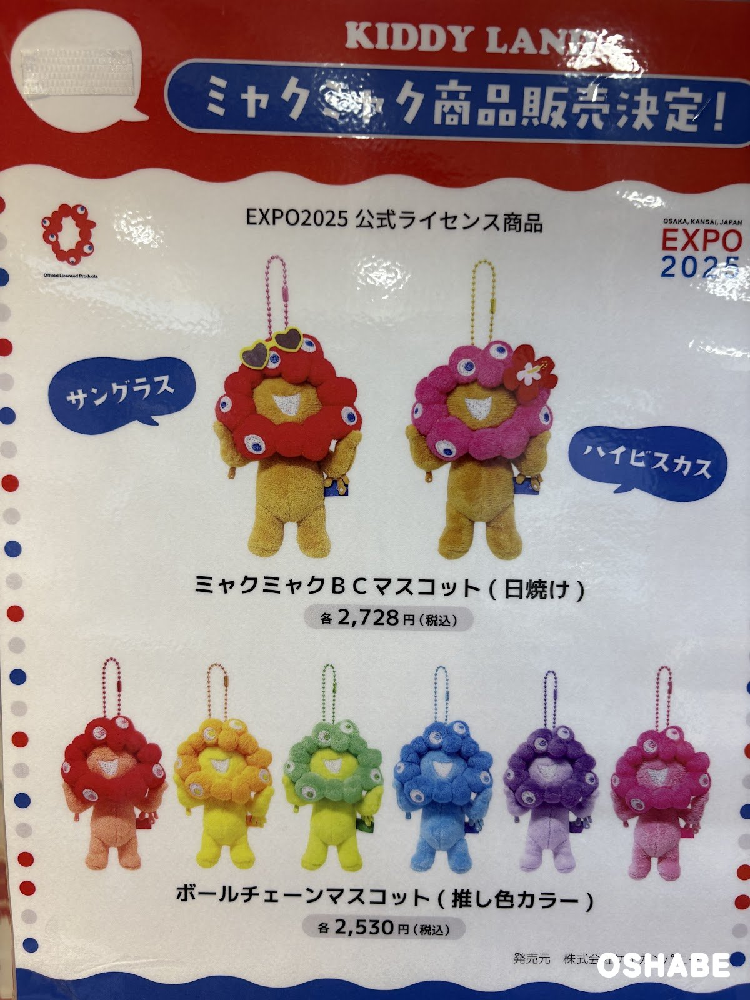
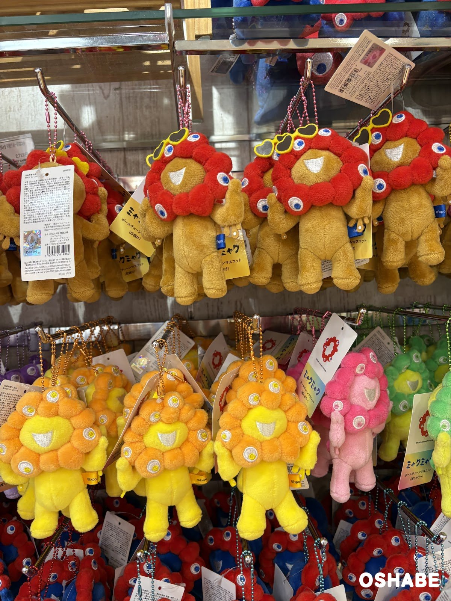
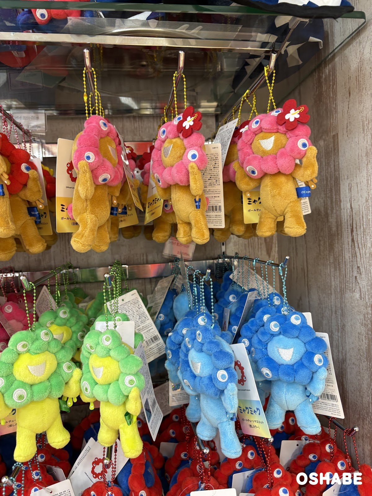

前回は、ミャクミャクのグッズの売り場を紹介しました☆

今回は、キデイランド（KIDDY LAND）でミャクミャクのグッズを見つけました。

ミャクミャクは、大阪・関西万博（EXPO 2025）の公式キャラクターです。

売り場には「日焼け」のミャクミャクのグッズがずらりと並んでいました。

日焼けした色のミャクミャクは、夏らしくて元気な雰囲気ですよね！

今回は『キデイランドのミャクミャク日焼けグッズ2026』について紹介していきたいと思います。

 ▼その他ミャクミャクのグッズはコチラ

- [ミャクミャクのグッズ2026【画像・値段】クロミャク、ぬいぐるみ、ポーチ](../../../../2026/11/07/myakumyaku-goods/)
- [ミャクミャクのマスコット2026【画像・値段】ミニぬいぐるみ、キーチェーン](../../../../2026/10/20/myakumyaku-mascot/)

## キデイランドのミャクミャク日焼けグッズ2026【画像一覧】

値段は、店頭のPOPに書かれていた税込の値段です（2026年11月17日時点）。

### サンリオキャラクターズとのコラボ

EXPO2025 公式ライセンス商品のPOP

サンリオキャラクターズが、日焼けしたミャクミャクの姿になったシリーズです。

| 商品名 | 値段 |
| :--- | :--- |
| ぬいぐるみ M 日焼け | 各税込5,940円 |
| ぬいぐるみカラビナマスコット 日焼け | 各税込3,960円 |
| キラキラララメシール | 各税込715円 |
| 立体マスコットフロッキーストラップキーホルダー | 各税込1,650円 |
| 立体マスコットキーホルダー 日焼け | 各税込1,320円 |

POPの一部の商品には「次回入荷未定」のシールが貼られていました。

ぬいぐるみカラビナマスコット 日焼け ハローキティ・マイメロディ・クロミ

「ぬいぐるみカラビナマスコット 日焼け」は、各税込3,960円です。

タグには「日焼けシリーズ」と書かれています。

ハローキティとマイメロディは赤やピンク、クロミは紫のミャクミャクの頭をかぶっています。

頭には、小さなお花の飾りが付いています。

カラビナが付いているので、カバンに付けて持ち歩けます。

ぬいぐるみカラビナマスコット 日焼け ポムポムプリン・ポチャッコ

ポムポムプリンは茶色、ポチャッコはピンクのミャクミャクの頭です。

どちらもハートの形のサングラスをかけています。

カラビナの色も、キャラクターごとにオレンジや緑と分かれていました。

サングラス姿がとっても可愛いです♪

### ミャクミャクのマスコット

ミャクミャクBCマスコット（日焼け）とボールチェーンマスコット（推し色カラー）のPOP

POPのいちばん上には「ミャクミャク商品販売決定！」と書かれていました。

「ミャクミャクBCマスコット（日焼け）」は、各税込2,728円です。

「ボールチェーンマスコット（推し色カラー）」は、各税込2,530円です。

BCマスコット（日焼け） サングラス

上の段は、赤い頭に黄色いハートのサングラスをかけたミャクミャクです。

日焼けした茶色の体で、ボールチェーンが付いています。

下の段には、オレンジや黄色、ピンク、緑の「推し色カラー」が並んでいました。

BCマスコット（日焼け） ハイビスカス

上の段は、ピンクの頭に赤いハイビスカスを付けたミャクミャクです。

下の段には、緑と青の「推し色カラー」が並んでいました。

お気に入りの色を選んでみてはいかがでしょうか。

## まとめ

いかがでしたか。

キデイランドには、サンリオキャラクターズのコラボ5種類と、ミャクミャクのマスコット2種類が並んでいました。

値段は、税込715円から5,940円までです。

ミャクミャクやサンリオが好きな子供や友達へのプレゼントにもぴったりです☆

ぜひ参考にしてみてくださいね。
