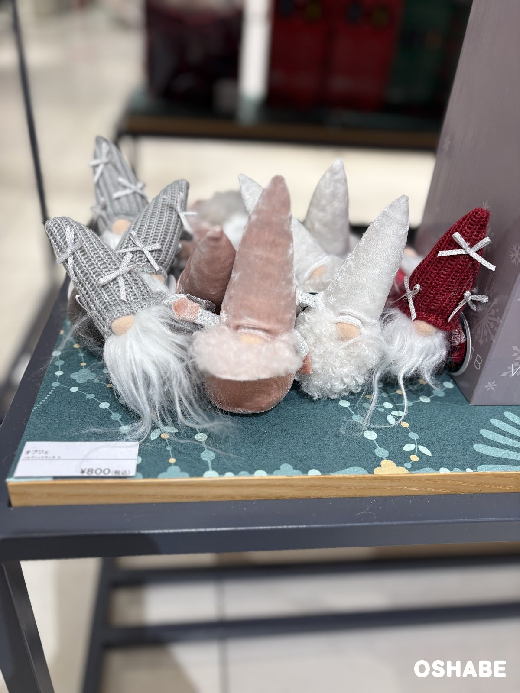
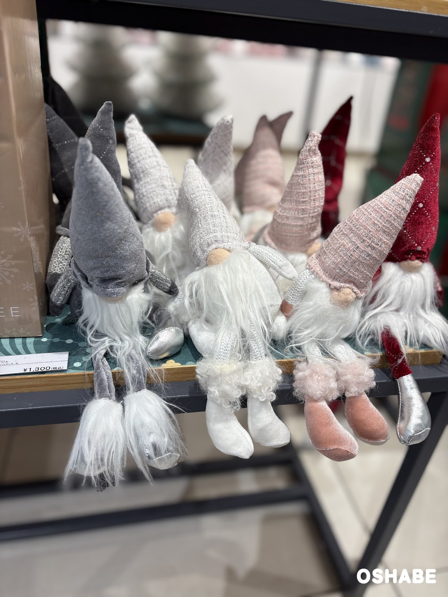
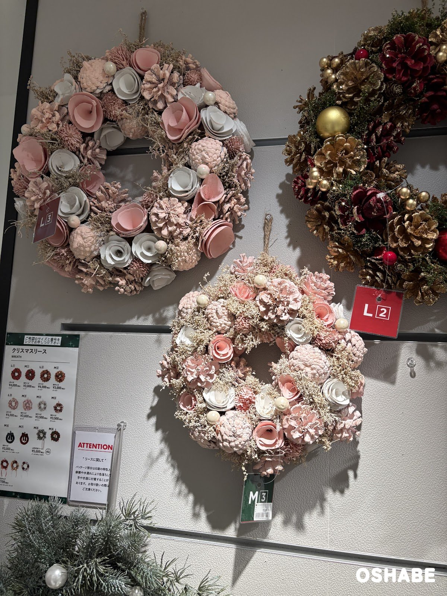
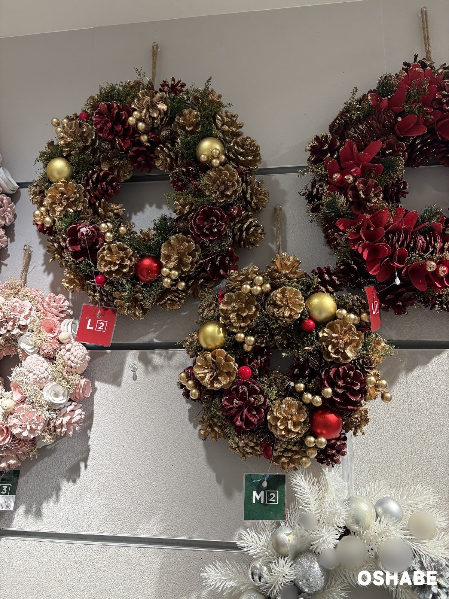
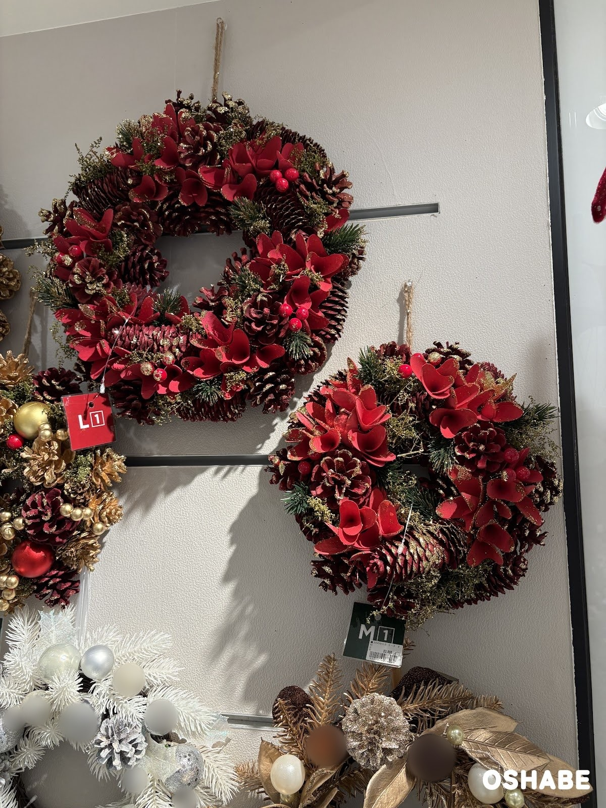
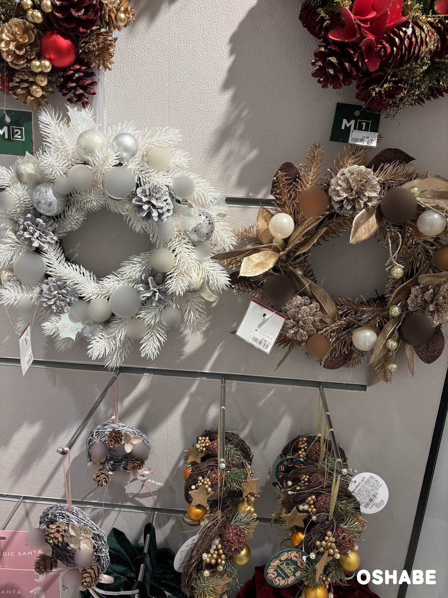

クリスマスまで、あと1か月ほどになりました☆

Francfranc（フランフラン）に行ったら、壁一面にクリスマスリースが飾られていました。

台の上には、とんがり帽子のサンタのオブジェもたくさん並んでいます。

玄関やお部屋をクリスマスらしくしたい方も多いですよね！

今回は『フランフランのクリスマス2026』について紹介していきたいと思います。

 ▼その他クリスマスグッズ2026はコチラ

- [LAKOLE（ラコレ）のクリスマス2026【画像・値段】リース、ツリー](../../../../2026/11/11/lakole-christmas-2026/)
- [アフタヌーンティーのクリスマス2026【画像・値段】紅茶、LEDライト](../../../../2026/11/06/afternoon-tea-christmas-2026/)
- [セリア100均のクリスマス飾り2026【画像・値段】ガーランド、ケーキピック](../../../../2026/11/08/seria-christmas-decoration/)
- [ダイソー100均のクリスマス雑貨2026【画像・値段】スノードーム、オブジェ](../../../../2026/11/04/daiso-christmas-2026/)

## フランフランのクリスマス2026【画像一覧】

値段は、店頭の値札と売り場の案内に書かれていた税込の値段です（2026年11月17日時点）。

### ノルディックサンタ

オブジェ ノルディックサンタ S

税込800円です。

目元まで隠れる大きな帽子をかぶった、小さなサンタのオブジェです。
帽子はグレーと赤のニット、ピンクと白のベロアのような生地があり、ニットの帽子には銀色の小さなリボンが付いています。
ふわふわの白いおひげから、丸い鼻だけがのぞいています。

棚の上やツリーの根元に、何人か並べて置けます。

色違いでそろえたくなる小ささです。

オブジェ ノルディックサンタ M

税込1,300円です。

Sよりひと回り大きく、長い脚の付いたサンタです。
帽子はグレー、白、ピンク、赤の4色が並んでいました。
白とピンクの帽子はラメの入ったツイードのような生地で、足先は白、ピンク、銀色です。

棚の端に置くと、脚をぶらんと下ろして座ってくれます。

何人か並べて座らせると、お部屋がにぎやかになりそうです♪

### クリスマスリース

売り場には見本のリースが掛かっていて、ほしいサイズと番号をレジで伝えて買う仕組みです。
案内に書かれていた値段は次のとおりです。

| サイズと番号 | 色 | 値段 |
| :--- | :--- | :--- |
| L1、L2、L3 | レッド、ゴールド、ピンク | 各税込4,000円 |
| M1、M2、M3 | レッド、ゴールド、ピンク | 各税込3,000円 |
| M4 | ホワイト | 税込3,500円 |
| M5 | グリッター | 税込3,500円 |
| M6、M7 | リボン グリーン、リボン レッド | 各税込3,000円 |
| M8、M9 | LED付きリース（パールリボン、リボン） | 各税込5,000円 |
| XS | レッド、ゴールド、ピンク | 各税込700円 |

クリスマスリース L3、M3（ピンク）

Lサイズは税込4,000円、Mサイズは税込3,000円です。

ピンクと白のバラのような花と、ピンクに塗られた松ぼっくりでできたリースです。
間にはパールのような白い玉と、ベージュのドライフラワーが入っています。
上には麻ひもの輪が付いています。

クリスマスが終わっても、春まで飾っておけそうな色合いです。

クリスマスリース L2、M2（ゴールド）

Lサイズは税込4,000円、Mサイズは税込3,000円です。

金色と深い赤の松ぼっくりを、すき間なく並べたリースです。
金色と赤のボールや、金色の小さな実も付いています。
松ぼっくりの先には、金色のラメがのっています。

玄関のドアに掛けると、パッと華やかになります。

定番の赤と金で、毎年使えるリースです。

クリスマスリース L1、M1（レッド）

Lサイズは税込4,000円、Mサイズは税込3,000円です。

赤い花びらと、赤く塗られた松ぼっくりでできたリースです。
花びらのふちと松ぼっくりの先には、金色のラメが付いています。
赤い実と緑の葉が、ところどころに入っています。

白い壁に掛けると、赤がよく映えます。

いちばんクリスマスらしい色のリースです。

クリスマスリース M4（ホワイト）、M5（グリッター）

どちらも税込3,500円です。

左のホワイトは、白いモミの葉に、銀色と白のボールと銀色の松ぼっくりを合わせたリースです。
右のグリッターは、金色の葉と、シャンパンゴールドのラメの松ぼっくりが付いています。
グリッターには、パールのような白い玉と、こげ茶やオレンジのボールも入っています。

ホワイトは雪の日のような、すっきりしたお部屋に合いそうです。

グリッターは大人っぽい色で、リビングに飾りたくなります。

## まとめ

いかがでしたか。

フランフランでは、ノルディックサンタのオブジェ2種類と、クリスマスリース15種類が並んでいました。

値段は、税込700円から5,000円までです。

クリスマスの飾り付けを始める前に、玄関やお部屋に合うリースを選んでみてはいかがでしょうか。

ぜひ参考にしてみてくださいね。
