前回はセリアのクリスマスシールを紹介しました☆

シールが掛かったフックのすぐそばには、クリスマスカードもたくさん並んでいました。

メッセージはスマホで送る方も多いですが、プレゼントに1枚添えるだけで気持ちが伝わりますよね！

今回は『セリアのクリスマスカード2026』について紹介していきたいと思います。

## セリアのクリスマスカード2026【画像一覧】

セリアの商品は、どれも税込110円です。商品名と大きさは、パッケージに書かれていたものです。

### メロディカード

どれも、押すと「We Wish You a Merry Christmas」のメロディが鳴るカードです。封筒が付いています。

メロディカード 紺色のサンタとトナカイ

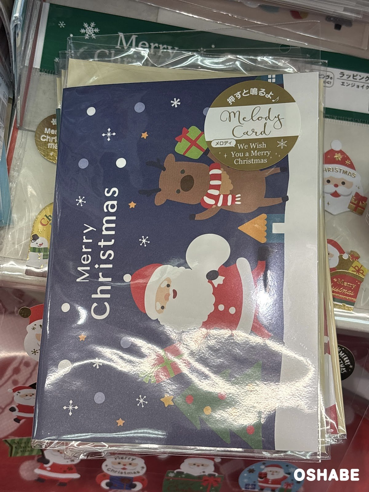

紺色の地に、手を振るサンタと、プレゼントを持ったトナカイが描かれています。白い「Merry Christmas」の文字は、カードの縦の向きに入っています。封筒はクリーム色です。

プレゼントの箱の上にのせて渡すと、押したときに曲が流れます。

メロディカード 赤のサンタとトナカイ

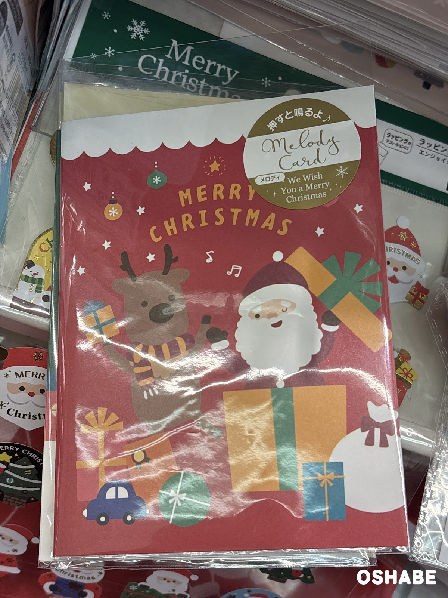

赤い地に、大きなプレゼントの箱から顔を出すサンタと、トナカイが描かれています。上の縁は白い波の形で、「MERRY CHRISTMAS」の文字はオレンジ色です。

足元に車やボールのおもちゃがあるので、子供へのプレゼントに合う絵柄です。

メロディカード 緑の雪だるま作り

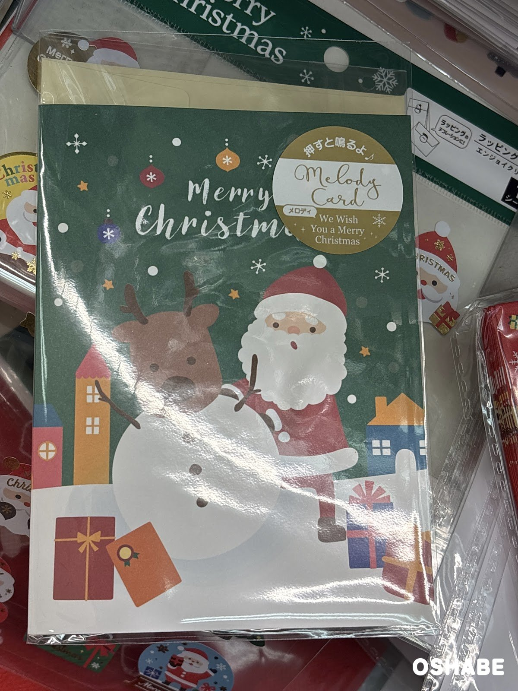

深い緑の地に、サンタとトナカイが雪だるまを作っている絵です。後ろには、オレンジや青の小さな家が並んでいます。

雪の町並みの絵なので、遠くに住む家族に送るカードにも使えます。

メロディカード くすんだ紫

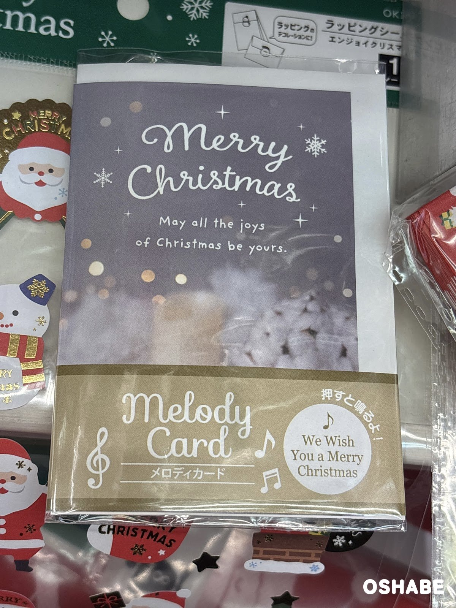

灰色がかった紫の地に、ぼんやりした明かりの写真が使われています。白い手書き風の「Merry Christmas」の下に、「May all the joys of Christmas be yours.」と英語の一文が入っています。下の金色の帯には「Melody Card」と書かれています。

キャラクターが入っていないので、大人の友達や職場の方に渡せます。

メロディカード 松ぼっくりと木のサンタ

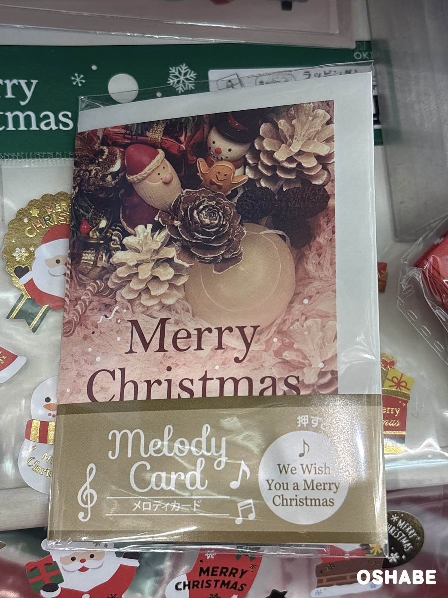

松ぼっくりや木のサンタ、雪だるまの人形、ジンジャーブレッドマンを写した写真のカードです。全体がくすんだピンクの色合いで、「Merry Christmas」の文字はえんじ色です。

木の人形の写真が、北欧の雑貨のような雰囲気です。

メロディカード 緑のチェック

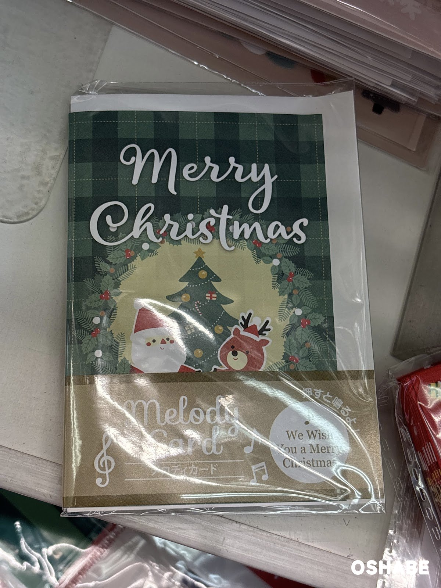

緑のチェック柄の地に、白い「Merry Christmas」の文字が入っています。ヒイラギのリースの中に、ツリーとサンタとトナカイが描かれています。

チェック柄とリースの組み合わせが、とってもクリスマスらしいカードです♪

### 3Dクリスマスカード

3Dクリスマスカード 3人の雪だるま

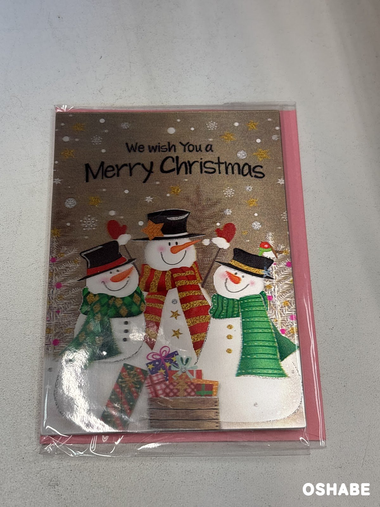

カードの大きさは、見開きで約H10.5×W14.5cmです。表面が凹凸のあるシートになっていて、絵が浮き上がって見えます。金色の地に、マフラーを巻いた3人の雪だるまと「We wish You a Merry Christmas」の文字が入っています。封筒はピンクです。

雪だるまのマフラーにも、金色のキラキラが入っています。

クリスマス会で配る1枚にすると、目を引くカードです。

3Dクリスマスカード 雪の森とそり

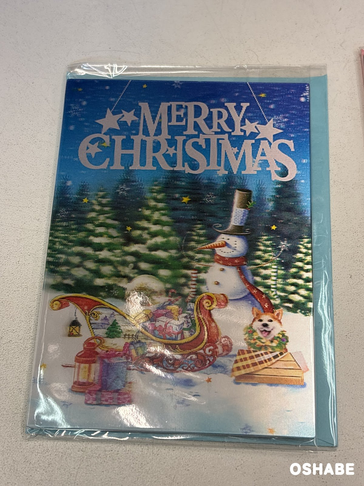

青い夜空と雪の積もったモミの木の森に、雪だるまと赤いそりが描かれています。木の箱の中から、リースを付けた犬が顔を出しています。封筒は水色です。

奥行きのある絵なので、机に立てて飾っておけます。

### ポップアップカード

amifa Christmas Pop up card

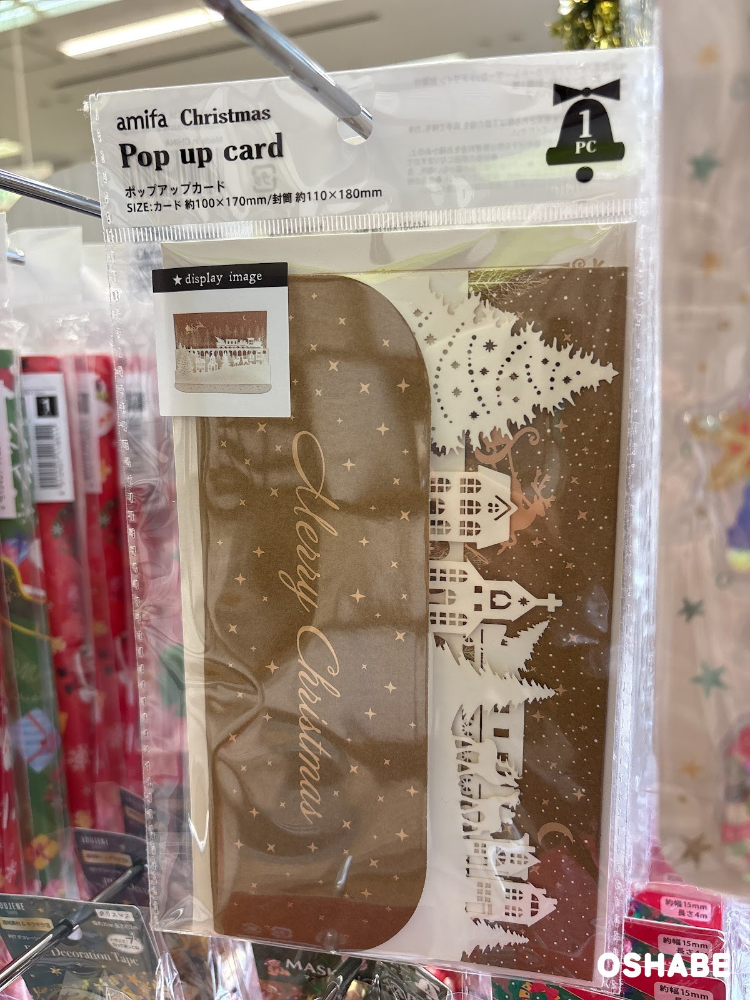

アミファ（amifa）のポップアップカードで、カードは約100×170mm、封筒は約110×180mmです。茶色の地に、白い紙を切り抜いたツリーや教会、家並み、そりを引くトナカイが付いています。見本の写真のように、開くと町並みが立ち上がります。

メッセージを書いたあと、開いたまま棚に置けば小さな飾りになります。

### ファブリックミニカード

amifa Christmas Fabric embellished mini card

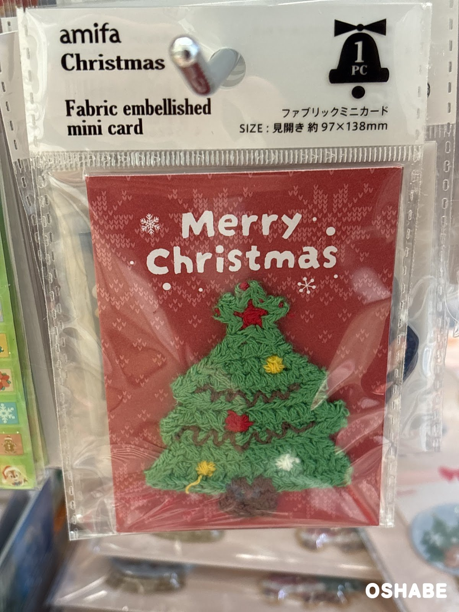

アミファのミニカードで、大きさは見開きで約97×138mmです。赤いニット柄の地に、緑の糸のもこもこしたツリーが付いています。ツリーには、赤い星や黄色の飾りの刺しゅうも入っています。

手で触れる立体のツリーなので、子供に渡すカードに向いています。

### ミニカードセット

amifa Christmas Mini card set サンタとコアラ

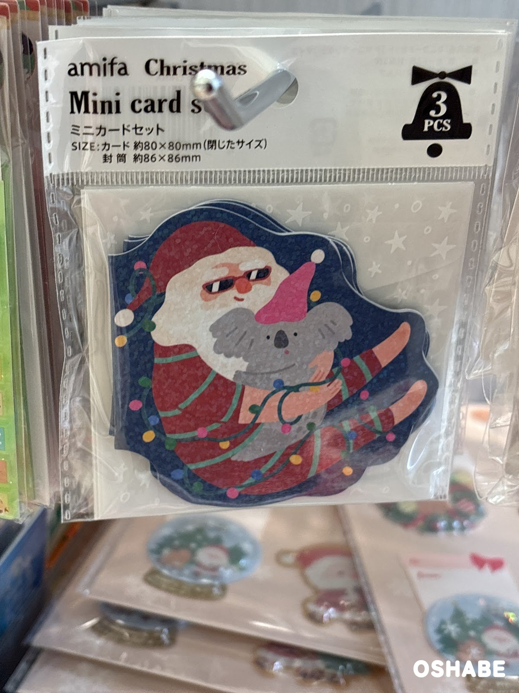

アミファのミニカードセットで、3枚入りです。カードは閉じた大きさが約80×80mm、封筒は約86×86mmです。サングラスのサンタがコアラを抱いて、カラフルな電球のコードを体に巻いた絵で、カードは絵の形に切り抜かれています。

小さいので、プレゼントの袋の中に1枚入れておけます。

amifa Christmas Mini card set ヤシの木とサンタ

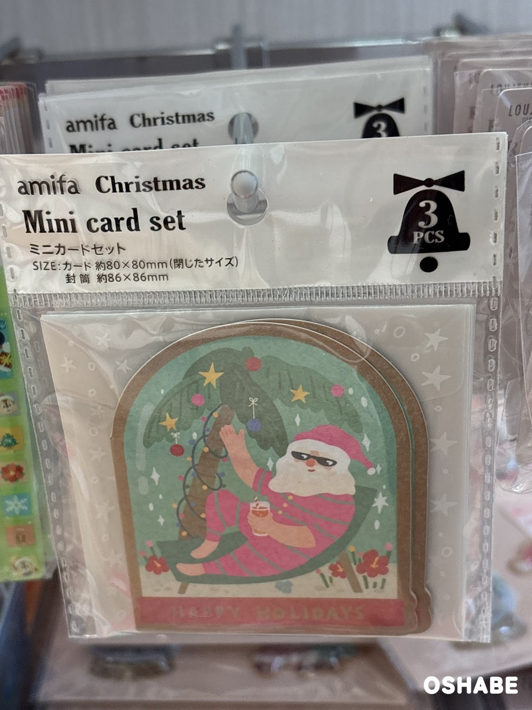

同じアミファのミニカードセットで、上が丸いアーチの形です。ヤシの木の下で、ピンクの服のサンタがビーチチェアに寝そべっています。下の帯には「HAPPY HOLIDAYS」と書かれています。

前回のシールと同じ、夏のクリスマスのような明るい柄です。

### ポチ袋

OKINI ポチ袋 万型 赤

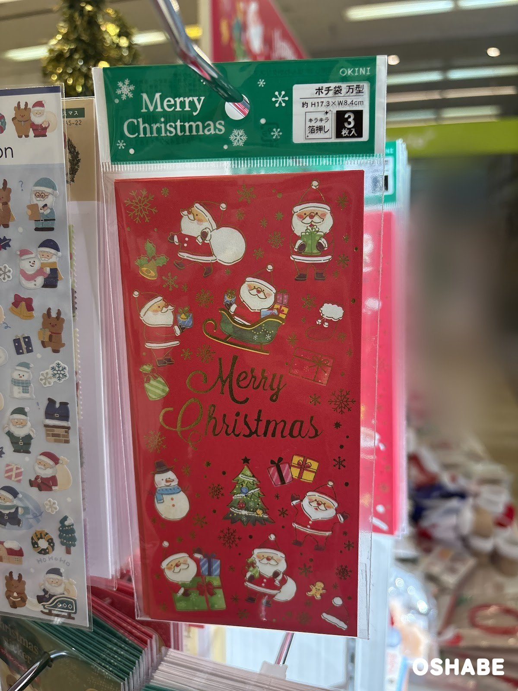

OKINI（オキニ）のポチ袋で、3枚入りです。大きさは約H17.3×W8.4cmの万型で、お札を折らずに入れられます。赤い地に、サンタやそり、ツリーの絵が並び、雪の結晶と「Merry Christmas」の文字は金色の箔押しです。

クリスマスにお小遣いやギフトカードを渡すときに使えます。

OKINI ポチ袋 万型 クリーム色

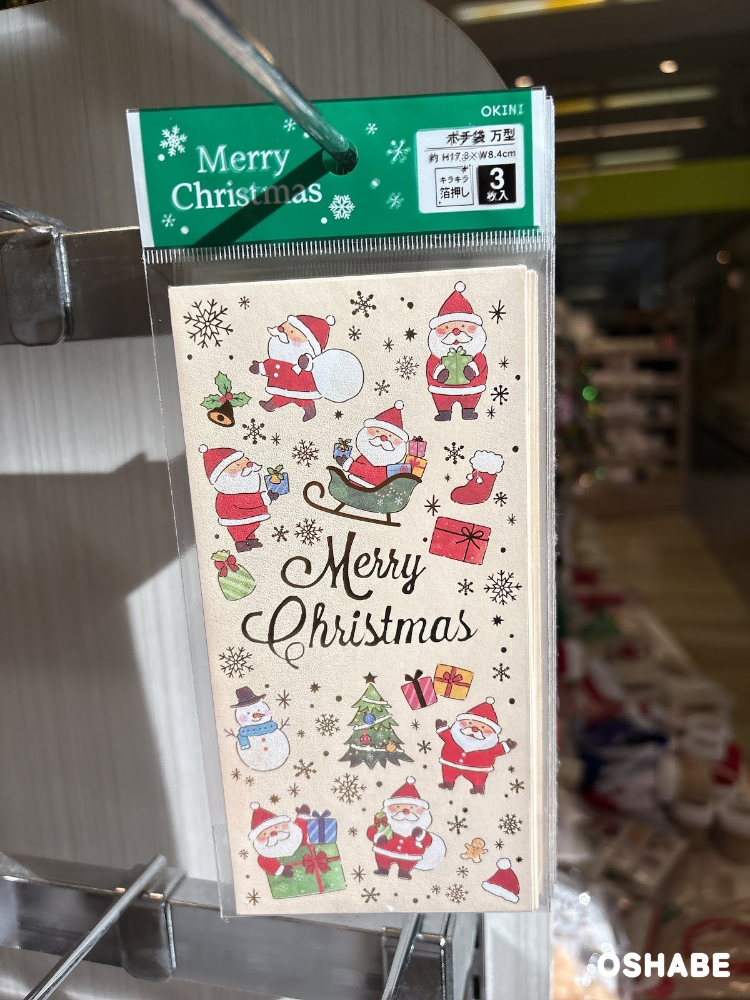

同じ柄の、クリーム色の地のポチ袋です。こちらも3枚入りで、金色の箔押しが入っています。

赤よりも絵柄がはっきり見えて、やさしい雰囲気です。

### スタンプ

LOUJENE TOKYO ラバースタンプ クリスマス

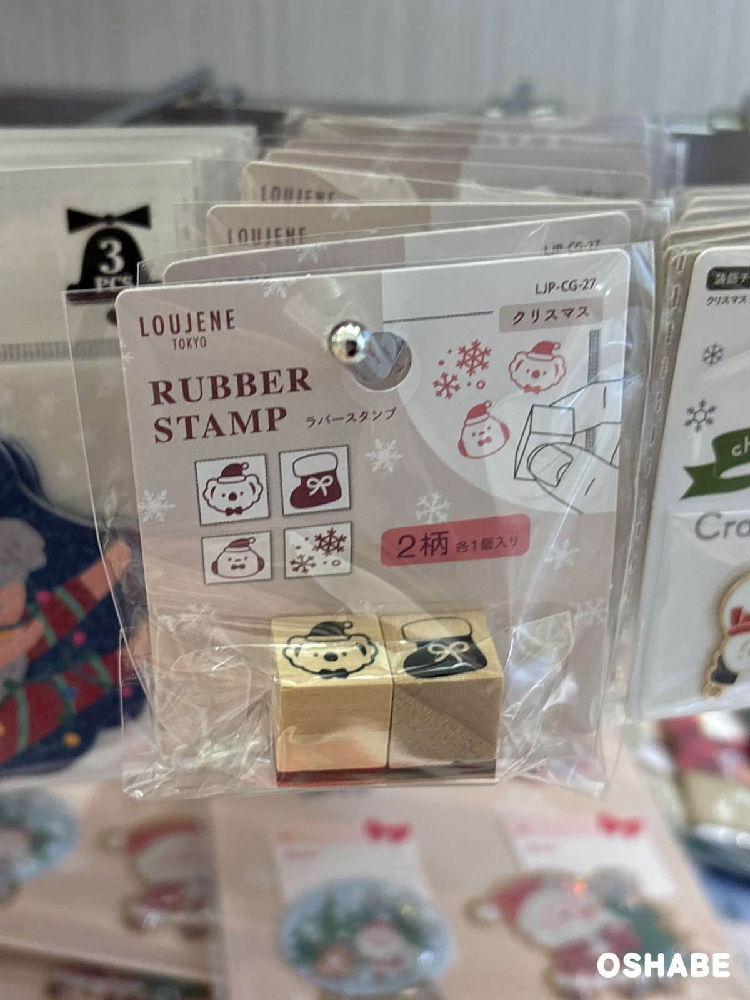

LOUJENE TOKYO のラバースタンプで、2柄が各1個入っています。この袋は、サンタの帽子をかぶった動物の顔と、リボンの付いたブーツの柄です。持ち手は木のブロックです。

カードの空いたところや封筒の裏に押すと、手作りのカードのようになります。

## まとめ

いかがでしたか。

セリアでは、メロディカード6種類、3Dカード2種類、ポップアップカード、ミニカード3種類と、ポチ袋2種類、スタンプが並んでいました。

値段は、どれも税込110円です。

12月の初めに選んでおけば、クリスマス会やプレゼントを渡す日に間に合います。

ぜひ参考にしてみてくださいね。

## 他のクリスマス関連はこちら

▼2026年のクリスマスグッズ

- [ダイソー100均のクリスマスカチューシャ2026【画像・値段】サンタ、トナカイ](../../../../2026/11/03/daiso-christmas-headband/)
- [ダイソー100均のサンタコスプレ2026【画像・値段】子供のサンタ服、ワンピース](../../../../2026/11/09/daiso-santa-costume-2026/)
- [ダイソー100均のクリスマス雑貨2026【画像・値段】スノードーム、オブジェ](../../../../2026/11/04/daiso-christmas-2026/)
- [セリア100均のクリスマス飾り2026【画像・値段】ガーランド、ケーキピック](../../../../2026/11/08/seria-christmas-decoration/)
- [セリア100均のクリスマスシール2026【画像・値段】フレーク、マスキングテープ](../../../../2026/11/19/seria-christmas-stickers-2026/)
- [セリア100均のクリスマス仮装2026【画像・値段】カチューシャ、ぬい服、ペット](../../../../2026/11/22/seria-christmas-headband-2026/)
- [セリア100均のクリスマスオーナメント2026【画像・値段】ツリー、りんご](../../../../2026/11/21/seria-christmas-ornaments-2026/)
- [ワッツ100均のクリスマス2026【画像・値段】オーナメント、カチューシャ](../../../../2026/11/02/xmas-ornament-headband/)
- [ニトリ デコホームのクリスマス飾り2026【画像・値段】ツリー、オーナメント](../../../../2026/11/16/nitori-christmas-2026/)
- [無印良品のクリスマスお菓子2026【画像・値段】バウムリース、ヘクセンハウス](../../../../2026/11/12/muji-christmas-sweets/)
- [フランフランのクリスマスツリー2026【画像・値段】スターターセット](../../../../2026/11/15/francfranc-christmas-tree-2026/)
- [フランフランのクリスマス2026【画像・値段】リース、ノルディックサンタ](../../../../2026/11/18/francfranc-christmas-2026/)
- [ナチュラルキッチンのクリスマス食器2026【画像・値段】サンタの皿、箸置き、紙皿](../../../../2026/11/17/christmas-tableware-2026/)
- [アフタヌーンティーのクリスマス2026【画像・値段】紅茶、LEDライト](../../../../2026/11/06/afternoon-tea-christmas-2026/)
- [LAKOLE（ラコレ）のクリスマス2026【画像・値段】リース、ツリー](../../../../2026/11/11/lakole-christmas-2026/)
- [TOP TOYのMayMei2026【画像・値段】冬のぬいぐるみ、がま口](../../../../2026/11/10/toptoy-maymei-winter/)

▼クリスマスの記事をまとめて見る

- [クリスマスの記事の一覧](../../../../category/xmas/)
