クリスマスツリーを出したら、次はオーナメント選びですよね！

セリア（Seria）のクリスマス売り場には、小さなツリーと、袋に入ったオーナメントが壁いっぱいに掛かっていました☆

ツリーの足元を隠すツリースカートや、てっぺんに付けるトップスターもそろっています。

今回は『セリアのクリスマスツリー2026』について紹介していきたいと思います。

## セリアのクリスマスツリー2026【画像一覧】

セリアの商品は、どれも税込110円です。パッケージやタグで確かめられた商品名と大きさは、そのまま書いています。

### モールとフェルトのツリー

金色のモールのツリー

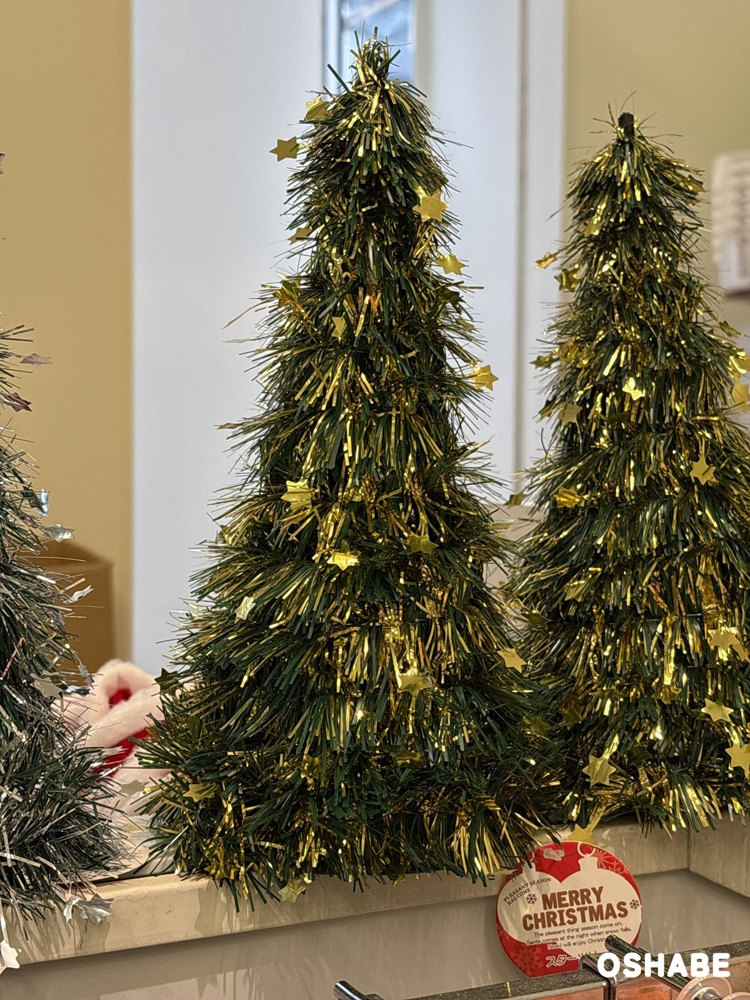

緑のモールに金色のモールを混ぜて、円すい形にしたツリーです。ところどころに、金色の星が付いています。

棚や玄関に置くだけで、ツリーを出したような雰囲気になります。

銀色のモールのツリー

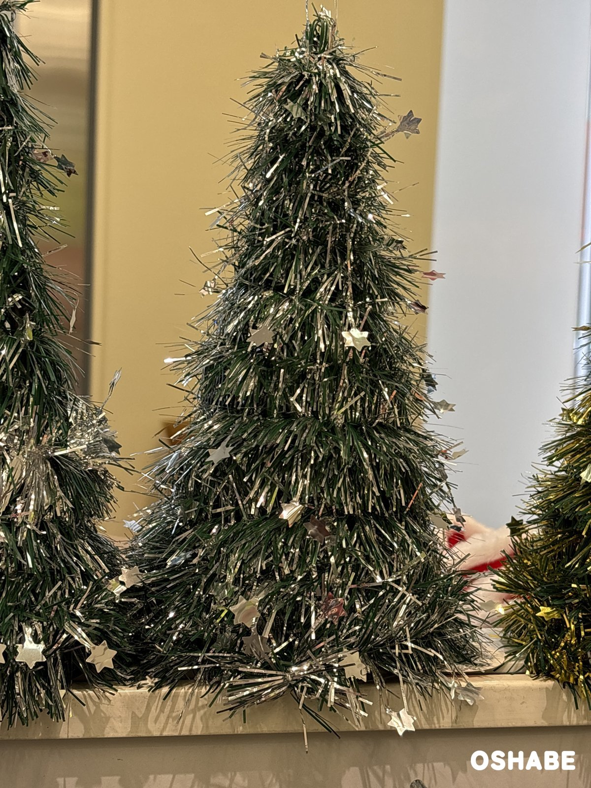

こちらは、緑のモールに銀色のモールと銀色の星を合わせたツリーです。

金色のツリーと並べて置くと、小さなツリーの林のようになります。

袋入りの銀色のツリー

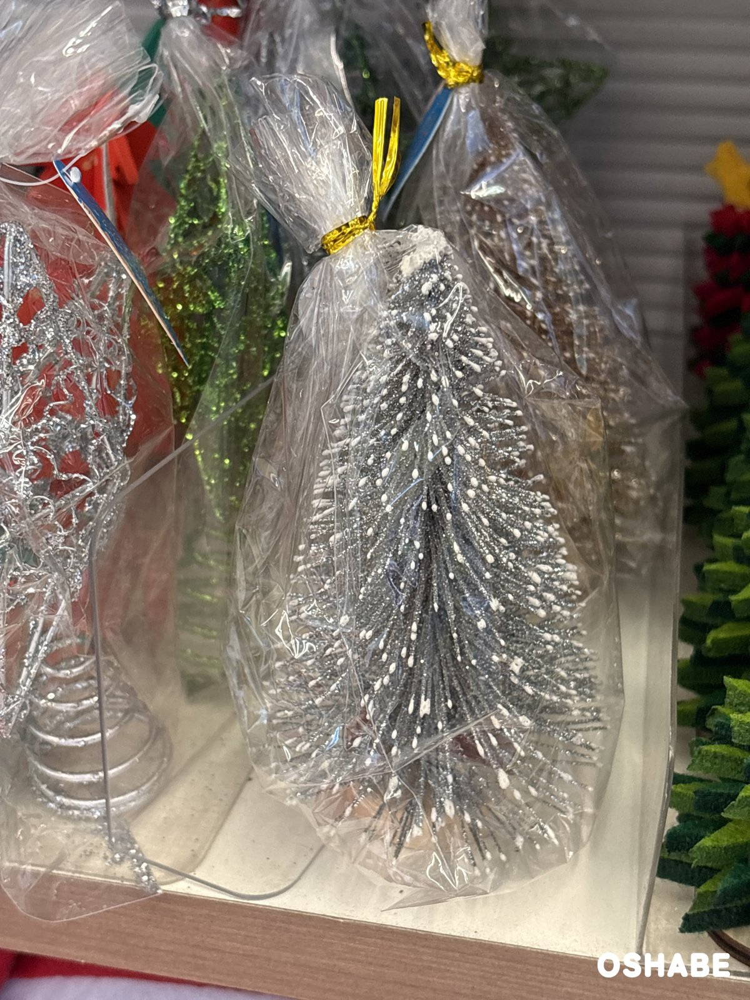

雪が付いたような銀色のブラシのツリーが、透明な袋に入っています。後ろには、緑のラメのツリーもありました。

ミニチュアの置物と合わせて飾れます。

フェルトのツリー

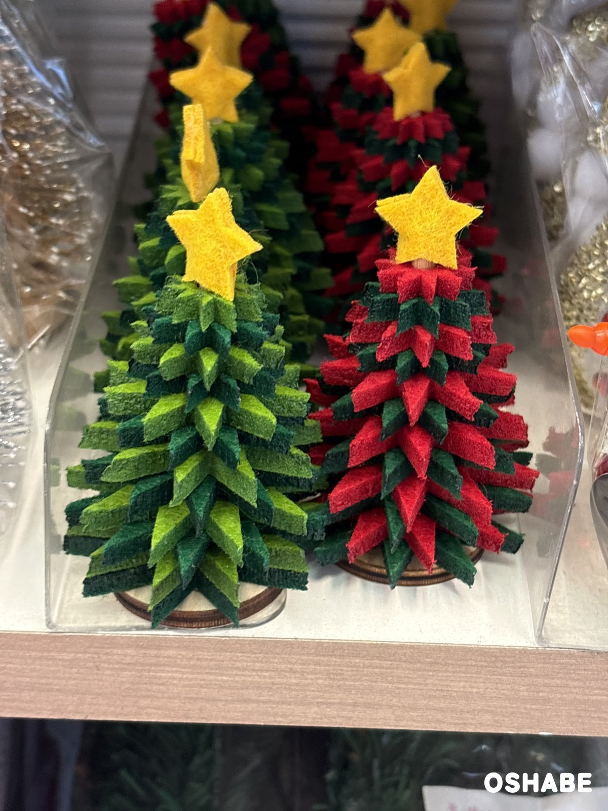

フェルトを何枚も重ねて作った、緑と赤のツリーです。てっぺんには、黄色いフェルトの星が付いています。

赤と緑を並べると、クリスマスらしい色の組み合わせになります。

### 卓上のツリーと足元の飾り

クリスマスヌードツリー 35cm

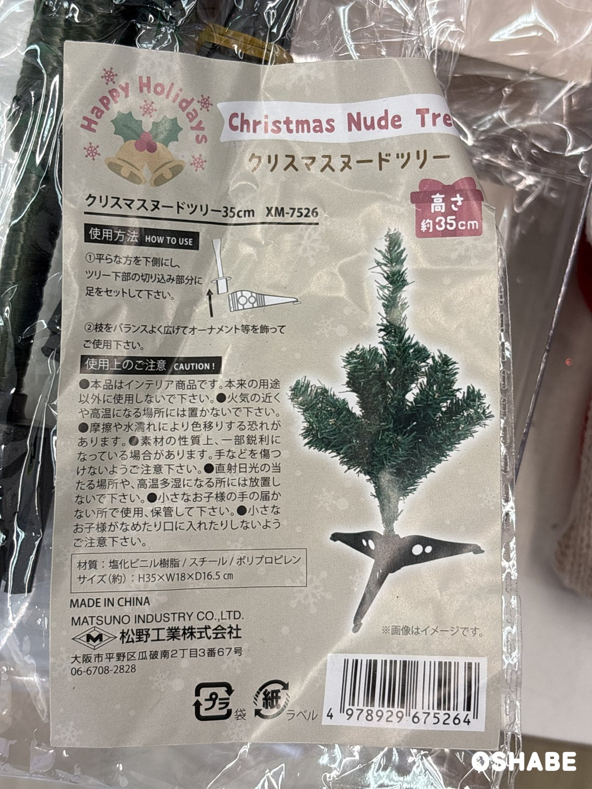

高さ約35cmの、飾りの付いていない緑のツリーです。幹の下の切り込みに脚を差し込んで立てる作りで、材質は塩化ビニル樹脂とスチールです。

オーナメントを自分で選んで飾るので、好きな色でそろえたツリーが作れます。

ホワイトファーツリースカート 直径約30cm

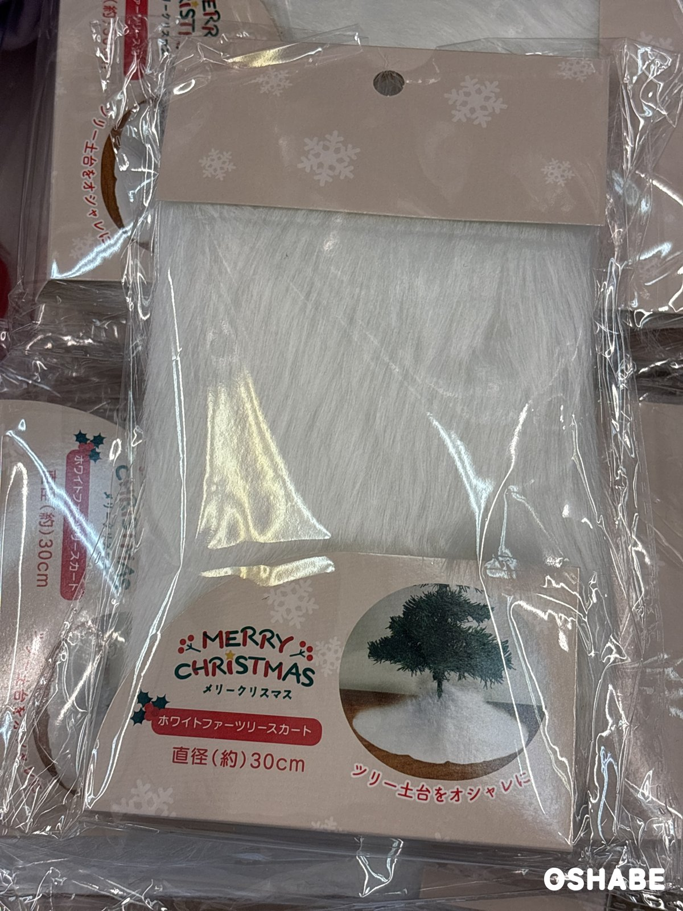

白いふわふわのファーでできた、丸いツリースカートです。パッケージには「ツリー土台をオシャレに」と書かれています。

ヌードツリーの脚に巻くと、雪が積もったような足元になります。

3Dツリーオブジェ

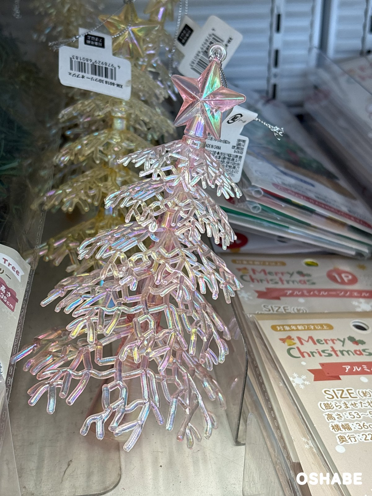

虹色に光る透明なパーツを重ねた、ツリーの形の置物です。てっぺんには星が付いていて、ピンクとゴールドの2色が並んでいました。

窓辺に置くと、光が当たってキラキラします☆

ツリー型ディスプレイスタンド

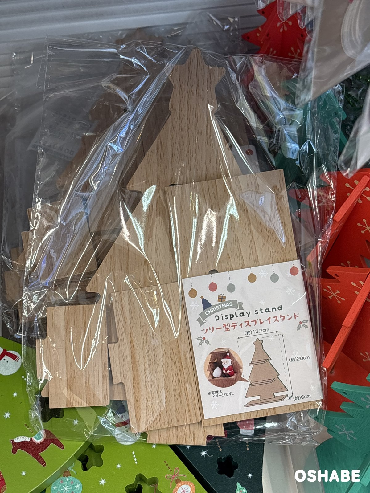

木目のツリーの形をした、組み立て式のスタンドです。大きさは約 幅13.7×高さ20×奥行き6cm です。

小さなサンタの置物やフィギュアを、段に並べて飾れます。

### トップスターとベル

クリスマスシャイニートップスター、クリスマスホーリーベル、ニットガールオーナメント

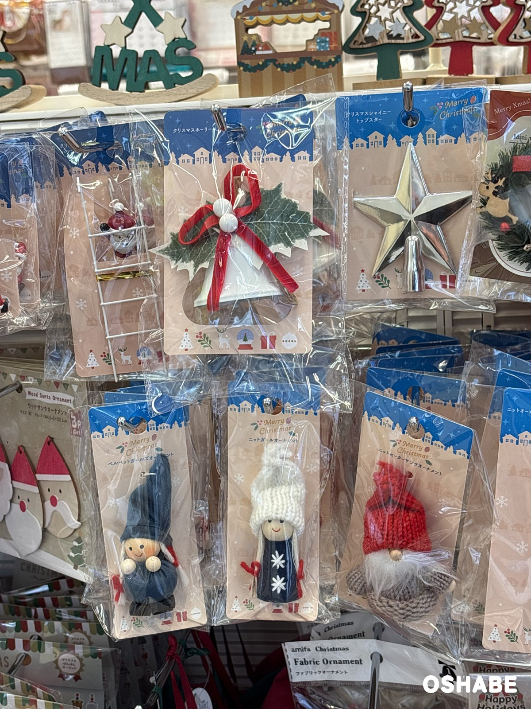

クリスマスシャイニートップスターは、銀色に光る星のトップスターです。クリスマスホーリーベルは、白いベルにヒイラギの葉と赤いリボンが付いています。

下の段には、木の顔にニットの帽子をかぶった人形のオーナメントが並んでいました。ベルベットガールズオーナメント、ニットガールオーナメント、ニットセーターサンタオーナメントの3種類です。

人形のオーナメントを枝に並べて下げると、ツリーがにぎやかになります♪

ツリートップスター アラベスク、ミックスオーナメント

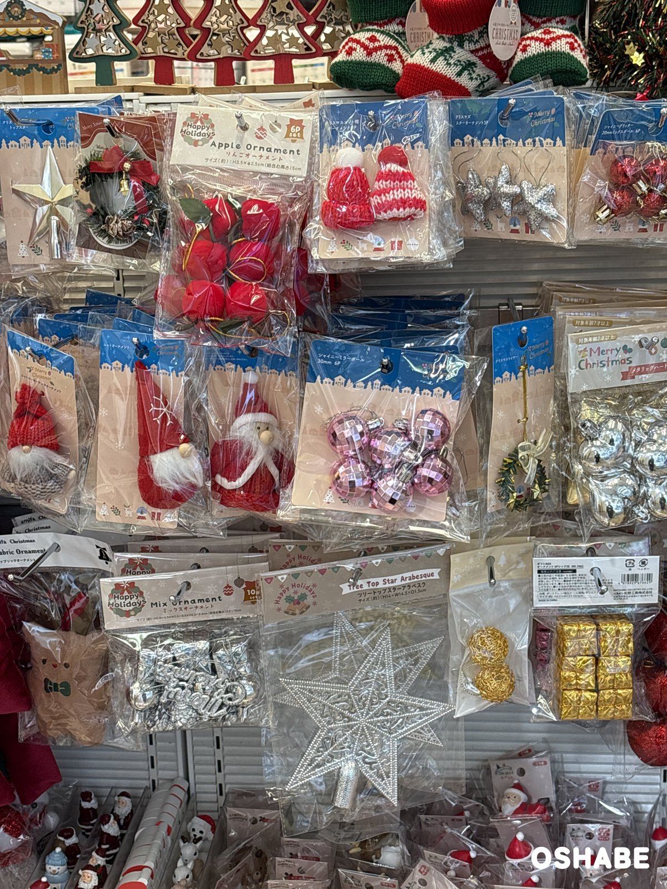

ツリートップスター アラベスクは、唐草模様のすかしが入った銀色の星です。大きさは約 高さ14×幅14.5×奥行き1.5cm です。

左下のミックスオーナメントは、銀色の小さな飾りがいろいろ入った10個入りです。

シンプルな銀色なので、どんな色のツリーにも合わせやすいです。

シャイニーベルオーナメント

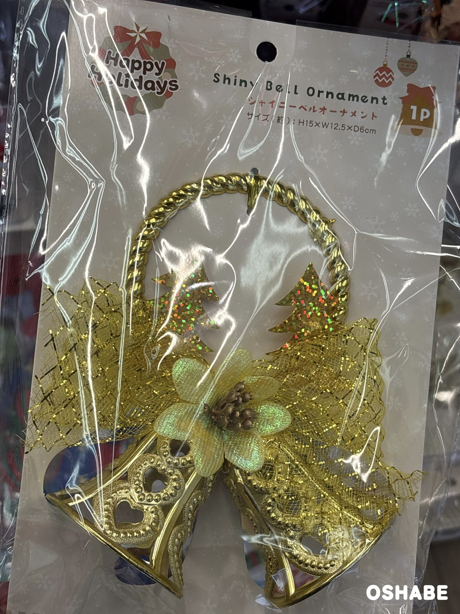

金色の2つのベルに、金色のネットと薄い緑の花、キラキラのツリーの飾りが付いています。大きさは約 高さ15×幅12.5×奥行き6cm で、1個入りです。

上に輪が付いているので、ドアノブやリースに掛けて飾れます。

### りんごとニットのオーナメント

りんごオーナメント 6P、ニットオーナメント、シャイニーミラーボール 30mm 6P

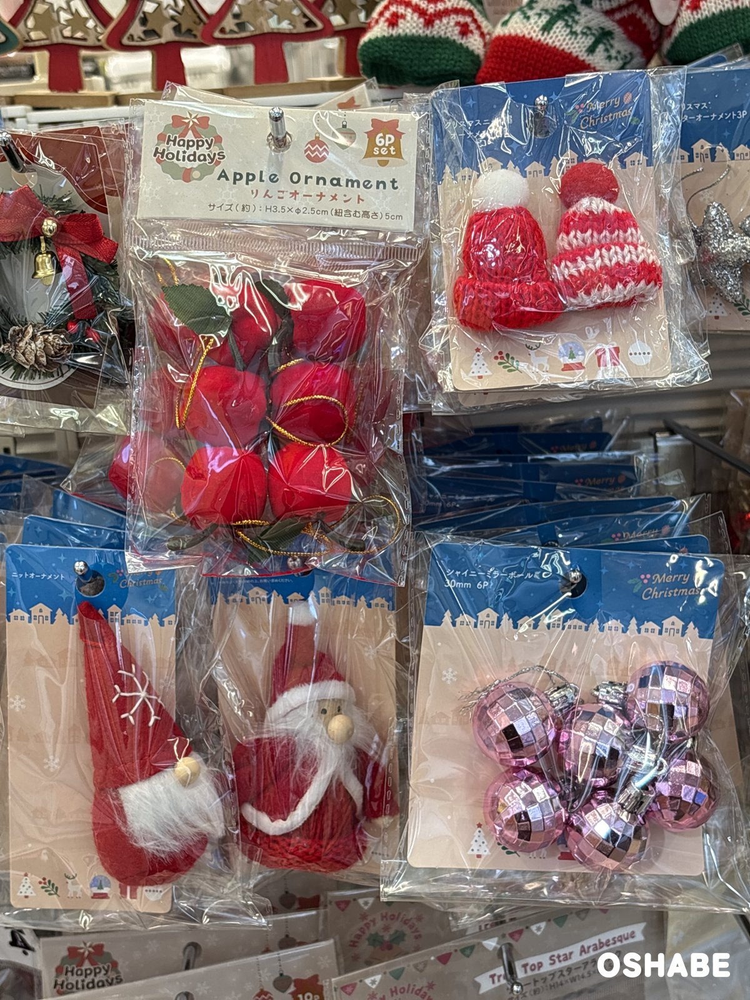

りんごオーナメントは、赤いりんごに緑の葉が付いた6個入りです。大きさは約 高さ3.5×直径2.5cm です。

ニットオーナメントは、赤いニットの長い帽子をかぶったサンタです。シャイニーミラーボールは、ピンクの鏡のボールが6個入っています。

赤いりんごを枝のあちこちに下げると、昔ながらのツリーになります。

### ボールとハートのオーナメント

クリスマススターオーナメント3P、シャイニーグリッター20mmミックスボール 6P、アンティークボール 20mm 6P

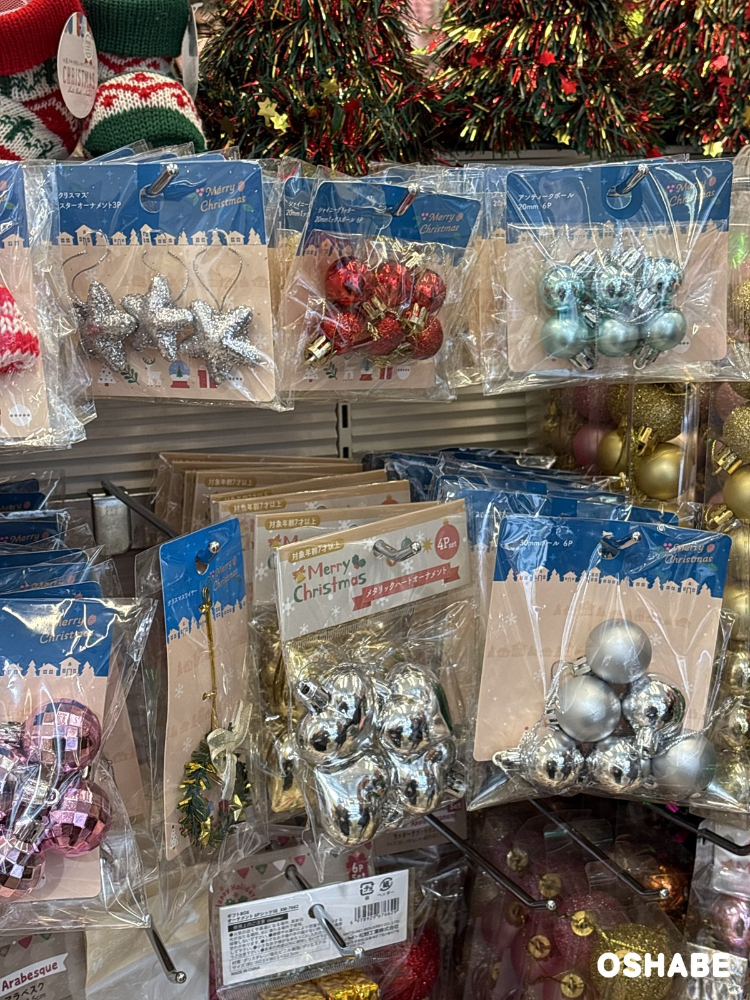

クリスマススターオーナメントは、銀色のラメの星の3個入りです。ミックスボールは赤、アンティークボールは水色で、どちらも直径20mmの6個入りです。

下の段には、銀色のハートが入ったメタリックハートオーナメントも並んでいました。

同じ色のボールをまとめて下げると、ツリーの色に統一感が出ます。

### アクリルと布のオーナメント

アクリルオーナメント 雪の結晶、ミニチュアクリスマスフィギュア

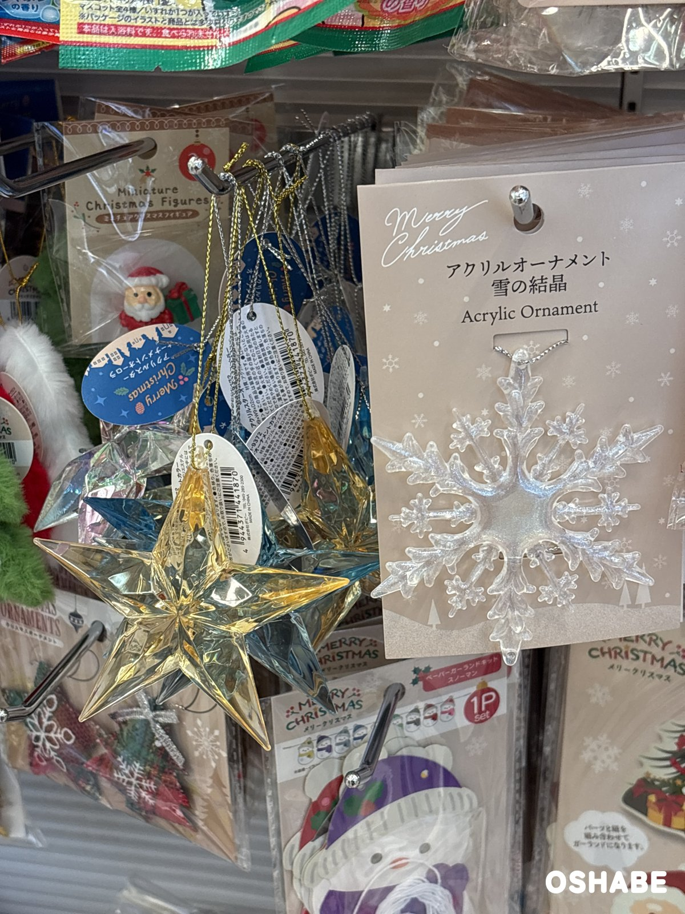

アクリルオーナメント 雪の結晶は、透明な雪の結晶の形のオーナメントです。左には、サンタがプレゼントを抱えたミニチュアクリスマスフィギュアもありました。

窓に近い枝に下げると、光が透けてきれいに見えます。

amifa（アミファ）のファブリックオーナメント

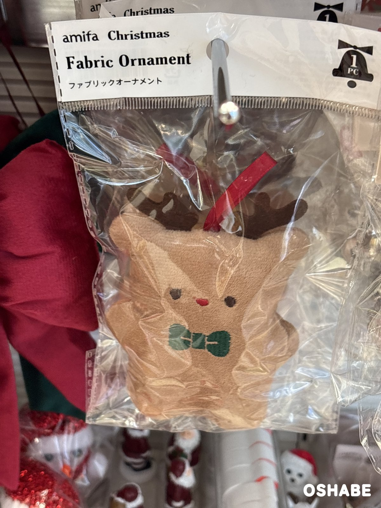

ベージュの布でできた、トナカイの形のオーナメントです。茶色の角と、緑の蝶ネクタイの刺しゅうが付いています。

布でできているので、子供が触っても割れる心配がありません。

クリスマスベロアリボンオーナメント

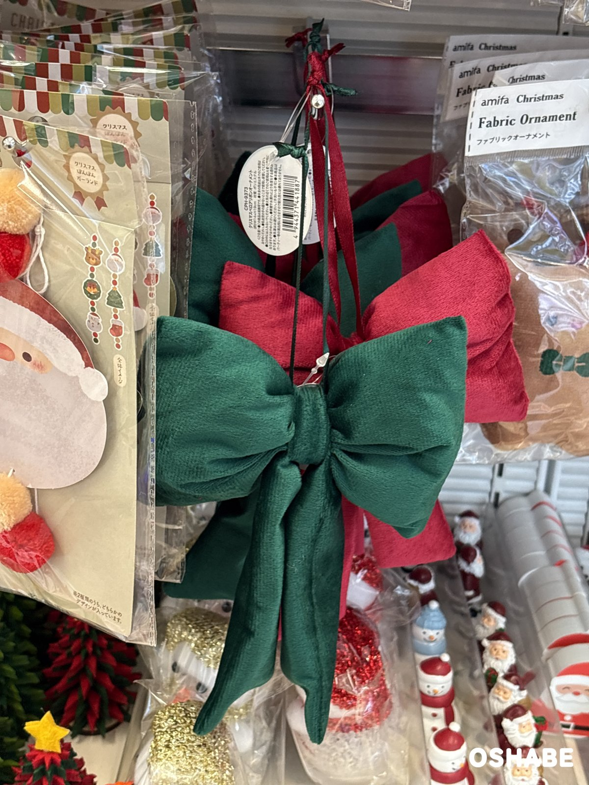

緑と赤の、ベロアの大きなリボンのオーナメントです。上に長いひもが付いていて、ツリーや壁に下げられます。

ツリーのてっぺんに付けると、星の代わりになります。

クリスマスベルベットリボン 5P

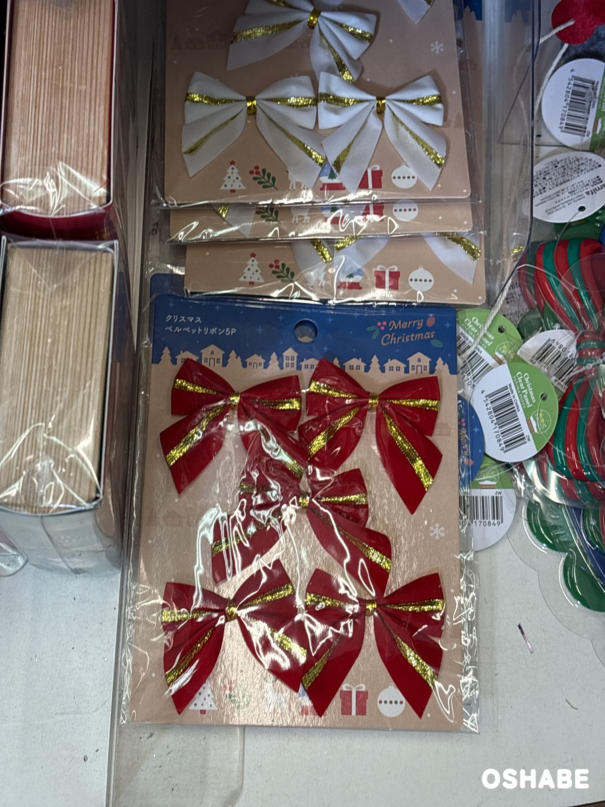

赤いベルベットに、金色のラインが入った小さなリボンの5個入りです。上には、白いリボンのセットも並んでいました。

プレゼントのラッピングにも使えます。

## まとめ

いかがでしたか。

セリアには、モールやフェルトのツリー、ツリースカートと、いろいろなオーナメントが並んでいました。

値段は、どれも税込110円です。

12月の飾り付けの前に、家族でオーナメントを選ぶのも楽しい時間になります♪

ぜひ参考にしてみてくださいね。

## 他のクリスマス関連はこちら

▼2026年のクリスマスグッズ

- [ダイソー100均のクリスマスカチューシャ2026【画像・値段】サンタ、トナカイ](../../../../2026/11/03/daiso-christmas-headband/)
- [ダイソー100均のサンタコスプレ2026【画像・値段】子供のサンタ服、ワンピース](../../../../2026/11/09/daiso-santa-costume-2026/)
- [ダイソー100均のクリスマス雑貨2026【画像・値段】スノードーム、オブジェ](../../../../2026/11/04/daiso-christmas-2026/)
- [セリア100均のクリスマス飾り2026【画像・値段】ガーランド、ケーキピック](../../../../2026/11/08/seria-christmas-decoration/)
- [セリア100均のクリスマスシール2026【画像・値段】フレーク、マスキングテープ](../../../../2026/11/19/seria-christmas-stickers-2026/)
- [セリア100均のクリスマスカード2026【画像・値段】メロディカード、ポチ袋](../../../../2026/11/21/seria-christmas-cards-2026/)
- [セリア100均のクリスマス仮装2026【画像・値段】カチューシャ、ぬい服、ペット](../../../../2026/11/22/seria-christmas-headband-2026/)
- [ワッツ100均のクリスマス2026【画像・値段】オーナメント、カチューシャ](../../../../2026/11/02/xmas-ornament-headband/)
- [ニトリ デコホームのクリスマス飾り2026【画像・値段】ツリー、オーナメント](../../../../2026/11/16/nitori-christmas-2026/)
- [無印良品のクリスマスお菓子2026【画像・値段】バウムリース、ヘクセンハウス](../../../../2026/11/12/muji-christmas-sweets/)
- [フランフランのクリスマスツリー2026【画像・値段】スターターセット](../../../../2026/11/15/francfranc-christmas-tree-2026/)
- [フランフランのクリスマス2026【画像・値段】リース、ノルディックサンタ](../../../../2026/11/18/francfranc-christmas-2026/)
- [ナチュラルキッチンのクリスマス食器2026【画像・値段】サンタの皿、箸置き、紙皿](../../../../2026/11/17/christmas-tableware-2026/)
- [アフタヌーンティーのクリスマス2026【画像・値段】紅茶、LEDライト](../../../../2026/11/06/afternoon-tea-christmas-2026/)
- [LAKOLE（ラコレ）のクリスマス2026【画像・値段】リース、ツリー](../../../../2026/11/11/lakole-christmas-2026/)
- [TOP TOYのMayMei2026【画像・値段】冬のぬいぐるみ、がま口](../../../../2026/11/10/toptoy-maymei-winter/)

▼クリスマスの記事をまとめて見る

- [クリスマスの記事の一覧](../../../../category/xmas/)
