玄関の棚にちょこんと飾るツリーと、リビングで枝いっぱいに飾り付けるツリー。ダイソーのクリスマス売り場には、どちらを選ぶか迷ってしまうほどサイズが揃っていました！

箱に描かれたツリーはどれもよく似ていますが、高さは90cm、120cm、150cmとかなり違います。小さな卓上ツリーも合わせて、置き場所を思い浮かべながら見ていきましょう。

今回は『ダイソーのクリスマスツリーと電飾イルミネーションライト』を、ツリーのサイズ、飾り付け、ライトの順に紹介していきたいと思います。

## ダイソー100均のクリスマスツリー2026【画像一覧】

### 棚にちょこんと置ける23cmと35cmのヌードツリー

まずは高さ23cmのヌードツリーです。

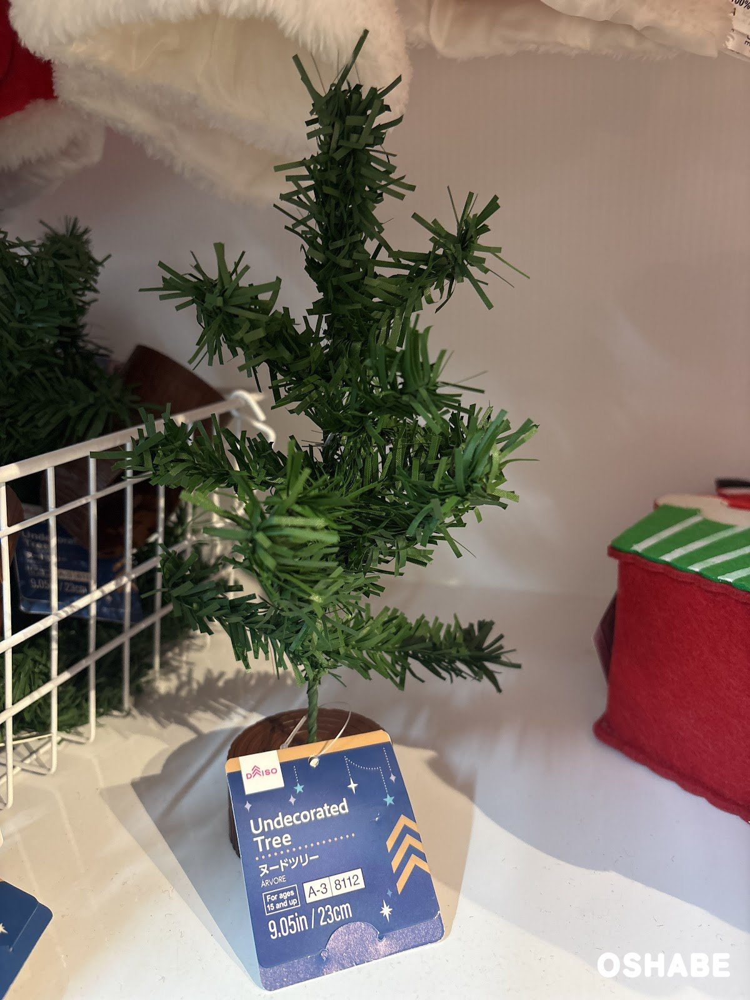

小さな茶色い台座から、濃い緑の枝が段々に伸びています。下の枝は横に広く、てっぺんには細い枝が一本。小さなリボンをひとつ結ぶだけでも、緑の中に色が入って可愛いですね♪

もう少し枝を飾りたいときは、こちらの35cm。

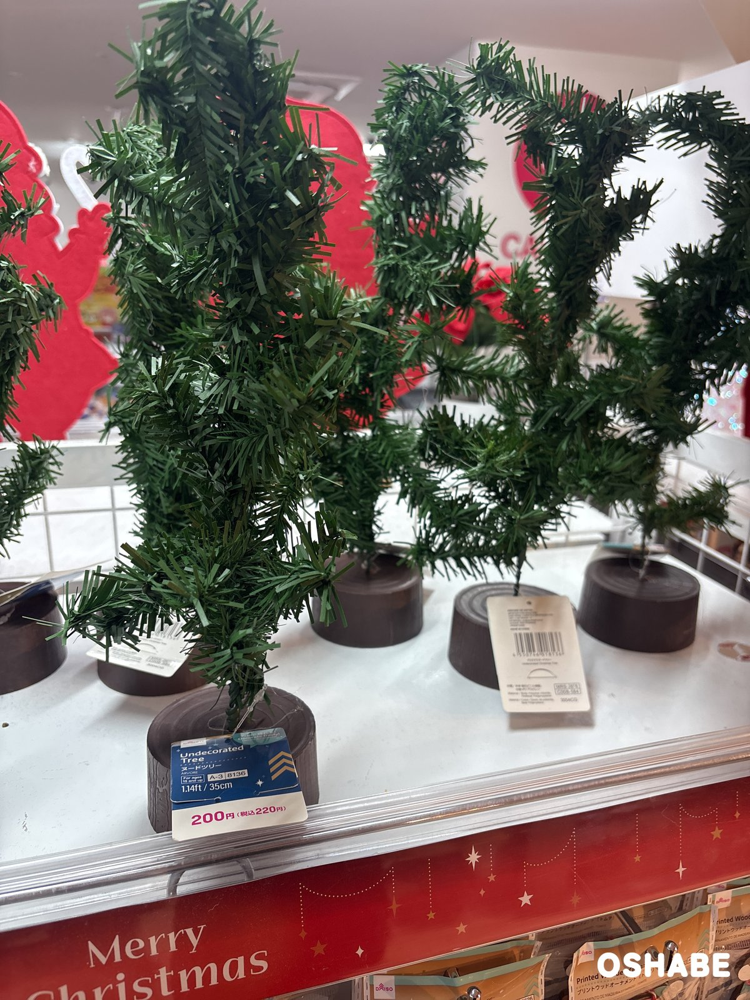

35cmは税込220円です。葉の間から向こう側が見えるので、小さなボールを枝先に下げると形が引き立ちそう。手前の青いタグには、高さと値段が並んでいます。

### 90cmはグリーンとホワイトがどちらも税込550円

クリスマスツリー（グリーン、90cm）

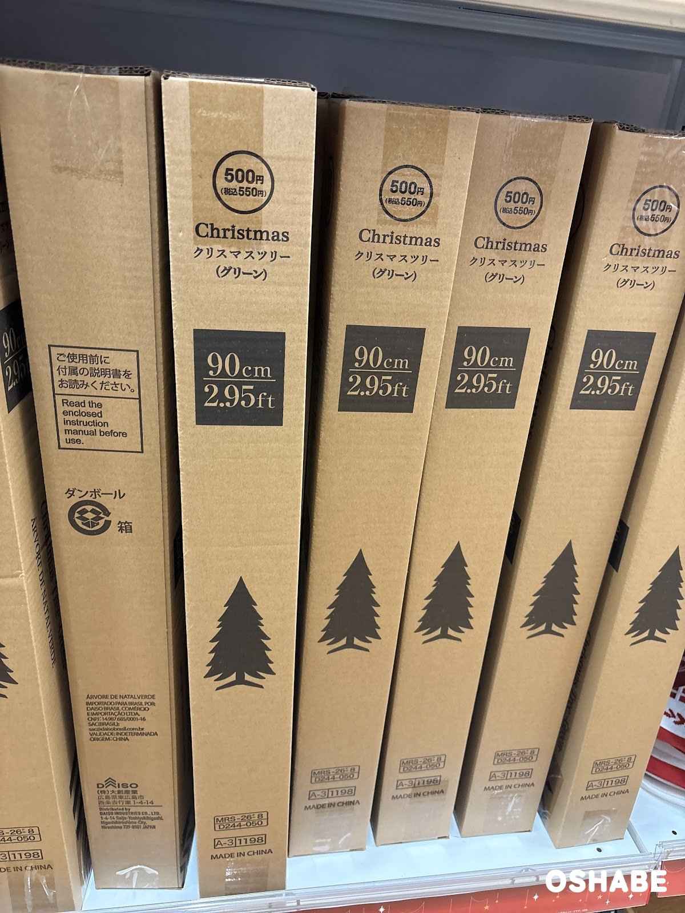

税込550円です。床に置いて飾りたいときに選びやすいのがこのサイズ。グリーンには、白い雪の飾りも赤いボールもよく映えます。

クリスマスツリー（ホワイト、90cm）

ホワイトも税込550円です。箱の上には青地に白いツリーを描いたラベルが付いています。

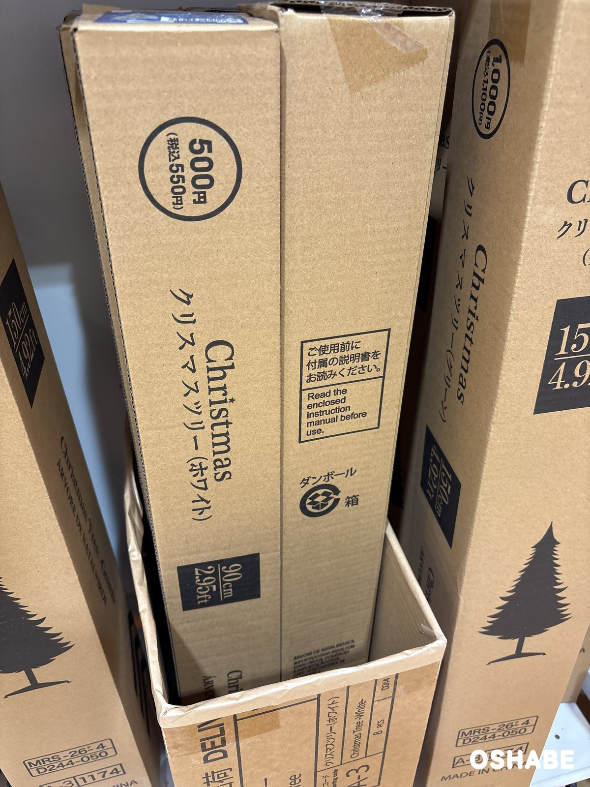

横から見ると、箱の丸い価格表示の下に「クリスマスツリー（ホワイト）」、その下に「90cm」の文字。グリーンもホワイトも広げたときの幅と奥行きは約35cmです。箱は細長いので、置きたい場所に35cm四方の余裕があるか先に測っておくと安心ですよ。

### 高さ120cmのツリーと、ひとまわり大きい150cm

クリスマスツリー（120cm）

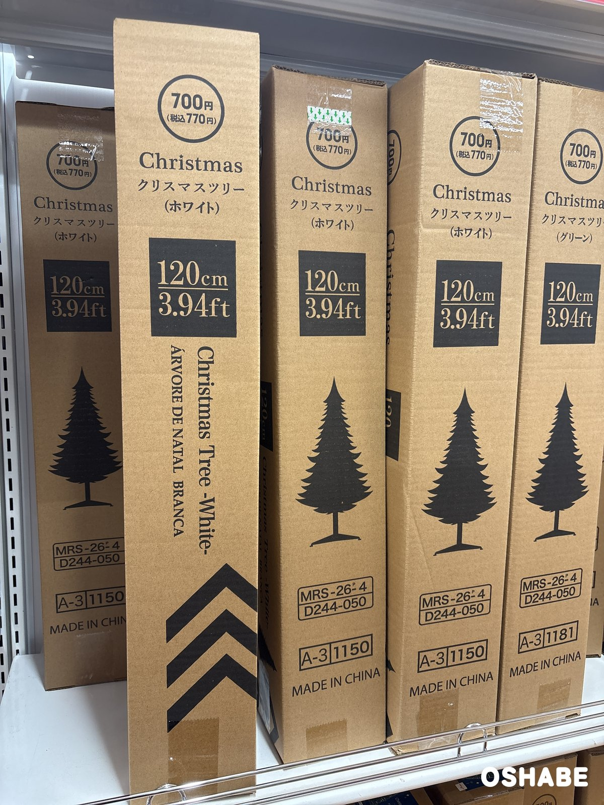

120cmは税込770円です。90cmから高さが30cm増えて、値段の差は220円。枝にボールやリボンを段々に並べたい方には、この高さも気になりますよね。

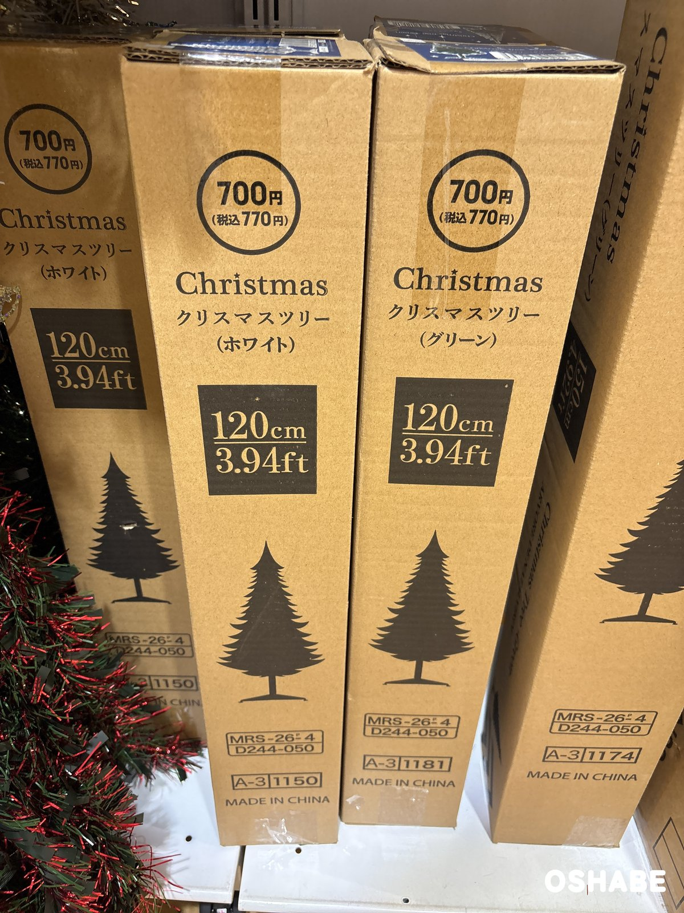

同じ120cmでも、写真の中央はホワイト、右はグリーンです。どちらの箱にも黒いツリーの絵があるので、色を選ぶときは商品名の下の「ホワイト」「グリーン」が目印です。

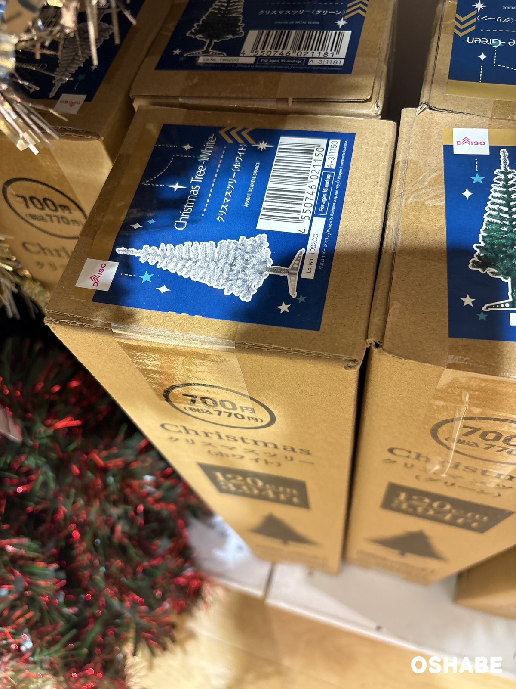

棚を上から見られるときは、ふたのラベルがもっと分かりやすいですよ。白いツリーの足元には白いスタンド、右隣のラベルには濃い緑の枝が描かれています。

床に置く3サイズを並べると、違いは高さだけではありません。150cmのグリーンは、枝が広がる幅も約60cmあります。

| 高さ | 広げたときの幅・奥行きの目安 | 税込価格 |
| --- | --- | --- |
| 90cm | 約35×35cm | 550円 |
| 120cm | 約45×45cm | 770円 |
| 150cm（グリーン） | 約60×60cm | 1,100円 |

## 白い雪と赤いステッキでツリーを飾り付け

緑のツリーに雪を積もらせたいときは、こちらのふわふわした白い飾り。

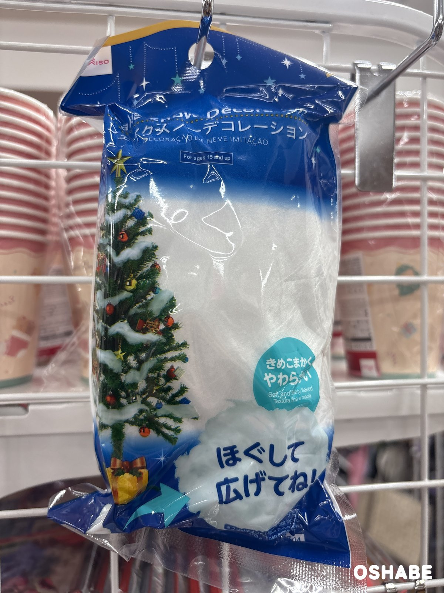

袋の見本では、緑の枝の上に白い雪が少しずつ積もっています。「ほぐして広げてね！」と書いてあるので、ひとかたまりずつ薄く広げてのせると、飾りの間に緑も見えてきれいです。

白を主役にしたいときは、こちらのディスプレイも参考になります。白い枝の間を銀色のモールがぐるりと囲み、赤白のしましまのステッキがところどころからのぞいています。淡い色の中に赤が少し入るだけで、ステッキの曲がった形がくっきり見えますね。

## ツリーの仕上げに合わせたい電飾イルミネーションライト

### 小さな光を枝に散らすオレンジとカラフルミックス

デコレーションライト（常時点灯、オレンジ）

公式オンラインストアでは税込110円です。長さ1.5mのコードにライトが10球。袋の丸い「オレンジ」のシールが目印です。オーナメントを主役にして、枝の奥から暖かな光をのぞかせたいときに合います。

デコレーションライト（点滅、カラフルミックス）

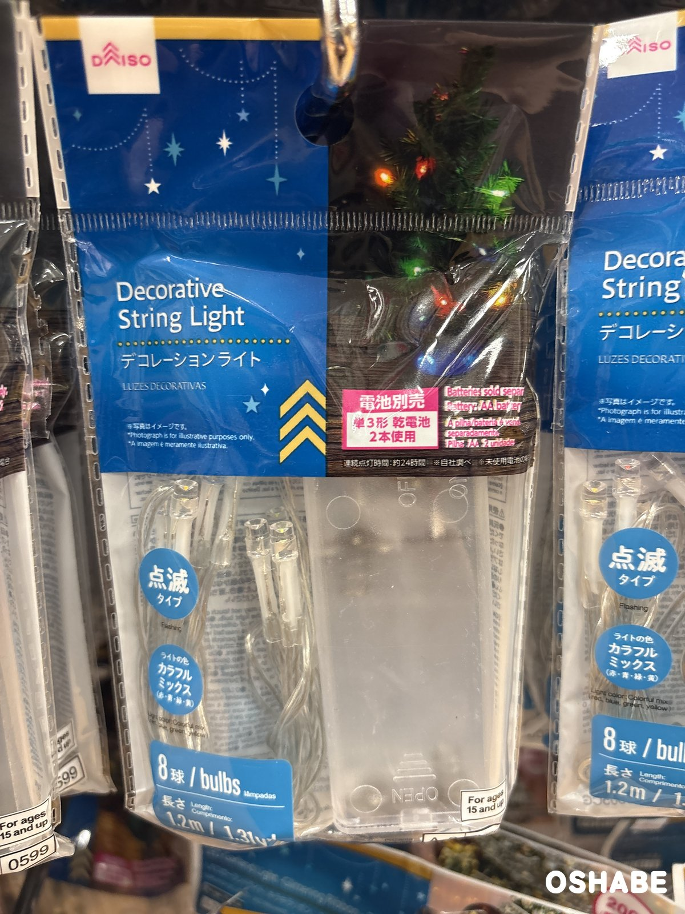

こちらも公式オンラインストアでは税込110円。長さ1.2mに8球で、いろいろな色が点滅します。同じ青い袋でも、こちらには「点滅タイプ」の丸い表示が付いています。どちらも単3形乾電池を2本使います。

### 枝先に雪の結晶や星が並ぶモチーフライト

デコレーションライト（スノー）

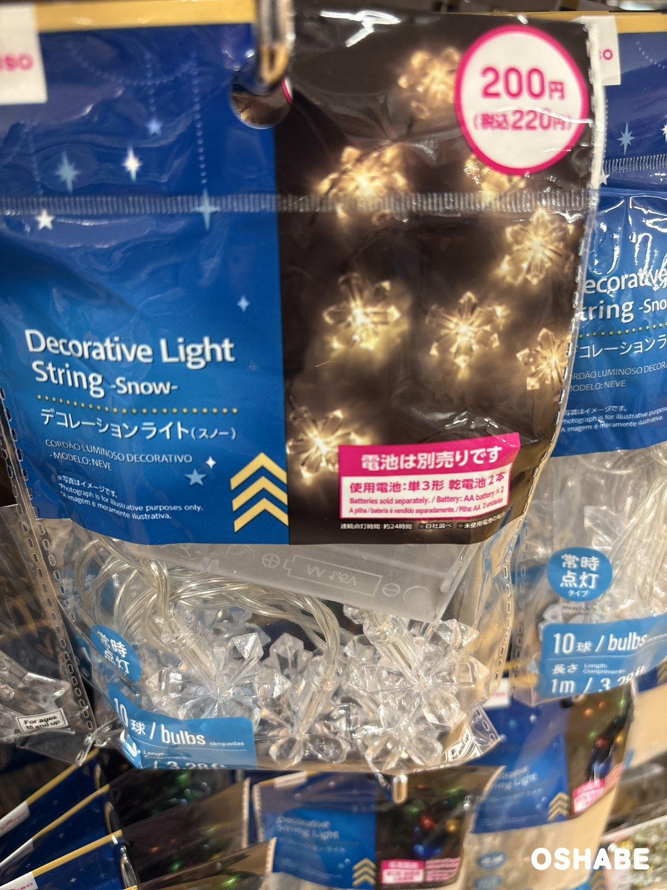

税込220円です。透明な雪の結晶は、枝のような細い線が中心から広がる形。グリーンのツリーに沿わせると、明かりを消している昼間にも輪郭が見えそうです。

デコレーションライト（スター）

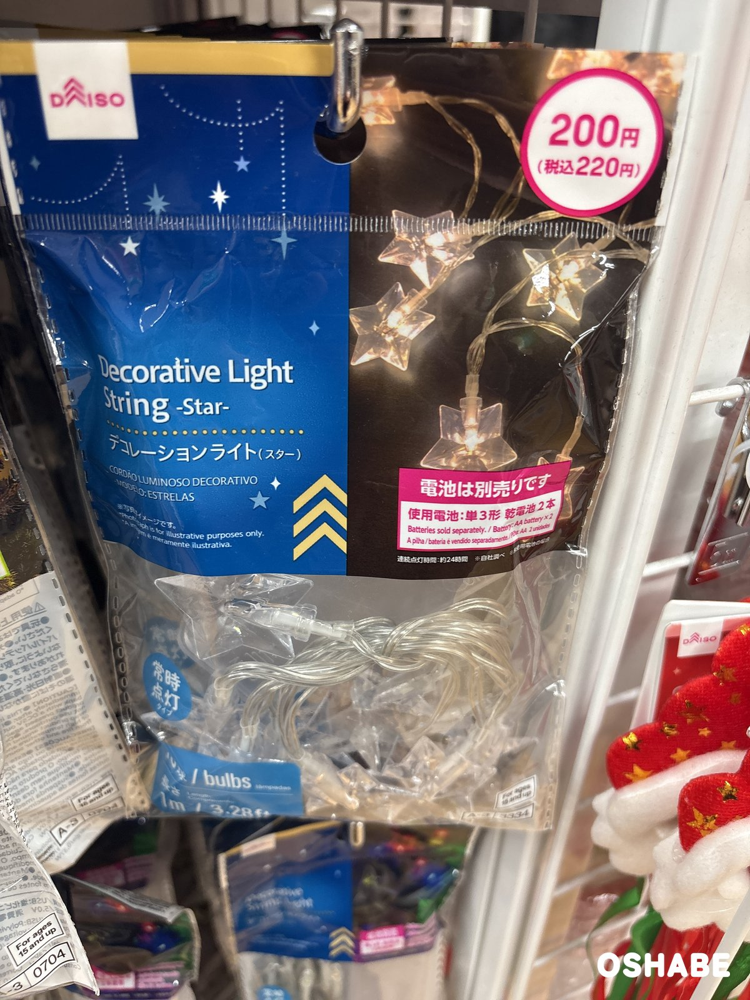

スターも税込220円です。こちらは角のはっきりした星形で、袋の上の写真には星の真ん中に光が灯った様子が載っています。雪で白く飾った枝にはスノー、てっぺんの星と形を揃えたいときにはスターもいいですね。

### ツリーとステッキ、銀と金のリボンのガーランド

LEDガーランドライト（クリスマス、20球）

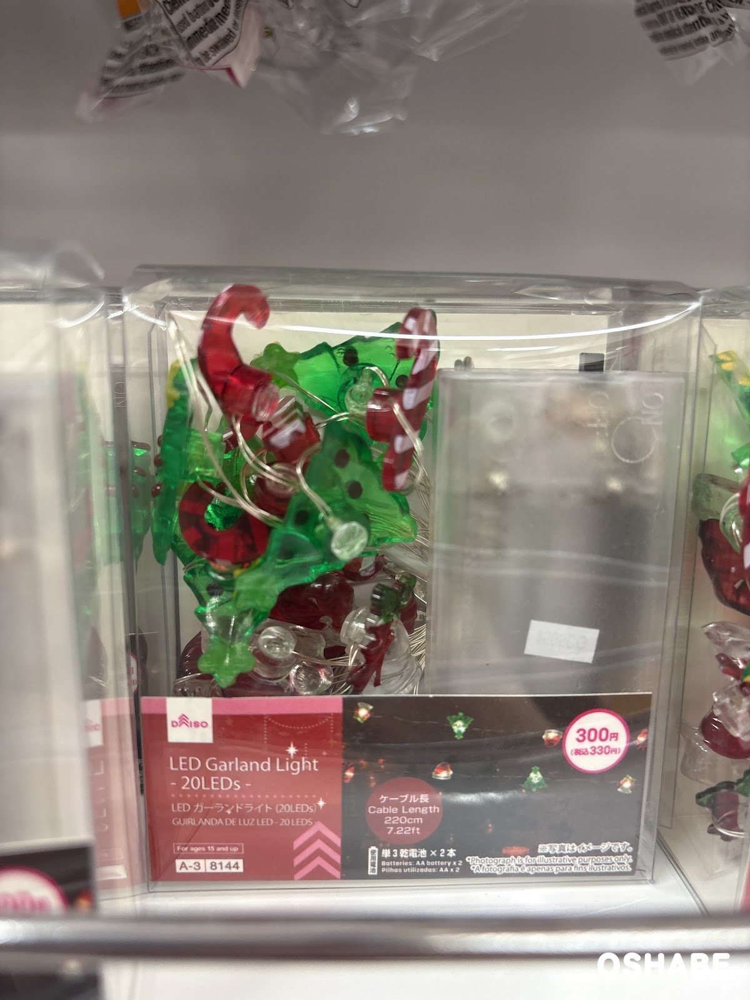

税込330円です。透明なケースの中に、緑のツリーや赤白のステッキがぎゅっと並んでいます。約2.3mのケーブルに20球付いていて、棚の縁に沿わせると小さな飾りを横一列に見せられます。

LEDガーランドライト（キラキラリボン、20球）

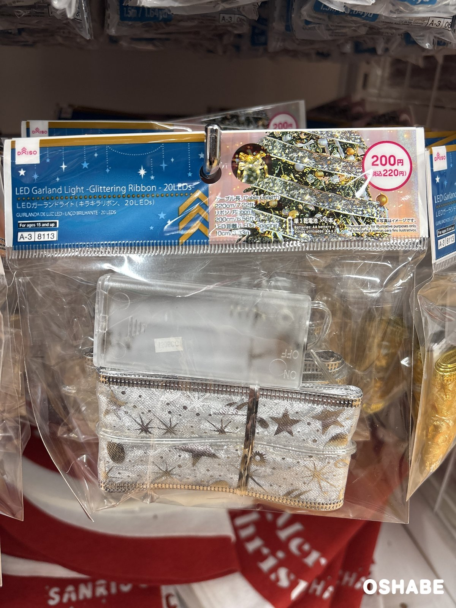

シルバーのリボンは税込220円です。透け感のある幅広のリボンに、星と光を散らしたような模様が入っています。モールを巻く感覚で、枝の手前に模様を見せたくなるデザインです。

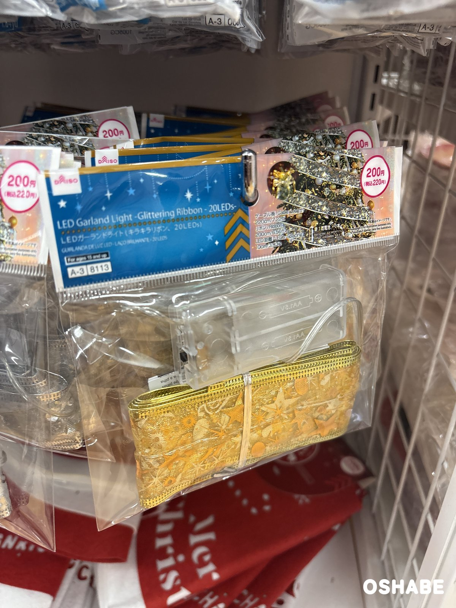

ゴールドも税込220円。銀色は白い枝になじみやすく、金色は深い緑の上に置くとリボンの幅がよく映えそうです。同じ星模様でも、ツリーに合わせる色でずいぶん印象が変わります。

### 球数の多いライトは長さと電源で選ぶ

デコレーションライト（40球、8パターン点灯）

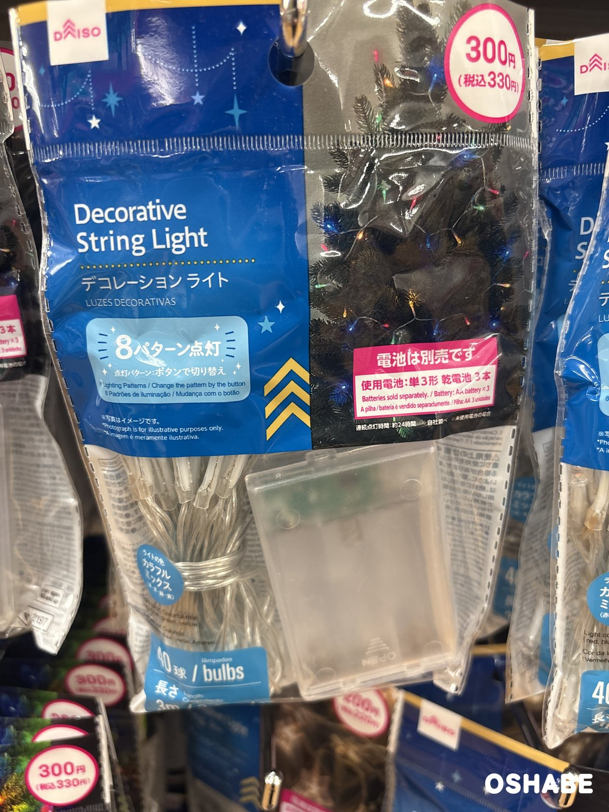

税込330円です。長さ3mに40球のカラフルミックス。ボタンで8通りの点灯パターンを切り替えられます。電池は単3形が3本なので、2本で使う小さなライトとの違いも見ておきたいところです。

ストリングライト（50球、シャンパンゴールド）

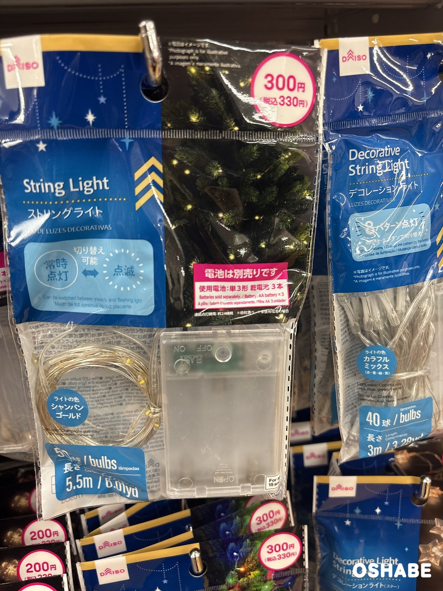

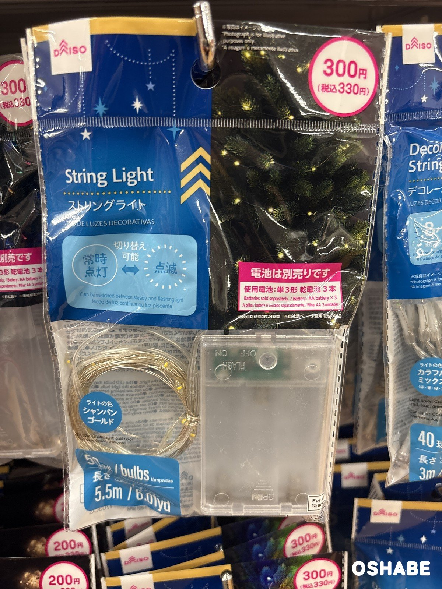

税込330円です。長さは5.5m。枝の上の段から下の段へゆったり巻きたいときに使いやすい長さです。常時点灯と点滅を切り替えられるので、同じシャンパンゴールドでも光の見せ方を選べます。

ワイヤーライト（60球、ウォームホワイト）

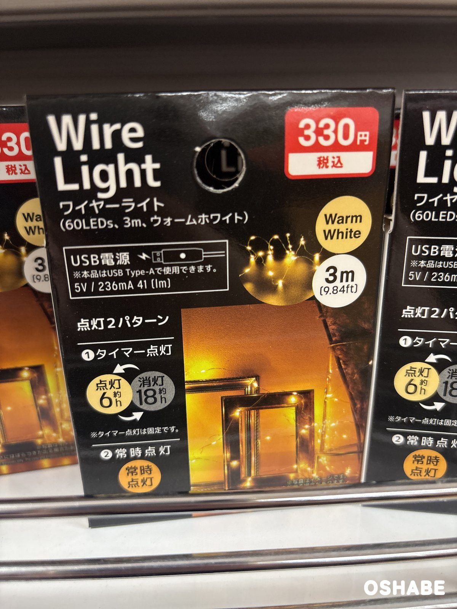

税込330円です。こちらは長さ3mに60球で、電源はUSB Type-A。箱には常時点灯のほか、約6時間点灯して約18時間消灯するタイマーの表示があります。USB電源を置ける棚で、夕方から決まった時間だけ灯したいときに便利です。

| たくさんの光を飾りたいとき | 長さ | 光り方・電源 | 税込価格 |
| --- | --- | --- | --- |
| デコレーションライト・40球 | 3m | カラフルミックス・単3形3本 | 330円 |
| ストリングライト・50球 | 5.5m | シャンパンゴールド・単3形3本 | 330円 |
| ワイヤーライト・60球 | 3m | ウォームホワイト・USB式 | 330円 |

## まとめ

いかがでしたか。

棚に小さく飾りたいなら23cmや35cm、床に置いてオーナメントをいくつも合わせたいなら90cm以上。箱入りのツリーは、高さと一緒に枝が広がる横幅を見ておくと選びやすいですね。

電飾は税込110円の小さな光から、雪や星の形、枝に巻けるリボン、タイマー付きの60球まで揃っていました。枝の間から光をのぞかせるか、ライトそのものを飾りにするか、おうちのツリーに合わせてぜひ選んでみてくださいね。

## 他のクリスマス関連はこちら

- [ダイソーのクリスマスグッズ](../../../../2026/11/04/daiso-christmas-2026/)
- [ダイソーのクリスマスオーナメントとモール](../../../../2026/11/28/daiso-christmas-ornaments-garlands-2026/)
- [セリアのクリスマスツリーとオーナメント](../../../../2026/11/21/seria-christmas-ornaments-2026/)
- [セリアのクリスマス飾り](../../../../2026/11/08/seria-christmas-decoration/)
- [ニトリのクリスマスグッズ](../../../../2026/11/16/nitori-christmas-2026/)
- [フランフランのクリスマスツリー](../../../../2026/11/15/francfranc-christmas-tree-2026/)
- [クリスマスの記事一覧](../../../../category/xmas/)
