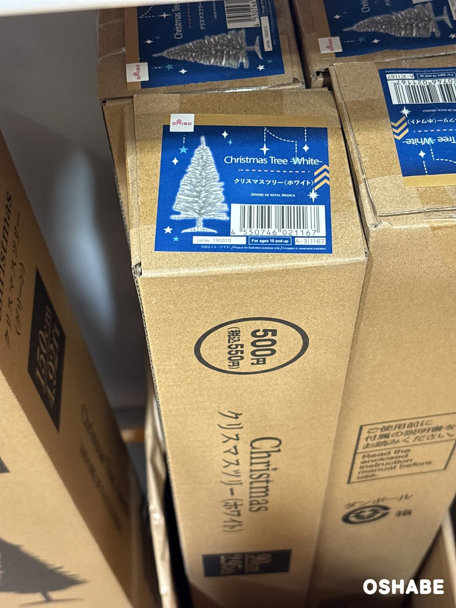
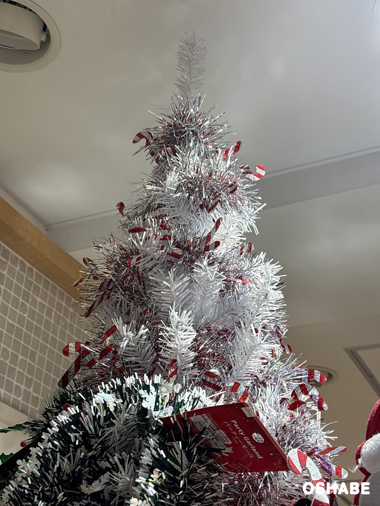
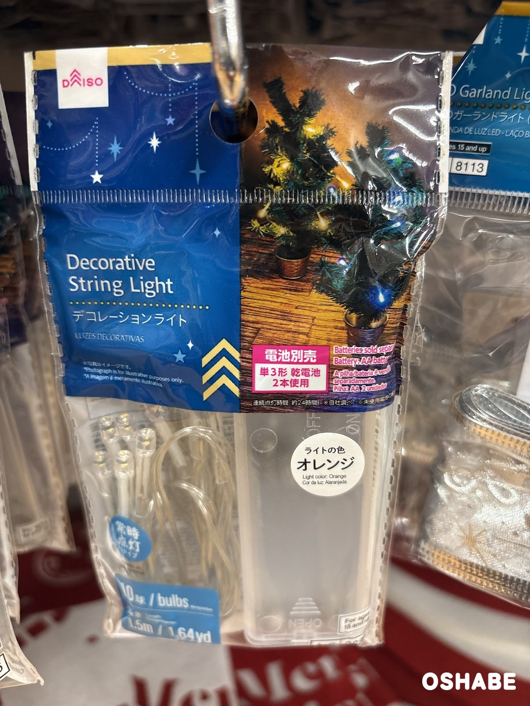

クリスマスツリーを選ぶとき、最初に迷うのが大きさですよね。玄関の棚にちょこんと飾るのと、リビングで枝いっぱいに飾りをつけるのとでは、ぴったりの一本も変わってきます。

ダイソーの売り場には、卓上に飾れる23cmのミニツリーと、高さ90cmのグリーンとホワイトが並んでいました。白い枝に赤いステッキを合わせた飾り付けも目を引きます！

今回は『ダイソーのクリスマスツリーと電飾イルミネーションライト』を、ツリーのサイズ、飾り付け、ライトの順に写真で紹介していきたいと思います。

## ダイソー100均のクリスマスツリー2026【画像一覧】

### 卓上に飾れる23cmのヌードツリー

ヌードツリー（23cm）

小さな茶色い台座から、濃い緑の枝が段々に伸びています。下の枝は横に広く、てっぺんには細い枝が一本。台座のすぐ上に少し幹が見えて、小さくてもツリーらしい姿です。

青いタグに書かれた高さは23cm。玄関の棚やデスクの端に一つ飾りたいときに選びやすい大きさです。てっぺんに小さなリボンをひとつ結ぶだけでも、緑の中に色が入って可愛いですよ♪

### オーナメントを合わせやすい90cmのグリーンツリー

クリスマスツリー（グリーン、90cm）

税込550円です。

こちらはリビングの床に置いて飾りたい高さ90cmのツリー。売り場では細長い茶色の箱に入っていて、黒いツリーのシルエットと「90cm」の表示が目印です。

広げたときの幅と奥行きは約35cm。箱の細さだけでは枝の広がりが分かりにくいので、置きたい場所に35cm四方のスペースがあるか測っておくと選びやすいですよ。深い緑には、白い雪の飾りも赤いボールもよく映えそうです。

### 同じ90cmでも印象が変わるホワイトツリー

クリスマスツリー（ホワイト、90cm）

税込550円です。

ホワイトは、箱の上に青地のラベルが付いています。白いツリーの絵の横には「クリスマスツリー（ホワイト）」の文字。茶色い箱がいくつも並んでいても、上から色を見分けられます。

こちらも高さ90cm、幅と奥行きは約35cmです。同じ場所に置ける2色なので、手持ちのオーナメントを思い浮かべて選ぶのも楽しいですね。

### 白と銀のツリーに赤を効かせた売り場の飾り付け

売り場で目を引いたのが、こちらのディスプレイ。白い枝の間を銀色のモールがぐるりと囲み、ところどころから赤と白のしましまのステッキがのぞいています。

近くで見ると、白い枝と細い銀のモールでは光の返り方が違います。淡い色を重ねた中に赤が少し入るだけで、ステッキの曲がった形がくっきり。白いツリーの飾り方に迷ったときに参考にしたい組み合わせです。

## ツリーの仕上げに合わせたい電飾イルミネーションライト

### オレンジの光を添えるデコレーションライト（10球）

公式オンラインストアでは税込110円です。

青い袋に入った常時点灯タイプで、長さ1.5mのコードに小さなライトが10球並びます。パッケージのツリー写真の下にある、丸い「オレンジ」のシールが光の色の目印です。

枝の間に小さな明かりを見せたいときや、手持ちのオーナメントを主役にしたいときに合わせやすい一本。電池ケースにはスイッチがあるので、枝にコードを沿わせるときは手の届く側にケースを置くと点灯しやすいですよ。

### 飾りの形まで楽しめるLEDガーランドライト（20球）

税込330円です。

透明なケースの中には、小さな緑のツリーや赤白のステッキがぎゅっと並んでいます。こちらはモチーフそのものが飾りになるガーランド。昼間も赤と緑のクリスマスカラーを楽しめます。

ケーブルは約2.3m、ライトは20球。10球タイプより約80cm長いので、棚の縁に沿わせて飾りを横一列に見せたいときにもよさそうです。どちらのライトも単3形乾電池を2本使います。電池は別売りです。

## まとめ

いかがでしたか。

ダイソーのツリーは、棚に飾るなら23cm、枝にいろいろ吊るしたいなら90cmと、置き場所を思い浮かべると選びやすいですね。90cmはグリーンもホワイトも税込550円です。

仕上げに光を少し足したいときは税込110円の10球ライト、赤や緑のモチーフも一緒に飾りたいときは税込330円のガーランド。おうちのクリスマスの飾り付けに、ぜひ参考にしてみてくださいね。

## 他のクリスマス関連はこちら

- [ダイソーのクリスマスグッズ](../../../../2026/11/04/daiso-christmas-2026/)
- [セリアのクリスマスツリーとオーナメント](../../../../2026/11/21/seria-christmas-ornaments-2026/)
- [セリアのクリスマス飾り](../../../../2026/11/08/seria-christmas-decoration/)
- [ニトリのクリスマスグッズ](../../../../2026/11/16/nitori-christmas-2026/)
- [フランフランのクリスマスツリー](../../../../2026/11/15/francfranc-christmas-tree-2026/)
- [クリスマスの記事一覧](../../../../category/xmas/)
