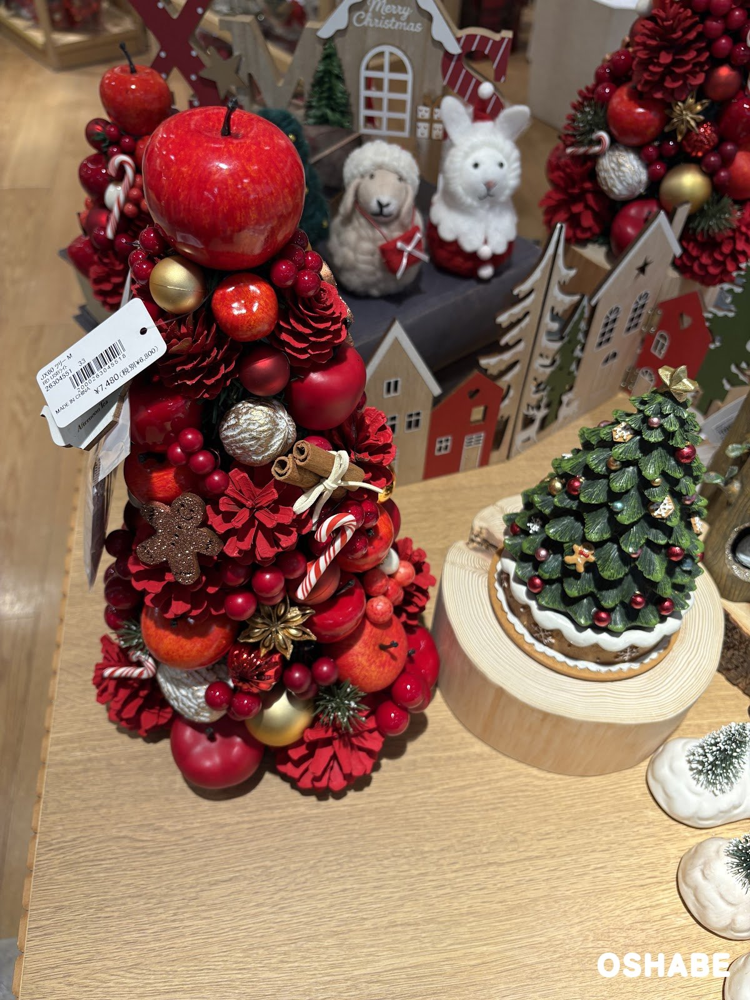
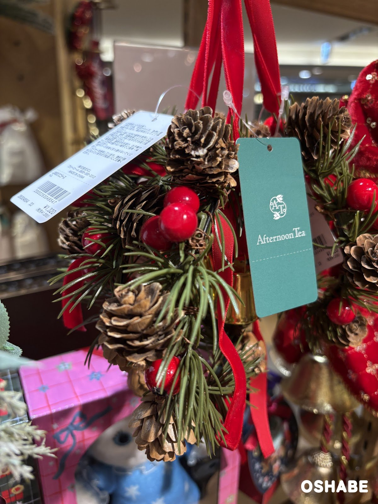
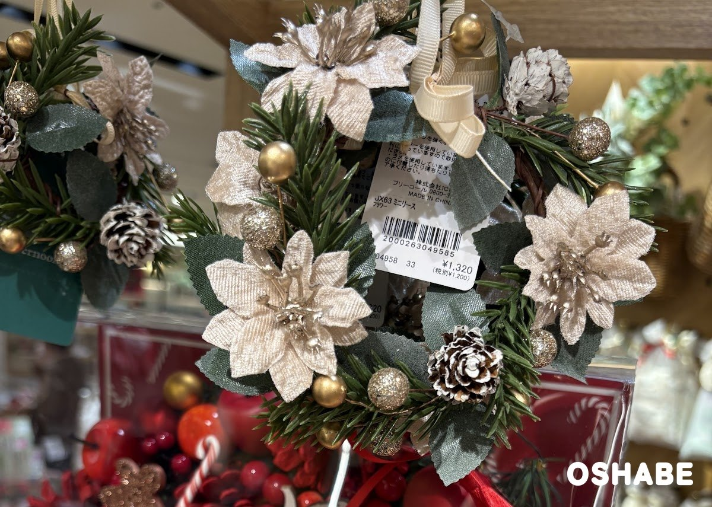
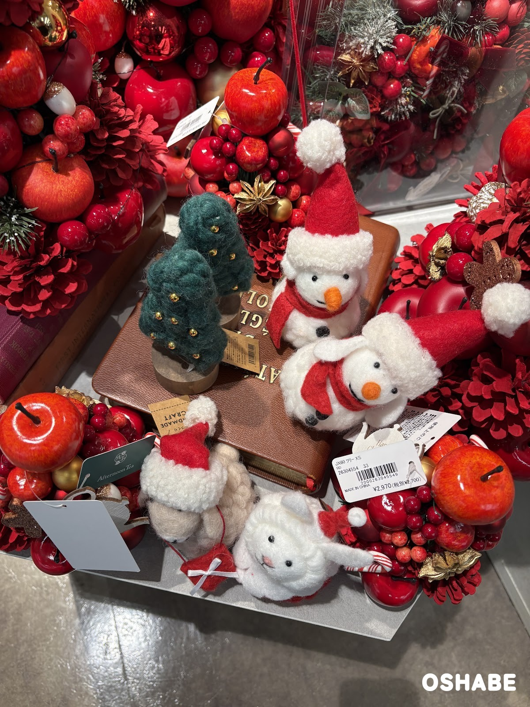

ツリーのてっぺんに、つやつやの赤いりんごがひとつ。近くで見ると、枝の間にはしましまのキャンディーまで隠れています。

棚に置ける小さなツリーも、床に置く大きなツリーも、同じりんごの飾りで揃えたくなりますよね！

今回は『アフタヌーンティー・リビングのりんごのツリーとミニリース』について紹介していきたいと思います☆

## アフタヌーンティーのクリスマス飾り2026【画像一覧】

値段は、店頭の値札と公式オンラインストアで確かめた税込の値段です。

### りんごのクリスマスツリー

りんごのツリーは、高さの違うサイズが並んでいました。どれも赤い実と赤い松ぼっくりを、すき間なく重ねた作りです。

【LEDライト付き】クリスマスツリー M アップル

税込7,480円です。

高さは約35cmで、てっぺんに大きなりんごがのっています。赤い松ぼっくりの間には、ジンジャークッキーのような飾りや、リボンで束ねたシナモンも見えます。

玄関の棚に置くと、小さな飾りまで目の高さで楽しめます。

【LEDライト付き】クリスマスツリー XL アップル

税込24,200円です。

高さは約70cmで、Mのちょうど2倍です。大きなりんごの数も増えて、赤と白のキャンディーが枝のあちこちから顔を出しています。

床やチェストの上に置けば、それだけで部屋の主役になる大きさです♪

クリスマスツリー XS アップル

税込2,970円です。

高さは約15cmで、写真の右側の値札が付いたものです。手のひらに乗るくらいの小ささでも、てっぺんにはちゃんとりんごがのっています。

売り場では、赤い帽子の雪だるまや羊の人形と一緒に並んでいました。デスクや窓辺に、ほかの小物と並べて飾れます。

### ミニクリスマスリース

ミニリースは直径14cm前後で、壁やドアに掛けるほか、ワインのボトルの首に掛けてテーブルに飾ることもできます。

ミニクリスマスリース パインコーン

税込1,100円です。

先が白くなった松ぼっくりと赤い実に、赤いリボンを合わせています。緑の葉の間からは、ポインセチアのような赤い葉ものぞきます。

雪をかぶったような松ぼっくりなので、冬のあいだずっと飾っておけます。

ミニクリスマスリース ベル

税込1,320円です。

茶色い松ぼっくりの間から細い緑の葉がのぞき、赤いリボンの下には金色のベルが下がっています。

白い壁に掛けると、赤い実の丸い形がよく映えます。

ミニクリスマスリース フラワー

税込1,320円です。

白っぽい大きな花が輪に沿って並び、金色の玉がところどころで光っています。松ぼっくりの先にも白が入って、雪化粧をしたみたいですね。

赤い飾りが多い部屋なら、このリースで少し色を休ませるのもおすすめです☆

## まとめ

いかがでしたか。

アフタヌーンティー・リビングには、りんごのツリー3サイズとミニリース3種類が揃っていました。

値段は、ミニリースが税込1,100円から1,320円、りんごのツリーが税込2,970円から24,200円です。

家族でツリーを飾り付ける週末の前に、置き場所の大きさから選んでみてはいかがでしょうか。

ぜひ参考にしてみてくださいね。

## 他のクリスマス関連はこちら

▼2026年のクリスマスグッズ

- [ダイソー100均のクリスマスツリーと電飾イルミネーションライト【2026】](../../../../2026/11/23/daiso-christmas-tree-lights-2026/)
- [ダイソー100均のクリスマス雑貨2026【画像・値段】スノードーム、オブジェ](../../../../2026/11/04/daiso-christmas-2026/)
- [セリア100均のクリスマスツリー2026【画像・値段】オーナメント、リボン](../../../../2026/11/21/seria-christmas-ornaments-2026/)
- [セリア100均のクリスマス飾り2026【画像・値段】ガーランド、ケーキピック](../../../../2026/11/08/seria-christmas-decoration/)
- [セリア100均のクリスマスカード2026【画像・値段】メロディカード、ポチ袋](../../../../2026/11/21/seria-christmas-cards-2026/)
- [ワッツ100均のクリスマス2026【画像・値段】オーナメント、カチューシャ](../../../../2026/11/02/xmas-ornament-headband/)
- [ニトリ デコホームのクリスマス飾り2026【画像・値段】ツリー、オーナメント](../../../../2026/11/16/nitori-christmas-2026/)
- [無印良品のクリスマスお菓子2026【画像・値段】バウムリース、ヘクセンハウス](../../../../2026/11/12/muji-christmas-sweets/)
- [フランフランのクリスマスツリー2026【画像・値段】スターターセット](../../../../2026/11/15/francfranc-christmas-tree-2026/)
- [フランフランのクリスマス2026【画像・値段】リース、ノルディックサンタ](../../../../2026/11/18/francfranc-christmas-2026/)
- [LAKOLE（ラコレ）のクリスマス2026【画像・値段】リース、ツリー](../../../../2026/11/11/lakole-christmas-2026/)
- [アフタヌーンティーのクリスマス2026【画像・値段】紅茶、LEDライト](../../../../2026/11/06/afternoon-tea-christmas-2026/)

▼クリスマスの記事をまとめて見る

- [クリスマスの記事の一覧](../../../../category/xmas/)
