ダイソーのクリスマス売り場で目に留まるのは、ミントグリーンのサンタブーツ。つま先まで編み目が続いていて、まるで小さなセーターのようです。

玄関の棚や壁にクリスマスの飾りをひとつ選ぶなら、置いたときの大きさも気になりますよね！

今回は「ダイソーのサンタブーツとクリスマスリース」について紹介していきたいと思います。

## ダイソーのサンタブーツとクリスマスリース2026【画像一覧】

### お菓子入りのブーツとベルト付きのブーツ

お菓子入りのサンタブーツ

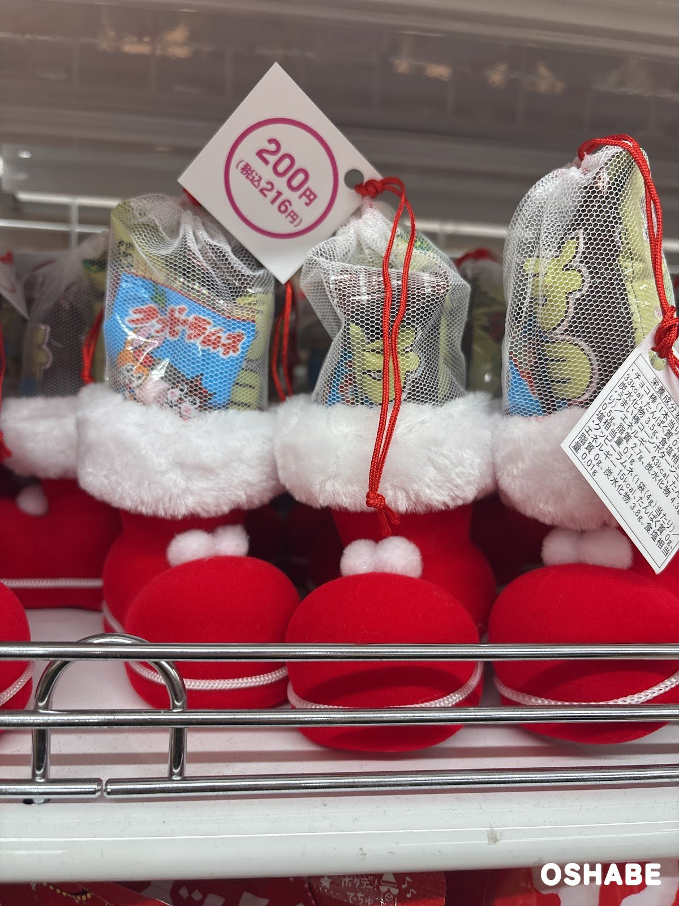

税込216円です。

白いネットからチョコ味のスナックの袋がのぞいています。つま先の上には白いポンポンが2つ。クリスマスのおやつをそのまま手渡したいときにいいですね。

サンタブーツ（14cm、ベルト付）

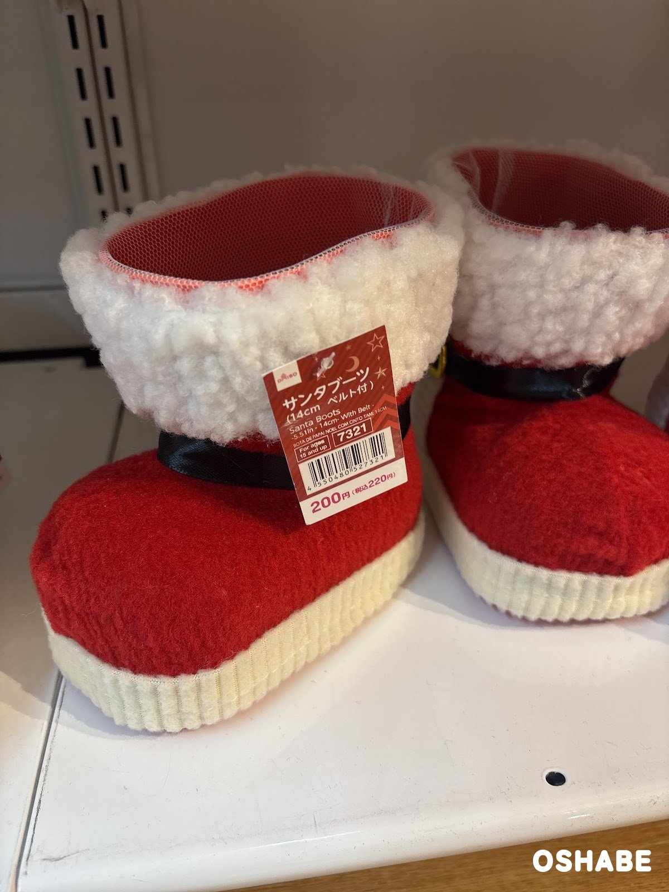

税込220円です。

足首をぐるっと囲む黒いベルトで、赤と白がくっきり引き立ちます。底の縁には縦の筋まで入っていますよ。玄関の棚に横向きに置くと、丸いつま先から靴底までよく見えます。

### 編み目が見えるニットのブーツ

サンタブーツ（14cm、ニット）の白

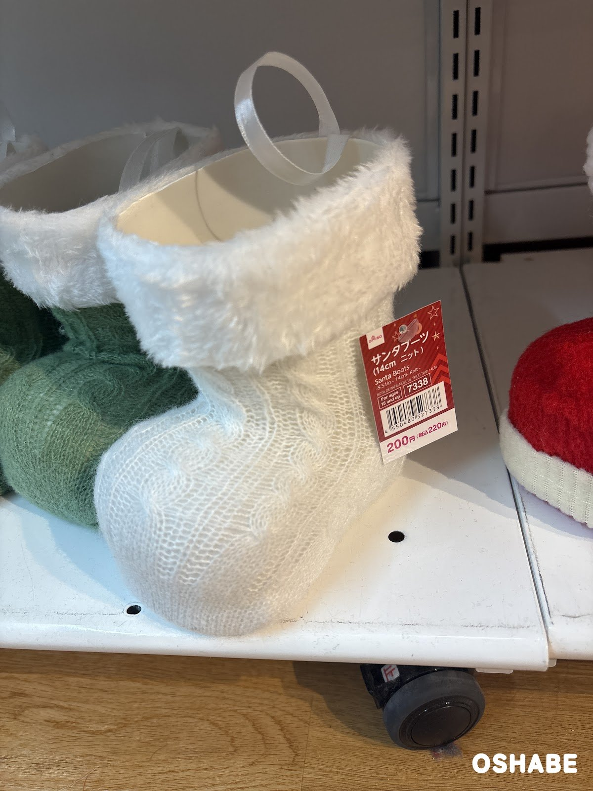

白、ミントグリーン、グレーの3色で、各税込220円です。

白は、ふわふわの履き口と縄のような編み模様が同じ色。木の棚に置くと、編み目の影まで楽しめます。

サンタブーツ（14cm、ニット）のミントグリーン

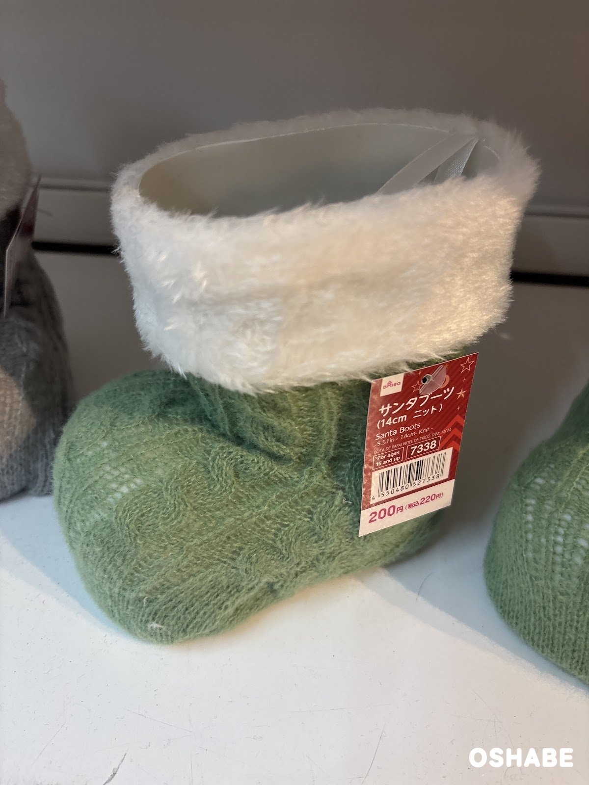

ミントグリーンは、白い履き口との境目がはっきりしています。横に向けると、つま先から足首までうねる模様がよく見えますね。

サンタブーツ（14cm、ニット）のグレー

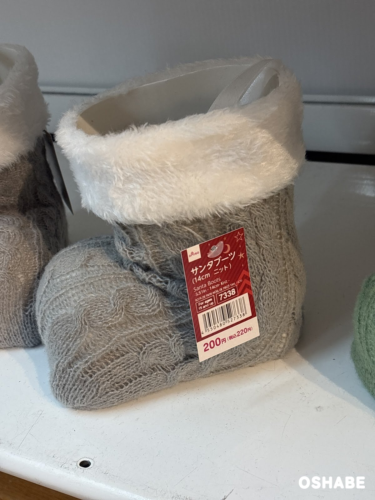

グレーは白い毛足の下に細かな編み目が並びます。シルバーのオーナメントと一緒に置くなら、この落ち着いた色はいかがでしょうか。

### ひも付きの小さなブーツ

サンタブーツ（9cm）

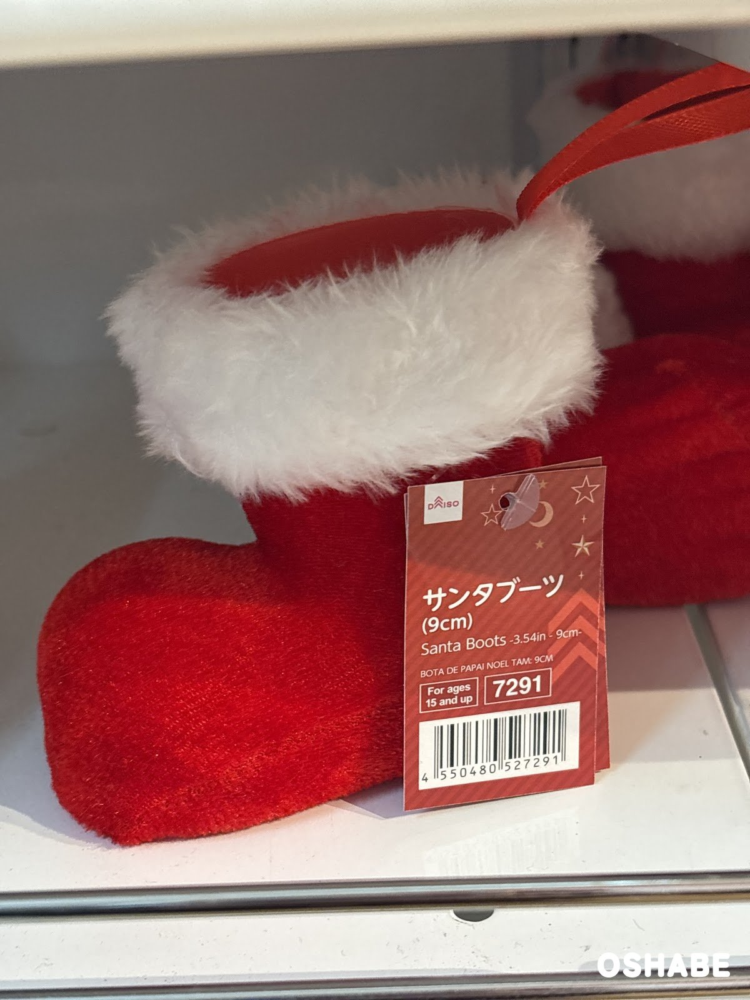

公式オンラインストアでは税込110円です。

赤いブーツに真っ白な縁取りを合わせた、シンプルな形です。履き口から赤いひもが伸びているので、フックに掛けて飾れますよ。

### リボンを選べるリースと小ぶりのリース

ヌードリース

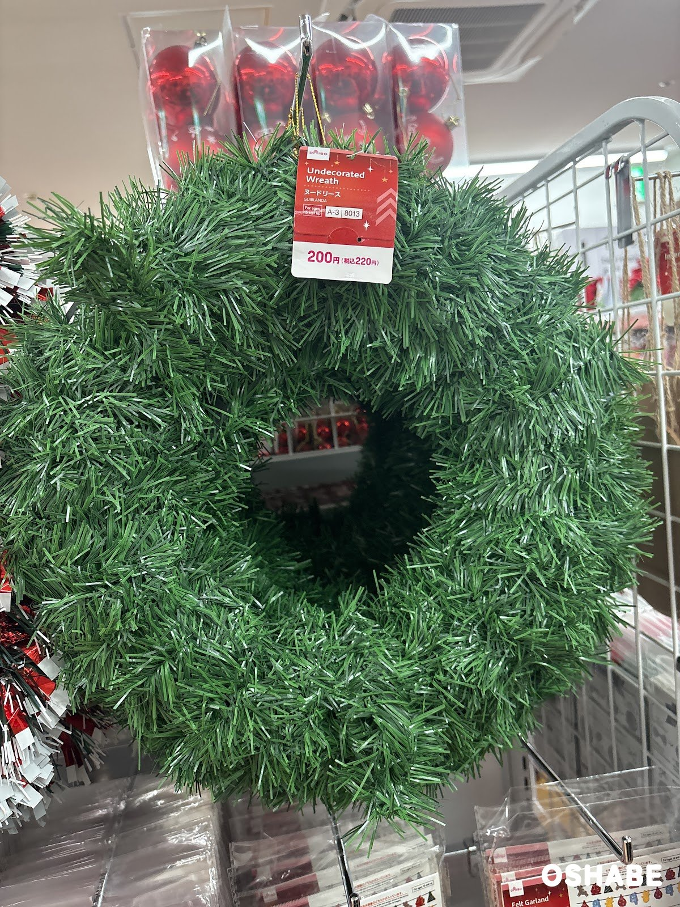

税込220円です。

幅は37cm。細い緑の葉がいろいろな向きに重なり、輪に厚みがあります。お気に入りのリボンをひとつ結ぶなら、どの色を合わせたくなりますか。

クリスマスリース（約15cm）

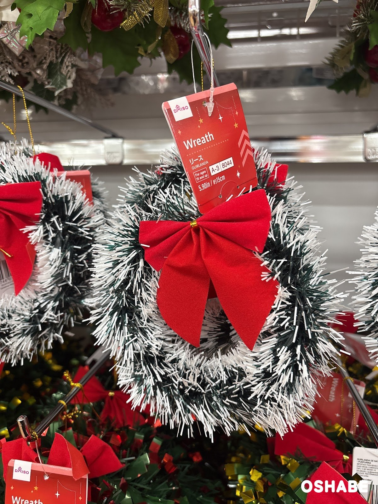

公式オンラインストアでは税込110円です。

濃い緑の輪に白い先端が重なって、雪をまとったように見えます。小ぶりなので、玄関の壁のちょっとした空きにも。赤いリボンがひとつあるだけで華やぎますね。

### 赤とゴールドのリース

クリスマスリース（キラキラ）のゴールド

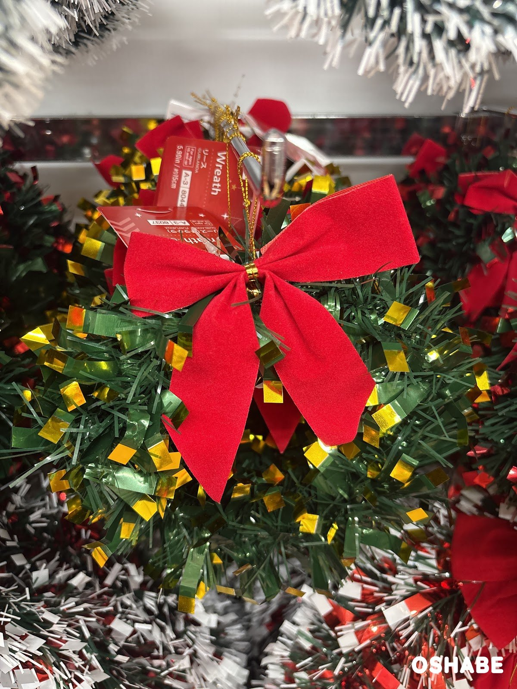

公式オンラインストアでは税込110円です。

緑の葉の間に、四角い金色の飾りがちりばめられています。真ん中で結んだ赤いリボンの裾が、輪の内側まで届いていますよ。

クリスマスリース（キラキラ）の赤

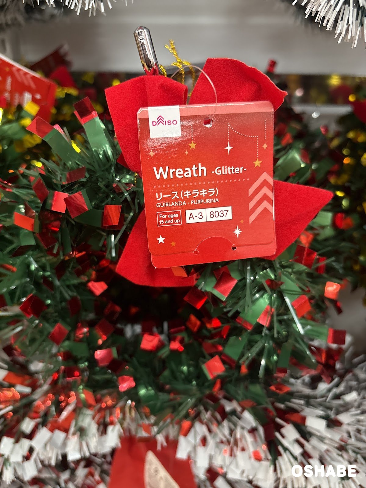

赤は、リボンと小さな飾りの色が揃います。どちらも幅20cmで、色違いを並べても飾りやすい大きさです。

### ベルを添えた大きなモールリース

モールリース（リボン）

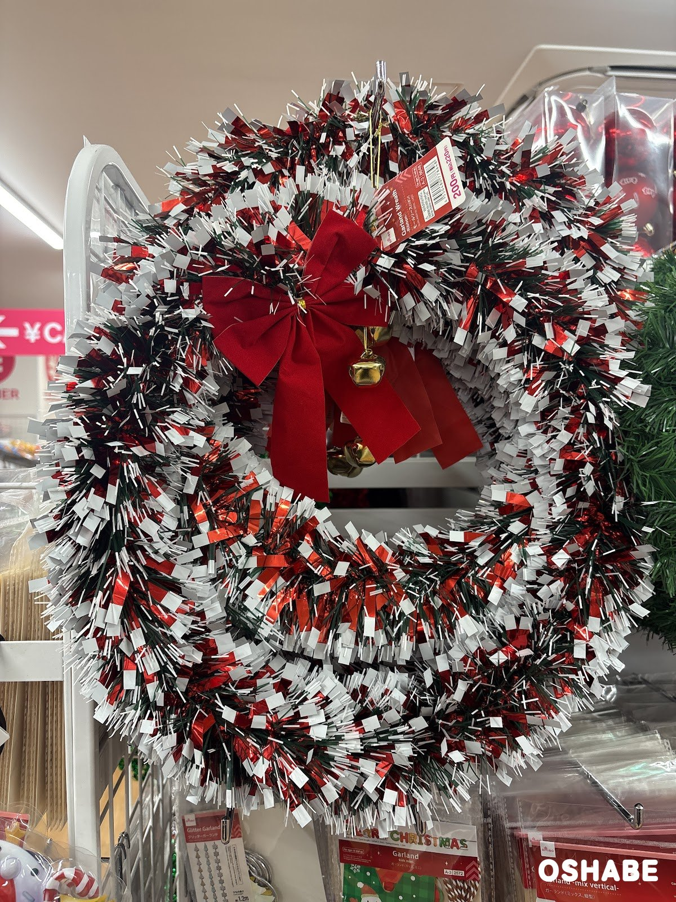

税込220円です。

こちらは幅41cm。白と赤のモールの中に見える濃い緑が、赤いリボンを引き立てています。広さのある壁に飾ると、輪の大きさが生きますね。

モールリースのリボンとベル

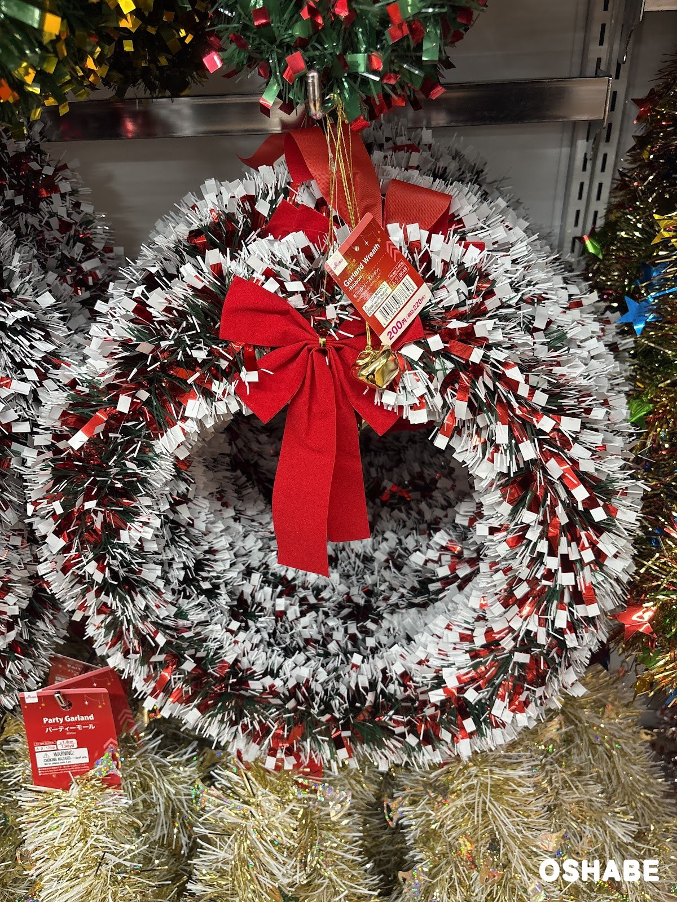

近くで見ると、リボンの下から金色のベルがのぞいています。垂らしたリボンが輪の内側にすっと伸びるのも素敵です。

クリスマスリースの売り場

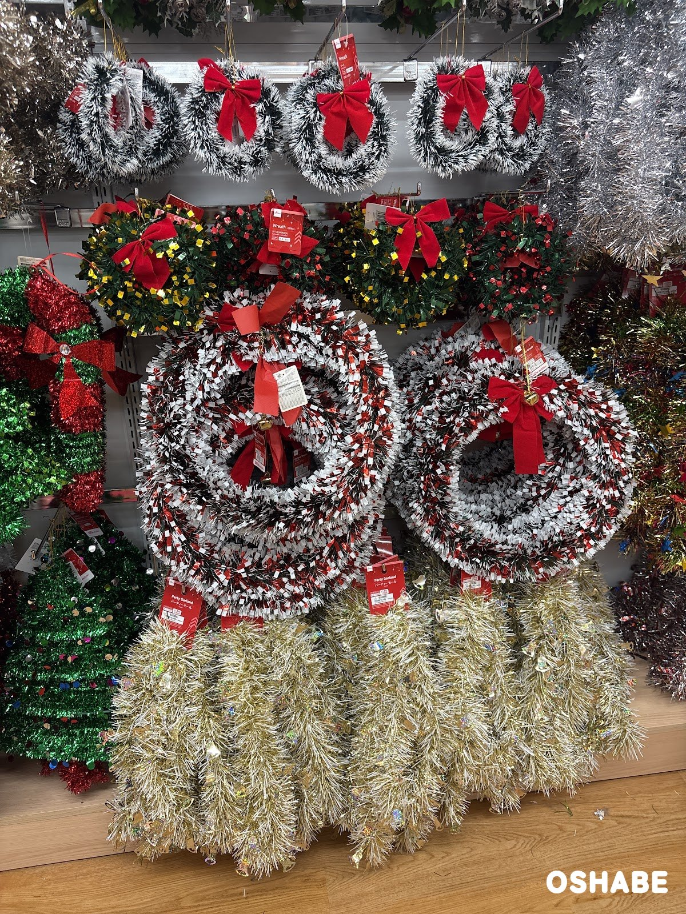

上の段には小さなリース、下の段にはひと回り大きなリースが並んでいます。飾る壁を思い浮かべながら見比べるのも楽しいですね。

## まとめ

いかがでしたか。

ダイソーには、ニットのサンタブーツや金色のベルが付いたモールリースが揃っていました。

今回ご紹介したブーツとリースは税込110円から220円です。

クリスマスの贈り物にはお菓子入りのブーツ、玄関の壁には好きな色のリースを選んでみてはいかがでしょうか。

ぜひ参考にしてみてくださいね。

## 他のクリスマス関連はこちら

- [ダイソーのクリスマスツリーとライト](../../../../2026/11/23/daiso-christmas-tree-lights-2026/)
- [セリアのクリスマス飾り](../../../../2026/11/08/seria-christmas-decoration/)
- [ワッツのクリスマスオーナメントとカチューシャ](../../../../2026/11/02/xmas-ornament-headband/)
- [ニトリ デコホームのツリーとオーナメント](../../../../2026/11/16/nitori-christmas-2026/)
- [アフタヌーンティーのりんごのツリーとミニリース](../../../../2026/11/24/afternoon-tea-apple-tree-wreaths-2026/)
- [クリスマスの記事一覧](../../../../category/xmas/)
