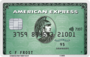
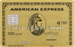

USJではアメリカン・エキスプレスカードが大変お得だということをお話ししましたが、

アメリカン・エキスプレスカードはUSJ以外の場面でもお得がいっぱい！

## AMEXおすすめ券種はコレ！

### ❶アメリカン・エキスプレス・カード／ゴールドカード

- アメックスブランドの代表カード

- 国内外約200のレストランにて2名以上のコース料金が1名分無料

- Expediaでのホテル予約が8%オフ

  |

①トラベル&エンターテイメントに強く、上質な特典が付帯！

- 空港ラウンジ無料(同伴者１人まで)

- 手荷物無料宅配サービス

- 「ゴールドダイニングby招待日和」で高級レストランの２名以上のコース料金が1名分無料

②旅行予約ポータル「Expedia」をアメックス会員優待料金で利用可能！
 国内ホテルご宿泊料金が８%オフに！

③個人向けカードとビジネスカードでポイントを合算できるので会社の経費で旅行に行くことも可能！

ExpediaでUSJの近くのホテルをお得に予約し、最大限お得に楽しもう☆

### ❷SPG AMEXカード

- 世界的ホテルチェーン「SPG」とAMEXの提携カード

- 発券したその日からホテルで VIP待遇

- 貯めたポイントはJALやANAのマイルに交換可能

  |

①SPGとは世界的なホテルチェーンであり、「シェラトンホテル」や「リッツカールトン」も参加している。

②SPG&マリオネットのゴールドエリート会員に自動的になれる。
 ホテルの部屋のアップグレード、レイトチェックアウトなどVIP待遇を受けることが出来る。

③貯まったポイントは JAL、ANAはじめ航空会社35社のマイルに交換することが出来る。

④アメックスブランドなのでトラベルデスク、荷物宅配などの充実サポートを享受可能。

⑤毎年のカード更新タイミングでSPGグループホテルの無料宿泊券(１泊２名様分)が貰える。

カード更新でもらえる無料宿泊券をセントレジスホテル大阪で利用し、旅行をより華やかに！

### ❸ANA AMEXカード

- 旅行傷害保険など、各種プロテクションサービスが充実

- ANAグループでのカード利用はポイント1.5倍

- 1000ポイント単位でマイルへ移行可能

  |

①空港ラウンジが国内２８空港で利用可能。
 同伴者1名無料。

②充実のプロテクション

- カードで購入した商品の破損や盗難を90日間保証

- カードで支払った旅行をキャンセルした時の保証

③ANA航空券の購入でも
 マイルが貯まる唯一のANAカード！

④ポイント還元率100円=1P=1マイル。
 ポイント有効期限なし！

大阪国際空港(伊丹)へは全国各地から直行便が就航。ANAはUSJの旅行商品もご用意しておりますよ！

高級レストランのコース料金が1名分無料になったり、毎年のカード更新タイミングでホテルの無料宿泊券がもらえたり、超破格の特典が盛りだくさんの AMEXカード！

毎年無料宿泊券がもらえるというのが旅行好きにはたまらないですね☆

お得すぎるカードなので是非検討してみてはいかがでしょうか？
